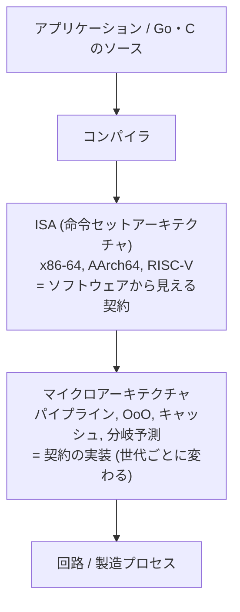
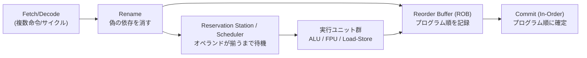
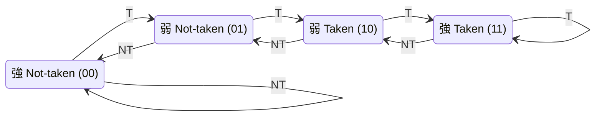
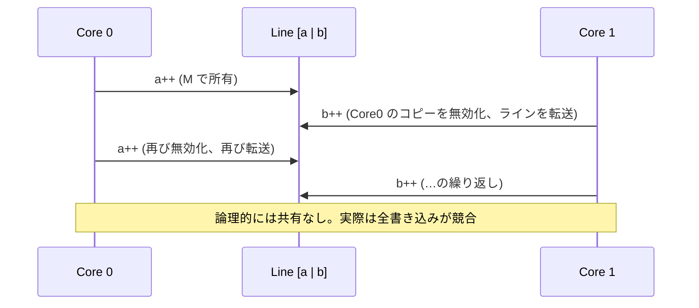
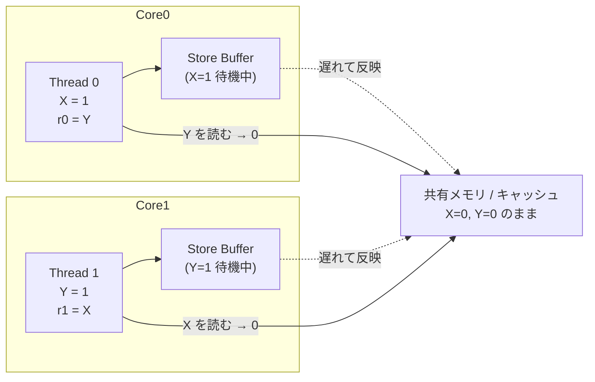
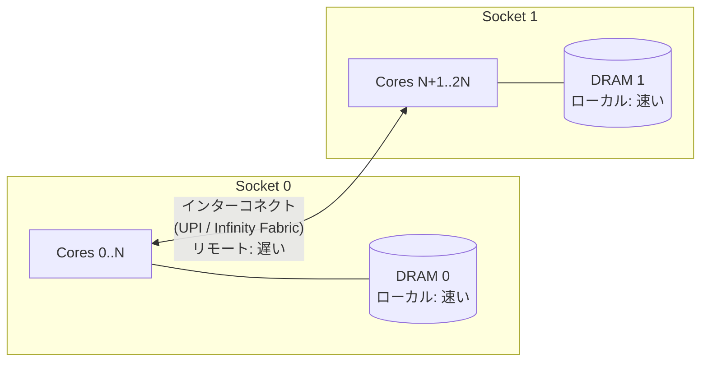
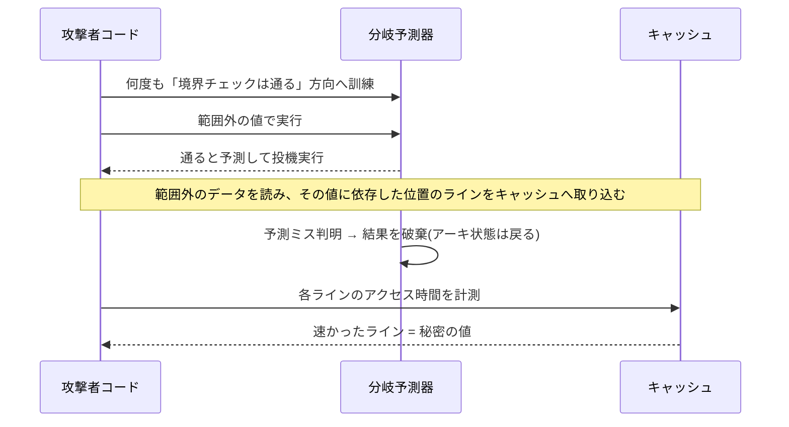

# 第1回 コンピュータアーキテクチャ

> ステータス: 執筆済み(第1版)
> 前提: プログラミング実務経験 1〜3年 / 演習言語: C(+ 一部 Go)
> 所要目安: 本文 2〜3時間 + 演習 3〜4時間

## この回のゴール

この回を終えると、次の問いに**数値と機構で**答えられるようになる。

1. 「配列はリストより速い」と言われる理由を、キャッシュライン・プリフェッチ・TLB の言葉で説明できる。
2. ソート済み配列の方が速い理由(分岐予測)と、その差がどれくらいか(桁)を言える。
3. 「各スレッドが自分専用の変数しか触っていないのに遅い」現象(false sharing)を診断し、直せる。
4. なぜ `x = 1; r = y;` と `y = 1; r = x;` を並行実行すると `r = 0, 0` が起こりうるのか、store buffer で説明できる。
5. 以降の全回(OS、ネットワーク、分散システム)の土台となる「レイテンシの地図」を頭に持つ。

なぜこれが全15回の第1回なのか。ソフトウェアの振る舞いは、最終的にすべて**この回で扱う物理機械の性質**に帰着するからである。仮想メモリ(第2回)はキャッシュと TLB の上に成り立ち、ロック(第4回)は coherence とメモリ順序の上に成り立つ。分散システムの「ネットワークは遅い」という感覚も、まず手元のマシンの中の遅さの階層を知らなければ定量化できない。

---

## 1. 動機: レイテンシの地図

まず、機械の中で起きることの「時間の尺度」を持つ。以下は典型的な現代のサーバ CPU での概数である(世代や機種で数倍変わる。重要なのは**桁**)。

| 操作 | 時間(概数) | 1ns=1秒に換算した体感 |
|---|---|---|
| 1 CPU サイクル(3GHz) | 0.3 ns | 0.3 秒 |
| L1 キャッシュ参照 | 1〜1.5 ns(4〜5サイクル) | 約1秒 |
| 分岐予測ミス | 3〜7 ns(10〜20サイクル) | 約5秒 |
| L2 キャッシュ参照 | 3〜5 ns | 約4秒 |
| L3 キャッシュ参照 | 15〜40 ns | 約半分〜1分 |
| DRAM 参照(ローカル) | 80〜100 ns | 約1.5分 |
| DRAM 参照(リモート NUMA) | 130〜200 ns | 約2〜3分 |
| NVMe SSD 4KB ランダム読み | 20〜100 µs | 約1日 |
| 同一データセンタ内ネットワーク往復 | 100〜500 µs | 約数日〜1週間 |
| 大陸間ネットワーク往復 | 100〜200 ms | 約数年 |

**自分のマシンで確かめる**のが演習1である。Apple M5 上で実測した結果(後述 §10)は、L1 で約 1 ns、DRAM で約 80 ns だった。上の表と整合している。

> **博士レベルの視点**: この表は「メモリの壁(memory wall)」の定量表現でもある。Wulf & McKee (1995) は、CPU 速度の伸びが DRAM アクセス時間の伸びを指数的に上回り続けることを指摘した。以後 30 年のアーキテクチャの歴史(キャッシュの多段化、OoO、プリフェッチ、SMT、HBM、CXL)は、ほぼすべてこの差を隠すための工夫として読める。

---

## 2. ISA とマイクロアーキテクチャ

### 2.1 2つの層を区別する



- **ISA**: プログラマ(コンパイラ)に見える契約。レジスタ、命令、アドレッシング、**メモリモデル**。
- **マイクロアーキテクチャ**: その契約を満たしつつ、いかに速く実行するかの実装。同じ ISA でも Intel と AMD で、同じ Intel でも世代で全く異なる。

重要な帰結: **ISA は「結果」だけを約束し、「時間」は約束しない**。だから同じバイナリが速度だけ違って動く。逆に、タイミング差から情報が漏れる(Spectre などのサイドチャネル、§9)余地が生まれる。

### 2.2 CPU 性能の基本式

$$\text{実行時間} = \text{命令数 (IC)} \times \text{命令あたりサイクル数 (CPI)} \times \text{サイクル時間 } T$$

- IC: コンパイラとアルゴリズムが決める。
- CPI(の逆数が IPC): マイクロアーキテクチャとメモリ階層が決める。**この回の主題の大半はここ**。
- T: 製造プロセスと設計が決める。2005 年頃から頭打ち。

### 2.3 なぜクロックは上がらなくなったか(Dennard scaling の終焉)

トランジスタを縮小すると、電力密度を一定に保ったままクロックを上げられた(Dennard scaling)。この関係が 2000 年代半ばに崩れた(リーク電流の増加)。その結果:

- 単一スレッド性能の伸びが鈍化(クロックは 3〜5GHz 付近で停滞)。
- マルチコア化が進んだ → **ソフトウェアが並行性を明示的に扱う必要が出た**(第4回につながる)。
- 全トランジスタを同時に動かすと熱で溶ける「dark silicon」問題。専用回路(GPU、NPU、暗号命令)が増える。

---

## 3. パイプラインと命令レベル並列(ILP)

### 3.1 古典的 5 段パイプライン

1命令の処理を段に分け、重ねて実行する。

| 段 | 略称 | 内容 |
|---|---|---|
| Instruction Fetch | IF | 命令を取り込む |
| Instruction Decode | ID | 解読、レジスタ読み出し |
| Execute | EX | ALU 演算、アドレス計算 |
| Memory | MEM | メモリ読み書き |
| Write Back | WB | レジスタへ書き戻し |

```
サイクル:  1    2    3    4    5    6    7    8
命令 I1 :  IF   ID   EX   MEM  WB
命令 I2 :       IF   ID   EX   MEM  WB
命令 I3 :            IF   ID   EX   MEM  WB
命令 I4 :                 IF   ID   EX   MEM  WB
```

理想的には**毎サイクル1命令が完了**する(CPI=1)。レイテンシは変わらないが、スループットが段数倍近くなる。

### 3.2 ハザード: 理想が崩れる3つの理由

| 種類 | 原因 | 例 | 対策 |
|---|---|---|---|
| 構造ハザード | 同じ資源を同時に使う | 命令フェッチとデータアクセスが同じメモリポートを要求 | 資源の複製(命令/データキャッシュ分離) |
| データハザード | 命令間の依存 | `add r1,r2,r3` の直後に `sub r4,r1,r5` | フォワーディング、命令の並べ替え |
| 制御ハザード | 分岐先が決まらない | `if` の結果が出るまで次のフェッチ先が不明 | **分岐予測** + 投機実行 |

データ依存には3種類ある。後述の OoO で重要になる。

- **RAW** (Read After Write): 真の依存。値が本当に必要。避けられない。
- **WAR** (Write After Read) / **WAW** (Write After Write): 名前の衝突にすぎない偽の依存。**レジスタリネーミング**で消せる。

```
ld   r1, [r2]      ; ロード (キャッシュヒットでも数サイクル)
add  r3, r1, r4    ; r1 を使う → RAW 依存 → ロード完了まで待つ (load-use stall)
```

### 3.3 スーパースカラと Out-of-Order 実行

現代の高性能コアは、1サイクルに複数命令を取り込み(スーパースカラ、幅 4〜8)、**プログラム順ではなく依存が解決した順に**実行する(Out-of-Order, OoO)。



仕組みの要点:

1. **リネーミング**: 命令が書くレジスタに、物理レジスタを新しく割り当てる。WAR/WAW が消え、RAW のみが残る。
2. **スケジューラ**: 入力が揃った命令から実行ユニットへ発行。ロード待ちの間に、無関係な後続命令が先に走る。
3. **ROB**: 実行は順不同でも、**確定(commit)は必ずプログラム順**。これにより例外(ページフォルトなど)を「ちょうどその命令の時点の状態」で正確に起こせる(precise exception)。
4. ROB のサイズ(約200〜500エントリ)が、**どれだけ先の命令までレイテンシを隠せるか**(いわゆる命令ウィンドウ)を決める。

古典: Tomasulo (1967) は、この動的スケジューリングの原型である。IBM 360/91 の浮動小数点ユニットで実装された。

### 3.4 投機実行

分岐の結果が出る前に、**予測した方向の命令を実行してしまう**。当たれば時間を節約でき、外れれば ROB 上の投機的な結果を破棄してやり直す(パイプラインフラッシュ)。

「結果は捨てられる」が「**副作用(キャッシュの状態)は残る**」。この非対称性が Spectre の根である(§9)。

---

## 4. 分岐予測

### 4.1 なぜ予測が必須か

パイプライン深度が 15〜20 段を超えると、分岐結果が出る(EX 段)まで待てば 10〜20 サイクルを失う。しかも約5命令に1個は分岐である。**予測なしでは性能が成り立たない**。

### 4.2 予測器の進化

| 方式 | アイデア | 精度の傾向 |
|---|---|---|
| 静的予測 | 後方分岐=taken(ループ)、前方=not-taken | 低〜中 |
| 1ビット | 直前の結果を覚える | ループ出口で2回外す |
| **2ビット飽和カウンタ** | 2回連続で外れるまで予測を変えない | ループで有効 |
| 相関予測 (gshare 等) | 直近の分岐履歴(グローバル履歴)とPCのXORで表を引く | 高 |
| **TAGE** (Seznec) | 長さの異なる複数の履歴を使い、最長一致を採用 | 現在の主流の基礎 |
| パーセプトロン | 履歴を入力とする単純ニューラルネット | 高(AMD等で採用) |

2ビット飽和カウンタの状態遷移:



予測は「00,01 → Not-taken」「10,11 → Taken」。1回の例外的な結果では予測が反転しない。

### 4.3 ソフトウェアへの含意

- **データ依存で気まぐれに変わる分岐**は予測できない(ランダムなデータに対する `if (x >= 128)`)。
- 予測できる分岐は**ほぼタダ**。予測できない分岐は**約10〜20サイクル**。
- 対策: データのソート/分類(処理をバッチ化して同じ方向にまとめる)、分岐のない演算(条件付きムーブ `cmov` / `csel`、ビット演算)、SIMD 化。コンパイラが自動で行うこともあるが、副作用のある分岐は残る。

**演習3**でこれを測る。Apple M5 では、同じ処理でランダム 1.42 秒 vs ソート済み 0.155 秒、**約9倍**だった。

> **博士レベルの視点**: 予測精度が 99% でも、1000命令あたり約200分岐 × 1% = 2回の予測ミス × 15サイクル = 30サイクル。IPC=4 の理想なら 250 サイクルで終わる区間に 12% の追加がのる。**数%の精度差が全体性能に効く**ので、予測器は今も CPU 設計の最大の投資先の一つである。

---

## 5. メモリ階層とキャッシュ

### 5.1 なぜ階層か: 局所性という経験則

プログラムのメモリアクセスは偏る。

- **時間的局所性**: 一度使ったデータは、すぐまた使われやすい。
- **空間的局所性**: あるアドレスの近傍は、すぐ使われやすい。

速い記憶は小さく高価、遅い記憶は大きく安価。局所性を利用して「小さくて速い記憶」に頻出データを置けば、**平均的には速くて大きい記憶に見える**。

階層の全体図は [diagrams/01-memory-hierarchy.md](diagrams/01-memory-hierarchy.md) を参照。

### 5.2 キャッシュの基本構造

キャッシュは**キャッシュライン**(通常 64 バイト。Apple Silicon の一部は 128 バイト)単位でメモリと入出力する。1バイトだけ欲しくても、ライン全体が運ばれる。

アドレスは3つに分解される([詳細図](diagrams/02-cache-address-breakdown.md)):

```
 | ← tag → | ← set index → | ← block offset → |
```

- **offset**: ライン内の位置(64B なら 6 ビット)
- **index**: どのセットに入るか
- **tag**: そのセット内で、どのアドレスのラインかを識別

**連想度(associativity)**:

| 方式 | 特徴 |
|---|---|
| ダイレクトマップ | 1アドレス→1箇所。単純で速いが、衝突ミスが多い |
| N-way セット連想 | 1アドレス→セット内 N 箇所のどれか。現代の標準(L1 は 8〜12way 程度) |
| 完全連想 | どこにでも置ける。TLB や小規模構造で使う |

**計算例**: 32KB, 8-way, 64B ライン

- ライン数 = 32768 / 64 = 512
- セット数 = 512 / 8 = 64 → index 6 ビット
- offset 6 ビット → index+offset = 12 ビット = **4KB(ページ内オフセット)**

これは偶然ではない。**VIPT**(Virtually Indexed, Physically Tagged)キャッシュは、仮想アドレスのページ内オフセット部だけでセットを引き始め、並行して TLB で物理タグを得る。そのため「L1 のサイズ ≤ 連想度 × ページサイズ」という制約が生じる。Apple Silicon が巨大な L1 を持てるのは 16KB ページを採用しているからでもある。仮想メモリ(第2回)との接点である。

### 5.3 書き込みと置換

- **Write-back + Write-allocate**: 書き込みはキャッシュ上のラインを dirty にするだけ。追い出すときにメモリへ書く。書き込みミスならまずラインを読み込む(read-for-ownership)。
- **置換**: 満杯のセットから誰を追い出すか。LRU やその近似(Pseudo-LRU, RRIP)。

### 5.4 ミスの3C

| 分類 | 意味 | 減らし方 |
|---|---|---|
| Compulsory (cold) | 初めて触るので必ずミス | プリフェッチ |
| Capacity | 作業集合がキャッシュより大きい | ブロッキング、データ圧縮、小さい型 |
| Conflict | 同じセットに集中して追い出される | 配置の工夫、パディング(2のべき乗ストライドに注意) |

(マルチコアでは4つ目の C、**Coherence** ミスが加わる。§6)

### 5.5 平均メモリアクセス時間 (AMAT)

$$\text{AMAT} = T_{L1} + m_{L1} \times (T_{L2} + m_{L2} \times (T_{L3} + m_{L3} \times T_{DRAM}))$$

例: L1 1ns・ミス率 5%、L2 4ns・ミス率 20%、L3 20ns・ミス率 30%、DRAM 90ns とする。

AMAT = 1 + 0.05 × (4 + 0.2 × (20 + 0.3 × 90)) = 1 + 0.05 × (4 + 0.2 × 47) = 1 + 0.05 × 13.4 = **1.67 ns**

L1 ミス率がたった 5% から 10% に悪化するだけで AMAT は約 2.3ns になる(約40%悪化)。**ミス率の小さな変化がそのまま性能に効く**。

### 5.6 ハードウェアプリフェッチと Memory-Level Parallelism

- **プリフェッチャ**: 連続・一定ストライドのアクセスを検出し、使われる前にラインを取り込む。→ 配列の順次走査は速く、**ポインタをたどるリスト/木は遅い**(次のアドレスが直前のロード結果に依存し、予測も重ねることもできない)。
- **MLP**: 互いに独立なミスは同時に処理できる(コアあたり約10〜数十本の未完了ミス)。DRAM レイテンシ 90ns でも、並列度 10 ならスループットは 9ns/ライン相当まで改善する。

**Little の法則**がここでも成立する:

$$\text{必要な並列度} = \text{レイテンシ} \times \text{スループット}$$

100GB/s を 90ns のレイテンシで出すには、約 9000B ≒ **140本のキャッシュラインを常に飛行中**にする必要がある。これが帯域を使い切るのが難しい理由であり、第6回(I/O)、第7〜8回(ネットワークの BDP)、第14回(分散基盤)でも同じ式が再登場する。

### 5.7 ソフトウェアへの含意(データ構造)

| 状況 | 推奨 |
|---|---|
| 順次走査が中心 | 連続配列(スライス)。`[]struct` より、必要なフィールドだけの SoA が有利なことも |
| 木・ハッシュ表 | ノードをキャッシュライン単位でまとめる(B-tree のノードが 4KB〜ページ単位なのも同じ理由) |
| ポインタ追跡が支配的 | 配列ベースのインデックス参照に置換、アリーナ割り当てでメモリを近づける |
| 行列演算 | ループ順序とブロッキング(演習4: 行優先 vs 列優先で約8倍) |

演習4の実測(Apple M5): 同じ 64MB 行列の総和で、行優先 0.007 秒、列優先 0.052 秒。

---

## 6. マルチコアとキャッシュコヒーレンス

### 6.1 問題

各コアが私有の L1/L2 を持つと、同じメモリ位置の**複数のコピー**が存在する。コピー同士が食い違えば、並行プログラムは意味を失う。コヒーレンスプロトコルは「**1つのメモリ位置に対する書き込みが、すべてのコアに同じ順序で見える**」ことを保証する。

### 6.2 MESI プロトコル

各キャッシュラインは4状態のいずれかを持つ([詳細図とバス事象](diagrams/03-mesi-state-machine.md))。

| 状態 | 意味 | 他コアのコピー | メモリと一致 |
|---|---|---|---|
| **M**odified | このコアだけが持ち、書き換え済み | なし | しない(dirty) |
| **E**xclusive | このコアだけが持つ、未変更 | なし | する |
| **S**hared | 複数コアが読み取り専用で持つ | あり | する |
| **I**nvalid | 無効 | — | — |

要点: **書き込むには、そのラインを M(または E)で所有する必要がある**。S 状態のラインに書くときは、他コアのコピーを無効化(invalidate)してからである。

実装は大きく2種類:

- **スヌープ型**: 共有バス/リングで全コアが他のリクエストを監視。コア数が少ない場合に適する。
- **ディレクトリ型**: 「どのコアがどのラインを持つか」を記録する表を引き、必要なコアにだけ通知。コア数・ソケット数が多い場合に必須(大規模 NUMA)。

### 6.3 False sharing

論理的には無関係な2つの変数が**同じキャッシュラインに載っている**と、片方への書き込みがもう片方のコアのコピーを無効化する。ライン全体が両コア間を行き来する(cache line ping-pong)。



演習2の結果(Apple M5, 4スレッド × 1億回): 隣接配置 0.178 秒 vs パディング 0.050 秒、**約3.6倍**。スレッド数が増えるほど、またコアをまたぐほど悪化する。

Go での対策の例(`golang.org/x/sys/cpu` の `CacheLinePad` を使う、または自前でパディング):

```go
type paddedCounter struct {
    n atomic.Uint64
    _ [128 - 8]byte // 64B/128B いずれのラインでも別ラインに載る
}
var counters = make([]paddedCounter, runtime.GOMAXPROCS(0)) // 各 goroutine は自分の添字だけを更新
```

> 注意: パディングは**ホットで、かつ複数コアが別々の変数を書く**場合のみ。やみくもに入れるとキャッシュ効率が落ちる。まず `perf c2c`(Linux)などで計測すること。

また、**真の共有**(同じカウンタを全スレッドが `atomic.Add`)は false sharing より根本的に遅い。解決は、スレッドごとにシャーディングして最後に集計する設計である。Go の `sync.Pool` や `runtime` の per-P 構造は、この発想で作られている。

---

## 7. メモリ順序(メモリモデル)

### 7.1 問題: 「プログラムの順に見える」とは限らない

単一スレッドでは、CPU がどんなに順序を入れ替えても結果は同じに見える(as-if)。しかし**別のコアから観測すると**、書き込みの順序は入れ替わって見えうる。原因は主に次の2つ。

1. **Store buffer**: 書き込みはまずコア内のバッファに入り、後からキャッシュに反映される。その間、後続の読み出しは先に実行できる。
2. **コンパイラと OoO による並べ替え**。



どちらのスレッドも、相手の書き込みが見える前に自分の読み出しを済ませてしまう。結果は **`r0 = 0, r1 = 0`**。逐次的な交互実行(どのインターリーブ)ではこの結果は出ない。

### 7.2 メモリモデルの強弱

| モデル | 代表 | 許される並べ替え |
|---|---|---|
| **SC** 逐次一貫性 (Lamport 1979) | 理想モデル | なし |
| **TSO** | x86-64, SPARC | **Store → Load のみ**(store buffer の存在による) |
| 弱いモデル | ARM, POWER, RISC-V(RVWMO) | 依存がなければ Load/Store のあらゆる組み合わせ |

x86 は強め、ARM は弱い。**x86 で動いていた並行コードが ARM(Apple Silicon、AWS Graviton)で壊れる**事故は、実務でも実際に起きる。

### 7.3 フェンスと acquire/release

順序が必要な箇所だけ、順序を強制する。

- **フェンス(バリア)**: ここをまたぐ並べ替えを禁止(x86 `mfence`、ARM `dmb`)。
- **Acquire 読み出し**: これより後の操作が、これより前に移動しない。
- **Release 書き込み**: これより前の操作が、これより後に移動しない。

典型パターン(メッセージパッシング):

```
Producer:  data = 42;                    // 通常の書き込み
           flag.store(1, release);       // ← これより前(data)が先に見える

Consumer:  while (flag.load(acquire) != 1) {}   // ← これより後が後に実行される
           use(data);                     // data = 42 が必ず見える
```

### 7.4 言語のメモリモデル

- **C11 / C++11**: `memory_order_relaxed / acquire / release / seq_cst`。**データ競合は未定義動作**。
- **Go**: Go 1.19 で正式化。`sync/atomic` の操作は**逐次一貫**。`sync.Mutex`・チャネルは happens-before を作る。**データ競合を含むプログラムは、結果が保証されない**。Go の `-race` で動的に検出できる。
- 核となる定理 **DRF-SC**: データ競合のないプログラムは、逐次一貫であるかのように振る舞う。**だからロックや atomic でデータ競合を作らないことが、メモリモデルの最も実用的な防御である**。

**演習5**で実測する。Apple M5(ARM)で、`relaxed` では 50万回中 **ほぼ全て(499,812回)が (0,0)**、`seq_cst` では **0 回**だった。

> **博士レベルの視点**: メモリモデルの形式化は未解決の問題を含む。例えば C11 の relaxed 原子操作には「out-of-thin-air 値」問題があり、依存循環を仕様上どう禁じるかが長年の研究対象である(Batty et al., 2011 ほか)。ハードウェア側は、Alglave らが ARM/POWER の実機を計測し、`herd7` というツールで形式モデルと突き合わせている。

---

## 8. NUMA と SMT

### 8.1 NUMA (Non-Uniform Memory Access)

多ソケット(また大型チップのチップレット構成)では、メモリコントローラがソケットごとに付く。**ローカルメモリは速く、他ソケットのメモリは遅い**(約1.5〜2倍のレイテンシ、帯域は低下)。



- **First-touch**: Linux は既定で、ページを**最初に触ったスレッドのノード**に置く。初期化を1スレッドで行い、処理を全スレッドで行うと、全部が片側のメモリに偏る。
- 対策: `numactl`、スレッドとメモリの親和性の固定、データの分割とノードごとの処理。
- Go ランタイムのスケジューラは NUMA を意識しない(本稿執筆時点の理解。最新の挙動はリリースノートで確認すること)。巨大インスタンスで Go サービスを動かすとき、プロセスをソケット単位で分ける運用が現実的である。

### 8.2 SMT (Hyper-Threading)

1つの物理コアが2つ以上の論理スレッドを持ち、**実行ユニットとキャッシュを共有**する。1スレッドがメモリ待ちで止まっている間、もう一方が実行ユニットを使える。スループットは通常 +20〜30% 程度であり、倍にはならない。

注意: 同一コア上のスレッドは L1/L2 を奪い合う。また、共有資源を介するサイドチャネルの温床でもある(クラウドでのコスアリング問題)。Apple のコアは SMT を持たない。

---

## 9. セキュリティとの接点: Spectre / Meltdown

§3.4 の「投機実行は結果を捨てるが、キャッシュの副作用は残る」を悪用する。



教訓:

- ISA の契約(結果の正しさ)が守られていても、**タイミングという観測可能な副作用**が情報を漏らす。
- 緩和策(分離、`lfence`、retpoline、サイト分離など)は性能コストを伴う。**性能とセキュリティのトレードオフ**の代表例である。
- クラウドで他テナントとハードウェアを共有する構成では、これが現実の脅威モデルになる(第11回のコンテナ分離、第12回以降の信頼境界の議論で再訪する)。

---

## 10. 計測する: 演習の実測結果と読み方

以下は **Apple M5 (arm64)** で今回の演習を実行した結果である。**あなたのマシンの数値は異なるが、「構造」(段差・比)は同じはず**。

### 演習1: キャッシュレイテンシ(ポインタチェイシング)

| 作業集合 | ns/アクセス | 解釈 |
|---|---|---|
| 4〜128 KB | 約 0.9〜1.3 | L1 に収まる |
| 256 KB〜8 MB | 約 3〜8 | L2 |
| 16 MB | 約 15 | L2 から L3(SLC)への移行 |
| 32 MB 以上 | 約 59〜84 | DRAM |

階段状のグラフが現れる。**段差の位置がキャッシュ容量、高さがレイテンシ**である。この手法は CPU のキャッシュ構造を外から推定するときの基本手法(lmbench、Chips and Cheese などの解析記事で使われる)である。

### 演習2〜5 の要約

| 演習 | 内容 | 結果 | 倍率 |
|---|---|---|---|
| 2 | false sharing(4スレッド) | 0.178s vs 0.050s | 約3.6倍 |
| 3 | 分岐予測(ランダム vs ソート) | 1.420s vs 0.155s | 約9.1倍 |
| 4 | 行優先 vs 列優先 | 0.052s vs 0.007s | 約7.9倍 |
| 5 | SB リトマス(relaxed vs seq_cst) | (0,0) が 499,812回 vs 0回 | — |

**演習3の落とし穴**: 最初に、単純な `if (x >= 128) sum += x` で試したところ、差は **1.08倍**しか出なかった。コンパイラが分岐を `csel`(条件付き選択)に変換し、分岐そのものを消したためである。**ハードウェアの現象は、コンパイラが何を出力したかを確認しないと観測できない**。この教訓(「測っているものは、本当に測りたいものか」)は、博士レベルのパフォーマンス分析の核心である。

演習の手順と課題は [exercises/README.md](exercises/README.md)。

---

## 11. 性能の考え方: 3つのモデル

1. **Amdahl の法則**: 並列化できる割合 p を n 並列にしたときの加速は
   $$S(n) = \frac{1}{(1-p) + p/n}$$
   p=0.95 でも、n→∞ で **20倍が上限**。直列部分が支配する。
2. **Roofline モデル** (Williams et al. 2009): 性能は「計算性能の屋根」と「メモリ帯域 × 演算強度の斜線」の小さい方で決まる。演算強度(FLOP/byte)が低いコードはメモリ帯域に張り付く。
3. **Little の法則**: 並列度 = レイテンシ × スループット(§5.6)。

実務では、まず**ボトルネックの種類を特定する**。

| 症状 | 疑うもの | 見る指標 |
|---|---|---|
| IPC が低い、cache-misses が多い | メモリバウンド | LLC miss、メモリ帯域 |
| branch-misses が多い | 分岐予測 | 分岐ミス率 |
| スレッドを増やすと遅くなる | コヒーレンス/ロック競合 | `perf c2c`、ロック統計 |
| IPC が高く、命令数が多い | 計算バウンド | 命令数削減(アルゴリズム) |

Linux では `perf stat -e cycles,instructions,cache-misses,branch-misses ./prog` が出発点。macOS では Instruments の Counters、または `xctrace` を使う。

---

## 12. 博士レベルの論点

答えが定まっていない、あるいは立場が分かれる問い。口頭試問でも議論したい。

1. **メモリの壁の次**: HBM、CXL(メモリのプール化とリモート化)で、メモリ階層はさらに深くなる。キャッシュコヒーレンスはどこまで拡張可能か。ディレクトリのスケーラビリティの限界は。
2. **投機の安全性**: 性能の源泉(投機)とセキュリティ(サイドチャネル)は根本的に衝突するのか。投機的に「見えない」実行(InvisiSpec、STT など)は、性能をどこまで保てるか。
3. **専用化**: 汎用 CPU の性能が頭打ちの今、GPU/TPU/DSA の「ドメイン固有アーキテクチャ」が主役になる(Hennessy & Patterson, Turing 賞講演 2018 "A New Golden Age")。ソフトウェアスタックは何を失い、何を得るか。
4. **メモリモデルの形式化**: ハードウェア、コンパイラ、言語の3者の整合は、どう取れば検証可能か。
5. **測定の科学**: 「速くなった」を主張する条件。ベンチマークの環境ノイズ、アドレス配置(リンク順)で 数%〜数十% 変わる(Mytkowicz et al., 2009, "Producing Wrong Data Without Doing Anything Obviously Wrong")。

---

## 13. 後続の回との接続

| この回の概念 | 再登場する回 | 内容 |
|---|---|---|
| キャッシュ、TLB、VIPT | 第2回 | 仮想メモリ、ページテーブルウォークのコスト |
| コンテキストスイッチとキャッシュ汚染 | 第3回 | スケジューリングのコスト、親和性 |
| コヒーレンス、メモリ順序、atomic | 第4回 | ロック、ロックフリー、メモリモデル |
| レイテンシの階層、Little の法則 | 第5〜6回 | ストレージの階層、I/O 並列度、io_uring |
| 帯域遅延積 (Little の法則) | 第8回 | TCP ウィンドウサイズ |
| 投機/サイドチャネル | 第11回 | コンテナ分離の限界 |
| レイテンシの階層全体 | 第12〜15回 | 分散システムの設計判断の基準 |

---

## 14. まとめ

- 機械の中のレイテンシは **L1 1ns から DRAM 100ns まで 2桁**、さらに SSD、ネットワークと階層的に伸びる。
- 性能は IC × CPI × T。現代は **CPI を支配するメモリ階層と分岐予測**が決め手。
- パイプライン、OoO、投機で CPU は命令を重ねるが、**依存と予測ミス、キャッシュミス**がそれを止める。
- キャッシュは **64B 単位**。局所性のあるアクセスは速く、ポインタ追跡は遅い。
- マルチコアでは **コヒーレンス**が正しさを守り、その代償が **false sharing** と **真の共有のコスト**。
- **メモリ順序**: x86 は TSO、ARM は弱い。データ競合を作らなければ SC として振る舞える(DRF-SC)。
- 測る前に仮説を持ち、**測っているものが本当に測りたいものかを確認する**。

次回(第2回)は、ここで出てきた「アドレス」とは何か、すなわち**仮想メモリ**を扱う。
