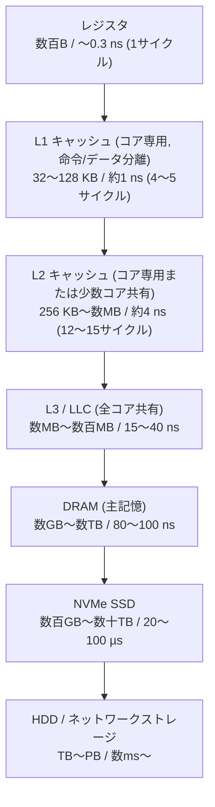

# 図1: メモリ階層

上に行くほど小さく・速く・高価。下に行くほど大きく・遅く・安価。数値は典型的な概数(世代で数倍変わる)。

## レイテンシ比(L1 を 1 とする)

| 階層 | 比 |
|---|---|
| L1 | 1 |
| L2 | 約4 |
| L3 | 約20〜40 |
| DRAM | 約80〜100 |
| NVMe SSD | 約20,000〜100,000 |
| 同一DC内ネットワーク往復 | 約100,000〜500,000 |

## 読み方

- 隣り合う階層の差は 数倍〜数十倍。**階層を1つ下がるたびに、桁が変わる**と覚える。
- 「データがどの階層にいるか」が、同じコードの速度を 100倍変える。
- 第5回(ストレージ)・第8回(TCP)・第12回以降(分散)は、この表の下側を拡張していく。
