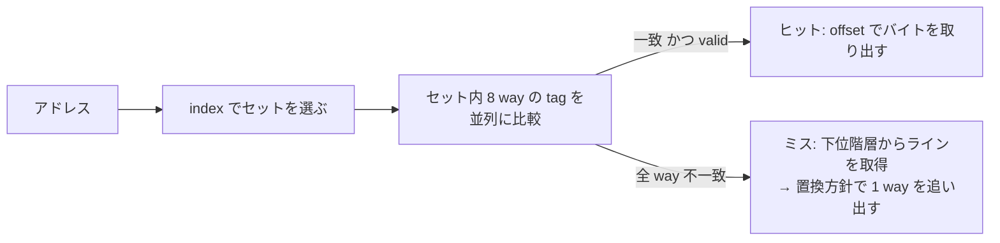

# 図2: キャッシュのアドレス分解

## 例: 32KB / 8-way / 64B ライン / 48ビットアドレス

```
 47                                   12 11            6 5             0
 +--------------------------------------+---------------+---------------+
 |              tag (36 bit)            | index (6 bit) | offset (6 bit)|
 +--------------------------------------+---------------+---------------+
```

| 項目 | 計算 | 値 |
|---|---|---|
| ライン数 | 32768 / 64 | 512 |
| セット数 | 512 / 8 | 64 |
| offset | log2(64) | 6 bit |
| index | log2(64 sets) | 6 bit |
| tag | 48 − 6 − 6 | 36 bit |

## ルックアップの流れ



## VIPT の制約(仮想メモリとの接点)

- ページサイズ 4KB → ページ内オフセットは下位 12 ビット。
- index + offset = 6 + 6 = 12 ビット。**ちょうどページ内オフセットに収まる**。
- そのため、仮想アドレスのままセットを引き始めても、物理アドレスのセットと一致する(エイリアス問題が起きない)。
- 一般式: **L1 容量 ≤ way数 × ページサイズ**(32KB = 8 × 4KB)。
- way を増やすか、ページを大きくする(Apple の 16KB ページ)と、L1 を拡大できる。

## 2のべき乗ストライドの罠(conflict miss)

同じ index になるアドレスは、**(ライン数/way = セット数) × 64B = 4096B** 間隔で現れる。4096B 刻みのアクセスは全て同一セットを狙い、8-way を超えると衝突ミスが連発する。

行列の行長が 4096B(1024 float)の倍数のとき、列方向走査が極端に遅くなるのはこのため。**パディングで行長を少しずらす**と解消する。
