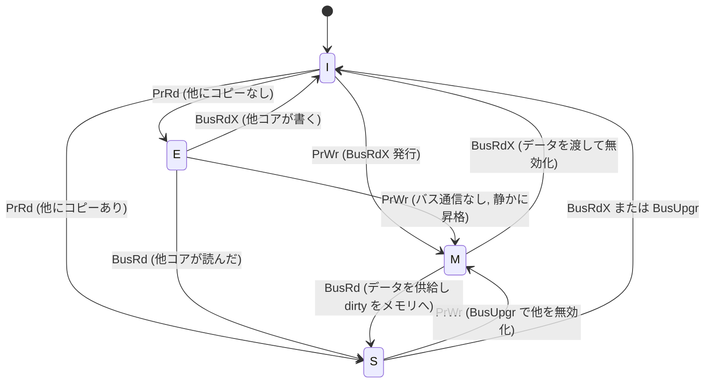

# 図3: MESI 状態遷移

## 状態遷移図(1本のキャッシュラインについて、ある1コアの視点)

- `Pr...` = 自コアのプロセッサ要求
- `Bus...` = 他コアがバスに流した事象(スヌープで観測)

## バス事象

| 事象 | 意味 |
|---|---|
| BusRd | 読み取り要求(共有でよい) |
| BusRdX | 書き込み目的の所有権付き読み取り(他のコピーを全て無効化させる) |
| BusUpgr | S から M への昇格(データ転送なし、無効化のみ) |

## なぜ E 状態があるのか

E がなければ、「自分だけが読んでいたラインに初めて書く」ときにも無効化通信が必要になる。E なら**通信なしで M に昇格**でき、単一スレッドで使うデータのコストを下げられる。

## 拡張プロトコル

- **MOESI** (AMD): Owned 状態を追加。dirty なラインを、メモリに書き戻さずに他コアへ共有できる。
- **MESIF** (Intel): Forward 状態を追加。S のうち**1つだけ**が応答役になり、重複応答を避ける。

## ソフトウェアから見える結果

| 操作 | 起きること |
|---|---|
| 複数スレッドが同じラインを**読むだけ** | 全員 S。通信なし。スケールする |
| 1スレッドが書く | 他全員を I へ。次に他が読むと再転送 |
| 複数スレッドが同じラインを**書く** | M が各コア間を往復(ping-pong)。**スケールしない** |
| 別変数だが同じラインを書く | 上と同じ(false sharing) |
