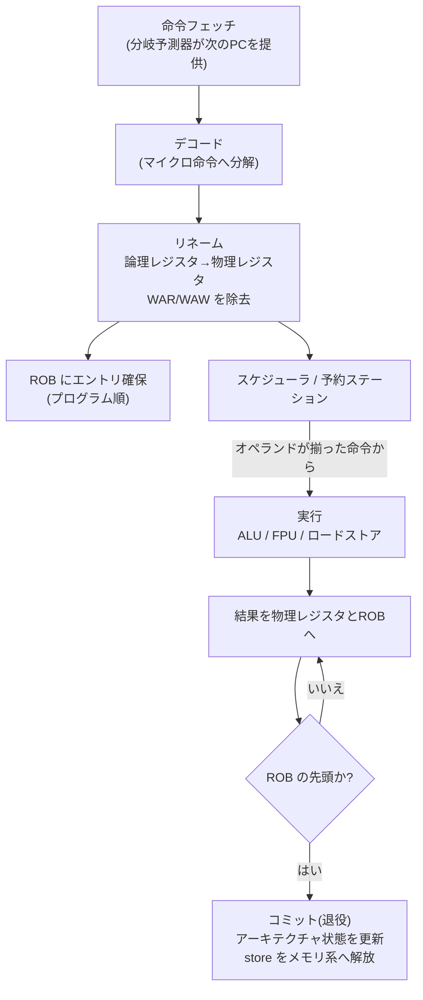
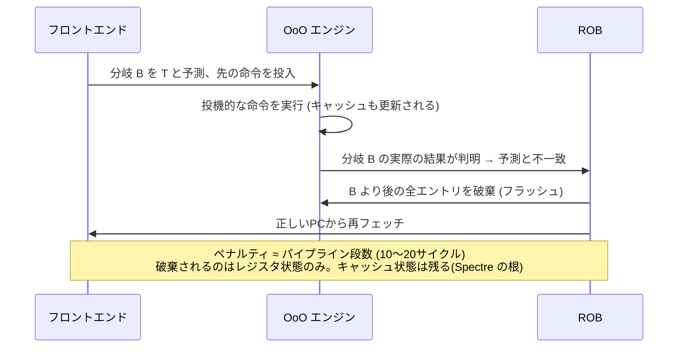

# 図4: Out-of-Order 実行と投機の流れ

## 1. 命令の旅



## 2. 分岐予測ミスのとき



## 3. 具体例: ロードミスを隠す

```
1: ld   r1, [A]        ; DRAM ミス → 約 300 サイクル待ち
2: add  r2, r1, 1      ; r1 に RAW 依存 → 待機
3: mul  r3, r4, r5     ; 独立 → すぐ実行できる
4: add  r6, r3, 7      ; 3 に依存 → すぐ実行できる
5: ld   r7, [B]        ; 独立 → 別のミスを並行して開始 (MLP)
```

- 3, 4, 5 は、1 の完了を待たずに実行される。
- ただし ROB が満杯になると、それ以上先へ進めず、フロントエンドが止まる。
- **ROB 容量 ÷ IPC ≒ 隠せるレイテンシの長さ**。DRAM ミス(約300サイクル)を完全に隠すには、ROB が足りないことが多い。

## 4. 覚えておくこと

- OoO は**実行**が順不同であり、**コミット**は常にプログラム順。
- 依存チェーン(ポインタ追跡など)は、OoO でも並列化できない。
- 独立な処理を**意図的に交互に書く**(インターリーブ)ことで、OoO と MLP の恩恵を引き出せる(例: ハッシュ表の複数キー検索のバッチ化、software prefetch)。
