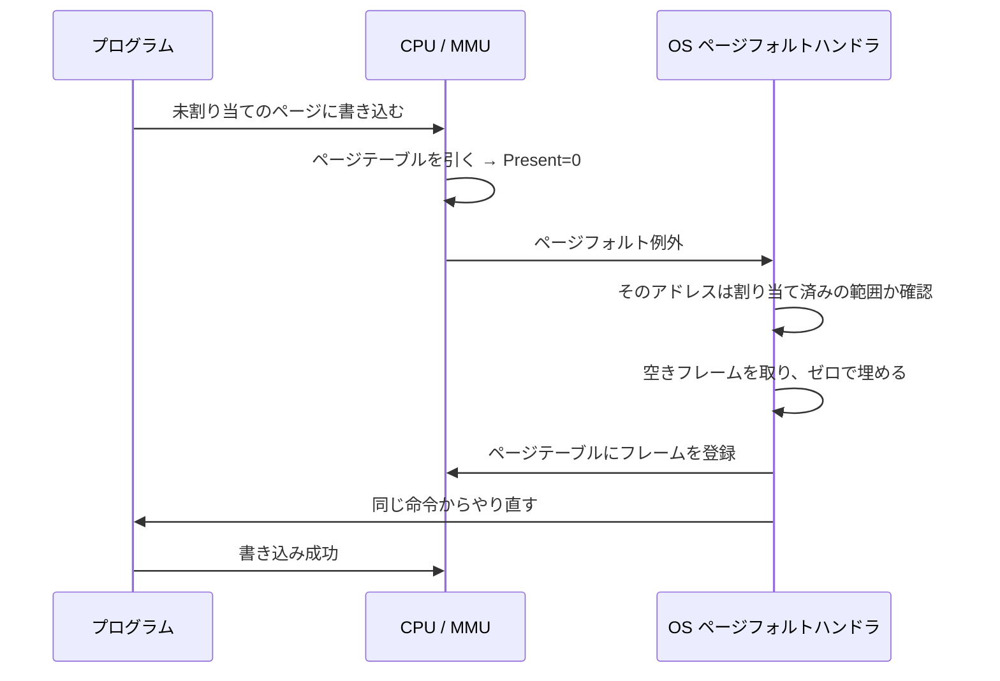

# 第2回 メモリ管理

> ステータス: 執筆済み(第1版)
> 前提: 第1回(キャッシュ、メモリ階層)
> 演習言語: C と Go
> 所要目安: 本文 2〜3時間 + 演習 4〜5時間

## この回のゴール

この回を終えると、次のことが説明できるようになる。

1. プログラムが使っている「アドレス」は物理メモリの場所ではない。では何で、誰がどう物理メモリに結びつけているのか。
2. `malloc(1GB)` が一瞬で成功するのに、使い始めると遅くなるのはなぜか。
3. `fork()` したプロセスのメモリが、すぐにはコピーされないのはなぜか。それはどんなときに問題になるか。
4. TLB ミスとは何で、どれくらい遅いのか。巨大ページは何を解決するのか。
5. 自分で書いた Go や C のコードのメモリ使用量を、RSS、VSZ、ヒープなどの指標で正しく読める。

第1回では、CPU がキャッシュの階層を通してメモリを読むところまでを見た。この回では、その「メモリのアドレス」が何なのかを扱う。ここを理解すると、第3回のプロセス、第4回のスレッド、第11回のコンテナの話が、すべて地続きになる。

---

## 1. まず問題から: 物理メモリを直接使うと何が困るか

仮想メモリがなかった時代、プログラムは物理メモリのアドレスをそのまま使っていた。複数のプログラムを同時に動かそうとすると、次の問題が出る。

| 問題 | 何が起きるか |
|---|---|
| 保護がない | あるプログラムのバグで、別のプログラムや OS のメモリを書き換えてしまう |
| 置き場所が固定される | プログラムが「アドレス 0x1000 から使う」と決め打ちしていると、2つ同時に動かせない |
| 連続した空きが必要 | 空きメモリの合計が足りていても、連続していなければ確保できない(断片化) |
| 物理メモリの容量が上限 | 物理メモリより大きなプログラムは動かせない |

これらを一度に解決するのが仮想メモリである。

---

## 2. 仮想メモリの考え方

発想は単純である。**プログラムには「自分専用の、広くて連続したアドレス空間」を見せておき、実際に物理メモリのどこにあるかは、OS とハードウェアが裏で対応づける。**

プログラムが見るアドレスを**仮想アドレス**、実際の DRAM 上の場所を**物理アドレス**と呼ぶ。両者の対応づけは、CPU の中の **MMU**(Memory Management Unit)が、メモリアクセスのたびにハードウェアで行う。対応表は OS が管理する。


上の図では、AもBも同じ仮想アドレス 0x1000 を使っているが、物理的には別の場所を指す。これで先ほどの4つの問題が次のように解決する。

- **保護**: 各プロセスの対応表には、そのプロセスに許した範囲しか載せない。載っていないアドレスに触れると、CPU が例外を起こす。
- **置き場所**: どのプロセスも同じ仮想アドレスから使える。物理的な位置は関係ない。
- **連続性**: 仮想アドレスで連続していれば、物理的にバラバラでよい。
- **容量**: 使っていない部分をディスクへ退避する、あるいはそもそも物理メモリを割り当てないことで、物理メモリより大きな空間を見せられる。

この仕組みの歴史的な出発点は、1960年代初頭の Atlas 計算機の「one-level storage」である。主記憶と補助記憶を、プログラムからは1つの大きな記憶に見せた。

---

## 3. プロセスのアドレス空間

1つのプロセスのアドレス空間は、用途ごとの領域に分かれている(詳細な図は [diagrams/01-address-space-layout.md](diagrams/01-address-space-layout.md))。

| 領域 | 内容 | 主な性質 |
|---|---|---|
| text | 機械語のコード | 読み取りと実行のみ。書き込み不可 |
| rodata | 文字列リテラルなどの定数 | 読み取りのみ |
| data | 初期値つきのグローバル変数 | 読み書き可。ファイルから初期化される |
| bss | 初期値なしのグローバル変数 | 読み書き可。最初は全部ゼロ |
| ヒープ | `malloc` や `new` で確保する領域 | 実行中に伸び縮みする |
| mmap 領域 | 共有ライブラリ、巨大な確保、ファイルの対応づけ | `mmap` で作られる |
| スタック | 関数の局所変数、戻りアドレス | 呼び出しのたびに伸び縮みする |
| カーネル | OS 自身 | ユーザーのコードからは触れない |

### ASLR

領域の配置は、プロセスを起動するたびにずらされる。これを **ASLR**(Address Space Layout Randomization)と呼ぶ。攻撃者が「このアドレスに目的の関数がある」と決め打ちしにくくするための防御である。

演習1で、同じプログラムを2回実行して確かめる。Apple M5 上の結果では、ヒープ、mmap 領域、スタックのアドレスが、実行のたびに変わった。

| 項目 | 1回目 | 2回目 |
|---|---|---|
| ヒープ(`malloc(100)`) | 0x1054b1020 | 0x104aad020 |
| mmap 1MB | 0x104c58000 | 0x109510000 |
| スタック | 0x16b1c66ac | 0x16b3866ac |

### 仮想アドレスの広さ

x86-64 では、現在の標準で 48 ビットの仮想アドレスを使う。2^48 バイトは 256 TiB で、Linux ではそのうち下半分の 128 TiB をユーザー空間に、上半分をカーネルに割り当てる。**物理メモリが 16GB のマシンでも、各プロセスは 128 TiB の空間を持てる。** 使っていない大部分は、対応表に載っていないだけである。

---

## 4. ページングとページテーブル

### 4.1 ページ単位で対応づける

バイト単位で対応表を作ると、表が巨大になる。そこで、メモリを**ページ**という固定サイズの塊に区切り、ページ単位で対応づける。

- 仮想アドレス空間の塊を**ページ**、物理メモリの塊を**フレーム**と呼ぶ。大きさは同じである。
- ページサイズは、x86-64 では通常 4KB。Apple Silicon の macOS は 16KB。
- 仮想アドレスは「ページ番号」と「ページ内の位置(オフセット)」に分けて考える。ページ番号だけを変換し、オフセットはそのまま使う。

例として、ページサイズ 4KB(オフセット 12 ビット)の場合を考える。

```
仮想アドレス = [ 仮想ページ番号 | オフセット(12ビット) ]
                   ↓ 変換
物理アドレス = [ 物理フレーム番号 | オフセット(12ビット) ]   ← オフセットは同じ
```

### 4.2 なぜ表を1枚にできないか

仮想アドレスが 48 ビット、ページサイズが 4KB なら、仮想ページは 2^36 個ある。各エントリが 8 バイトなら、表は 2^36 × 8B = **512 GiB** になる。しかもこれが**プロセスごと**に必要になる。物理メモリより大きな表は作れない。

### 4.3 多段ページテーブル

解決策は、表を階層にして、**使っている部分だけ作る**ことである。x86-64 の標準的な 4 段の構造を示す(図は [diagrams/02-page-table-walk.md](diagrams/02-page-table-walk.md))。

- 48 ビットの仮想アドレスを、9 + 9 + 9 + 9 + 12 に分ける。
- 上から順に、各 9 ビットで1段ずつ表を引く。表は1枚あたり 512 エントリ × 8B = 4KB。
- 最後の段のエントリに、物理フレーム番号が入っている。
- 最上位の表の物理アドレスは、CPU のレジスタ(x86 では CR3)に入っている。プロセスを切り替えるときは、このレジスタを書き換える。

段の名前は、上から PML4、PDPT、PD、PT である。1つのエントリがカバーする範囲は次のとおり。

| 段 | 表1枚がカバーする範囲 |
|---|---|
| PT | 512 × 4KB = 2 MiB |
| PD | 512 × 2MiB = 1 GiB |
| PDPT | 512 × 1GiB = 512 GiB |
| PML4 | 512 × 512GiB = 256 TiB |

小さなプロセスなら、使うアドレスは数カ所にしかまとまらない。表は PML4 から PT まで各1枚、合計 4 枚(16KB)あれば、その周辺の 2 MiB を扱える。512 GiB の巨大な表を持つ必要はない。

### 4.4 変換の具体例

仮想アドレス `0x00007f1234567abc` を変換するときの分解を示す。

| 部分 | 値 |
|---|---|
| オフセット(下位 12 ビット) | 0xabc |
| PT の添字(次の 9 ビット) | 359 |
| PD の添字 | 418 |
| PDPT の添字 | 72 |
| PML4 の添字 | 254 |

CPU は次のように進む。

1. CR3 が指す PML4 の、254 番目のエントリを読む。そこに PDPT の物理アドレスが入っている。
2. その PDPT の 72 番目のエントリを読む。PD の物理アドレスが入っている。
3. その PD の 418 番目を読む。PT の物理アドレスが入っている。
4. その PT の 359 番目を読む。データのあるフレームの物理アドレスが入っている。
5. フレームの先頭に、オフセット 0xabc を足した位置が、求める物理アドレスである。

つまり、**1回のメモリアクセスのために、最大で4回の追加のメモリ参照**が必要になる。この遅さを避ける仕組みが次の TLB である。

### 4.5 ページテーブルエントリ(PTE)の中身

エントリには、フレーム番号だけでなく、次のような制御ビットも入っている。

| ビット | 意味 | 使い方 |
|---|---|---|
| Present | 物理メモリにあるか | 0 のとき、アクセスするとページフォルトになる |
| Read/Write | 書き込みを許すか | 0 のとき書くとフォルト。COW や読み取り専用に使う |
| User/Supervisor | ユーザーモードから触れるか | カーネル領域の保護 |
| NX(実行禁止) | 命令として実行してよいか | データ領域の実行を禁じ、コード注入攻撃を防ぐ |
| Accessed | 最近アクセスされたか | ページ置換の判断材料(CPU が自動で立てる) |
| Dirty | 書き込まれたか | 追い出すときにディスクへ書き戻すかの判断(CPU が自動で立てる) |

---

## 5. TLB — 変換のキャッシュ

### 5.1 TLB の役割

毎回 4 段の表を引いていては、メモリアクセスが 5 倍遅くなってしまう。そこで、CPU は最近使った「仮想ページ番号 → 物理フレーム番号」の対応を、専用の小さなキャッシュに覚えておく。これが **TLB**(Translation Lookaside Buffer)である。

- **TLB ヒット**: ほぼ追加コストなしで物理アドレスが得られる。
- **TLB ミス**: ハードウェア(またはソフトウェア)が表を引く。これを**ページウォーク**と呼ぶ。

ページウォークでは、途中の表のエントリも通常のデータキャッシュに載るため、実際の追加コストは、条件が良ければ数十サイクルで済む。ただし、表のエントリがキャッシュに載っていなければ、メモリへの参照が最大 4 回の遅延として積み重なる。

### 5.2 TLB の届く範囲

TLB は小さい。例えば TLB が 1536 エントリ、ページサイズが 4KB なら、一度に変換を覚えておける範囲は 1536 × 4KB = 6 MiB にすぎない。これを **TLB reach** と呼ぶ。作業集合がこれを超えると、TLB ミスが頻発する。

### 5.3 巨大ページ

ページを大きくすれば、同じエントリ数で届く範囲が広がる。x86-64 には 2 MiB と 1 GiB のページがある(PT の段を飛ばして、PD や PDPT のエントリを最終エントリにする)。

| 方式 | 利点 | 欠点 |
|---|---|---|
| 通常ページ(4KB) | 細かく割り当てられる。無駄が少ない | TLB の届く範囲が狭い |
| 巨大ページ(2MiB) | TLB の届く範囲が 512 倍になる。ページウォークの段も減る | 連続した物理メモリが必要。断片化に弱い。使わない部分も確保される |

Linux には **THP**(Transparent Huge Pages)という、巨大ページを自動で使う機能がある。便利な反面、ページをまとめる処理(コンパクション)で遅延のばらつきが出ることがあり、Redis など一部のデータベースは THP を無効にするよう案内している。性能の安定が重要なシステムでは、`madvise` で明示的に使う方式が好まれる。

### 5.4 TLB とコンテキストスイッチ

プロセスが切り替わると、仮想アドレスの意味が変わる。昔は切り替えのたびに TLB を全消去していたため、切り替え直後は TLB ミスが続いた。現在は、TLB のエントリにプロセスの識別子を付ける方式(x86 の PCID、ARM の ASID)で、全消去を避けている。

Meltdown(第1回で触れた)への対策として、ユーザー空間とカーネルでページテーブルを分ける **KPTI** が導入された。システムコールのたびに表が切り替わるため、PCID がなければ大きなコストになる。

### 5.5 TLB の効果を測る(演習3)

演習3は、同じ個数のキャッシュラインを、「1ページに1本ずつ」と「連続して詰めて」で読み比べる。使うキャッシュラインの数は同じなので、差はほぼ TLB から来る。Apple M5(ページサイズ 16KB)の結果を示す。

| ページ数 N | 分散配置 (ns) | 連続配置 (ns) | 比 |
|---|---|---|---|
| 64〜128 | 0.67 | 0.67 | 1.0 |
| 256〜2048 | 約 2.0 | 0.67 | 約 3.0 |
| 4096 | 8.9 | 2.9 | 3.1 |
| 16384 | 11.6 | 4.3 | 2.7 |

読み方は次のとおり。

- **N が 128 まで**: 分散していても遅くならない。変換結果が、最初の階層の TLB に全部収まっていると考えられる。
- **N が 128 から 256 になったところ**: 分散配置だけが約 3 倍になる。最初の TLB から溢れ、2段目の TLB に頼るようになったと考えられる(TLB の構成は公開値を確認していない。この解釈は、差が出る位置からの推定である)。
- **N が 4096 を超えたところ**: 分散配置は約 9ns まで悪化する。ただし、連続配置もこのあたりから遅くなっている(使うラインの合計が 256KB になり、L1 キャッシュから溢れたため)。TLB だけの効果は、2つの差(約 6ns)で見る。

---

## 6. ページフォルトと遅延割り当て

### 6.1 「確保」と「割り当て」は別

`malloc(1GB)` や `mmap` は、すぐに成功する。実際に物理メモリを割り当てているわけではなく、「このアドレス範囲を使ってよい」という記録を OS が残しているだけだからである。物理ページが割り当てられるのは、**そのページに初めて触れたとき**である。これを**遅延割り当て**(demand paging)と呼ぶ。

### 6.2 ページフォルトの流れ

PTE の Present が 0 のページにアクセスすると、CPU は処理を中断して OS の**ページフォルトハンドラ**を呼ぶ。図は [diagrams/03-page-fault-flow.md](diagrams/03-page-fault-flow.md)。



ページフォルトには3種類ある。

| 種類 | 状況 | 重さ |
|---|---|---|
| マイナーフォルト | ページは確保済み、または必要な内容が主記憶上にあり、対応づけだけが足りない(ゼロ埋め、COW など) | 数百ns〜数µs |
| メジャーフォルト | ディスクからの読み込み(スワップイン、ファイルの初回読み込み)が必要 | 数十µs〜数ms |
| 無効なアクセス | 確保していない範囲、権限のない操作 | プロセスに SIGSEGV を送る(セグメンテーションフォルト) |

### 6.3 実測(演習2)

Apple M5 で 1 GiB を `mmap` し、そのうち 256 MiB に、1ページに1バイトずつ書いた結果を示す。

| 操作 | RSS | フォルト |
|---|---|---|
| 起動直後 | 1.6 MB | — |
| `mmap` で 1 GiB 確保 | 1.6 MB(変化なし) | +0 |
| 256 MiB に初めて書く | 257.6 MB | +16384(ページ数と一致) |
| 同じ範囲に再び書く(1回目) | 257.6 MB | +0 |
| 物理ページを OS に返した後 | 1.6 MB | — |
| もう一度書く | 257.6 MB | +16384 |

確認できたこと:

- 1 GiB 確保しても、RSS は増えない。
- 初めて書いたとき、フォルトの回数は 256MiB ÷ 16KB = 16384 回で、ページ数とちょうど一致した。
- 物理ページを返して再び触ると、また同じ回数のフォルトが起きる。

1ページあたりの時間は、初回が約 2〜3µs だった(ほぼフォルトの処理時間)。

**測って分かったが、説明できていないこと。** 同じ範囲に何度も書き直すと、macOS では時間が段階的に短くなった。

| 回 | 1ページあたり | フォルト |
|---|---|---|
| 1回目 | 約 2,850 ns | 16384 |
| 2回目 | 約 1,257 ns | 0 |
| 3回目 | 約 10 ns | 0 |
| 4回目 | 約 7 ns | 0 |

2回目はフォルトが1回も増えていないのに、3回目の 100 倍以上遅い。原因は特定できていない。OS が数えない形で、対応づけの整理を後から行っている可能性を考えているが、確認はしていない。**こういう「数えている指標に出ない時間」が実機にはある**ことは覚えておいてほしい。Linux で同じ演習を実行すると、結果が変わるかもしれない(課題)。

### 6.4 オーバーコミットと OOM

遅延割り当てのおかげで、OS は**物理メモリの総量より多く**の確保を許せる。実際にすべてを使うプロセスは少ないからである。これを**オーバーコミット**と呼ぶ。Linux の既定は、明らかに無謀な要求だけを断る設定である。

しかし、全員が使い始めて物理メモリが尽きると、OS は**OOM killer** を使い、いずれかのプロセスを強制終了して空きを作る。コンテナでは、そのコンテナに許したメモリの上限(cgroup の `memory.max`)を超えたとき、同じことが起きる。Kubernetes の `OOMKilled` や終了コード 137(SIGKILL)は、これである。

**`malloc` が成功しても、メモリが使えることの保証にはならない。** 失敗は、確保ではなく、使い始めた後に起きうる。

---

## 7. mmap とページキャッシュ

### 7.1 mmap の種類

`mmap` は、アドレス空間の一部を、何かに対応づける呼び出しである。

| | 匿名(anonymous) | ファイルバック |
|---|---|---|
| 内容の出どころ | ゼロで初期化される | ファイルの中身 |
| `MAP_PRIVATE` | `malloc` の大きな確保や、スレッドのスタックに使う | ファイルを読み込む。書くと自分のコピーだけが変わる(COW) |
| `MAP_SHARED` | プロセス間の共有メモリ | 書き込みが他のプロセスにも見え、最終的にファイルに反映される |

共有ライブラリが、複数のプロセスで同じ物理メモリを使えるのも、読み取り専用のファイルバックの対応づけを共有しているからである。

### 7.2 ページキャッシュ

OS は、読んだファイルの内容を、空いているメモリにページ単位で残しておく。これが**ページキャッシュ**である。同じファイルを再び読めば、ディスクではなくメモリから返る。

- `read()` はページキャッシュから、ユーザーのバッファへ**コピー**する。
- `mmap` したファイルは、ページキャッシュのページを**そのまま**アドレス空間に見せる。コピーがない。

Linux の `free` コマンドで空きが少なく見えても、多くはページキャッシュであり、必要になれば OS が手放す。見るべきは `available` の欄である。第5回(ファイルシステム)で詳しく扱う。

### 7.3 データベースで mmap を使うことの注意

mmap は書きやすいが、データベースでは落とし穴が多い。例えば、ページが追い出されるタイミングを OS が決めるため、書き込みの順序をデータベース側で制御できない。I/O のエラーがシグナルとして返り、扱いにくい。多数のスレッドが同時にページフォルトを起こすと、OS 内の競合で遅くなる。これらを実測で示した論文が、Crotty, Leis, Pavlo (CIDR 2022) である。参考文献を参照。

---

## 8. fork と Copy-on-Write

### 8.1 fork は本当にコピーするのか

`fork()` は、プロセスを複製する。数 GB のメモリを使っているプロセスでも、`fork()` は数ミリ秒で返る。メモリ全体を実際にコピーしているわけではない。

OS は次のように処理する。

1. 親のページテーブルを子へ複製する。
2. 書き込み可能なページを、親子とも**読み取り専用**に変更する。ページ本体は共有したままである。
3. どちらかがそのページに書こうとすると、読み取り専用違反でページフォルトが起きる。
4. OS はそのページだけを新しいフレームへコピーし、書いたプロセスに、書き込み可能な状態で渡す。

これが **Copy-on-Write**(COW)である。図は [diagrams/03-page-fault-flow.md](diagrams/03-page-fault-flow.md) の後半。

### 8.2 実測(演習5)

Apple M5 で、256 MB を常駐させた親が `fork` し、子がその全ページに触れたときの結果である。

| 測定 | 結果 |
|---|---|
| `fork()` の所要時間 | 常駐 0MB で約 0.5〜0.7ms、256MB で約 0.9〜2.4ms(ばらつき大) |
| 子が全ページを**読む** | 約 8〜10 ms、フォルト 16384 回 |
| 子が全ページに**書く** | 約 47〜51 ms、フォルト 16384 回(1ページ約 2.9〜3.1µs) |
| 子が書いた後の親のデータ | 変わっていない(全て元の値) |

分かること:

- `fork()` 自体は、メモリが増えるほど少しずつ遅くなる。ページテーブルの複製コストが効くからである。ただし今回の範囲では、ばらつきが大きく、傾向は弱くしか見えなかった。
- 書き込みは、読み込みの約 5〜6 倍重い。ページごとにコピーが必要だからである。
- 親子の独立性は保たれている。

なお、読むだけでフォルトが起きるかは OS による。今回の macOS では、子が最初に読むときもフォルトが起きた。Linux では、ページテーブルが複製済みなので、読むだけなら通常は起きない。

### 8.3 実務での影響: Redis のスナップショット

Redis は、ディスクへ保存するときに `fork()` を使う。子は、`fork` の瞬間のメモリを、変わらない姿で書き出せる。この間、親は通常どおり書き込みを受け付ける。

親が書き換えたページは COW でコピーされる。**書き込みが多いと、最悪でメモリ使用量が最大でほぼ 2 倍になる。** 「平常時は 8GB 使っていて、ディスクへ保存した瞬間に 14GB になって OOM で落ちた」という障害は、この仕組みで起きる。

また、`fork()` の時間は常駐メモリに比例して伸びるため、大きなプロセスでは、`fork` の間、親が数十〜数百ミリ秒止まることがある。

### 8.4 fork と exec

シェルなどは、`fork()` の直後に `exec()` で別のプログラムに置き換える。この場合、COW で共有したページテーブルは、すぐ捨てられる。このむだを避けるために、`vfork` や `posix_spawn` が用意されている。第3回で扱う。

---

## 9. 物理メモリが足りなくなったとき

### 9.1 何を追い出すか

物理メモリが足りなくなると、OS は使われていないページを退避させ、フレームを空ける。

| ページの種類 | 退避の方法 |
|---|---|
| ファイルバックで、変更なし | 捨てる。必要になったらファイルから読み直せる |
| ファイルバックで、変更あり(dirty) | ファイルへ書き戻してから捨てる |
| 匿名(ヒープやスタックなど) | **スワップ領域**へ書き出す。または圧縮する |

macOS は、スワップに書く前に、メモリ内でページを圧縮する仕組み(圧縮メモリ)を積極的に使う。Linux にも zswap などがある。

### 9.2 追い出すページの選び方

理想は、「最も長く使われない未来を持つページ」を追い出すことである(Belady の最適アルゴリズム、1966)。未来は分からないので、過去の使われ方から推測する。

| 方式 | 考え方 |
|---|---|
| FIFO | 古く入ったものから。単純だが、よく使うページも追い出してしまう |
| LRU | 最も長く使われていないものから。精度は高いが、すべてのアクセスの記録が必要で重い |
| **Clock** (second chance) | Accessed ビットを使う近似。1周する間に一度も使われていなければ追い出す |

実際の OS は、LRU の近似を使う。Linux は、ページを「活発」と「非活発」の2つのリストに分けて管理している。

### 9.3 スラッシング

物理メモリが、動いているプログラム全体の作業集合(Denning, 1968)より小さいと、ページを追い出しては、すぐ読み戻すことの繰り返しになる。CPU はほとんど待ち時間になり、システムが急に極端に遅くなる。これを**スラッシング**と呼ぶ。

「少しずつ遅くなる」のではなく、「ある点を超えると急に崖から落ちる」のが特徴である。サーバでは、スワップを無効にして、メモリ不足を早く OOM として表面化させる運用も多い。遅いまま延々と動き続けるより、落ちて再起動したほうが復旧が早いからである。

---

## 10. malloc の仕組み

### 10.1 2つの層

メモリの確保には、2つの層がある。混同しやすいので分けて考える。

| 層 | 担当 | 扱う単位 | 呼び出し |
|---|---|---|---|
| OS(カーネル) | 仮想アドレス範囲の割り当て、物理ページの割り当て | ページ(4KB/16KB 以上) | `mmap`、`brk`、`munmap` |
| ユーザー空間のアロケータ | 受け取った範囲を、小さな塊に切って渡す | バイト単位(16 バイト刻みなど) | `malloc`、`free` |

`malloc(100)` のたびにシステムコールを呼ぶと遅すぎるので、アロケータは、OS から大きめにまとめて受け取り、自分で小さく切り分ける。図は [diagrams/04-malloc-layers.md](diagrams/04-malloc-layers.md)。

### 10.2 アロケータが解く問題

「サイズがばらばらの確保と解放が、任意の順序で来る」ときに、次を同時に満たしたい。

1. 速い(1回あたり数十 ns)
2. 無駄が少ない
3. 複数スレッドで競合しない

特に難しいのが**断片化**である。

| 種類 | 意味 | 例 |
|---|---|---|
| 内部断片化 | 確保した塊の中に、使われない余りがある | 100B を頼んだら、128B の塊を渡された(28B の無駄) |
| 外部断片化 | 空きの合計は足りるが、連続していない | 空きが 64B ずつ点在し、合計では十分だが、4KB の要求を満たせない |

### 10.3 基本の方式: 空きリストとブロックの結合

演習4の自作 malloc は、最も単純な方式である。アリーナ(確保済みの大きな領域)を、ブロックの列として管理する。

- 各ブロックの先頭に、サイズ、前後のブロック、空きかどうかを書いたヘッダを置く。
- **確保**: 先頭から、入る空きブロックを探す(first-fit)。余りが大きければ、2つに分割する。
- **解放**: ブロックを空きにして、前後のブロックが空きなら**結合**する。結合しないと、空きが細切れのまま残ってしまう。

演習4の実測(Apple M5)では、次の2つが確認できた。

**結合は正しく動く。** ランダムに20万回の確保と解放を行い、すべて解放した後、空きが元の1つの大きなブロックに戻った。パターンを書き込んで、途中で破損しないことも確認した。

**外部断片化は、実際に起きる。** 4MiB のアリーナを、64B と 1024B の交互の確保で埋め尽くし、64B の方だけを解放した。

| 状態 | 空きの合計 | 最大の連続した空き | 外部断片化 |
|---|---|---|---|
| 満杯 | 992 B | 992 B | — |
| 64B の方を解放 | 233,952 B | 992 B | 99.6% |

空きの合計は約 228KB あるのに、4096B の確保は失敗した。連続した空きが 992B しかなかったからである。

**速度**は、自作が約 300 ns/回、システムの `malloc` が約 18 ns/回だった。約 16 倍の差がある。差の主な理由は、自作が毎回リストを先頭から探すこと(確保済みの数に比例して遅くなる)である。

### 10.4 実用のアロケータの工夫

実用のアロケータは、この単純な方式を、次の工夫で速くしている。

| 工夫 | 内容 |
|---|---|
| **サイズクラス** | サイズを 16, 32, 48, 64, … のように丸め、クラスごとに別の空きリストを持つ。探す手間がなくなる。代償は内部断片化 |
| **スレッドごとのキャッシュ** | スレッドごとに専用の空きリストを持ち、ロックなしで確保できる。競合が減る |
| **大きな確保は直接 mmap** | 大きな確保は、アロケータを通さず OS から直接取る。解放すると OS に即座に返せる |
| **ページ単位での返却** | 空きが続いたページを OS に返し、RSS を減らす |

代表的な実装は次のとおり。

| 実装 | 特徴 |
|---|---|
| glibc の ptmalloc | Linux の標準。スレッドごとのアリーナ、`tcache` と呼ぶスレッドローカルのキャッシュ |
| **tcmalloc** (Google) | スレッドごと、または CPU ごとのキャッシュ。サイズクラス。Go のアロケータの手本 |
| **jemalloc** | 断片化の抑制に強い。FreeBSD の標準。長期稼働のサーバで広く使われる |
| mimalloc (Microsoft) | 空きリストを小さな領域ごとに分割して管理し、局所性と速度を両立 |

実装は OS ごとに異なる。macOS の標準は libmalloc である。

---

## 11. Go のメモリ

### 11.1 スタックとヒープ

Go では、変数がスタックとヒープのどちらに置かれるかを、**プログラマではなくコンパイラが決める**。C のように `malloc` を書く必要はない。

- **スタック**: 関数が終われば自動で解放される。確保も解放も、ポインタを動かすだけで、ほぼ無料。GC の対象ではない。
- **ヒープ**: 関数が終わっても残る。確保にコストがかかり、不要になった後は GC が回収する。

goroutine のスタックは、最初は小さい(2KB)。足りなくなると、倍の大きさの領域に**コピーして移す**ことで伸びる。これにより、何十万もの goroutine を持てる。

### 11.2 エスケープ解析

コンパイラは、「その変数が、関数が終わった後も参照されうるか」を調べる。参照されうる(エスケープする)なら、ヒープに置く。

```go
func sumByValue() int {
    p := point{1, 2}      // 関数の外に出ない → スタック
    return p.x + p.y
}

func newPointer() *point {
    p := point{1, 2}      // ポインタを返す → ヒープへ移動
    return &p
}
```

演習6で、`testing.AllocsPerRun` を使って、1回の呼び出しあたりのヒープ確保回数を測った(Go 1.26.5、Apple M5)。

| 関数 | 確保回数 | 理由 |
|---|---|---|
| `sumByValue` | 0 | 外に出ない値はスタック |
| `newPointer` | 1 | ポインタを返すのでヒープへ |
| `toInterface(7)` | 1 | 実行時の値を interface に入れ、大域変数に保存するのでヒープへ |
| `makeSmallSlice` | 0 | 大きさが定数で小さいスライスはスタックへ |
| `makeSliceDynamic(16)` | 1 | この例では、実行時に決まる大きさのスライスはヒープへ |
| `makeSliceDynamic(100000)` | 1 | 大きいスライスはヒープへ |

注意点が2つある。

- 値が**定数だけ**のときは、`interface` に入れても確保が起きなかった(読み取り専用の静的な領域が使われる)。最初に書いた例では、確保回数が 0 になり、意図とずれた。**予想と違う結果が出たら、コンパイラの出力で確認する。**
- どの場合にスタックに載せられるかは、**Go のバージョンで変わる**。これは1.26.5 での結果であり、他のバージョンで同じとは限らない。

判定の理由は、`go build -gcflags=-m` で、コンパイラ自身に出力させて確認できる(例: `moved to heap: p`)。

### 11.3 Go のヒープ

Go のヒープ管理は、tcmalloc の設計を土台にしている。

- ヒープを**スパン**(ページの連なり)に分け、スパンごとに1つのサイズクラスを割り当てる。サイズクラスは、32KB までに 60 数種類ある。
- **mcache**: 論理プロセッサ(P)ごとの専用のキャッシュ。ロックなしで小さな確保ができる。
- **mcentral**: サイズクラスごとの、共有のスパンの一覧。mcache が空になると補充する。
- **mheap**: ページを管理する大元。足りなければ OS から取る。32KB より大きな確保は、直接ここから取る。

### 11.4 OS への返却

GC で不要になったメモリは、すぐには OS に返されない。演習6の結果を示す。

| 状況 | HeapAlloc(使用中) | HeapIdle(保持するが未使用) | HeapReleased(OSへ返却済み) |
|---|---|---|---|
| 開始 | 0.3 MB | 3.0 MB | 3.0 MB |
| 256MiB を確保して保持 | 256.2 MB | 3.1 MB | 2.8 MB |
| 参照を捨てて GC | 0.2 MB | **259.0 MB** | 2.8 MB |
| `FreeOSMemory` 後 | 0.2 MB | 259.1 MB | **259.0 MB** |

GC した直後は、使用中のメモリは 0.2MB に戻っているが、**259MB が「確保したまま保持」されており、OS に返っていない**。`top` で見ると RSS が高いままで、「メモリリークだ」と誤解しやすい。Go ランタイムは、バックグラウンドのスカベンジャで少しずつ OS に返すが、すぐには返さない。`debug.FreeOSMemory()` は、これを強制する。

GC の詳細(いつ走るか、どう止めずに回収するか、`GOGC` と `GOMEMLIMIT`)は、第11回で扱う。

---

## 12. メモリのバグと防御

C や C++ では、境界を超えた書き込みなど、メモリに関するバグが、そのままセキュリティの穴になる。

| バグ | 内容 |
|---|---|
| バッファオーバーフロー | 確保した範囲の外へ書く。戻りアドレスなどを書き換えられる |
| use-after-free | 解放した後で、そのポインタを使う |
| double free | 同じ領域を2回解放する。アロケータの管理情報が壊れる |
| 未初期化の読み出し | 以前の内容(別の秘密)が見える |

これらが、ここまでの仕組みを使って、次のように防がれる。

| 防御 | 仕組み | 関係する回 |
|---|---|---|
| NX(実行禁止) | PTE の NX ビット。データ領域を実行できなくする | 本回 |
| ASLR | 領域の配置をランダム化 | 本回 |
| スタックカナリア | 戻りアドレスの手前に目印を置き、書き換えを検出 | コンパイラの機能 |
| AddressSanitizer (ASan) | 確保領域の前後に毒を塗り、アクセスを監視する(速度とメモリの代償は数倍) | 開発・テスト用 |
| メモリタグ (ARM MTE) | ポインタとメモリに小さなタグを付け、不一致を検出する | ハードウェア |
| メモリ安全な言語 | Rust の所有権、Go の境界検査と GC | 言語設計 |

**Go は、通常はメモリ安全だが、例外がある。** `unsafe` を使うと安全性が失われる。また、データ競合は、複数語から成る値(スライス、interface など)が壊れた状態で読まれて、メモリ破壊に至ることがある。Go で `-race` を使う理由の1つである(第4回)。

---

## 13. 実務で見るメモリの指標

「このプロセスはメモリをどれだけ使っているか」という問いに、1つの答えはない。

| 指標 | 意味 | 注意 |
|---|---|---|
| **VSZ**(仮想サイズ) | 確保した仮想アドレスの総量 | 実際に使っているわけではない。大きくても問題ないことが多い |
| **RSS**(常駐サイズ) | 物理メモリに載っている量 | 共有ライブラリなどの共有分を、各プロセスが重複して数える |
| **PSS** | 共有分を、使うプロセス数で割って数える | プロセス群の合計を見るときに正確 |
| **USS** | そのプロセスだけが使っている量 | 終了させたときに実際に戻る量 |
| macOS の footprint | 圧縮メモリなども含めた、プロセスの実質的な使用量 | Activity Monitor の「メモリ」列に近い |

見るためのコマンド:

- Linux: `/proc/<pid>/status`(`VmRSS`)、`/proc/<pid>/smaps_rollup`(PSS)、`pmap -x <pid>`
- macOS: `vmmap <pid>`、`footprint <pid>`

コンテナで気をつける点:

- cgroup のメモリ使用量には、**ページキャッシュも含まれる**。ファイルをたくさん読んだだけで、使用量が上限に近づくことがある。ただし、キャッシュは必要なら回収されるため、OOM の判断には、回収できない分(working set)を見る。
- Go の場合、`GOMEMLIMIT` でヒープの目標を、コンテナの上限より少し低く設定しておくと、GC が早めに動き、OOM を避けやすい。

---

## 14. 演習の実測結果のまとめ

Apple M5(arm64、ページサイズ 16KB、メモリ 16GB)での結果。数値は環境ごとに異なる。

| 演習 | 内容 | 主な結果 |
|---|---|---|
| 1 | アドレス空間の観察 | 領域ごとにアドレスが分かれ、実行のたびにヒープ・mmap・スタックが変わる(ASLR) |
| 2 | 遅延割り当て | 1 GiB 確保で RSS は変化なし。256MiB に触れるとフォルト 16384 回 |
| 3 | TLB の届く範囲 | 分散配置が連続配置の約 3 倍。差はページ数 256 付近から出る |
| 4 | 自作 malloc | 結合が動く。断片化で、空き 228KB でも 4KB が確保できない。速度はシステムの約 16 倍遅い |
| 5 | fork と COW | 書き込みは読み込みの約 5〜6 倍。子が書いても親は変わらない |
| 6 | Go の確保 | ポインタを返すと確保 1 回。GC 後も 259MB が OS に返らない |

手順と課題は [exercises/README.md](exercises/README.md)。

**測定でつまずいた点**

- 演習3は、最初に書いた版では、計測ループがコンパイラに消されて「0.00 ns」と表示された。`volatile` の付け方(値ではなくポインタ自体に付ける必要があった)が誤っていた。第1回の演習3(分岐予測)と同じく、**測ったものが本当に測りたいものかを確認する**ことが要る。
- 演習4の最初の断片化テストは、アリーナが大きすぎて、空きが常に末尾に残るため、断片化が現れなかった。アリーナを小さくして埋め尽くすことで、初めて再現した。
- 演習5は、出力が二重に表示された。`fork` の前に、まだ出力されていないバッファが親から子へ複製されたためである。`fork` の前に `fflush` が要る。

---

## 15. 博士レベルの論点

答えが定まっていない問い。口頭試問でも議論する。

1. **アドレス変換のコスト**: メモリが TB 級になると、TLB reach の不足が支配的になる。Basu ら (ISCA 2013) は、大きな連続領域に対して、ページングを使わず、基底と上限で変換する「直接セグメント」を提案した。ページングの柔軟性と、変換のコストは両立できるか。
2. **仮想化とのかけ合わせ**: 仮想マシンでは、ゲストの変換とホストの変換が重なる(ネストしたページング)。4 段 × 4 段で、1回のミスに最大 24 回のメモリ参照が必要になる。これを、どう減らせるか(Bhargava ら 2008、Barr ら 2010)。
3. **巨大ページの限界**: 巨大ページは、TLB には有利だが、断片化に弱く、使わない部分も確保される。THP の自動化は、遅延のばらつきという別の問題を作る。OS はどこまで自動で判断すべきか。
4. **メモリの階層化**: CXL などで、遅いが大容量のメモリが加わる。OS は、どのページを速いメモリに置くか、どう判断するか。ページ単位の追跡は十分か。
5. **mmap と明示的 I/O**: データベースは mmap を避けるべきか。OS のページ置換と、データベース自身のバッファ管理の責任分担は、どうあるべきか。
6. **メモリ安全性**: C/C++ のコードを、書き直さずに、どこまで安全にできるか。ASan、MTE、CHERI(ポインタに範囲と権限を持たせるアーキテクチャ)の比較。
7. **ハードウェアの信頼性**: Rowhammer(Kim ら 2014)のように、同じ DRAM 行への繰り返しアクセスが、隣の行のビットを反転させる。仮想メモリの保護は、物理層の欠陥を前提にできるか。

---

## 16. 後続の回との接続

| この回の概念 | 再登場する回 | 内容 |
|---|---|---|
| ページテーブル、CR3、TLB | 第3回 | プロセス切り替えのコスト、スレッドとの違い |
| fork と COW、`exec` | 第3回 | プロセス生成、シェルの実装 |
| ページキャッシュ、dirty ページ、`fsync` | 第5回 | ファイルシステムと永続化 |
| `mmap`、ゼロコピー | 第6回 | I/O の高速化 |
| メモリ使用量の上限、OOM | 第11回 | cgroup、コンテナのメモリ制限 |
| Go のヒープ、スタック、スカベンジャ | 第11回 | GC の設計 |
| ページ置換、キャッシュの追い出し | 第14回 | 分散キャッシュ、LRU の発展 |

---

## 17. まとめ

- プログラムが使うアドレスは**仮想アドレス**で、MMU が、OS の作った**ページテーブル**を使い、ページ単位で物理メモリに対応づける。これが保護、配置の自由、連続性、容量の問題を解く。
- ページテーブルは多段にして、**使う部分だけ**作る。ただし、1回のアクセスに最大で数回の追加参照が要るので、変換結果を **TLB** にキャッシュする。TLB の届く範囲を超えると遅くなる。
- メモリの確保は、**アドレスの確保**と、**物理ページの割り当て**が別である。後者は、初めて触れた瞬間の**ページフォルト**で起きる。だから確保が速く、`malloc` の成功は使えることを保証しない。
- `fork` は **COW** で、書くまでコピーしない。書き込みが多いと、メモリ使用量が最大で約 2 倍になりうる。
- ユーザー空間のアロケータは、OS から大きくもらって小さく切り分ける。**断片化**との戦いであり、サイズクラスとスレッドごとのキャッシュで速くしている。
- Go は、**エスケープ解析**でスタックかヒープかを決める。GC した後も、メモリはすぐには OS に返らない。
- メモリの使用量を見るときは、**VSZ、RSS、PSS、USS** を区別する。

次回(第3回)は、このアドレス空間を持つ「プロセス」そのものを扱う。プロセスはどう作られ、どう切り替わり、CPU はどう分け合うのか。
