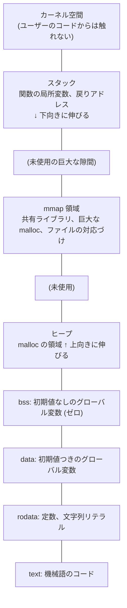
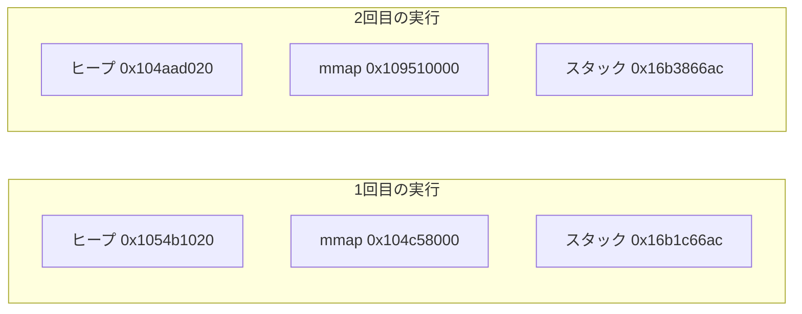

# 図1: プロセスのアドレス空間

## 全体像(x86-64 Linux の典型的な配置。上が高いアドレス)

- 隙間の部分は、ページテーブルに載っていない。そこに触れると SIGSEGV になる。
- macOS(Apple Silicon)でも領域の種類は同じだが、アドレスの値と配置は異なる。演習1の出力で確認する。

## 各領域の性質

| 領域 | 読む | 書く | 実行 | 出どころ |
|---|---|---|---|---|
| text | ○ | × | ○ | 実行ファイル |
| rodata | ○ | × | × | 実行ファイル |
| data | ○ | ○ | × | 実行ファイル(初期値) |
| bss | ○ | ○ | × | ゼロで初期化(ファイルには載っていない) |
| ヒープ | ○ | ○ | × | 匿名メモリ |
| mmap | 指定による | 指定による | 指定による | ファイル、または匿名 |
| スタック | ○ | ○ | ×(NX) | 匿名メモリ |

## ASLR の効果

(上の数値は Apple M5 上での実測例。実行のたびに、ヒープ・mmap・スタックの開始位置がずれる。)

## 観察の方法

- 演習1: `./ex1` を2回実行してアドレスを比べる。
- Linux: `cat /proc/<pid>/maps`、`pmap <pid>`
- macOS: `vmmap <pid>`
