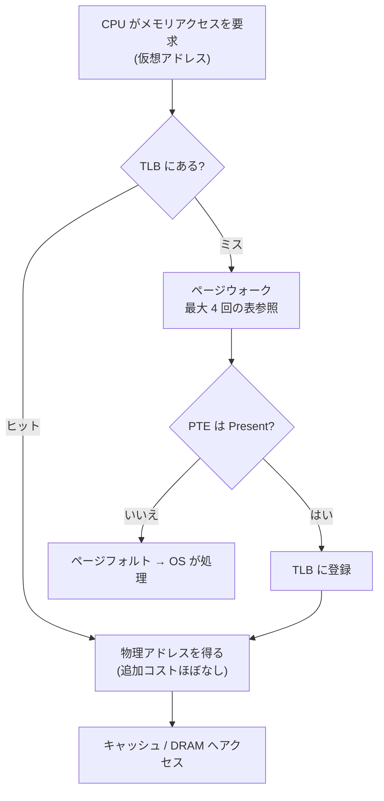

# 図2: x86-64 の 4 段ページテーブルと変換

## 仮想アドレスの分解(4KB ページ、48 ビット)

```
 47      39 38      30 29      21 20      12 11           0
 +---------+----------+----------+----------+--------------+
 |  PML4   |   PDPT   |    PD    |    PT    |   offset     |
 | 9 bit   |  9 bit   |  9 bit   |  9 bit   |   12 bit     |
 +---------+----------+----------+----------+--------------+
```

## ページウォークの流れ


## 具体例: 0x00007f1234567abc

| 部分 | 値 |
|---|---|
| PML4 の添字 | 254 |
| PDPT の添字 | 72 |
| PD の添字 | 418 |
| PT の添字 | 359 |
| offset | 0xabc |

## TLB を含めた全体の流れ



## 表1枚がカバーする範囲

| 段 | エントリ数 | 1エントリの範囲 | 表1枚の範囲 |
|---|---|---|---|
| PT | 512 | 4 KiB | 2 MiB |
| PD | 512 | 2 MiB | 1 GiB |
| PDPT | 512 | 1 GiB | 512 GiB |
| PML4 | 512 | 512 GiB | 256 TiB |

## 巨大ページ

- **2 MiB ページ**: PD のエントリを最終エントリにする。PT の段が不要になる(offset は 21 ビット)。
- **1 GiB ページ**: PDPT のエントリを最終エントリにする(offset は 30 ビット)。
- ページウォークの段が減り、TLB の1エントリが覆う範囲も広がる。

## 表を1枚にした場合との比較

| 方式 | 表の大きさ(1プロセス) |
|---|---|
| 1段(仮想ページ 2^36 個 × 8B) | 512 GiB |
| 4段(小さなプロセス: 各段1枚) | 16 KiB |

## 仮想化との組み合わせ

仮想マシンでは、ゲストの変換(ゲスト仮想 → ゲスト物理)の各段の参照ごとに、ホストの変換(ゲスト物理 → ホスト物理)が必要になる。

- ゲスト 4 段 × ホスト 4 段 → 最大 (4+1) × (4+1) − 1 = **24 回**のメモリ参照
- このため、仮想化環境では TLB ミスが特に高くつく。巨大ページが特に効く理由である。
