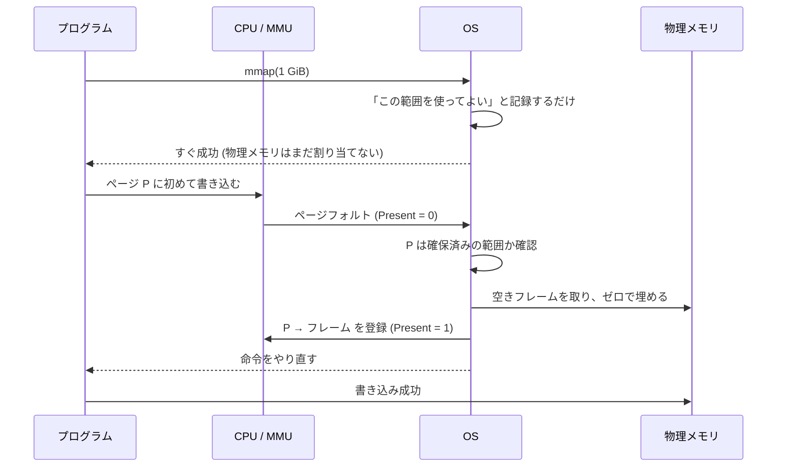
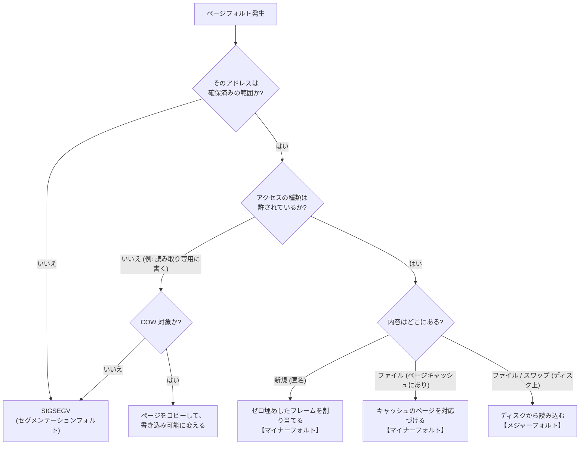
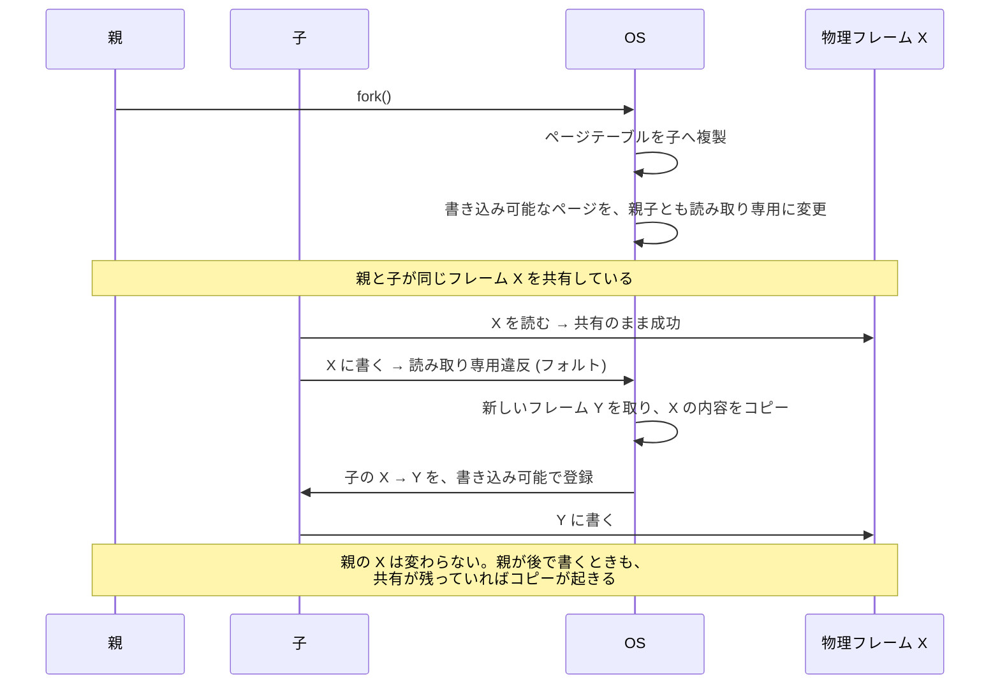

# 図3: ページフォルトの流れ

## 1. 遅延割り当て(demand paging)

`mmap` や `malloc` の直後は、対応するページテーブルのエントリが空(Present = 0)である。

## 2. 無効なアクセス

## 3. fork と Copy-on-Write

## 4. 3種類のフォルトの比較

| 種類 | 起きる場面 | 代表的なコスト(今回の M5 での目安) |
|---|---|---|
| マイナー(ゼロ埋め) | 初めて触れる匿名ページ | 約 2〜3 µs/ページ |
| マイナー(COW) | fork 後の書き込み | 約 3 µs/ページ |
| メジャー | ディスクから読む | SSD で数十 µs〜、HDD で数 ms |
| 無効 | 範囲外、権限違反 | プロセスの強制終了 |
