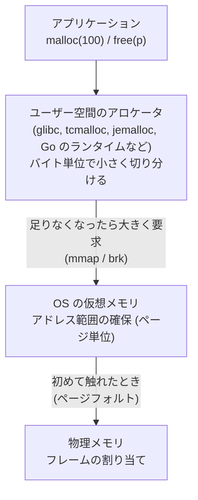
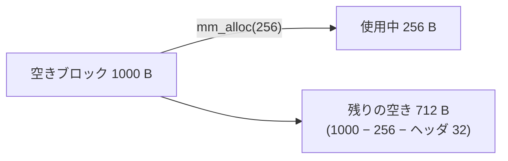
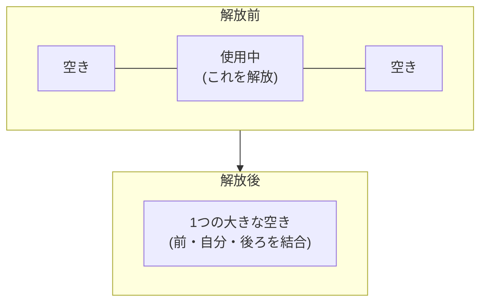
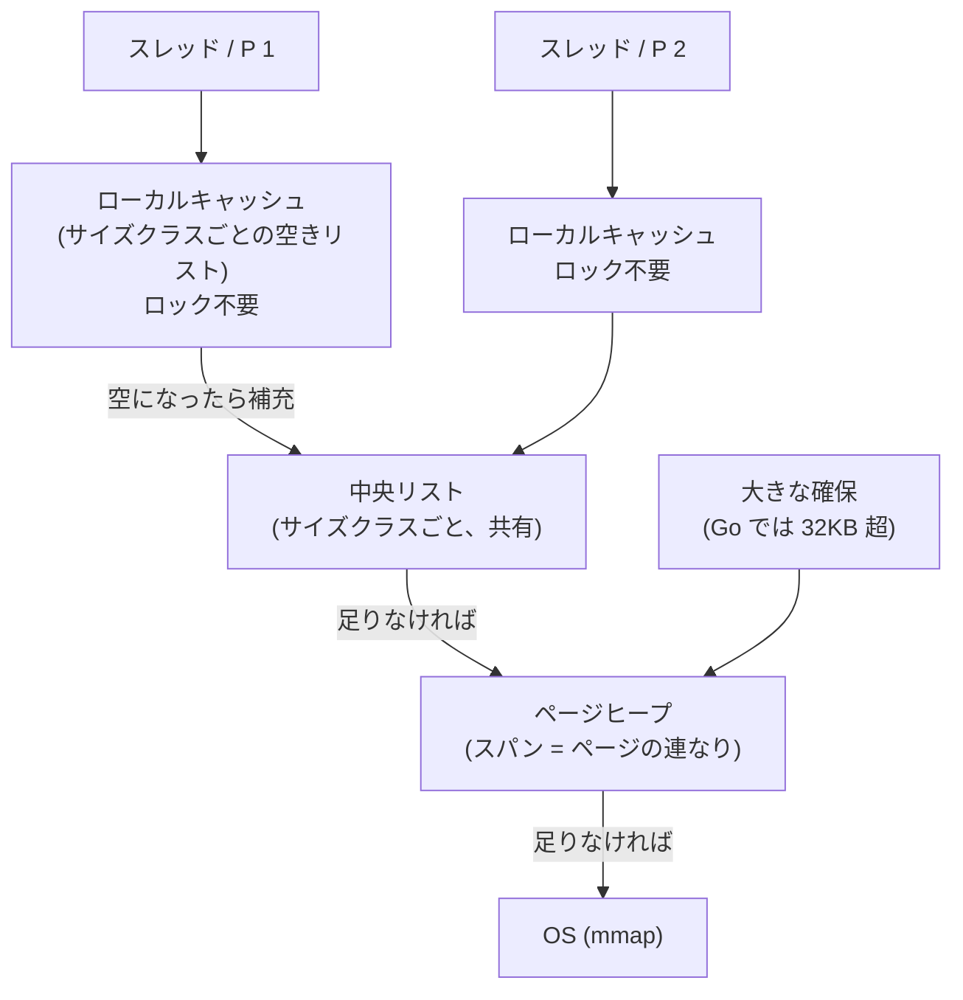

# 図4: malloc の層構造と空きリスト

## 1. メモリ確保の2つの層



- `malloc` のたびにシステムコールは呼ばない。まとめて受け取り、中で切り分ける。
- アロケータが OS に返すのは、ページ単位。1バイトだけ返すことはできない。

## 2. 自作 malloc(演習4)のブロック構造

各ブロックの先頭にヘッダ(32 バイト)を置き、アドレス順の双方向リストでつなぐ。

```
アリーナ (mmap で確保した領域)
+--------+-----------+--------+-------+--------+--------------------+
| header | payload   | header | free  | header | free               |
| 使用中 | 64 B      | 使用中 | 128 B | 使用中 | 巨大な空き          |
+--------+-----------+--------+-------+--------+--------------------+
   ↑ size, prev, next, free フラグ
```

## 3. 確保: 分割



余りがヘッダ + 最小サイズ以上ならば分割する。足りなければ、ブロック全体を渡す(内部断片化)。

## 4. 解放: 結合



結合しないと、空きが細切れのまま残り、後で大きな確保が失敗する。演習4のテスト1は、全部解放した後に「空きが1つに戻る」ことで、結合の正しさを確認する。

## 5. 外部断片化の例(演習4のテスト2)

```
満杯:     [64][1024][64][1024][64][1024][64][1024] ...
64B 側を解放:
          [空 64][1024][空 64][1024][空 64][1024] ...
```

- 空きの合計は大きい(今回は約 228KB)。
- どの空きも 64B(結合後も最大 992B)しかない。
- 4096B の確保は失敗する。

## 6. 実用のアロケータの構造(tcmalloc 系、Go の例)



| 層 | Go での名前 | 競合 |
|---|---|---|
| ローカルキャッシュ | mcache(P ごと) | なし |
| 中央リスト | mcentral(サイズクラスごと) | あり(ロック) |
| ページヒープ | mheap | あり(ロック) |

## 7. Go のスタックの伸長


スタック上のオブジェクトを指すポインタは、ヒープからは持てない(コピーで移動するため)。これが、エスケープ解析が「ヒープから参照されうる変数はヒープに置く」と決める理由の1つである。
