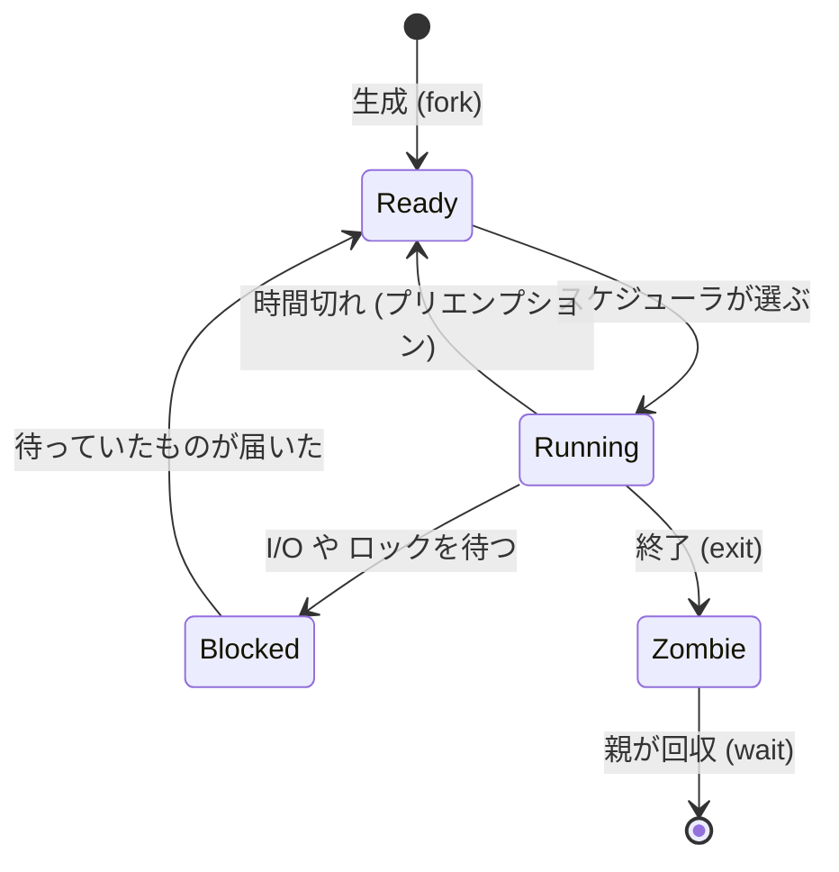

# 第3回 プロセスとスケジューリング

> ステータス: 執筆済み(第1版)
> 前提: 第1回(CPU、キャッシュ)、第2回(仮想メモリ、fork と COW)
> 演習言語: C と Go
> 所要目安: 本文 2〜3時間 + 演習 4〜5時間

## この回のゴール

この回を終えると、次のことが説明できるようになる。

1. プロセスとは何か。プログラムとの違いは何か。OS はプロセスについて何を覚えているのか。
2. CPU が1つしかなくても、たくさんのプログラムが同時に動いて見えるのはなぜか。切り替えの瞬間に何が起きて、いくらかかるか。
3. シェルで `ls | wc -l` と打つと、裏で何回 `fork` が呼ばれ、ファイルディスクリプタがどうつながるか。
4. ゾンビプロセス、孤児プロセス、シグナルの性質を説明できる。コンテナの PID 1 で何が問題になるか。
5. OS は、どのプロセスを次に走らせるかを、どう決めているのか。Linux の `nice` 値は、何を変えるのか。
6. Go の goroutine は OS スレッドと何が違い、なぜ切り替えが速いのか。

第2回で、プロセスが持つ「アドレス空間」を見た。この回では、そのアドレス空間を持つ**実行の単位**そのものを扱う。次回(第4回)のスレッドと並行性は、この回の話の延長にある。

---

## 1. プロセスとは何か

### 1.1 プログラムとプロセス

**プログラム**は、ディスクに置かれたファイルである。命令とデータが書いてあるだけで、動いてはいない。**プロセス**は、そのプログラムを実行している状態のことである。同じプログラム(例えば `ls`)を2つ同時に起動すれば、プロセスは2つできる。

プロセスは、大きく3つのものから成る。

| 構成要素 | 内容 | 第何回で扱ったか |
|---|---|---|
| アドレス空間 | コード、データ、ヒープ、スタック | 第2回 |
| 実行状態 | レジスタの値、次に実行する命令の位置、スタックの位置 | 本回 |
| OS が管理する資源 | 開いているファイル、カレントディレクトリ、環境変数、ユーザー権限、シグナルの設定 | 本回 |

### 1.2 OS が覚えていること

OS は、プロセスごとに、管理用のデータ構造を1つ持つ。Linux では `task_struct` と呼ぶ。教科書では **PCB**(Process Control Block)という。中には、次のようなものが入っている。

- プロセス ID(PID)と、親のプロセス ID(PPID)
- プロセスの状態(次の 1.3 を参照)
- 保存されたレジスタの値(実行を止めている間、ここに退避する)
- ページテーブルへのポインタ(第2回)
- **ファイルディスクリプタ表**(開いているファイルやソケットの一覧)
- シグナルの設定、ユーザー権限、スケジューリングの情報(優先度、使った CPU 時間)

### 1.3 プロセスの状態

プロセスは、常に走っているわけではない。多くの時間は、何かを待っている。



| 状態 | 意味 | `ps` の STAT |
|---|---|---|
| Running(実行中) | CPU の上で命令を実行している | R |
| Ready(実行可能) | 走れる状態だが、CPU が空くのを待っている | R |
| Blocked(待機) | I/O の完了やロックなどを待っている。走れない | S(中断できる待ち)、D(中断できない待ち) |
| Zombie(ゾンビ) | 終了したが、親がまだ終了状態を受け取っていない | Z |

**実行可能な状態の数が多いほど、CPU の取り合いが激しい**。Linux の load average は、実行可能なプロセスと、D 状態(ディスク I/O などで中断できない待ち)のプロセスの数の平均である。

### 1.4 プロセスとスレッドの関係(先取り)

スレッドは、**アドレス空間などを共有する、複数の実行の流れ**である。Linux では、プロセスもスレッドも、同じ `task_struct` で表され、`clone()` というシステムコールで作られる。違いは、何を共有するかを指定するフラグだけである。

| | 共有するもの |
|---|---|
| `fork()`(プロセス) | 何も共有しない(コピー。ページは COW) |
| スレッドの作成 | アドレス空間、ファイルディスクリプタ表、シグナルの設定などを共有 |

この回では、主にプロセスを扱う。スレッド間の同期は第4回で扱う。

---

## 2. モードの切り替えとシステムコール

### 2.1 ユーザーモードとカーネルモード

CPU には、権限の異なる2つのモードがある。

| モード | できること |
|---|---|
| ユーザーモード | 自分のアドレス空間の読み書きと、普通の計算だけ。ハードウェアの操作や、他のプロセスのメモリには触れない |
| カーネルモード | すべての命令を使え、すべてのメモリに触れる。OS のカーネルが動く |

アプリケーションがファイルを開く、メモリを要求する、ネットワークに送る、といった特権の要る操作をするには、**システムコール**でカーネルに依頼する。

### 2.2 システムコールの流れ

1. アプリが、システムコール番号と引数をレジスタに置き、特別な命令を実行する(x86-64 は `syscall`、ARM64 は `svc`)。
2. CPU が、モードをカーネルモードに切り替え、あらかじめ決められたカーネル内の入り口へ飛ぶ。
3. カーネルが処理して、結果を返す。
4. 特別な命令でユーザーモードへ戻る。

### 2.3 モードの切り替えとコンテキストスイッチは別

ここを区別することが重要である。

| | モードの切り替え | コンテキストスイッチ |
|---|---|---|
| 何が変わるか | 権限だけ(同じプロセスのまま) | 走るプロセスやスレッドそのもの |
| 例 | システムコールの出入り | 別のプロセスへ切り替える |
| 概算のコスト | 数十〜数百 ns | 数 µs 程度(後述の間接コストを含む) |

演習2で、`getppid()` というほぼ何もしないシステムコールを 200万回呼んだところ、Apple M5 では **1回あたり約 100 ns** だった。普通の関数呼び出し(数 ns)の数十倍であり、システムコールが安くはないことが分かる。ただし、コンテキストスイッチよりはずっと安い。

---

## 3. コンテキストスイッチ

### 3.1 なぜ必要か

CPU のコアは、1度に1つの命令の流れしか実行できない。それでも多数のプロセスが同時に動いて見えるのは、**OS が、短い時間ごとに実行するプロセスを切り替えている**からである(**時分割**)。

### 3.2 切り替えのきっかけ

| きっかけ | 例 |
|---|---|
| 自発的 | `read` で、データが届くのを待つ(ブロック)。`sleep`、ロックの待ち、`yield` |
| 強制的(プリエンプション) | **タイマー割り込み**で、決められた時間を使い切った。より優先度の高いプロセスが実行可能になった |

タイマー割り込みが重要である。これがなければ、無限ループに入ったプログラムが CPU を永久に占有できてしまう。OS は、**ハードウェアのタイマーを使って、強制的に制御を取り戻す**。

### 3.3 切り替えで起きること

図は [diagrams/01-process-states-and-context-switch.md](diagrams/01-process-states-and-context-switch.md)。プロセス A から B へ切り替える流れは、次のとおり。

1. 割り込み(またはシステムコール)でカーネルに入る。
2. A のレジスタ、スタックポインタ、次に実行する命令の位置を、A の PCB に**保存する**。
3. スケジューラが、次に走らせるプロセス B を選ぶ。
4. **ページテーブルの基底を B のものに切り替える**(x86 は CR3、ARM は TTBR0)。TLB のエントリは、PCID や ASID で区別されるため、全消去しなくて済むことが多い(第2回)。
5. B のレジスタなどを復元する。
6. ユーザーモードに戻り、B が前回止まった続きから走る。

同じプロセスの**スレッド**間の切り替えでは、4 のページテーブルの切り替えが要らない。

### 3.4 コスト: 直接と間接

| 種類 | 内容 | 大きさ |
|---|---|---|
| 直接コスト | 上の 1〜6 の処理そのもの | 数百 ns〜数 µs |
| **間接コスト** | 切り替えた後、B が使うデータがキャッシュにない。TLB に B の変換がない。分岐予測器の履歴が A のもの | 直接コストを大きく上回ることがある |

間接コストは測りにくいが、重要である。第1回で見たとおり、キャッシュミスは 1回で数十〜数百 ns かかる。切り替えのたびに、これが連鎖する。**頻繁に切り替わるシステムは、切り替えそのものより、キャッシュが冷えることで遅くなる**。

### 3.5 実測(演習2)

2つの実行主体が、パイプで1バイトずつやりとりする。片方が `write` した後に `read` で待ち、もう片方が起きて `read` して `write` し返す。1往復に、切り替えが2回起きる。Apple M5 での結果を示す。

| 測定 | 1往復 | 切り替え1回あたり(往復の半分) |
|---|---|---|
| スレッド間(同じプロセス) | 約 2.8〜3.3 µs | 約 1.4〜1.7 µs |
| プロセス間 | 約 4.0〜4.4 µs | 約 2.0〜2.2 µs |
| プロセス ÷ スレッド | 約 1.3〜1.5 倍 | |

分かること:

- プロセス間のほうが、スレッド間より約 3〜5 割遅い。**アドレス空間を切り替えるコスト**が上乗せされていると考えられる。
- 1往復で、各側の自発的な切り替えは1回ずつ起きている(`getrusage` の `ru_nvcsw` で確認)。

**この数字を使うときの注意。** 1往復には、`write` と `read` が各2回(計4回のシステムコール)が含まれており、数字はすべてを含んだ時間である。さらに macOS では、2つの実行主体をコアに固定できないため、別々のコアで動き、「別のコアを起こす」経路も含まれる。「1つのコアの上での純粋な切り替え」の値ではない。Linux では `taskset -c 0 ./ex2` で固定すると、その値が測れる。

---

## 4. プロセスの一生

### 4.1 fork、exec、wait、exit

Unix のプロセスの生成は、2つの操作に分かれている。

| システムコール | 何をするか |
|---|---|
| `fork()` | 呼んだプロセスを複製する。戻り値が、親では子の PID、子では 0 になる |
| `exec()` | 今のプロセスのアドレス空間を、別のプログラムで**置き換える**(PID は変わらない) |
| `wait()` | 子が終了するのを待ち、終了状態を受け取る |
| `exit()` | 自分を終了し、終了状態を親に伝える |

新しいプログラムを起動するには、`fork()` で複製し、子の中で `exec()` を呼ぶ。2つに分かれていることが、次の「パイプとリダイレクト」を可能にしている。**`fork` と `exec` の間に、子の側で、ファイルディスクリプタなどを自由に組み替えられる**からである。

図は [diagrams/02-fork-exec-wait.md](diagrams/02-fork-exec-wait.md)。

### 4.2 ゾンビプロセス

子が `exit` しても、その**終了状態(終了コード、使った資源の情報)は、親が `wait` で受け取るまで残る**。この、終了したが回収されていない子を、**ゾンビ**と呼ぶ。

ゾンビは、メモリやCPUはほとんど使わないが、**PID を占有し続ける**。親が `wait` を呼び忘れて子を作り続けると、PID が枯渇して、新しいプロセスを作れなくなる。

演習3で確認した。子が終了し、親がまだ `wait` していない時点で `ps` を見ると、次のように出る。

```
  PID  PPID STAT COMM
36949 36948 Z    <defunct>
```

STAT が Z で、コマンド名は `<defunct>` になっている。`waitpid` を呼ぶと、プロセスは消えた。

### 4.3 孤児プロセスと PID 1

親が先に終了すると、子は**孤児**になる。孤児は、PID 1 のプロセス(Linux では `init` や `systemd`、macOS では `launchd`)に引き取られる(親が PID 1 に変わる)。

演習3の孫プロセスは、親が終了した後、`ppid=1` に変わった。PID 1 は、引き取った子が終了したときに `wait` で回収する責任を持つ。

### 4.4 コンテナの PID 1 問題

コンテナの中では、起動したアプリが **PID 1** になる。ここに2つの問題がある。

1. **シグナルの既定の動作が働かない。** Linux では、PID 1 に送られたシグナルは、ハンドラを設定していなければ、既定の動作(終了など)が行われない。`docker stop` が送る SIGTERM を無視する形になり、猶予期間(既定 10 秒)の後、SIGKILL で強制終了される。Kubernetes も、SIGTERM の後、猶予期間(既定 30 秒)を過ぎると SIGKILL を送る。
2. **孤児の回収をする人がいない。** アプリが子プロセスを起こして、それが孤児になると、PID 1 のアプリが `wait` しなければ、ゾンビが溜まる。

対策は、`tini` のような小さな init を PID 1 にする(`docker run --init`)、またはアプリ自身が SIGTERM を明示的に処理して、孤児を回収することである。Go では `signal.Notify` で SIGTERM を受けて、後片付けして終了する形が基本になる。

---

## 5. パイプとリダイレクト

### 5.1 ファイルディスクリプタ

プロセスが開いたファイル、パイプ、ソケットは、すべて**ファイルディスクリプタ(fd)**という小さな整数で参照する。0 が標準入力、1 が標準出力、2 が標準エラー出力である。fd は、プロセスごとの表の添字であり、表の各エントリは、カーネル内の「開いたファイル」を指す。

重要な性質が2つある。

- `fork()` で、**fd 表は子にコピーされる**。親子は、同じ「開いたファイル」を共有する。
- `exec()` では、**fd 表は引き継がれる**(閉じる指定をしない限り)。

### 5.2 リダイレクトの実現

`sort < in.txt > out.txt` は、シェルが次のように実現している。

1. `fork()` で子を作る。
2. **子の中で**、`in.txt` を開き、`dup2` で fd 0 に付け替える。`out.txt` を開き、fd 1 に付け替える。
3. `exec("sort")`。`sort` は何も知らないが、標準入力から読み、標準出力へ書くだけで、ファイルを読み書きする。

プログラム側は、リダイレクトを意識しなくてよい。fd の付け替えを、`fork` と `exec` の間に行えるから、これが成り立つ。

### 5.3 パイプ

`a | b` は、次のように実現される。

1. `pipe()` で、読み端と書き端の2つの fd を作る。カーネル内のバッファでつながっている。
2. `a` を `fork` し、標準出力をパイプの書き端に付け替えて `exec`。
3. `b` を `fork` し、標準入力をパイプの読み端に付け替えて `exec`。
4. 親は、パイプの**両端を閉じる**。

**4 が重要である。** 書き端が1つでも開いたまま残っていると、読み手(`b`)は EOF を受け取れず、データが来るのを待ち続ける。演習1のシェルでも、親が閉じ忘れると、パイプラインが終わらなくなる。

パイプのバッファがいっぱいになると、書き手は(ブロックして)待たされる。読み手が追いつけば進む。これで、処理の速度が自然に揃う(**バックプレッシャー**)。この考え方は、第7回以降のネットワークのフロー制御でも再登場する。

### 5.4 演習1: ミニシェル

演習1で、`fork`、`exec`、`wait`、`pipe`、`dup2` を使って、次のことができるシェルを書いた。

- コマンドの実行、パイプ(複数段)、`<` `>` `>>` のリダイレクト
- 組み込みコマンド `cd` と `exit`

`cd` と `exit` を、**シェル自身のプロセスの中で**処理するのは、設計上の理由がある。`cd` を子プロセスで実行しても、カレントディレクトリが変わるのは子だけで、親のシェルには効かないからである。

実行例(`seq 1 5 | sort -r | head -2 > file` の後で `cat file`)で `5` と `4` が出ることを確認した。存在しないコマンドは終了コード 127 を返し、`ls` が失敗した場合は、その終了コード 1 を `[exit 1]` と表示した。

---

## 6. シグナル

### 6.1 シグナルとは何か

**シグナル**は、プロセスへの**非同期の通知**である。どの時点で届くか、プログラムは決められない。

| シグナル | 発生 | 既定の動作 |
|---|---|---|
| SIGINT | Ctrl-C | 終了 |
| SIGTERM | `kill` の既定。「終了してください」という依頼 | 終了 |
| SIGKILL | `kill -9`。強制終了 | 終了(**捕捉も無視もできない**) |
| SIGSEGV | 不正なメモリアクセス(第2回) | 終了(コアダンプ) |
| SIGCHLD | 子が終了または停止した | 無視 |
| SIGUSR1/2 | アプリが自由に使う | 終了 |

### 6.2 SIGTERM と SIGKILL の使い分け

- **SIGTERM** は、プロセスが捕捉できる。プロセスは、処理中の仕事を終わらせ、接続を閉じ、ファイルを保存してから終了できる(**グレースフルシャットダウン**)。
- **SIGKILL** は、捕捉できない。後片付けの機会がなく、カーネルが即座にプロセスを消す。

運用では、まず SIGTERM を送り、一定時間待ってから SIGKILL を送る。Kubernetes や Docker は、この手順で動く。

演習3で、SIGKILL にハンドラを設定しようとすると、`Invalid argument` で失敗することを確認した。SIGTERM にはハンドラを設定でき、`kill(getpid(), SIGTERM)` で自分に送ったとき、ハンドラが呼ばれた。

### 6.3 シグナルの落とし穴

**1. 通常のシグナルは、数えられない。** 同じシグナルが保留中に何度も送られても、**1回にまとまる**。演習3で、SIGUSR1 をブロックした状態で5回送り、ブロックを解除したところ、ハンドラは **1回だけ**呼ばれた。「シグナルの数 = 出来事の数」と考えてはいけない。

**2. ハンドラの中でできることは、ごく限られる。** シグナルは、プログラムの任意の位置に割り込む。たとえば、`malloc` の途中でハンドラが呼ばれ、ハンドラの中でも `malloc` を呼ぶと、アロケータの内部状態が壊れる(第2回)。ハンドラの中では、**async-signal-safe** と決められた関数だけを使い、普通は、フラグを立てるだけにして、本処理はメインのループで行う。

**3. `errno` を壊さない。** ハンドラが `errno` を書き換えると、割り込まれた側のコードが誤動作する。演習3の SIGCHLD ハンドラは、`errno` を保存して戻している。

### 6.4 SIGCHLD で子を回収する

子が終了するたびに SIGCHLD が届くが、複数の子が同時に終了すると、シグナルは**1回にまとまる**ことがある(6.3 の1)。そのため、ハンドラの中では、`waitpid(-1, ..., WNOHANG)` を、回収できなくなるまで**繰り返す**必要がある。1回だけ呼ぶと、一部の子がゾンビとして残る。

演習3で、3つの子を終了時刻をずらして作り、この方式で3つとも回収できることを確認した。

### 6.5 Go でのシグナル処理

Go では、ハンドラを書く代わりに、チャネルでシグナルを受け取る。

```go
sigs := make(chan os.Signal, 1)
signal.Notify(sigs, syscall.SIGTERM, syscall.SIGINT)
<-sigs                       // メインの流れで、普通に待てる
// ここで、サーバーを止める、接続を閉じる、などの後片付けをする
```

Go ランタイムが、シグナルをチャネル経由の通常の通知に変えてくれるため、ハンドラの制約(6.3 の 2)を意識しなくて済む。

---

## 7. スケジューリングの目標と指標

### 7.1 スケジューラの仕事

**スケジューラ**は、「今、どのプロセスをどのコアで走らせるか」を決める OS の部分である。決めるのは、実行可能なプロセスが、コアの数より多いときである。

### 7.2 相反する目標

スケジューリングの目標は、複数あり、互いに対立する。

| 目標 | 意味 |
|---|---|
| スループット | 単位時間あたりに、多くの仕事を終える |
| ターンアラウンド時間 | 仕事を出してから、終わるまでの時間を短くする |
| **応答時間** | 仕事を出してから、最初に反応が返るまでの時間を短くする |
| 公平性 | 各プロセスに、妥当な取り分を与える |
| 切り替えコストの抑制 | 切り替えを減らして、キャッシュを活かす |

例えば、応答時間を良くするには、短い時間ごとに切り替えたいが、それは切り替えのコスト(3.4)を増やし、スループットを下げる。**1つの方式で、すべてを満たすことはできない**。何を優先するかで、方式が変わる。

### 7.3 指標の定義

- ターンアラウンド時間 = 完了時刻 − 到着時刻
- 応答時間 = 初めて CPU を得た時刻 − 到着時刻

---

## 8. 古典的なスケジューリング方式

演習4のシミュレータで、4つの方式を比べた。時間を1単位ずつ進めて、各方式が次のジョブを決める。

| 方式 | 動き | 長所 | 短所 |
|---|---|---|---|
| **FCFS** | 到着順に、最後まで実行 | 単純。切り替えが最小 | 長いジョブが先頭にいると、後ろが全員待たされる(**護送船団効果**) |
| **SJF** | 実行時間が最短のジョブを先に(走り始めたら最後まで) | 平均ターンアラウンドが小さい | 実行時間を事前に知る必要がある。長いジョブが飢える |
| **SRTF** | 残り時間が最短のジョブを常に優先(新しい短いジョブが来たら、切り替える) | 平均ターンアラウンドが最小になる | 同上。切り替えが増える |
| **RR** | 決まった時間(クォンタム q)ずつ、順番に実行 | 応答時間が良い。公平 | q が小さいと、切り替えが増える |

### 8.1 護送船団効果

長いジョブ L(100)が時刻 0 に到着し、短いジョブ(5)が4つ、時刻 1〜4 に続くワークロードの結果である。切り替えのコストは 0 としている。

| 方式 | 平均ターンアラウンド | 平均応答 | 切り替え回数 |
|---|---|---|---|
| FCFS | 108.0 | 84.0 | 4 |
| SJF | 108.0 | 84.0 | 4 |
| SRTF | **32.8** | **4.8** | 5 |
| RR (q=10) | 40.0 | 12.0 | 5 |

FCFS では、短いジョブが、L の終了(時刻 100)まで走れない。**SJF も、時刻 0 には L しかいないため、L を選んで走らせ始め、途中で止めない**ので、結果は FCFS と同じになる。SRTF は、短いジョブが来た時点で L を止めるので、大きく改善する。

### 8.2 ラウンドロビンのクォンタムの選び方

同じ長さ(20)のジョブ5つが、同時に到着するワークロードである。

| q | 平均ターンアラウンド(コスト0) | 平均応答(コスト0) | 平均ターンアラウンド(切り替えコスト 1) | 切り替え回数 |
|---|---|---|---|---|
| 1 | 98.0 | 2.0 | 195.0 | 99 |
| 5 | 90.0 | 10.0 | 107.0 | 19 |
| 20 (= FCFS) | 60.0 | 40.0 | 62.0 | 4 |

ここから、2つの教訓が読み取れる。

1. **同じ長さのジョブでは、RR は FCFS より平均ターンアラウンドが悪い**(60.0 対 98.0)。みんなが最後まで一斉に遅れて終わるからである。RR が得るのは、**応答時間**(40.0 から 2.0 へ)であり、ターンアラウンドではない。
2. **切り替えにコストがあると、q が小さいほど急激に悪化する**。q=1 では、コスト 1 の切り替えで、ターンアラウンドが 98 から 195 へほぼ倍になった。

クォンタムの選択は、**応答時間と切り替えコストのトレードオフ**である。実際の OS は、数 ms から数十 ms 程度を使う。

### 8.3 MLFQ

事前にジョブの長さを知ることはできない。そこで **MLFQ**(Multi-Level Feedback Queue)は、**実際の動きを見て、長さを推定する**。

- 優先度の異なる複数の待ち行列を持つ。
- 新しいジョブは、最高優先度から始まる。
- クォンタムを使い切ったら、優先度を1つ下げる(CPU を長く使う = 長いジョブと推定)。
- クォンタムの途中で、I/O などで自発的に待ちに入ったら、優先度を保つ(対話的なジョブと推定)。
- 飢え防止のため、一定時間ごとに、全ジョブを最高優先度に戻す。

結果として、対話的な短いジョブは素早く応答し、長い計算は後回しになる。MLFQ は、CTSS(1960年代)に起源があり、多くの OS が、この発想の変種を使っている。

---

## 9. Linux のスケジューラ

### 9.1 完全公平スケジューラ(CFS)の考え方

Linux は、長く CFS(Completely Fair Scheduler)を使ってきた。考え方は単純である。

- 各プロセスに、**仮想実行時間(vruntime)**を持たせる。
- 常に、**vruntime が最も小さいプロセス**を走らせる(これまであまり走れていないプロセス)。
- 走った分だけ、vruntime を進める。このとき、**重みで割る**。重みの大きい(優先度の高い)プロセスは、vruntime が遅く進むので、より長く走れる。
- vruntime の順に並べた**赤黒木**で管理する。最小のものを取り出すのは、速い(O(log n))。

### 9.2 nice 値と重み

nice 値(−20〜19)は、重みに対応する。nice が 1 小さいと、CPU の取り分がおよそ 10% 増える設計になっている。

| nice | 重み |
|---|---|
| −5 | 3121 |
| 0 | 1024 |
| 5 | 335 |
| 10 | 110 |

2つのプロセスが CPU を奪い合うとき、取り分は、重みの比になる。演習4で、この考え方をシミュレートした(100,000 単位時間)。

| 組み合わせ | 取り分(実測) | 重みから計算 |
|---|---|---|
| nice 0 と nice 5 | 75.3% 対 24.7% | 75.3% 対 24.7% |
| nice 0 と nice 10 | 90.3% 対 9.7% | 90.3% 対 9.7% |

シミュレーションが重みの比とぴったり一致するのは、シミュレータがその定義どおりに作ってあるからである。**これは、実際の OS の挙動の測定ではなく、考え方の再現である。**

### 9.3 実際の OS で測る(演習5)

論理 CPU の数と同じ個数の nice 0 のプロセスと nice 10 のプロセスを同時に走らせ、4 秒間の計算量の合計を比べた。Apple M5(論理 CPU 10)の結果は、次のとおり。

| グループ | 取り分 |
|---|---|
| nice 0(10個) | 68.3% |
| nice 10(10個) | 31.7% |

**Linux の CFS の重みから予想される 90.3% 対 9.7% とは、大きく違う。** macOS のスケジューラは、nice 値を、Linux とは違う方法で優先度に反映するためと考えられるが、原因は確認していない。また、この M5 は性能コア4個と効率コア6個から成り、どのプロセスがどのコアで動いたかが結果に影響している可能性もある。

**教訓: 「nice 値 10 の差は約 9:1」という Linux の知識を、他の OS にそのまま持ち込んではいけない。** 実環境の挙動は、実際に測らなければ分からない。

### 9.4 CFS から EEVDF へ

Linux 6.6(2023年)から、CFS に代わって **EEVDF**(Earliest Eligible Virtual Deadline First)が使われている。基本の発想は、CFS と同じく「使った分を公平に配る」だが、次の点が違う。

- 各プロセスに「**仮想的な締め切り**」を割り当てる。
- 受け取るべき取り分より**多く使っていない**プロセスだけが選ばれる資格を持つ(eligible)。
- 資格のあるプロセスのうち、締め切りが最も早いものを選ぶ。

短い時間で応答したいプロセスは、短いスライスを要求でき、遅延に敏感なプロセスが、よりよく扱われる。CFS の経験則的な調整値(遅延に関するパラメータ)に頼る部分が減る。

### 9.5 スケジューリングクラス

Linux には、通常のスケジューラとは別に、**リアルタイム用のクラス**がある。

| クラス | 内容 |
|---|---|
| 通常(SCHED_OTHER など) | CFS / EEVDF。nice 値で重みを変える |
| SCHED_FIFO | 優先度が固定。通常のプロセスより常に優先。自分から手放すか、より高い優先度が来るまで走り続ける |
| SCHED_RR | SCHED_FIFO に、同じ優先度どうしの時分割を加えたもの |
| SCHED_DEADLINE | 締め切りに基づく(EDF)。実行時間、締め切り、周期を宣言して使う |

リアルタイムの優先度は、使い方を誤ると、システム全体を止める。通常のサービスでは、まず使わない。

### 9.6 マルチコアのスケジューリング

コアが複数あると、問題が増える。

- **コアごとの実行可能キュー**: 1つの共有キューは、ロックの競合で遅くなる。通常は、コアごとにキューを持つ。
- **負荷分散**: コア間でキューの長さが偏ったら、プロセスを移す。ただし、**移すとキャッシュが冷える**(第1回)。移さなければ、あるコアが空き、別のコアが混む。
- **親和性(affinity)**: プロセスを、特定のコアで走らせるよう指定する。同じコアに留まるほどキャッシュが温まる。
- **NUMA**(第1回): 遠いメモリのコアへ移すと、メモリアクセスが遅くなる。

2016年の論文(Lozi ら, "The Linux Scheduler: a Decade of Wasted Cores")は、Linux の負荷分散に、**一部のコアが空いているのに、別のコアで待っているスレッドがいる**状態を長く続けるバグがあることを実測で示した。スケジューラの正しさを確認するのは、難しい。

---

## 10. 優先度逆転

優先度に基づくスケジューリングには、有名な落とし穴がある。

1. 低優先度のタスク L が、ロックを取る。
2. 高優先度のタスク H が来て、L を押しのけて走る。H が、L の持つロックを必要として、待ちに入る。
3. **中優先度のタスク M** が走り始める。M は、L より優先度が高いので、L は走れない。
4. L が走れないので、ロックは解放されず、**H は M の終わるまで待たされる**。

H(高)が、M(中)より、事実上低い扱いになってしまう。これが**優先度逆転**である。

1997年、火星探査機 Mars Pathfinder は、このバグで、システムが繰り返しリセットされた。地球から、**優先度継承**を有効にする設定をアップロードして、解決した。

**優先度継承**は、ロックを持つ低優先度のタスクに、そのロックを待つ高優先度のタスクの優先度を、一時的に**継承させる**。L が、H の優先度で走って、ロックを早く手放せるので、M に割り込まれない。

---

## 11. Go のスケジューラ

### 11.1 なぜ OS スレッドをそのまま使わないか

OS のスレッドは、作る、切り替える、のいずれも比較的重い(スタックが数百 KB〜数 MB、切り替えは数 µs)。数十万の同時接続を、1接続1スレッドで扱うのは難しい。

Go は、**goroutine** という軽い実行単位を、ランタイムの中で、OS スレッドの上に多重化して走らせる。

### 11.2 G、M、P モデル

図は [diagrams/04-go-scheduler-gmp.md](diagrams/04-go-scheduler-gmp.md)。

| 記号 | 名前 | 意味 |
|---|---|---|
| G | goroutine | 実行したい仕事の単位。スタックは 2 KB から始まる(第2回) |
| M | machine | OS のスレッド。実際に命令を実行する |
| P | processor | 実行の権利。ローカルの実行可能キューを持つ。数は `GOMAXPROCS` で決まる |

**M が G を実行するには、P を持っていなければならない。** P の数が、同時に Go のコードを実行できる OS スレッドの数の上限になる。

動きの要点:

- 各 P は、ローカルの実行可能キューを持つ。ロックなしで素早く取り出せる。
- ローカルキューが空になると、他の P のキューから、**半分を盗む**(work stealing)。全体の負荷が自然に均される。
- ネットワーク I/O は、OS の仕組み(第6回の epoll など)を使うネットポーラが扱う。待っている goroutine は、スレッドを占有しない。
- goroutine がブロッキングなシステムコールに入ると、その M は止まる。長く止まっていれば、ランタイムは **P を取り上げて**、別の M に渡し、他の goroutine を走らせ続ける。

### 11.3 プリエンプション

goroutine が、関数呼び出しのない無限ループで CPU を占有し続けたら、どうなるか。

昔の Go(1.13 以前)は、関数呼び出しの入り口で、「止まるよう頼まれているか」を確認する、**協調的**なプリエンプションだった。関数を呼ばないループは、止められず、他の goroutine が動けなくなった。

Go 1.14 以降は、**シグナルによる非同期のプリエンプション**を使う。実行が長い(目安として 10 ms 以上)goroutine に、ランタイムが OS のシグナル(SIGURG)を送り、その goroutine を止める。

演習6で、`GOMAXPROCS(1)` にして、無限ループの goroutine と、100 ms 眠ってから再開する main を動かした。

| 設定 | 結果 |
|---|---|
| 既定 | main が再開した。100 ms の sleep に実際にかかった時間は 112 ms |
| `GODEBUG=asyncpreemptoff=1` | 4 秒待っても main が再開せず、外から kill した |

既定の 112 ms は、100 ms 眠った後、占有ループが止まるのを約 10 ms 待ったと考えられる。非同期プリエンプションを無効にすると、占有ループを止める手段がなくなり、プログラムは止まったままになる。

### 11.4 切り替えのコスト(演習6)

2つの goroutine が、チャネルで交互にやりとりする。Apple M5 の結果は次のとおり。

| 設定 | 1往復 | 切り替え1回あたり |
|---|---|---|
| goroutine(`GOMAXPROCS=1`) | 209 ns | 約 104 ns |
| goroutine(`GOMAXPROCS`=既定) | 184 ns | 約 92 ns |
| 各 goroutine を専用の OS スレッドに固定 | 15,910 ns | 約 7,955 ns |

goroutine の切り替えは **約 100 ns** で、演習2で測った OS スレッドの切り替え(約 1.4〜2.2 µs)の十数分の1である。ユーザー空間の中で、レジスタを少し保存して、別の goroutine に移るだけだからである(カーネルに入らず、モードの切り替えもない)。

専用の OS スレッドに固定した場合は、約 8 µs/切り替えと、さらに遅い。固定すると、切り替えのたびに、OS スレッドを眠らせたり起こしたりする手続き(futex など)が必要になるためと考えられる(内部の動作までは確認していない)。

**`runtime.LockOSThread` を安易に使うと、goroutine の利点が失われる。** これが必要なのは、スレッドごとの状態を持つ外部のライブラリ(GUI や、一部の C ライブラリ)を使うときなど、限られる。

### 11.5 GOMAXPROCS とコンテナ

`GOMAXPROCS` は、同時に実行できる P の数であり、既定では、論理 CPU の数である。

コンテナで、**CPU の使用を制限**(例: 0.5 CPU)されていると、論理 CPU の数(例: 64)のままでは、P が多すぎる。64 本の OS スレッドが同時に走ろうとし、制限に達して、一斉に止められる(次節のスロットリング)。

Go のドキュメント(`runtime.GOMAXPROCS`)によると、**言語バージョンが 1.25 以上**(`go.mod` の `go` 行)なら、既定値を決めるときに、Linux の cgroup の CPU 制限も考慮する。1.24 以下では、そうではない(`GODEBUG=containermaxprocs=0` が既定)。古い Go を使っているコンテナでは、`GOMAXPROCS` を明示するか、`automaxprocs` などのライブラリを使う。

---

## 12. CPU 制限とスロットリング

コンテナでは、cgroup で、CPU の使用量を制限できる。主な設定は2種類ある。

| 設定 | 意味 |
|---|---|
| CPU シェア(重み) | CPU が混んだときの取り分の比。空いていれば、制限なしに使える |
| **CPU クォータ**(cgroup v2 の `cpu.max`) | 一定の周期(既定 100 ms)ごとに、使ってよい CPU 時間の上限。Kubernetes の CPU `limits` が、これに当たる |

クォータは、「周期ごとの CPU 時間の予算」である。例えば `cpu.max` が `50000 100000` なら、100 ms ごとに 50 ms 分(= 0.5 CPU)まで使える。

**予算を使い切ると、周期の終わりまで、そのコンテナのスレッドが全員止められる**(スロットリング)。マルチスレッドのプロセスは、複数のコアで同時に走って、予算を一気に使い切るので、周期の残り(例えば 70 ms)の間、**まったく応答しない**ことがある。平均の CPU 使用率が低くても、**テイルレイテンシが急に悪化する**。

確認する方法は、cgroup の `cpu.stat` の `nr_throttled`(止められた回数)と `throttled_usec`(止められた時間)である。

---

## 13. 実務で見る指標

| 見るもの | 意味 | 見方 |
|---|---|---|
| load average | 実行可能 + D 状態のプロセス数の、1・5・15 分平均 | `uptime`。コア数と比べる。D 状態が多ければ、CPU ではなく I/O が詰まっている |
| `ps` の STAT | R、S、D、Z、T(停止) | Z が増えていれば、`wait` の呼び忘れ。D が多ければ I/O の待ち |
| コンテキストスイッチ数 | 自発的(待ち)、非自発的(時間切れ・割り込まれた) | `/proc/<pid>/status` の `voluntary_ctxt_switches`、`nonvoluntary_ctxt_switches`。macOS は `getrusage` |
| 非自発的な切り替えが多い | CPU が混んでいる、または CPU を使い続けている | `pidstat -w`、`perf sched` |
| 自発的な切り替えが多い | I/O やロックの待ちが多い | 同上 |
| スロットリング | クォータで止められた回数と時間 | cgroup の `cpu.stat` |

**load average が高いからといって、CPU が足りないとは限らない。** D 状態が多ければ、ディスクやネットワークが原因である。まず、`ps` で STAT を見て、種類を分ける。

---

## 14. 演習の実測結果と、つまずいた点

Apple M5(論理 CPU 10: 性能コア 4 + 効率コア 6)、macOS、Go 1.26.5 での結果。

| 演習 | 内容 | 主な結果 |
|---|---|---|
| 1 | ミニシェル | パイプ、リダイレクト、`cd` が動く。存在しないコマンドは終了コード 127 |
| 2 | 切り替えコスト | システムコール約 100 ns、スレッド間約 1.4〜1.7 µs/切り替え、プロセス間約 2.0〜2.2 µs/切り替え |
| 3 | ゾンビ、孤児、シグナル | ゾンビは STAT=Z。孤児の親は 1 に。SIGKILL は捕捉不可。SIGUSR1 5回が1回にまとまった |
| 4 | スケジューラのシミュレーション | 護送船団で FCFS 108.0 対 SRTF 32.8(平均ターンアラウンド)。RR は q を小さくすると、コスト 1 で 195.0 まで悪化 |
| 5 | nice の効果 | nice 0 が 68.3%、nice 10 が 31.7%。Linux の重みの予想(90/10)と異なる |
| 6 | Go のスケジューラ | goroutine の切り替え約 100 ns。固定した OS スレッドは約 8 µs。非同期プリエンプションを切ると止まる |

手順と課題は [exercises/README.md](exercises/README.md)。

**測定でつまずいた点**

- 演習3の孤児のデモは、最初、孫の2回目の出力が出なかった。`_exit()` は、標準出力のバッファを書き出さずに終了するためである。`_exit` の前に `fflush` が必要だった。`fork` した子では、`exit` ではなく `_exit` を使うのが定石だが(親から複製されたバッファの内容を、子が二重に出さないため)、その代わり、子が自分で出力したい内容は、自分で `fflush` する必要がある。第2回の演習5の「出力が二重になる」不具合とは原因が逆向きだが、どちらも**標準出力のバッファと `fork` の相性**から来ている。
- 演習2の最初の版は、自発的な切り替えの回数が、スレッド版で 2.00 回、プロセス版で 1.00 回と出て、食い違って見えた。`getrusage(RUSAGE_SELF)` が、スレッド版では両方のスレッドを、プロセス版では親のみを数えるためである。表示に注記を付けた。数字を読む前に、**何を数えているのかを確認する**。
- 演習5は、予想(90/10)と違う結果になった。原因は確認していない。これは「結果が合わなかったので、結果を直す」のではなく、「予想が当てはまらない環境があることを知る」という扱いにしている。

---

## 15. 博士レベルの論点

答えが定まっていない問い。口頭試問でも議論する。

1. **スケジューラの正しさ**: Lozi ら(2016)が見つけたような、「空いているコアがあるのに待っているスレッドがいる」という状態を、設計として防げるか。どう検証するか。
2. **ユーザー空間でのスケジューリング**: OS のスケジューラは、すべてのアプリに汎用である。Google の ghOSt(SOSP 2021)は、スケジューリングの判断を、ユーザー空間のエージェントに委ねられるようにした。Shenango や Caladan は、数 µs の単位で、コアをアプリ間で再配分する。OS の汎用性と、アプリごとの最適化を、どう両立させるか。
3. **テイルレイテンシ**: 平均の性能が良くても、1% の遅い要求が、全体の体験を決める("The Tail at Scale", Dean & Barroso, 2013)。スケジューリングは、テイルの原因になる。スロットリング、コアの移動、クォンタム、割り込みは、それぞれどう寄与するか。
4. **リアルタイムの保証**: Liu & Layland(1973)の Rate-Monotonic は、周期的なタスクの CPU 使用率が約 69%(n が大きいとき ln 2)以下なら、締め切りを守れることを示した。マルチコア、キャッシュ、割り込みがある実機で、最悪実行時間をどう見積もるか。
5. **異種コア**: 性能コアと効率コアが混在する CPU(Apple Silicon、Intel のハイブリッド)で、どのプロセスをどのコアに置くかを、OS はどう決めるべきか。アプリが意図を伝える方法(QoS クラスなど)は十分か。
6. **協調と強制**: Go の非同期プリエンプションは、シグナルを使って、実行中の任意の位置で止める。これは、ガベージコレクションが安全にオブジェクトを調べられる位置の保証と、どう両立しているか(第11回)。

---

## 16. 後続の回との接続

| この回の概念 | 再登場する回 | 内容 |
|---|---|---|
| コンテキストスイッチ、スレッド | 第4回 | ロック、同期、ブロック時の切り替え |
| ブロッキングと実行可能キュー | 第6回 | epoll、I/O の多重化、ブロックしない I/O |
| fd、パイプ、バックプレッシャー | 第6〜8回 | ソケット、フロー制御、TCP のウィンドウ |
| goroutine、P | 第11回 | Go のランタイム全体、GC |
| cgroup の CPU 制限、PID 1、シグナル | 第11回 | コンテナの仕組み(namespace と cgroup) |
| テイルレイテンシ、スロットリング | 第14〜15回 | 分散システムの遅延、SRE |

---

## 17. まとめ

- **プロセス** = アドレス空間 + 実行状態 + OS が管理する資源。OS は PCB(Linux では `task_struct`)で管理する。
- 多数のプロセスが同時に動いて見えるのは、**タイマー割り込み**で OS が制御を取り戻し、**コンテキストスイッチ**で切り替えているからである。切り替えは、直接のコストより、キャッシュと TLB が冷える**間接のコスト**が大きい。
- Unix のプロセス生成は **`fork` と `exec` の2段階**で、間に fd を組み替えられる。これが**パイプとリダイレクト**を可能にする。
- **ゾンビ**は `wait` の呼び忘れで残り、**孤児**は PID 1 に引き取られる。コンテナでは、PID 1 のシグナルとゾンビの扱いに注意する。
- **シグナル**は非同期で、通常は数えられず、ハンドラの中でできることは少ない。SIGTERM で後片付けし、SIGKILL は最後の手段。
- スケジューリングは、**応答時間、ターンアラウンド、公平性、切り替えコスト**のトレードオフ。短い時間で切り替えるほど応答は良いが、コストが増える。
- Linux は、**vruntime と重み**の考え方で公平に配る(CFS、現在は EEVDF)。nice 値の効き方は、OS で違う。
- Go の **goroutine は約 100 ns で切り替わる**。OS スレッドの十数分の1。**コンテナの CPU 制限**では、スロットリングでテイルレイテンシが悪化する。

次回(第4回)は、この「実行の流れ」が複数あり、同じメモリを同時に触るときに起きる問題、すなわち**並行性と同期**を扱う。
