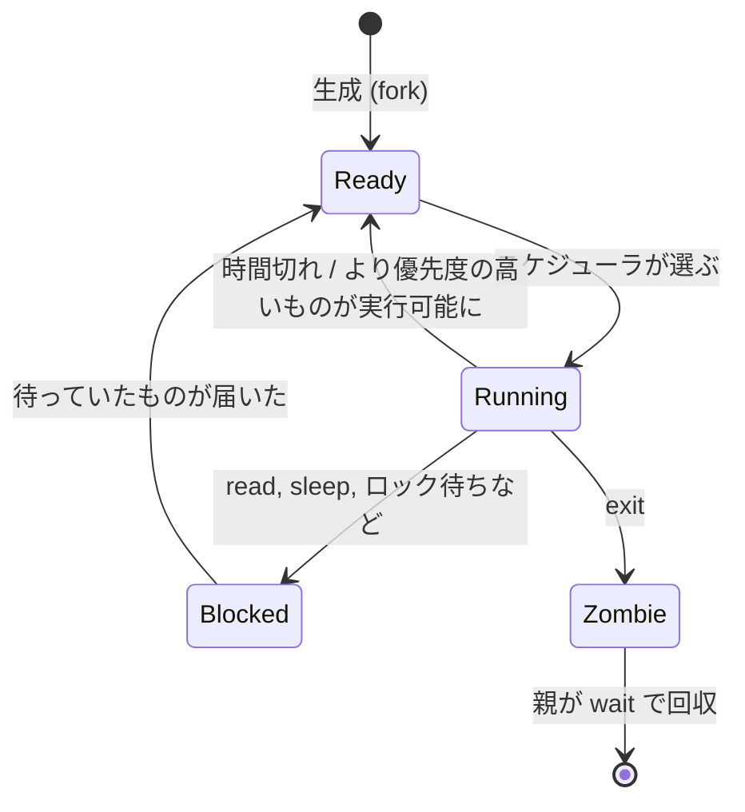
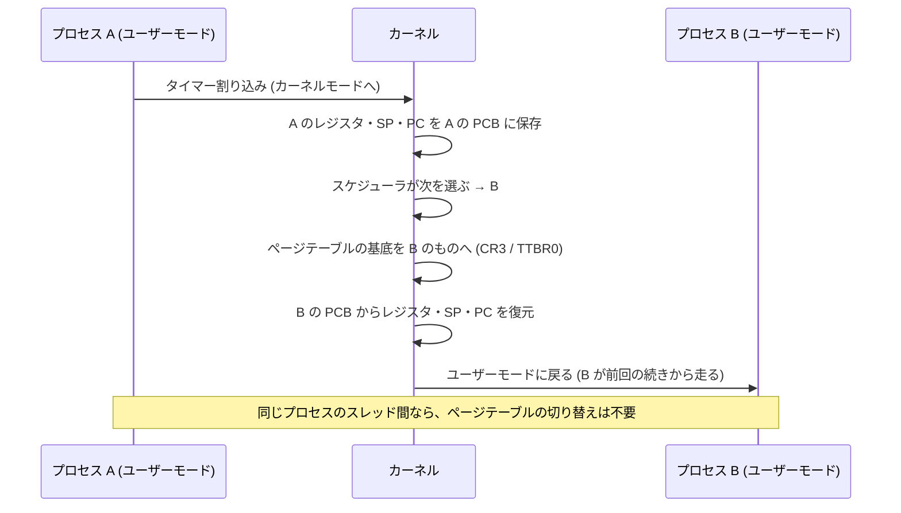
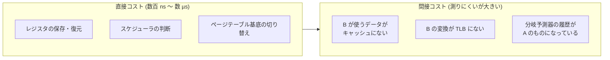

# 図1: プロセスの状態とコンテキストスイッチ

## 1. プロセスの状態遷移

| 遷移 | 原因 | 自発的か |
|---|---|---|
| Running → Ready | タイマー割り込みでクォンタムを使い切った | 強制的(非自発的な切り替え) |
| Running → Blocked | `read` でデータが来ていない、`sleep`、ロック待ち | 自発的な切り替え |
| Blocked → Ready | データ到着、タイマー満了、ロック解放 | (割り込みやほかのプロセスが起こす) |

## 2. コンテキストスイッチの流れ(タイマー割り込みの場合)

## 3. 直接コストと間接コスト

## 4. モードの切り替えとコンテキストスイッチの違い

| | システムコール | コンテキストスイッチ |
|---|---|---|
| 走るプロセス | 同じ | 変わる |
| 変わるもの | CPU の権限(ユーザー ↔ カーネル) | 走る実行の流れそのもの、ページテーブル |
| 測定値(Apple M5) | 約 100 ns | 約 1.4〜2.2 µs(往復の半分。別コアの起床を含む) |
