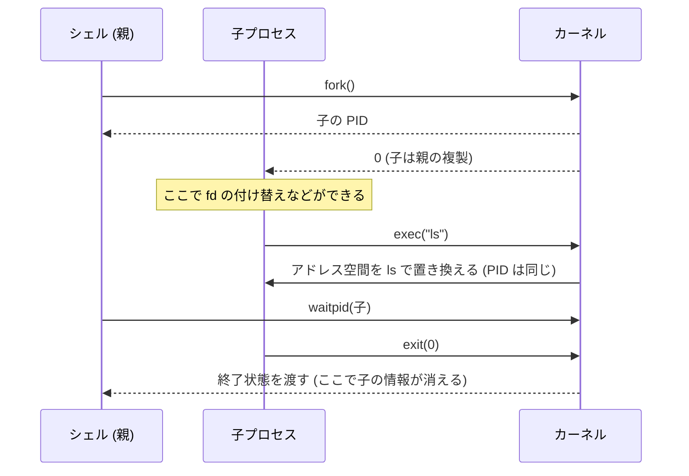
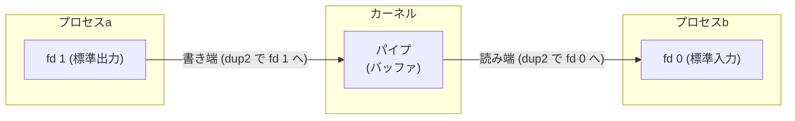
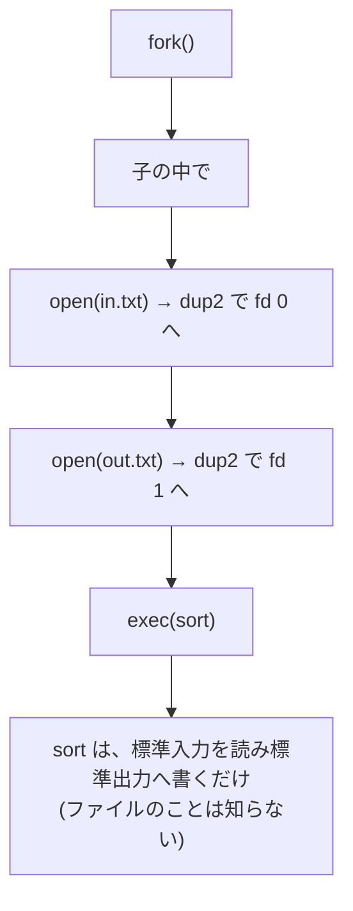
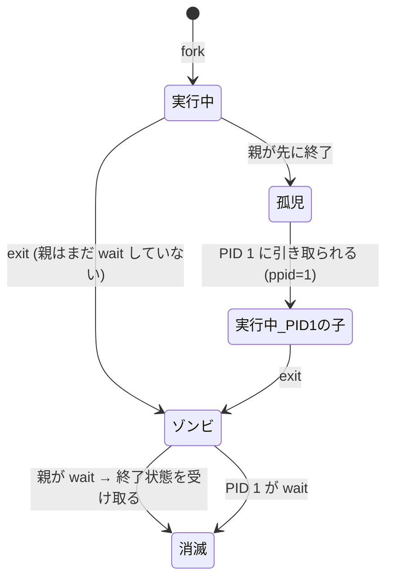

# 図2: fork / exec / wait とパイプ

## 1. シェルが `ls` を実行する流れ



## 2. `a | b` の fd のつながり



手順:

1. `pipe(fds)` → `fds[0]` が読み端、`fds[1]` が書き端。
2. `a` を `fork`。子で `dup2(fds[1], 1)`、パイプの fd を `close`、`exec(a)`。
3. `b` を `fork`。子で `dup2(fds[0], 0)`、パイプの fd を `close`、`exec(b)`。
4. **親は `fds[0]` と `fds[1]` の両方を `close`。**
5. 親は、2つの子を `wait`。

**手順 4 を忘れると**: 親が書き端を持ち続けるので、`b` は EOF を受け取れず、データを待ち続ける。パイプラインが終わらない。

## 3. リダイレクト `sort < in.txt > out.txt`



## 4. ゾンビと孤児



| 状況 | `ps` での見え方 | 問題 |
|---|---|---|
| ゾンビ | STAT が Z、`<defunct>` | PID が占有され続ける。親が `wait` を呼ぶと消える |
| 孤児 | PPID が 1(macOS は launchd) | 通常は問題ない。PID 1 が回収する |
| コンテナの PID 1 が回収しない | Z が溜まる | PID の枯渇。`tini` などの init を使う |

## 5. 演習3の出力(Apple M5)

```
--- 子が終了し、親が wait する前 ---
  PID  PPID STAT COMM
36949 36948 Z    <defunct>
--- waitpid の後 (終了コード = 7) ---
(pid 36949 はもう存在しない)
```

```
孫: 起動直後         ppid=36954
孫: 親が終了した後   ppid=1  (1 = init / launchd に引き取られた)
```
