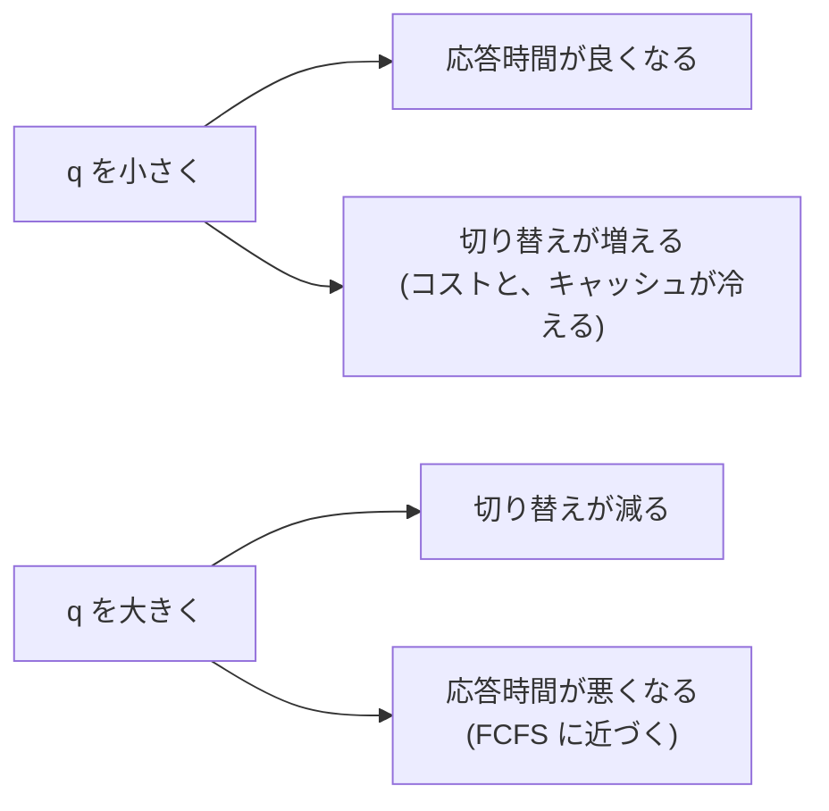
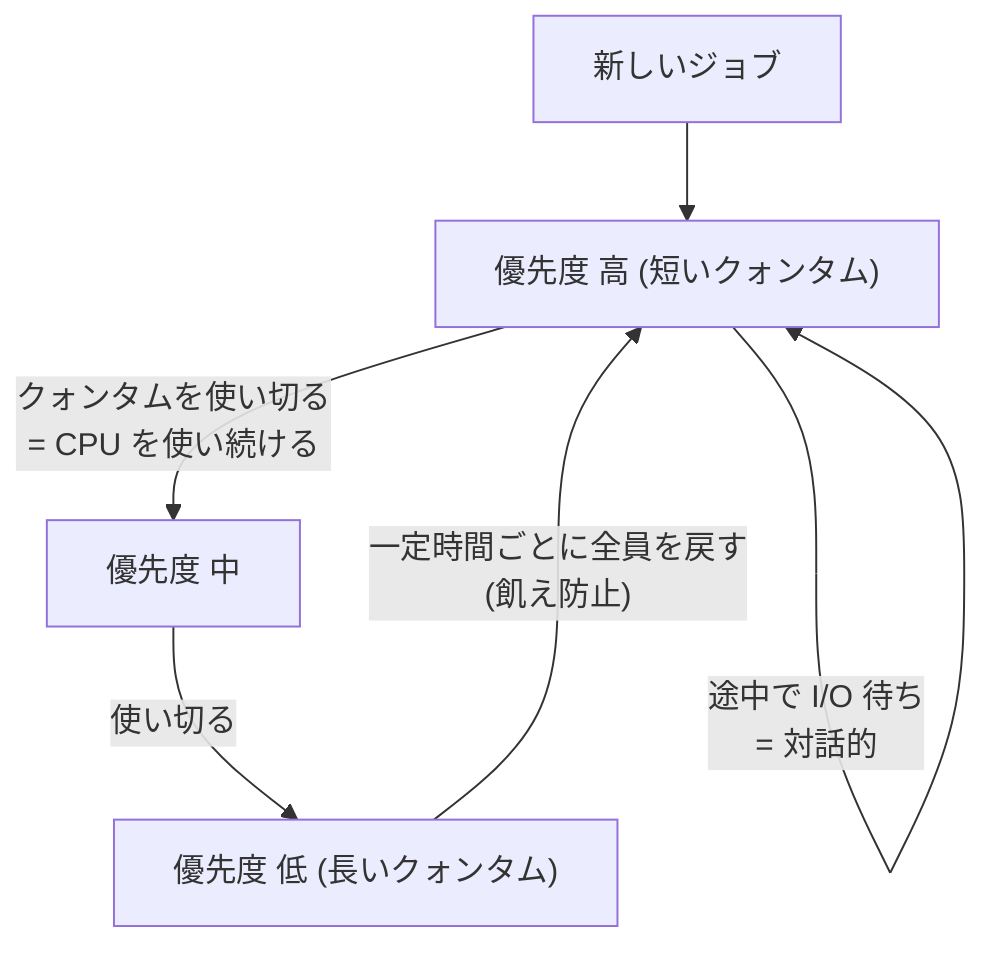
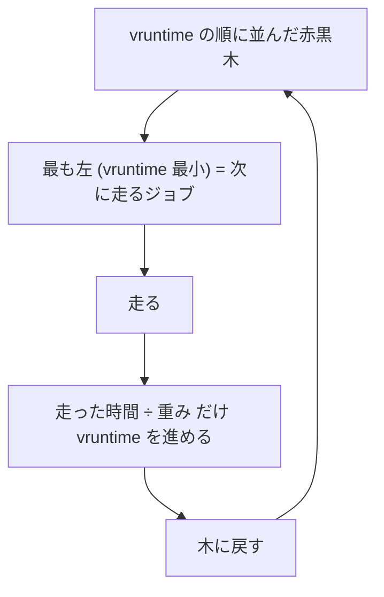
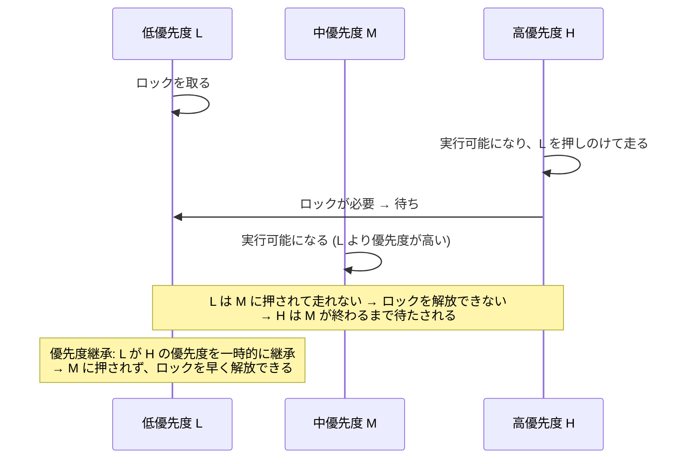

# 図3: スケジューリング方式の比較

## 1. 護送船団効果のタイムライン

ワークロード: L(到着 0、長さ 100)、S1〜S4(到着 1〜4、長さ各 5)。切り替えコスト 0。

各方式が CPU を割り当てた区間(時刻の範囲):

| 方式 | 実行順 |
|---|---|
| FCFS / SJF | L 0〜100 → S1 100〜105 → S2 105〜110 → S3 110〜115 → S4 115〜120 |
| SRTF | L 0〜1 → S1 1〜6 → S2 6〜11 → S3 11〜16 → S4 16〜21 → L 21〜120 |

- FCFS では、短いジョブが L の終了(時刻 100)まで待たされる。
- SRTF では、短いジョブが到着した時点で L を止めて先に走らせるので、短いジョブが次々に終わる。

| 方式 | 平均ターンアラウンド | 平均応答 |
|---|---|---|
| FCFS | 108.0 | 84.0 |
| SJF | 108.0 | 84.0 |
| SRTF | 32.8 | 4.8 |
| RR (q=10) | 40.0 | 12.0 |

SJF が FCFS と同じになるのは、時刻 0 には L しかおらず、L を選んだ後は途中で止めない(非プリエンプティブ)ため。

## 2. ラウンドロビン: クォンタムのトレードオフ

同じ長さ(20)のジョブ5つが同時に到着。

| q | 平均応答 | 平均ターンアラウンド(コスト 1) | 切り替え |
|---|---|---|---|
| 1 | 4.0 | 195.0 | 99 |
| 2 | 6.0 | 143.0 | 49 |
| 5 | 12.0 | 107.0 | 19 |
| 10 | 22.0 | 87.0 | 9 |
| 20 | 42.0 | 62.0 | 4 |

## 3. MLFQ の規則

## 4. CFS / EEVDF の考え方: vruntime

重みの例と、2ジョブが奪い合うときの取り分(演習4):

| nice の組 | 重みの比 | 取り分 |
|---|---|---|
| 0 と 5 | 1024 : 335 | 75.3% : 24.7% |
| 0 と 10 | 1024 : 110 | 90.3% : 9.7% |

- 重みが大きい(優先度が高い)と、vruntime が遅く進み、より長く走れる。
- EEVDF は、これに「仮想的な締め切り」を加えて、短いスライスを要求するジョブの応答を良くした(Linux 6.6 以降)。

## 5. 優先度逆転

