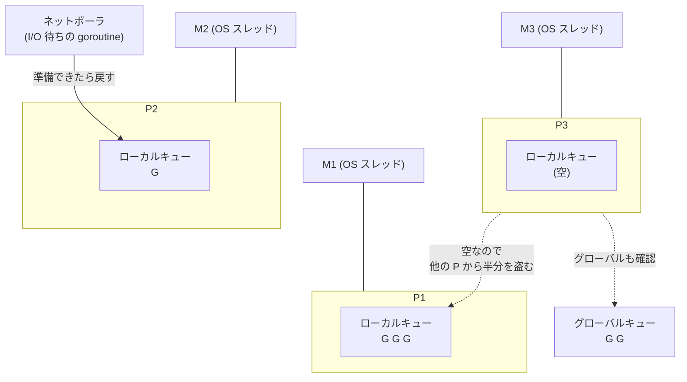
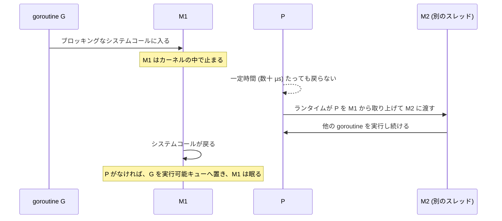
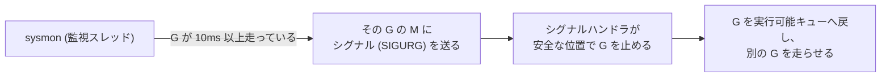

# 図4: Go のスケジューラ (G-M-P)

## 1. 登場人物

| 記号 | 名前 | 意味 |
|---|---|---|
| G | goroutine | 実行したい仕事。スタックは 2 KB から |
| M | machine | OS のスレッド。実際に命令を実行する |
| P | processor | 実行の権利。ローカルの実行可能キューを持つ。数は `GOMAXPROCS` |

**M が G を実行するには、P を持っている必要がある。**

## 2. 全体構造

- 各 P のローカルキューは、ロックなしで素早く扱える。
- 空になった P は、他の P のキューから**半分を盗む**(work stealing)。
- ネットワーク I/O の待ちは、OS のスレッドを占有せず、ネットポーラ(epoll など。第6回)が管理する。

## 3. ブロッキングなシステムコール

## 4. プリエンプション

| Go のバージョン | 方式 | 関数呼び出しのない無限ループ |
|---|---|---|
| 1.13 以前 | 協調的(関数の入り口で確認) | 止められない |
| 1.14 以降 | 非同期(シグナル) | 止められる |

演習6の結果(`GOMAXPROCS(1)`、無限ループの goroutine がいる状態で main が 100 ms 眠る):

- 既定: main は 112 ms 後に再開した。
- `GODEBUG=asyncpreemptoff=1`: 4 秒待っても再開しなかった。

## 5. 切り替えコストの比較(Apple M5)

| 切り替えの種類 | 1回あたり |
|---|---|
| goroutine(同じ OS スレッドの上) | 約 100 ns |
| OS スレッド(同じプロセス) | 約 1.4〜1.7 µs |
| OS プロセス | 約 2.0〜2.2 µs |
| goroutine を専用の OS スレッドに固定(`LockOSThread`) | 約 8 µs |

goroutine の切り替えが速いのは、**カーネルに入らず**、ユーザー空間の中で、レジスタを少し保存して移るだけだからである。
