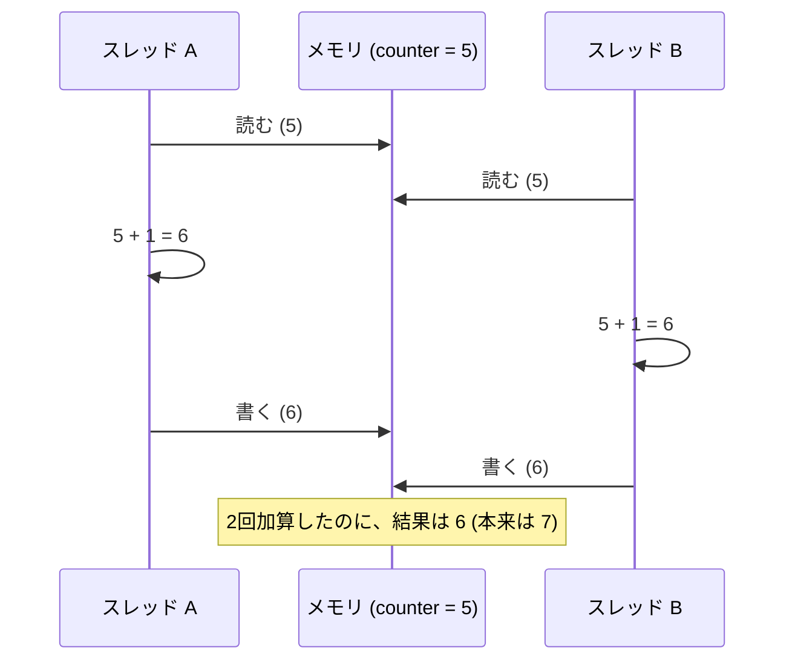

# 第4回 並行性と同期

> ステータス: 執筆済み(第1版)
> 前提: 第1回(キャッシュコヒーレンス、メモリ順序)、第3回(スレッド、コンテキストスイッチ)
> 演習言語: C と Go
> 所要目安: 本文 3時間 + 演習 5〜6時間

## この回のゴール

この回を終えると、次のことが説明できるようになる。

1. `counter++` が、なぜ複数のスレッドから呼ぶと壊れるのか。データ競合と競合状態(race condition)は、どう違うのか。
2. アトミック命令(CAS など)は何を保証し、何を保証しないのか。ロックは、それを使ってどう作られているのか。
3. スピンロック、チケットロック、mutex は、何が違い、どんなときにどれが遅くなるのか。
4. デッドロックが起きる4つの条件と、それぞれを崩す方法。Go のランタイムが検出できるデッドロックと、できないデッドロック。
5. ロックフリーとは何か。常にロックより速いのか。ABA 問題とは何か。
6. Go で、チャネルと mutex をどう使い分けるか。`-race` が見つけるものと、見つけないもの。
7. 「スレッドを増やしたのに遅くなった」ときに、何を疑うか。

第1回では、キャッシュコヒーレンスと、メモリ順序の話をした。第3回では、実行の流れが切り替わる仕組みを見た。この回は、それらが**複数の実行の流れが同じメモリを同時に触る**という場面で、どう効いてくるかを扱う。

---

## 1. 並行と並列、そして、なぜ難しいのか

### 1.1 言葉の整理

| 言葉 | 意味 |
|---|---|
| **並行**(concurrency) | 複数の仕事が、**同時進行している状態を作る**こと(構造の話)。1つのコアでも、時分割で交互に進めれば、並行である |
| **並列**(parallelism) | 複数の仕事を、**実際に同時に実行する**こと(実行の話)。複数のコアが必要 |

並行は「プログラムをどう組み立てるか」、並列は「どう実行するか」である。この回で扱う問題の多くは、並行であれば、並列でなくても起きる。コアが1つでも、プリエンプション(第3回)が、どこにでも切り替えを差し込むからである。

### 1.2 難しさの根っこ

並行プログラムが難しいのは、主に次の3つが重なるからである。

1. **共有された、変更可能な状態**がある。
2. **実行の順序をプログラマが決められない**。スレッドの切り替えのタイミングは、OS とハードウェアが決める。
3. **失敗が再現しにくい**。ほとんどの実行ではうまく動き、まれにだけ壊れる。

3 つ目が特に厄介である。テストを何度通っても、本番で月に1回だけ壊れる、ということが起きる。

---

## 2. データ競合と競合状態

### 2.1 counter++ が壊れる理由

`counter++` は、1つの操作に見えるが、機械語では **3つの手順**である。

1. メモリから、カウンタの値をレジスタに**読む**。
2. レジスタの値に 1 を**足す**。
3. レジスタの値を、メモリに**書き戻す**。

2つのスレッドが、この手順を同時に実行すると、次のように、片方の加算が失われる([図](diagrams/01-lost-update-and-atomics.md))。



これを**更新の喪失**(lost update)と呼ぶ。

### 2.2 実測(演習1)

8 スレッドが、それぞれ 200 万回、保護なしのカウンタを +1 した。正しい合計は 1600 万である。Apple M5 での結果を示す。

| 方式 | 結果(合計) | 失われた数 | 時間 |
|---|---|---|---|
| 保護なし | 2,977,736〜4,032,633 | 約 1200 万〜1300 万(75〜81%) | 0.004〜0.011 秒 |
| mutex | 16,000,000 | 0 | 約 0.20〜0.22 秒 |
| アトミック加算 | 16,000,000 | 0 | 約 0.34〜0.41 秒 |
| スレッドごとのカウンタ | 16,000,000 | 0 | 約 0.003 秒 |

分かること:

- 保護なしは、**4分の3以上の更新が失われた**。しかも、実行のたびに結果が違う。
- mutex とアトミック加算は、正しい結果になるが、保護なしの約 20〜100 倍遅い。
- **スレッドごとに別のカウンタを持つ**と、正しく、しかも最も速い。共有をなくすことが、最も効果的な対策である。
- **アトミック加算が、mutex より遅かった。** 「アトミックはロックより軽い」と思い込みがちだが、競合が激しいと逆転することがある。理由は確認していないが、mutex では、ロックを放したスレッドが、すぐ取り直せることが多く(後述の公平さが低い)、その間、キャッシュラインが動かずに済むためではないかと考えている。

なお、保護なしの版は、C の規格では**データ競合**であり、未定義動作である。ここでは、挙動を見るためだけに使っている。

### 2.3 データ競合と競合状態は別のもの

この2つは、よく混同されるが、別の概念である。

| | データ競合(data race) | 競合状態(race condition) |
|---|---|---|
| 定義 | 2つのスレッドが、**同じ場所**に、同時にアクセスし、**少なくとも片方が書き込み**で、**順序づけがない** | **実行の順序やタイミング**によって、結果の正しさが変わる |
| 判定 | 言語のメモリモデルで、機械的に判定できる | プログラムの意図(仕様)に依存する |
| ツールで検出 | できる(Go の `-race` など) | 一般にはできない |
| 関係 | データ競合がなくても、競合状態はありうる | データ競合は、たいてい競合状態の原因になる |

「データ競合がなければ、競合状態もない」わけではない。この違いが、後の演習6で、はっきり見える。

### 2.4 確認してから行動する(check-then-act)

次のコードは、各メソッドが mutex で守られているため、データ競合はない。

```go
if acct.Balance() >= 100 {   // 確認(ロックして、放す)
    acct.Withdraw(100)       // 引き出し(もう一度ロックする)
}
```

しかし、「確認」と「引き出し」の**間**に、もう1人が割り込めるので、残高が 100 のときに、2人が両方とも確認を通り、**残高がマイナスになる**。これは、データ競合ではなく、**競合状態**である。

演習6で、2 つの goroutine が、2万の口座から 100 を引き出そうとした結果を示す。

| 実行方法 | 残高がマイナスになった口座 |
|---|---|
| 通常の実行(5回) | 0〜4 個 / 20,000 |
| `-race` 付きの実行(3回) | 179〜613 個 / 20,000 |
| 確認と引き出しを、1つのロックの中でやる(修正版) | 0 個 |

分かることが2つある。

1. **race detector は、これを報告しなかった**(`WARNING: DATA RACE` は出ない)。データ競合ではないからである。**`-race` が静かでも、競合状態がないとは限らない。**
2. 通常の実行では、20,000 件中、0〜4 件しか壊れなかった。**まれにしか起きないバグは、見逃されやすい。** `-race` 付きだと、実行が遅くなり、割り込める隙間が広がるため、179〜613 件に増えた。

修正は、「確認」と「引き出し」を、**1つの不可分な操作**にまとめること(`TryWithdraw`)である。**ロックを細かく取るのではなく、不変条件を守る単位でロックを取る**。

---

## 3. アトミック命令

### 3.1 何を保証するか

ロックを作るには、まず、**他のスレッドに割り込まれない操作**が要る。CPU は、そのための命令を提供する。

| 操作 | 意味 |
|---|---|
| **fetch-add** | 値を読んで、足して、書く。この3つが分割されずに行われる |
| **exchange**(test-and-set) | 値を新しいものに入れ替え、古い値を返す |
| **CAS**(compare-and-swap) | 「今の値が期待どおりなら、新しい値に書き換える」。成否が分かる |

CAS を疑似コードで書くと、次のようになる(これ全体が1つの不可分な操作である)。

```
CAS(addr, expected, new):
    if *addr == expected:
        *addr = new
        return true
    else:
        return false
```

実装は CPU で違う。x86-64 は `LOCK` 接頭辞つきの命令(`LOCK XADD`、`LOCK CMPXCHG`)で、キャッシュラインを排他的に保持している間に行う。ARM は、伝統的には **LL/SC**(Load-Linked / Store-Conditional、`LDXR` と `STXR`)で、間に他のコアが書いたら失敗する形で実現する。ARMv8.1 以降は、CAS や fetch-add を直接行う命令(LSE)もある。

### 3.2 アトミックは「順序」を保証しない

アトミック命令が保証するのは、**その1回の操作が分割されない**ことである。**他のメモリ操作との順序**(第1回のメモリモデル)は、別の話である。C や C++ では、アトミック操作に、`relaxed`、`acquire`、`release`、`seq_cst` のどれを使うかを指定する。Go の `sync/atomic` の操作は、**逐次一貫**(最も強い順序)である。

### 3.3 競合するアトミック操作のコスト

アトミック命令は、キャッシュラインを**排他的に**所有する必要がある(第1回のコヒーレンス)。複数のコアが同じ変数に対してアトミック操作を繰り返すと、そのキャッシュラインが、**コア間を往復する**。1回あたりの時間は、ラインの転送の時間で決まり、コアが増えても、全体のスループットは増えない。

---

## 4. ロックの作り方

### 4.1 スピンロック(TAS)

最も単純なロックは、**フラグ1つ**でできる。

```
lock:   while (exchange(&flag, 1) == 1) { /* 空回り */ }
unlock: flag = 0
```

`exchange` が 0 を返せば、自分がロックを取れた。1 を返せば、誰かが持っているので、取れるまで繰り返す。これが**スピンロック**である。

問題は、待っているスレッドが、`exchange`(書き込みを伴う)を繰り返すことである。そのたびに、キャッシュラインの所有権が、待っているコア間を往復する(コヒーレンスの嵐)。

### 4.2 TTAS

改良は、「**読むだけで待ち、空いたように見えたときだけ、書き込む**」ことである。

```
lock:
    loop:
        while (flag == 1) { }                 // 読むだけ。各コアが自分のキャッシュの共有コピーを見る
        if (exchange(&flag, 1) == 0) break    // 空いたら、取りにいく
```

待っている間は、読み取りだけなので、キャッシュラインは共有状態(第1回の S)のまま動かない。ロックが放されたときだけ、無効化が起きる。

### 4.3 チケットロック

TAS や TTAS は、**公平ではない**。待っているスレッドのうち、誰が取れるかは運で、あるスレッドが取れ続けて、別のスレッドが飢えることがある。

**チケットロック**は、銀行の窓口の番号札のように、取った順に処理する。

```
lock:   my = fetch_add(&next_ticket, 1);       // 番号札を取る
        while (now_serving != my) { }           // 自分の番号が呼ばれるまで待つ
unlock: now_serving = my + 1                    // 次の番号を呼ぶ
```

FIFO で、飢えがない。ただし、全員が `now_serving` という同じ変数を見ているため、放されるたびに、全員のキャッシュが無効化される。さらに、**弱点がある**。次に呼ばれる番号のスレッドが、OS に止められて(プリエンプション)いると、その後ろの全員が待たされる。

### 4.4 MCS ロック

待つ人ごとに**別々の場所**で待たせるのが、MCS ロック(Mellor-Crummey & Scott, 1991)である。待ち行列を連結リストで作り、各スレッドは、**自分のノードのフラグ**だけを見て待つ。ロックを放すスレッドが、次の人のノードのフラグを書き換えて起こす。

- 待っている間、各スレッドが見るのは、自分専用のキャッシュライン。**無効化の嵐が起きない**。
- FIFO である。

Linux カーネルのスピンロック(qspinlock)は、MCS ロックをもとにしている。図は [diagrams/02-lock-implementations.md](diagrams/02-lock-implementations.md)。

### 4.5 スピンしない: futex と mutex

スピンロックは、**待っている間、CPU を使い続ける**。ロックの保持時間が長ければ、無駄である。そこで、OS が管理する待ち行列で、待っているスレッドを**眠らせる**。

Linux の **futex**(fast userspace mutex)は、次の方式を提供する。

1. **ロックが空いているとき**: ユーザー空間の、アトミック命令だけで取る。**カーネルは関与しない**(速い)。
2. **ロックが取られているとき**: `futex` システムコールで、スレッドを眠らせる。
3. ロックを放すとき、待っているスレッドがいれば、`futex` で起こす。

多くの言語の mutex(pthread、Go、Java の一部)は、この考え方で作られている。**競合がない通常の場合は、アトミック命令1つのコスト**で済み、競合があるときだけ、OS を呼ぶ。

実装では、すぐに眠らず、**少しの間スピン**してから眠ることが多い。ロックがすぐ空くなら、眠って起こされるコスト(第3回で見た、数 µs)より、スピンのほうが安いからである。

### 4.6 Go の sync.Mutex

Go の `sync.Mutex` は、次のように動く。

1. 速い経路: CAS でロックを取る。
2. 取れなければ、複数コアのとき、少しスピンする。
3. それでも取れなければ、眠る(ランタイムのセマフォで待つ)。
4. **飢えの防止**: 待っているスレッドが、**1 ms 以上**待たされたら、「飢えモード」に入る。このモードでは、ロックを放したスレッドが、**待ち行列の先頭に直接、所有権を渡す**。新しく来たスレッドは、スピンせずに、待ち行列の最後に並ぶ。

通常は、**ロックを放した直後に、新しく来たスレッドが取ってしまう**ことを許す(割り込み、barging)。これは、スループットを上げる(眠っているスレッドを起こす時間を待たなくてよい)が、不公平である。1 ms の待ちを超えたら、公平さを優先する、という切り替えをしている。

### 4.7 演習2: ロックを比べる

4つのロックを、複数のスレッドが 0.5 秒間、取り合う。ロックの中で、共有のカウンタを +1 する。Apple M5(論理 CPU 10)の結果を示す。

| スレッド数 | TAS | TTAS | チケット | pthread mutex |
|---|---|---|---|---|
| 1 | 222 | 238 | 563 | 290 |
| 2 | 20.7 | 10.8 | 9.7 | **138.6** |
| 4 | 21.3 | 7.0 | 8.3 | **105.6** |
| 8 | 4.7 | 6.1 | 6.5 | **78.6** |
| 20(論理 CPU より多い) | 2.3 | 2.7 | **0.11** | 87.4 |

(単位: 全体で 1 秒あたり何百万回ロックを取って放せたか [Mops/s]。すべての結果で、排他は正しく働いていた)

公平さ(最も少ないスレッドの回数 ÷ 最も多いスレッドの回数)は、次のとおり。

| スレッド数 | TAS | TTAS | チケット | pthread mutex |
|---|---|---|---|---|
| 4 | 0.744 | 0.322 | 0.996 | 0.971 |
| 20 | 0.509 | 0.343 | **0.001** | 0.883 |

分かることが4つある。

1. **競合があると、スピンロックは 1 スレッドの時より桁違いに遅くなる**。1 スレッドで 222〜563 Mops/s だったのが、2 スレッドで 10〜20 Mops/s に落ちた。ロックの変数のキャッシュラインが、コア間を往復するコストである(第1回)。
2. **pthread mutex は、競合があっても、スピンロックよりずっと速かった**(2 スレッドで約 7〜14 倍)。この理由は、確認していない。mutex の実装が、スピンと眠りを組み合わせている、ロックを放したスレッドがすぐ取り直せる、などが考えられるが、どれが効いているかは分からない。また、この M5 は性能コアと効率コアが混在しており、スレッドがどのコアに乗ったかが、結果に影響している可能性もある。
3. **チケットロックは、公平さは高い(0.996)が、論理 CPU より多いスレッドでは崩壊した**。20 スレッドで 0.11 Mops/s、公平さは 0.001。次に呼ばれるスレッドが OS に止められていると、その後ろの全員が、空回りしながら待たされるためである(4.3 の弱点)。
4. **TTAS は、公平さが低い**(4 スレッドで 0.322)。取れるスレッドと、取れないスレッドが、偏った。

**まとめ: 普通のアプリケーションでは、スピンロックを自作せず、OS や言語が提供する mutex を使う。** スピンロックが妥当なのは、ロックの保持時間が極めて短く、スレッドがプリエンプションされないことが保証されるとき(カーネルの内部など)に限られる。

---

## 5. ロック以外のプリミティブ

### 5.1 条件変数

「ある条件が成り立つまで、眠って待つ」ための仕組みが、**条件変数**(condition variable)である。

```go
mu.Lock()
for !condition {       // ← if ではなく for
    cond.Wait()        // 眠る間、mu を自動的に放す。起きたら、mu を取り直して戻る
}
// 条件が成り立った状態で、処理する
mu.Unlock()
```

**`if` ではなく `for`(ループ)で条件を確認する**ことが、決まりである。理由は2つ。

1. **偽の起床**(spurious wakeup)が起こりうる。
2. 起こされてから、ロックを取り直すまでの間に、**別のスレッドが条件を壊しうる**。

### 5.2 読み書きロック(RWMutex)

読み取りだけなら、同時に複数のスレッドが入ってよい。書き込みは、1つだけが、読み取りもなしで入る。これが**読み書きロック**である。

注意点が2つある。

- **読み取りロックも、タダではない。** 読み手の数を数える共有カウンタを、アトミックに更新するため、読み手が多いと、そのキャッシュラインが競合する。「読み取りが多いから RWMutex」とは、必ずしも速くならない。
- Go の `RWMutex` は、書き手が待っていると、**新しい読み手を止める**。そのため、読み取りロックを持ったまま、再度、読み取りロックを取る(再入)と、書き手が間に挟まったときに、デッドロックする。

### 5.3 セマフォ、バリア、Once

| 仕組み | 用途 |
|---|---|
| セマフォ | 資源の個数を数える。N 個まで同時に許す。Dijkstra (1965) |
| バリア | 全員が揃うまで待つ |
| Once(Go の `sync.Once`) | ある初期化を、**ちょうど1回**だけ行う |

---

## 6. デッドロック

### 6.1 4つの条件

デッドロックは、**複数のスレッドが、互いに相手の持つ資源を待ち合って、永久に進めなくなる**状態である。Coffman ら(1971)は、起きるための **4 つの必要条件**を示した。**4つがすべて成り立つときだけ**、起きる。

| 条件 | 意味 | 崩す方法 |
|---|---|---|
| 相互排他 | 資源は、同時に1人しか使えない | 共有をやめる、読み取り専用にする |
| 保持と待機 | 資源を持ったまま、別の資源を待つ | 必要な資源を、**一度にまとめて取る** |
| 横取り不可 | 持っている資源を、強制的に奪えない | `TryLock` で取れなければ、持っているものを放して、やり直す |
| **循環待ち** | 待ちの関係が、輪になっている | **ロックを取る順序に、全体で一貫した順番をつける** |

実務で最もよく使うのは、循環待ちを崩す、**ロックの順序づけ**である。

### 6.2 典型例: AB-BA

```
スレッド 1:  Lock(A) → Lock(B)
スレッド 2:  Lock(B) → Lock(A)
```

スレッド 1 が A を、スレッド 2 が B を取った時点で、それぞれ相手の持つ資源を待つ。どちらも進めない。図は [diagrams/03-deadlock-and-ordering.md](diagrams/03-deadlock-and-ordering.md)。

### 6.3 Go ランタイムの検出と、その限界(演習3)

演習3で、AB-BA を Go で書いた。

| モード | 結果 |
|---|---|
| `abba` | `fatal error: all goroutines are asleep - deadlock!` が出て、プログラムが終了した |
| `hidden` | **3 秒待っても終了しなかった**(強制終了した) |
| `ordered`(取る順序をそろえた) | 正常に完了した |
| `trylock` | 正常に完了した(やり直し回数は 1 回と 0 回) |

`abba` と `hidden` は、**まったく同じデッドロック**を作っている。違いは、`hidden` では、別の goroutine が、周期的に眠っては起きているだけ、という点である。

Go ランタイムが検出できるのは、**すべての goroutine が眠っていて、起こしてくれるものがない**場合だけである。**一部の goroutine だけが止まっている**(部分的なデッドロック)場合は、他の goroutine が動いているので、検出されない。サーバーのように、常に何かが動いているプログラムでは、ほとんどのデッドロックが、**検出されないまま、その部分だけが静かに止まる**。

つまり、**Go のランタイムの検出に頼ってはいけない**。デッドロックは、設計(ロックの順序)で防ぎ、運用では、ゴルーチンのダンプやタイムアウトで見つける。

### 6.4 関連する問題

| 問題 | 内容 |
|---|---|
| **ライブロック** | 全員が動いているのに、進まない。例: `TryLock` に失敗して、全員が同時に放して、同時にやり直す。**待ち時間にランダムなばらつきを入れて**、同時のやり直しを避ける(演習3の `trylock`) |
| **飢え** | 特定のスレッドだけが、いつまでも資源を得られない。TTAS の公平さが低かった(演習2)のは、この傾向 |
| **優先度逆転** | 第3回で扱った |

---

## 7. ロックフリー

### 7.1 進捗の保証

ロックを使うと、**ロックを持ったスレッドが止まれば、全員が止まる**(プリエンプション、ページフォルト、障害)。この問題を避ける設計が、**非ブロッキング**(non-blocking)である。保証の強さで、3 段階に分けられる。

| 保証 | 意味 |
|---|---|
| **障害フリー**(obstruction-free) | 他のスレッドが止まっていれば、自分は有限の手数で終わる |
| **ロックフリー**(lock-free) | どのスレッドが止まっても、**システム全体として、必ずどれかの操作が進む** |
| **ウェイトフリー**(wait-free) | **どのスレッドも**、有限の手数で、必ず終わる |

CAS を使った「やり直しのループ」は、ロックフリーだが、ウェイトフリーではない。あるスレッドが、他のスレッドに負け続けて、いつまでもやり直す可能性がある(それでも、誰かは進んでいる)。

### 7.2 Treiber スタック

CAS で作るスタックである(演習4)。`head` ポインタを、CAS で書き換える。

```
Push(v):
    n = new node(v)
    loop:
        old = head
        n.next = old
        if CAS(&head, old, n): return        // head が変わっていなければ成功
        // 他のスレッドが先に変えたので、やり直す

Pop():
    loop:
        old = head
        if old == nil: return empty
        if CAS(&head, old, old.next): return old.value
```

ロックがないので、1つのスレッドが止まっても、他は進む。

### 7.3 ABA 問題

CAS は、「今の値が期待値と**同じ**か」だけを見る。**途中で別の値に変わって、また元に戻っていても、気づけない**。これが **ABA 問題**である。

Treiber スタックで、起きる順序を示す。

1. スレッド 1 が Pop を始める。`old = A`、`old.next = B` を読む。ここで、スレッド 1 が止まる。
2. スレッド 2 が、A を Pop し、B を Pop し、A を(再利用して)Push し直す。スタックは `A → ...`(B は含まれない)。
3. スレッド 1 が再開。`head` はまだ A なので、CAS が**成功**して、`head = B` にしてしまう。しかし、B は既に取り除かれている。**スタックが壊れる**。

対策は、メモリの再利用を安全にすること(後述)、または、値に**バージョン番号**を付けて、CAS の対象に含めること(`(ポインタ, カウンタ)` の組を比べる)である。

**ガベージコレクションのある言語では、事情が違う**。Go では、あるスレッドが `old` への参照を持っている間、そのノードのメモリは再利用されない。そのため、上のような「同じアドレスが、別物として戻ってくる」ことは起きにくい。ただし、自分でノードを再利用すると(`sync.Pool` など)、同じ問題が戻ってくる。

### 7.4 メモリの回収問題

C や C++ では、ロックフリーのデータ構造から取り除いたノードを、**いつ `free` してよいか**が難問である。他のスレッドが、まだそのノードを読んでいるかもしれないからである。

| 方式 | 考え方 |
|---|---|
| **ハザードポインタ**(Michael, 2004) | 各スレッドが「今、読んでいるノード」を公開する。それに載っているノードは、解放しない |
| **エポックベース回収** | 全員が、あるエポック(時期)を通過してから、前のエポックのものを解放する |
| **RCU** | 読み手はロックも CAS も使わない。書き手は、コピーを作って差し替え、**すべての読み手が古い版を読み終える(猶予期間)のを待って**から、古い版を解放する |

**RCU**(Read-Copy-Update、McKenney)は、Linux カーネルで広く使われる。読み手のコストが、ほぼゼロである。経路表など、読み取りが圧倒的に多いデータに向く。

### 7.5 ロックフリーが速いとは限らない(演習4)

Treiber スタックと、mutex で守ったスタックを、同じ条件(どちらもノードを1つずつ確保)で比べた。各 goroutine が、push と pop を交互に行う。Apple M5 の結果を示す(Mops/s)。

| goroutine 数 | ロックフリー | mutex |
|---|---|---|
| 1 | 171.9 | 159.7 |
| 2 | 35.8 | 36.8 |
| 4 | **22.4** | 10.6 |
| 8 | 6.0 | **12.1** |
| 16 | 6.8 | **12.2** |

(正しさの確認は、両方とも、個数と合計が合って通った)

- 4 goroutine では、ロックフリーが約 2 倍速かった。
- **8、16 goroutine では、mutex のほうが約 2 倍速かった。**
- どちらも、goroutine が増えると、**全体の処理量が大きく落ちた**(1 goroutine の 160〜170 から、8 では 6〜12)。

ロックフリーが遅くなる理由は、競合が激しいと、CAS が失敗してやり直すことが増え、**捨てられる仕事**が増えるからだと考えられる(確認はしていない)。mutex は、待つスレッドを眠らせるので、やり直しの空回りが少ない。

**ロックフリーは、「ロックを持ったスレッドが止まっても、全員が止まらない」ための保証であり、スループットを上げる保証ではない。**

---

## 8. Go の並行性

### 8.1 チャネルと CSP

Go は、**CSP**(Communicating Sequential Processes、Hoare 1978)の考え方を、言語に取り入れている。goroutine が、**チャネルでメッセージをやりとりして**協調する。

Go の有名な標語がある。

> メモリを共有して通信するのではなく、通信によってメモリを共有せよ。

共有の変数を、ロックで守るのではなく、**データの所有権を、チャネルで受け渡す**。ある時点で、データを触れるのは1つの goroutine だけなので、競合が起きない。

### 8.2 チャネルと mutex の使い分け

標語は、「常にチャネルを使え」という意味ではない。

| 状況 | 向いているもの |
|---|---|
| データの**所有権を渡す**。処理の**パイプライン** | チャネル |
| 仕事を、複数のワーカーに**配る**、結果を集める | チャネル |
| キャンセル、タイムアウトの通知 | チャネル、`context` |
| 共有の**状態**(キャッシュ、カウンタ、設定)を守る | mutex |
| 単純な、1つの数値の更新 | `sync/atomic` |

チャネルの内部には、mutex がある(送受信のたびにロックを取る)。**チャネルも、無料ではない**。単純なカウンタを、チャネルで守ると、mutex より遅い。

### 8.3 Go のメモリモデル

Go のメモリモデルは、**happens-before**(第1回で見たメモリ順序の、プログラマ向けの言い方)で定義される。次のものが、順序を作る。

- チャネルの**送信**は、対応する**受信が完了する**ことより前に起きる。
- `sync.Mutex` の `Unlock` は、次の `Lock` より前に起きる。
- `sync/atomic` の操作は、逐次一貫である。
- `sync.Once` の初期化は、`Do` の戻りより前に起きる。

**データ競合のあるプログラムの挙動は、保証されない**。第1回の DRF-SC(データ競合がなければ、逐次一貫に見える)が、この土台である。

### 8.4 race detector (`-race`)

`go run -race`、`go test -race` で、実行中に**データ競合**を検出できる。仕組みは、ThreadSanitizer の考え方で、メモリアクセスのたびに、happens-before の関係を記録し、順序づけのない書き込みを見つけると報告する。

演習6で、保護なしの `counter++`(8 goroutine × 100 万回)を実行した。

| 実行方法 | 結果 |
|---|---|
| 通常 | 結果 2,021,136(正しい値は 8,000,000) |
| `-race` | `WARNING: DATA RACE` が出て、競合した読み書きの位置が報告された |

`map` への同時書き込みは、通常の実行でも、`fatal error: concurrent map writes` で、プログラムが落ちた。これは、ランタイムによる(完全ではない)検出である。

使い方の注意:

- **`-race` は、実行された範囲でしか検出できない**。そのパスを通らなければ、見つからない。テストを広く通すことと、併用する。
- 実行時間とメモリが、数倍になる(Go のドキュメントには、時間が 2〜20 倍、メモリが 5〜10 倍の目安がある)。**本番ではなく、テストと CI で使う**。
- **競合状態(2.3、2.4)は見つけられない**。

### 8.5 goroutine のリーク

Go の並行性の典型的なバグは、**goroutine が、永久にブロックされたまま残る**ことである。例えば、チャネルに送ろうとしたが、受け取る側がもういない。goroutine は、メモリ(スタック)を持ち続ける。

対策: `context` でキャンセルを伝える。チャネルは、受け手が止まっても、送り手が詰まらないよう、バッファか `select` で設計する。見つけるには、`runtime.NumGoroutine()` や、pprof の goroutine プロファイル、テストでは `goleak` などを使う。

---

## 9. スケーラビリティ: スレッドを増やすと速くなるか

### 9.1 演習5: 共有カウンタ

全体で 4000 万回の +1 を、goroutine の数を変えて分担した。Apple M5 の結果を示す(Mops/s、全体の処理量)。

| goroutine 数 | mutex | atomic | sharded(goroutine ごと) |
|---|---|---|---|
| 1 | 265〜293 | 600〜612 | 1,059〜3,399 |
| 2 | 43 | 163〜218 | 2,050〜7,230 |
| 4 | 13〜14 | 100〜107 | 3,900前後 |
| 8 | 14 | 24〜46 | 5,400〜6,600 |
| 16 | 14 | 26〜30 | 5,500〜7,000 |

(同じ測定を3回行った結果の範囲。sharded は、ばらつきが大きい。特に 1 goroutine の値は、実行ごとに大きく変わった。原因は確認していない。性能コアと効率コアのどちらで動いたかが影響している可能性がある。)

はっきり読み取れることは、次のとおり。

- **mutex は、goroutine を増やすと、全体の処理量が 20 分の 1 に落ちた**(約 280 から約 14 Mops/s)。**増やしたのに、遅くなった**。
- atomic も、約 600 から約 25〜30 Mops/s へ落ちた。mutex より速いが、同じ傾向である。
- **sharded は、桁違いに速く、goroutine を増やすと伸びた**。共有しないからである。

### 9.2 なぜ、増やすと遅くなるのか

並行処理の性能を説明する、Gunther の**普遍スケーラビリティ法則**(USL)がある。スレッド数 N に対する処理量の目安は、次のとおり。

$$C(N) = \frac{N}{1 + \sigma (N-1) + \kappa N (N-1)}$$

- σ(競合): 直列に実行せざるをえない部分(ロックの待ちなど)。これは、第1回の Amdahl の法則と同じ効果で、頭打ちを作る。
- κ(一貫性): 各スレッドが、**互いにデータを揃えるコスト**(キャッシュコヒーレンスなど)。N の 2 乗で効くので、ある点を超えると、**処理量が減り始める**。

演習5の mutex が、**頭打ちになるのではなく落ちた**のは、κ が効いている典型である。共有のカウンタのキャッシュラインが、コア間を往復するコスト(第1回)が、スレッドが増えるほど重くなる。

### 9.3 対策の順序

1. **共有をなくす**: スレッドごとに別の状態を持ち、最後に集計する(sharded)。Go のランタイムも、P ごとのキャッシュで、これをしている(第3回)。
2. **ロックの保持時間を短くする**: ロックの中で、I/O や重い計算をしない。
3. **ロックを分割する**: 1つの大きなロックを、データの区画ごとのロックに分ける(ロックストライピング)。
4. 読み取りが多ければ、RCU や、コピーオンライト(読み手は古い版を見続ける)を検討する。
5. 最後に、ロックフリー。ただし、**演習4で見たとおり、速くなる保証はない**。

---

## 10. 実際のバグから学ぶ

Lu らの研究(ASPLOS 2008)は、MySQL、Apache、Mozilla、OpenOffice の、実際の並行バグ 105 件を調べた。

- 31 件がデッドロック、74 件がデッドロック以外。
- デッドロック以外のバグの大半(約 97%)は、**原子性の違反**(本来1つの操作であるべきものが、途中で割り込まれる。2.4 の bank の例)か、**順序の違反**(AがBより先に起きるはずが、逆になる)のどちらか。
- 多くの修正は、数行である。見つけることが難しい。

Tu らの研究(ASPLOS 2019)は、Go の実際のバグを調べ、**チャネルなどのメッセージパッシングの誤用による「ブロックしたまま戻らない」バグ**も多いことを報告した。「チャネルを使えば安全」ではない。

これらから分かる設計の教訓:

1. **不変条件を守る範囲で、ロックを取る**。
2. 複数のロックを取るなら、**順序を全体で決める**。
3. 共有する状態を、**できるだけ小さく**する。
4. 並行バグは、再現しにくいので、**ツール(`-race`)と、設計のレビュー**で防ぐ。

---

## 11. 演習の実測結果と、つまずいた点

Apple M5(論理 CPU 10: 性能コア 4 + 効率コア 6)、macOS、Go 1.26.5 での結果。

| 演習 | 内容 | 主な結果 |
|---|---|---|
| 1 | データ競合 | 保護なしで 75〜81% の更新が失われた。mutex とアトミックは正しいが 20〜100 倍遅い。スレッドごとのカウンタが最速 |
| 2 | ロックの比較 | 競合でスピンロックは 1 スレッドの 1/10〜1/60 に。チケットロックは 20 スレッドで 0.11 Mops/s に崩壊。pthread mutex が安定して速い |
| 3 | デッドロック | `abba` は検出、`hidden` は検出されず止まる。順序をそろえる、`TryLock` で回避 |
| 4 | ロックフリースタック | 4 goroutine ではロックフリーが 2 倍速、8 以上では mutex が 2 倍速 |
| 5 | スケーラビリティ | mutex は goroutine を増やすと 1/20 に落ちた。sharded は伸びた |
| 6 | race detector | `-race` はデータ競合を報告し、check-then-act は報告しなかった |

手順と課題は [exercises/README.md](exercises/README.md)。

**測定でつまずいた点**

- 演習1の「スレッドごとのカウンタ」は、最初、時間が **0.000 秒**になった。コンパイラが、ループ全体を「`v += 200 万`」に置き換えて、実質的に計算を消したためである。カウンタに `volatile` を付けて、毎回のメモリ更新を強制した。第1回(分岐予測)、第2回(TLB)と同じく、**測りたい処理が本当に実行されているかを確認する**。
- 演習3の `trylock` は、最初の版で、やり直し回数が **0、0** と出た。ロックを取ってから `TryLock` までの間に時間がなく、2つの goroutine が衝突しなかったためである。間に 50 ms の待ちを入れて、衝突させた。**回避策のデモでは、回避すべき状況が本当に起きているかを確認する**。
- 演習5の `sharded` の値は、実行ごとのばらつきが大きく、特に 1 goroutine で、3 回で 1,059、1,976、3,399 と変わった。原因は確認していない。値の大小は信用せず、「mutex や atomic と、桁が違う」という傾向だけを使っている。
- 演習6の `bank` は、通常の実行で、壊れる件数が 0〜4 と少なく、**まれにしか起きない**。これは、バグの性質そのものである。`-race` 付きだと 179〜613 に増えて見えやすくなるが、race detector 自身は何も報告しない。
- 「アトミック加算が mutex より遅い」「pthread mutex がスピンロックよりずっと速い」といった、**予想と違った結果の原因は、確認できていない**。本文では、考えられる理由を書いたが、どれも推測である。

---

## 12. 博士レベルの論点

答えが定まっていない問い。口頭試問でも議論する。

1. **正しさの定義**: **線形化可能性**(Herlihy & Wing, 1990)は、並行オブジェクトの操作が、呼び出しから応答の間の、ある一点で、瞬間的に起きたように見えることを求める。逐次一貫性との違いは何か。線形化可能性は、なぜ合成できる(部品が線形化可能なら、全体もそうなる)のか。
2. **コンセンサス数**: Herlihy(1991)は、同期の命令の「強さ」を、コンセンサスを解ける最大のスレッド数で分類した。読み書きのレジスタだけでは 1、test-and-set や fetch-add は 2、**CAS は無限**。なぜ CAS で、どんなウェイトフリーなデータ構造でも作れるのか。
3. **トランザクショナルメモリ**: ロックの代わりに、複数のメモリ操作を、トランザクションとして原子的に実行する(Herlihy & Moss, 1993)。ハードウェア支援(Intel TSX)は、セキュリティ上の問題などで、多くの CPU で無効化された。ソフトウェアのトランザクショナルメモリは、なぜ主流にならなかったのか。
4. **メモリモデルと最適化**: コンパイラとハードウェアが、どこまで並べ替えてよいか。データ競合のあるプログラムを、「未定義」にしてよいのか(C/C++ の立場)、「限られた挙動」に制限すべきか(Java の立場)。Go は、その中間である。
5. **検証**: 並行プログラムを、テストで見つけるのは難しい。モデル検査(TLA+ など)、決定的なスケジューリングによるテスト、証明支援系は、どこまで実用的か。
6. **非同期とブロッキング**: スレッドを増やすか、非同期の I/O(第6回の epoll)と、少数のスレッドで足りるか。Go のように、ランタイムが、同期的な見かけのまま、裏で非同期に変える設計は、何を隠しているか。
7. **所有権による静的な保証**: Rust の所有権システムは、データ競合を、コンパイル時に防ぐ。Go のように、実行時の検出に頼る設計と、何が違うか。競合状態(2.4)は、型で防げるか。

---

## 13. 後続の回との接続

| この回の概念 | 再登場する回 | 内容 |
|---|---|---|
| ロック、アトミック、順序 | 第5回 | ファイルシステムのロック、fsync、ジャーナリングの順序 |
| ブロックする、眠る、起こす | 第6回 | epoll、イベントループ、ブロッキングと非同期 |
| チャネル、バックプレッシャー | 第7〜10回 | ネットワークのフロー制御、キューイング |
| goroutine、ロック、GC | 第11回 | Go ランタイム、GC の停止、世界を止める |
| happens-before、線形化可能性 | 第12回 | 分散システムの一貫性、時計 |
| 合意、CAS の一般化 | 第13回 | Paxos、Raft(分散した CAS のようなもの) |
| デッドロック、飢え、スロットリング | 第14〜15回 | 分散ロック、リトライの嵐、SRE |

---

## 14. まとめ

- **データ競合**は、順序づけのない同時アクセス(少なくとも片方が書き込み)で、機械的に判定できる。**競合状態**は、タイミングで結果が変わることで、データ競合がなくても起きる。**`-race` は、前者だけを見つける**。
- `counter++` は、**読む、足す、書く**の3手順で、2つのスレッドが交互に差し込むと、更新が失われる。実測で、75〜81% が失われた。
- **アトミック命令**(CAS など)は、1つの操作が分割されないことを保証し、ロックの土台になる。順序の保証は別である。
- ロックは、**スピン**(TAS、TTAS、チケット、MCS)と、**眠る**(futex、mutex)に分けられる。普通のアプリでは、OS や言語の mutex を使う。**チケットロックは、論理 CPU より多いスレッドで崩壊した**。
- **デッドロック**は、4つの条件がそろったときだけ起きる。**ロックの順序づけ**(循環待ちを崩す)が、実務で最も効く。**Go のランタイムは、全員が眠っている場合しか検出しない**。
- **ロックフリー**は、「誰かが止まっても全員は止まらない」保証で、**速さの保証ではない**。ABA とメモリ回収に注意する。
- スレッドを増やしても速くならない最大の理由は、**共有**である。共有のカウンタは、増やすと**遅くなった**(1/20)。**共有をなくす**のが、最も効く。
- **不変条件を守る単位で、ロックを取る**。ロックを細かく取ると、check-then-act のバグを生む。

次回(第5回)は、プロセスが、データを永続的に残す方法、すなわち**ファイルシステムとストレージ**を扱う。ここまでの、メモリの階層、プロセス、同期の話が、ディスクの上に載ったとき、何が変わるのか。
