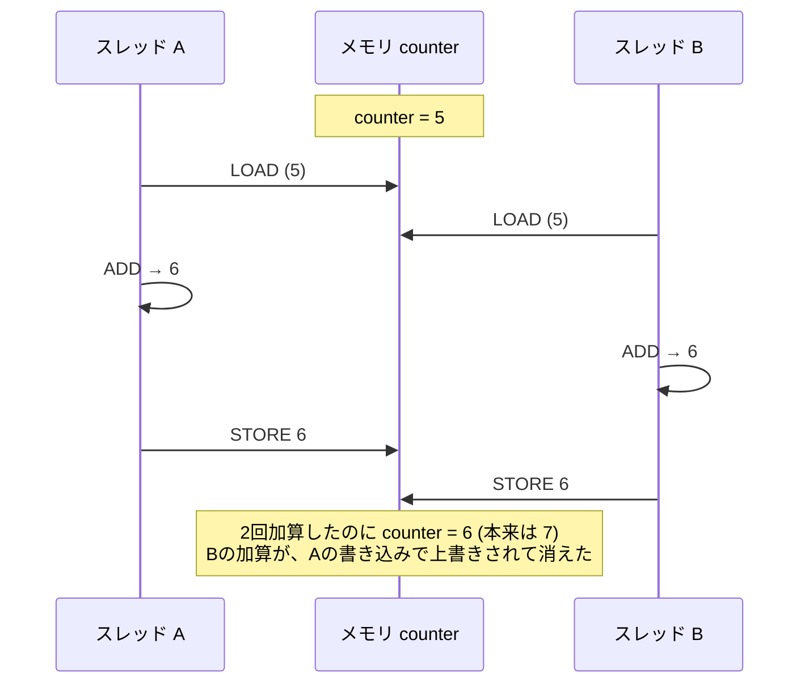
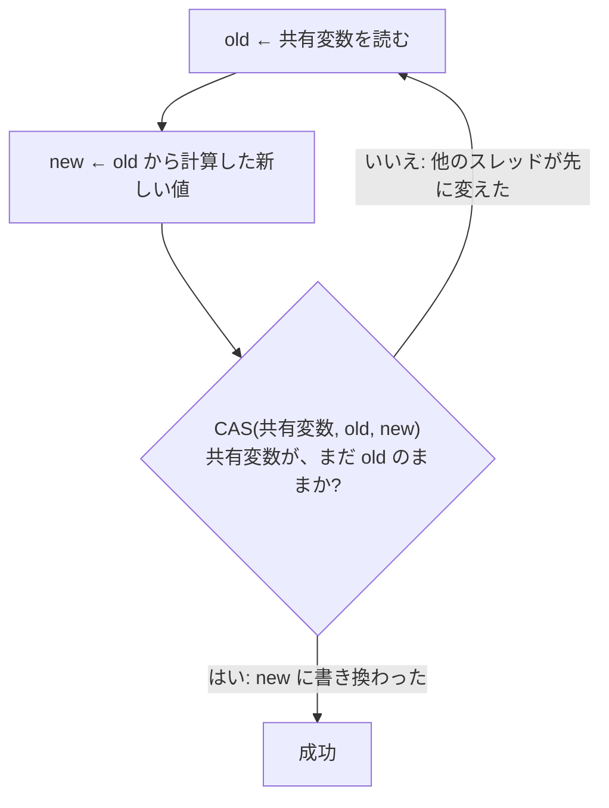
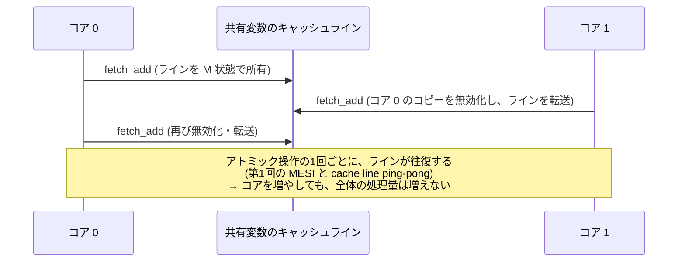
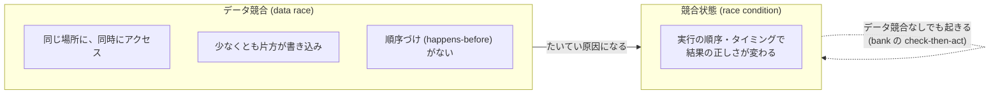
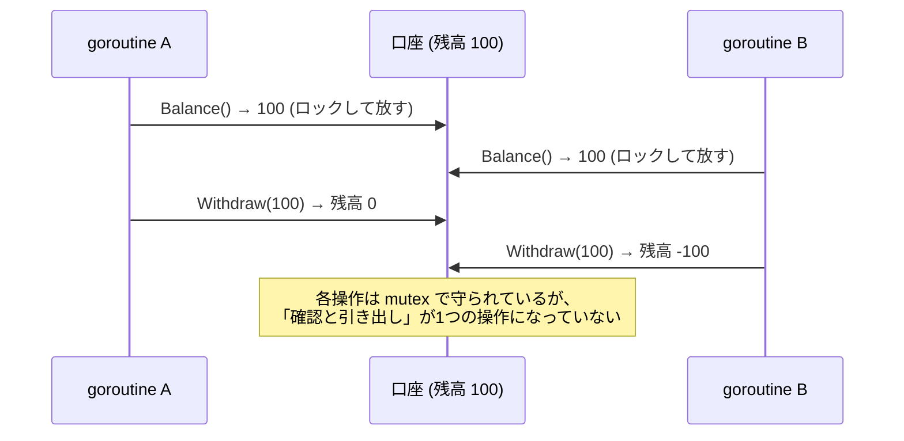

# 図1: 更新の喪失とアトミック命令

## 1. counter++ の3つの手順と、割り込み

```
counter++  は、実際には:
   1. LOAD   r ← [counter]
   2. ADD    r ← r + 1
   3. STORE  [counter] ← r
```



## 2. 実測(演習1: 8 スレッド × 200 万回、正しい合計 1600 万)

| 方式 | 結果 | 失われた割合 |
|---|---|---|
| 保護なし | 約 300 万〜400 万 | 75〜81% |
| mutex | 1600 万 | 0% |
| アトミック加算 | 1600 万 | 0% |
| スレッドごとのカウンタ | 1600 万 | 0% |

## 3. CAS(compare-and-swap)のやり直しループ



- CAS 全体が、**1つの不可分な操作**である。
- 失敗したら、最新の値を読み直して、**やり直す**。これがロックフリーの基本の形(演習4の Treiber スタック)。

## 4. アトミック命令とキャッシュライン



## 5. データ競合と競合状態



| | `-race` で見つかる | 例 |
|---|---|---|
| データ競合 | はい | 保護なしの `counter++` |
| 競合状態(データ競合なし) | **いいえ** | 確認(ロック)→ 引き出し(ロック) の間の割り込み |

## 6. check-then-act (演習6)



修正: 確認と引き出しを、**1つのロックの中**でやる(`TryWithdraw`)。

| 実行 | マイナスの口座 (全 20,000) |
|---|---|
| 通常(5回) | 0〜4 |
| `-race` 付き(3回) | 179〜613 (race detector は何も報告しない) |
| 修正版 | 0 |
