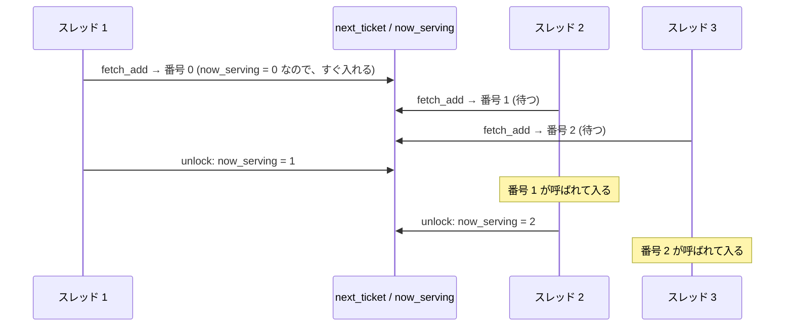
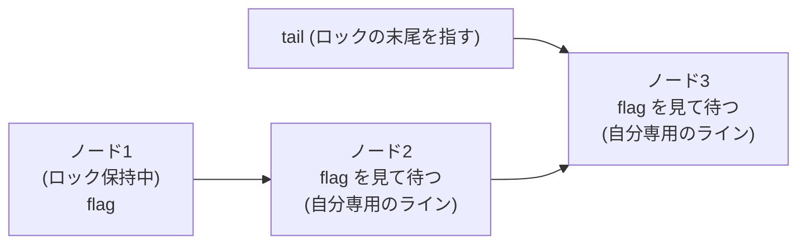
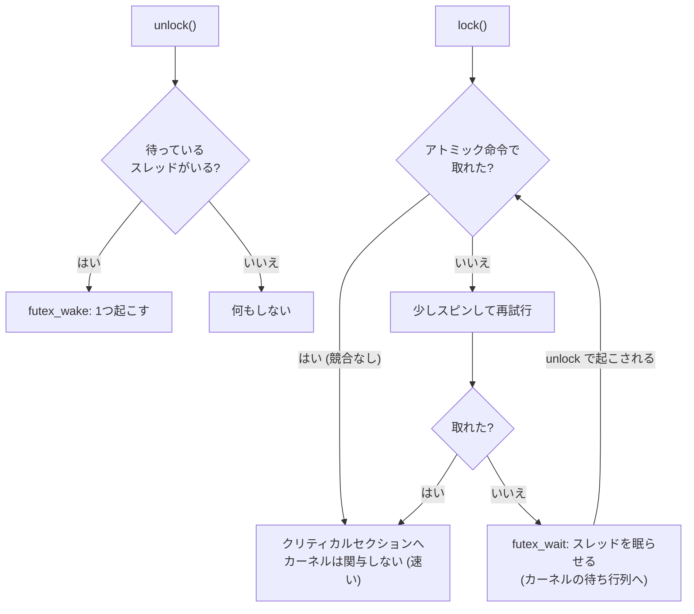
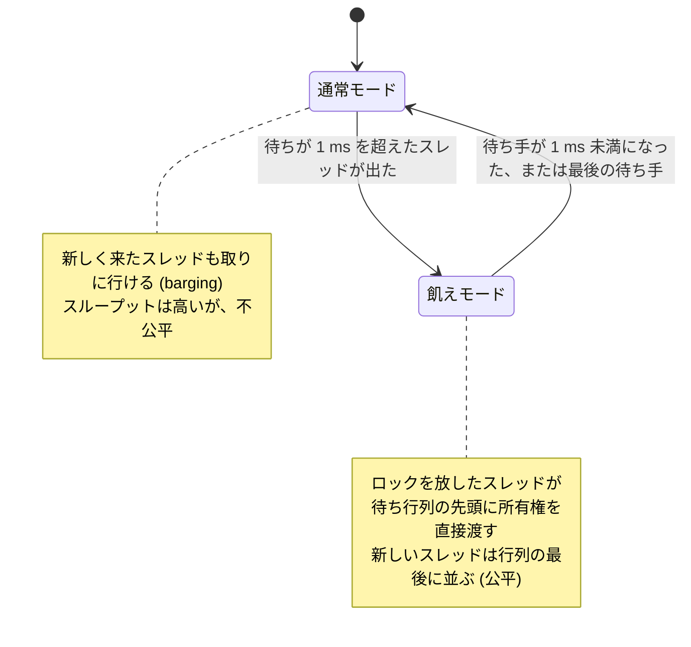

# 図2: ロックの実装

## 1. 4種類のロックの比較

| ロック | 待ち方 | 公平 | 待つ間のキャッシュの動き | 弱点 |
|---|---|---|---|---|
| TAS | `exchange` を繰り返す(書く) | ×(運しだい) | ラインが待ち手の間を往復し続ける | 競合で極端に遅い |
| TTAS | 読むだけで待ち、空いたら `exchange` | ×(偏る) | 待つ間は共有状態で動かない。放された瞬間に全員が殺到 | 偏り、放された瞬間の混雑 |
| チケット | 番号札を取り、`now_serving` を見て待つ | ○(FIFO) | 全員が同じ変数を見るので、放すたび全員が無効化される | **次の番号のスレッドが止まると全員が待つ** |
| MCS | 自分のノードのフラグだけを見て待つ | ○(FIFO) | 各自が専用のライン。無効化の嵐がない | 実装が複雑 |

## 2. チケットロック

**弱点**: 番号 1 のスレッドが OS に止められている(プリエンプション)と、番号 2 以降は、番号 1 が戻って、使って、放すまで、全員が空回りする。演習2の 20 スレッドで、処理量が 0.11 Mops/s に崩壊した。

## 3. MCS ロックの待ち行列

- 各スレッドは、**自分のノードの flag だけ**を見て待つ。
- 放すスレッドが、**次のノードの flag だけ**を書き換える。他のコアのキャッシュは無効化されない。
- Linux カーネルの qspinlock の元になった方式。

## 4. futex ベースの mutex

## 5. Go の sync.Mutex の2つのモード

## 6. 演習2の結果(Mops/s、Apple M5)

| スレッド数 | TAS | TTAS | チケット | pthread mutex |
|---|---|---|---|---|
| 1 | 222 | 238 | 563 | 290 |
| 2 | 20.7 | 10.8 | 9.7 | 138.6 |
| 4 | 21.3 | 7.0 | 8.3 | 105.6 |
| 8 | 4.7 | 6.1 | 6.5 | 78.6 |
| 20 | 2.3 | 2.7 | 0.11 | 87.4 |

公平さ(最少 ÷ 最多)は、20 スレッドで、TAS 0.509、TTAS 0.343、**チケット 0.001**、mutex 0.883。
