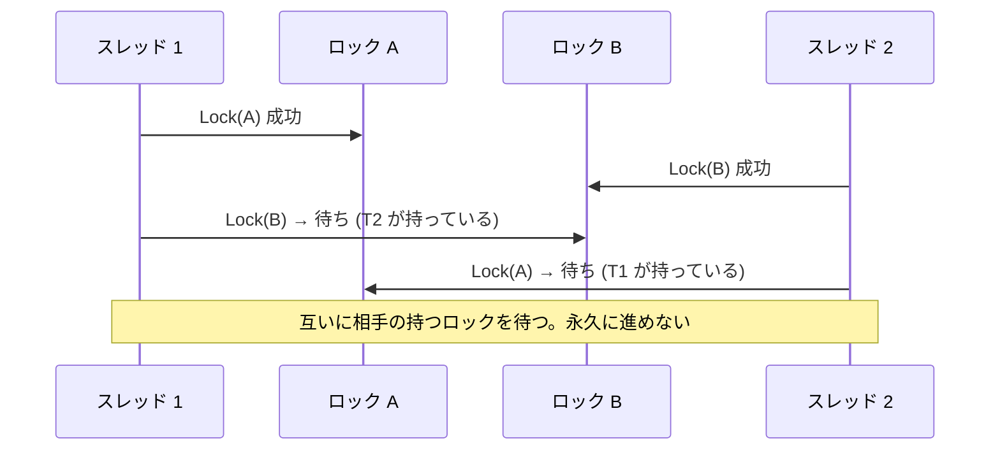
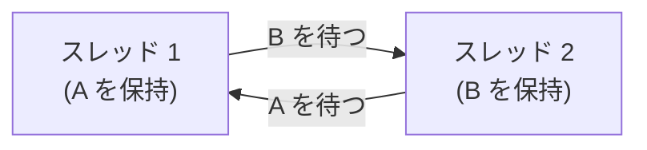
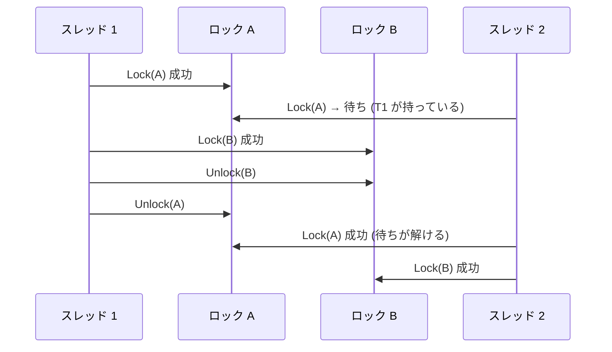
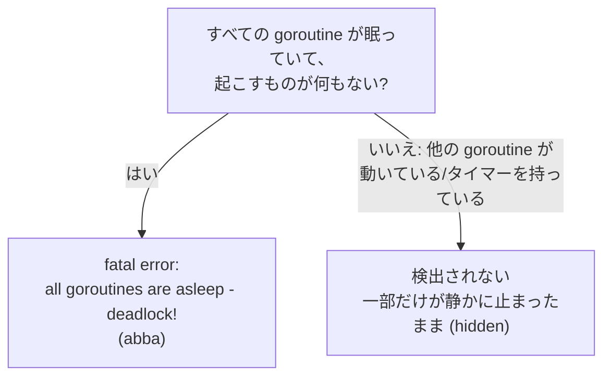
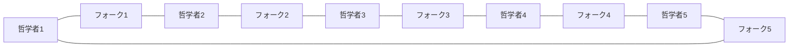

# 図3: デッドロックと、ロックの順序づけ

## 1. AB-BA のデッドロック

## 2. 待ちの関係のグラフ(wait-for graph)

**グラフに輪(閉路)があれば、デッドロック**。データベースは、このグラフを監視して、輪を見つけたら、どれかのトランザクションを中止する。

## 3. 4つの必要条件と、崩す方法

| 条件 | 崩す方法 | 具体例 |
|---|---|---|
| 相互排他 | 共有しない、読み取り専用にする | スレッドごとのデータ、不変のデータ |
| 保持と待機 | 必要なものを**一度にまとめて**取る | 全部取れなければ、1つも取らない |
| 横取り不可 | 取れなければ、持っているものを**放してやり直す** | `TryLock` + バックオフ(演習3 `trylock`) |
| **循環待ち** | **ロックを取る順序に、全体で一貫した順番**をつける | ロックに番号をつけ、常に小さい番号から取る(演習3 `ordered`) |

## 4. ロックの順序づけで、循環を断つ

両方が「A → B」の順で取るので、待ちの関係に輪ができない。

## 5. Go の検出の限界(演習3)

| モード | 結果 |
|---|---|
| `abba` | `fatal error: all goroutines are asleep - deadlock!` で終了 |
| `hidden`(同じデッドロックに、周期的に眠る goroutine を1つ足す) | 3 秒待っても終了しない(検出されない) |
| `ordered` | 正常に完了 |
| `trylock` | 正常に完了(やり直し 1 回と 0 回) |

## 6. 哲学者の食事問題

5人の哲学者が円卓に座り、隣との間にフォークが1本ずつ(計5本)ある。食べるには、左右の2本が要る。

- 全員が**左のフォークを先に取る**と、全員が左を持ったまま、右を待つ。**デッドロック**。
- 解決例: フォークに番号をつけ、**小さい番号から取る**(循環待ちを崩す)。または、同時に座れるのは4人まで(資源の取り合いを減らす)。
- 全員が取れなければ放して、同じタイミングで取り直すと、**ライブロック**になる。待ち時間にばらつきを入れる。

## 7. ライブロックと飢え

| 問題 | 全員が動いているか | 進むか | 例 |
|---|---|---|---|
| デッドロック | いいえ(止まっている) | 進まない | AB-BA |
| ライブロック | **はい**(動いている) | 進まない | `TryLock` に失敗して、全員が同時に放して、同時にやり直す |
| 飢え | 一部は動く | 特定のスレッドだけ進まない | 不公平なロック(TTAS の公平さ 0.322) |
