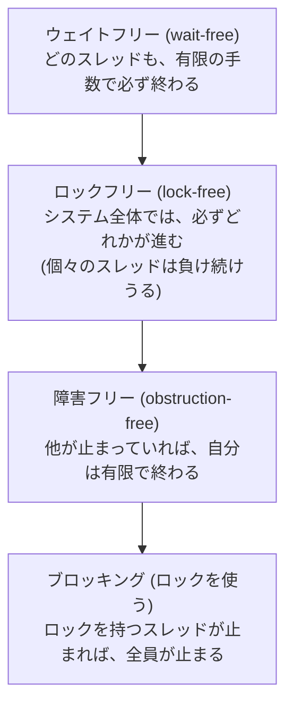
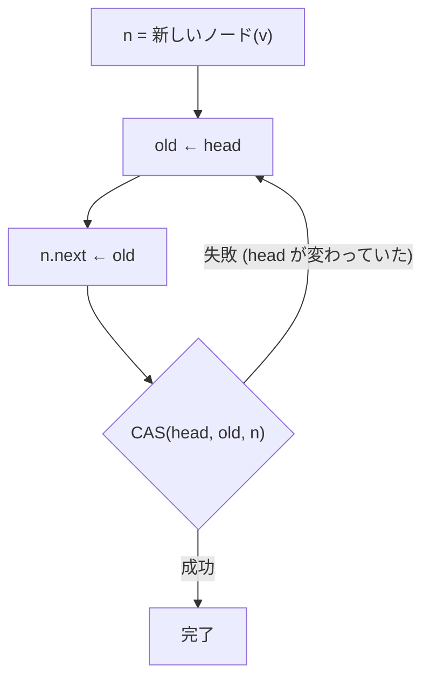
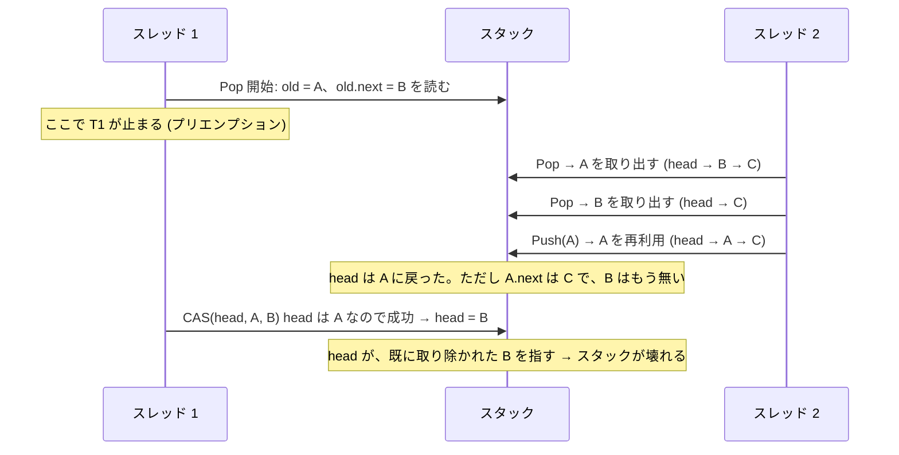
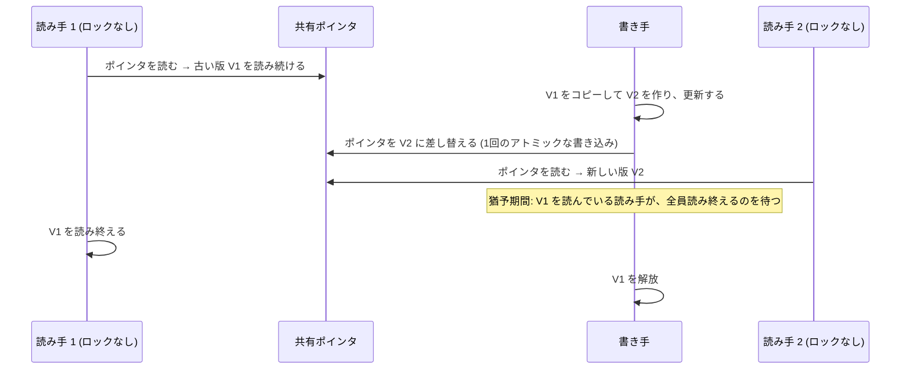

# 図4: ロックフリー、ABA 問題、RCU

## 1. 進捗の保証の強さ

上ほど強い保証。CAS のやり直しループは、**ロックフリー**だが、**ウェイトフリーではない**。

## 2. Treiber スタックの Push

Pop も同様に、`CAS(head, old, old.next)` で行う。

## 3. ABA 問題

スタック: `head → A → B → C`

| 対策 | 内容 |
|---|---|
| バージョン番号つきポインタ | `(ポインタ, カウンタ)` の組を CAS する。A に戻っても、カウンタが違うので失敗する |
| 安全なメモリ回収 | 他のスレッドが参照している間は、ノードを解放・再利用しない(ハザードポインタ、エポック、RCU) |
| GC のある言語 | 参照されている間は再利用されないので、この形の ABA は起きにくい。ただし自前でノードを再利用すると、起きる |

## 4. RCU(Read-Copy-Update)

- 読み手は、**ロックも CAS も使わない**。コストは、ほぼゼロ。
- 書き手は、コピーを作るので重い。
- 読み取りが圧倒的に多いデータ(ルーティング表、設定など)に向く。Linux カーネルで広く使われる。

## 5. ロックフリーとロックの比較(演習4の実測、Apple M5、Mops/s)

| goroutine 数 | ロックフリー | mutex |
|---|---|---|
| 1 | 171.9 | 159.7 |
| 2 | 35.8 | 36.8 |
| 4 | **22.4** | 10.6 |
| 8 | 6.0 | **12.1** |
| 16 | 6.8 | **12.2** |

- 4 goroutine では、ロックフリーが約 2 倍速い。
- 8 以上では、mutex が約 2 倍速い。
- 競合が激しいと、CAS の失敗とやり直しが増えて、捨てられる仕事が増えると考えられる(確認はしていない)。
- **ロックフリーは、進捗の保証であり、速さの保証ではない。**

## 6. 共有をなくす(演習5の実測、Apple M5、Mops/s)

| goroutine 数 | mutex | atomic | goroutine ごとのカウンタ |
|---|---|---|---|
| 1 | 265〜293 | 600〜612 | 1,059〜3,399 |
| 4 | 13〜14 | 100〜107 | 約 3,900 |
| 16 | 14 | 26〜30 | 5,500〜7,000 |

共有のカウンタは、goroutine を増やすと**全体の処理量が下がった**。ロックの種類を変えるより、**共有をなくす**ほうが、桁違いに効く。
