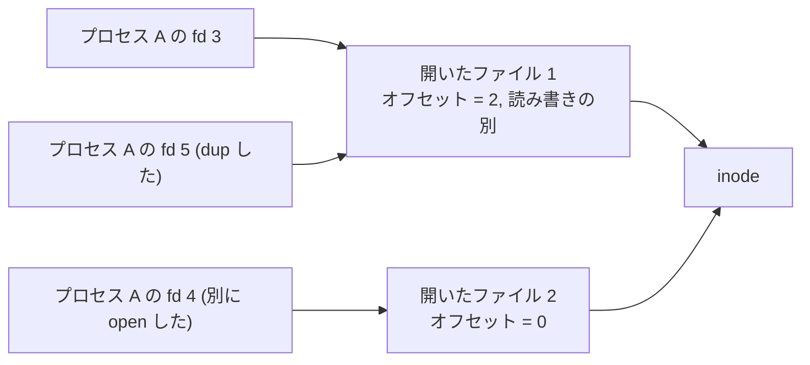
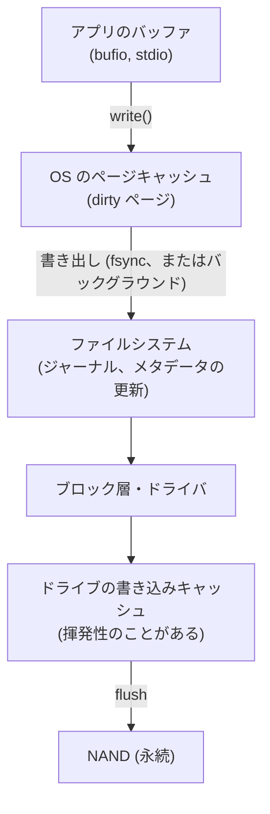
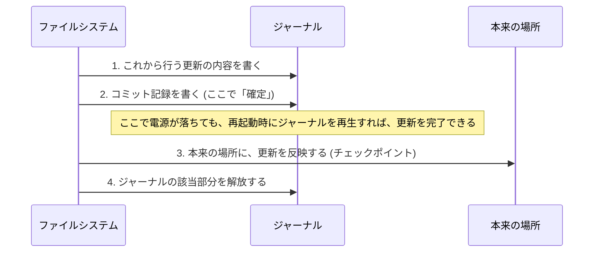
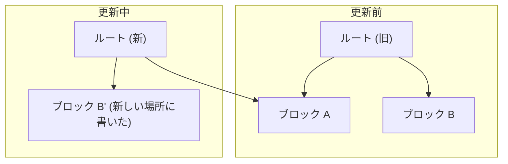
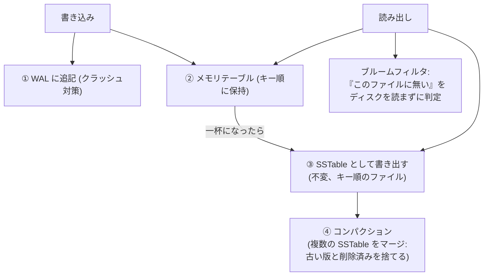

# 第5回 ファイルシステムとストレージ

> ステータス: 執筆済み(第1版)
> 前提: 第1回(メモリ階層、Little の法則)、第2回(ページキャッシュ、mmap、dirty ページ)、第4回(ロック、順序)
> 演習言語: C と Go
> 所要目安: 本文 3時間 + 演習 5〜6時間

## この回のゴール

この回を終えると、次のことが説明できるようになる。

1. SSD の内部では何が起きていて、なぜ「ランダム書き込み」と「並列度」が性能を左右するのか。
2. ファイルの「名前」「中身(inode)」「開いている状態(fd)」は、どう別々のものなのか。ファイルを消しても領域が戻らないことがあるのは、なぜか。
3. `write()` が成功したのに、電源が落ちるとデータが消えるのは、なぜか。`fsync` は何を保証し、何を保証しないのか。
4. 複数のブロックを更新する途中で電源が落ちたとき、ファイルシステムはどうやって壊れずに済むのか(ジャーナリングとコピーオンライト)。
5. 設定ファイルなどを、途中で落ちても壊さずに、安全に置き換える方法。
6. B-tree と LSM-tree は、何が違い、どんなときにどちらが向くのか。

第1回で、メモリの階層を見た。第2回で、ファイルの内容がページキャッシュに載ることを見た。この回では、その階層の**下の端**、すなわち**電源を切っても残るデータ**を扱う。ここまでの「速さ」の話に、「**壊れないこと**」という、新しい軸が加わる。

---

## 1. ストレージの特性

### 1.1 階層の復習

第1回のレイテンシの表を思い出す。

| 操作 | 時間(概数) |
|---|---|
| DRAM 参照 | 80〜100 ns |
| NVMe SSD の 4KB ランダム読み | 20〜100 µs |
| 同一データセンタ内のネットワーク往復 | 100〜500 µs |

DRAM と SSD の間には、約 1000 倍の差がある。そして、SSD は**電源を切っても残る**。この2つの違いが、この回の設計判断のほとんどを決める。

演習5で、この Mac の内蔵 SSD の 4KB ランダム読み込みを測ると、キュー深さ 1 で**平均 63.7 µs**だった。上の表の範囲に入っている。

### 1.2 HDD: 機械が動く

HDD は、回転する円盤と、動く磁気ヘッドでできている。データを読むには、ヘッドを目的のトラックまで動かし(**シーク**、数 ms)、円盤が回って目的の位置が来るのを待つ(**回転待ち**、数 ms)。

- **ランダムアクセスは、1回あたり数 ms**。1 秒間に 100〜200 回程度しかできない。
- **順次アクセスは、ヘッドが動かない**ので、100〜200 MB/s 程度出る。
- 差は**約 100〜1000 倍**。HDD の時代のファイルシステムやデータベースは、ほぼ「ランダムアクセスを避ける」ために設計されている(関連するデータを近くに置く、など)。

### 1.3 SSD: NAND フラッシュ

SSD には、機械部品がない。データは、**NAND フラッシュ**というメモリセルに、電荷として保存される。ただし、NAND には、独特の制約がある。

| 操作 | 単位 | 特徴 |
|---|---|---|
| 読み出し | **ページ**(4〜16KB 程度) | 速い(数十 µs) |
| 書き込み(プログラム) | **ページ** | **空のページにしか書けない**。上書きできない |
| 消去 | **ブロック**(数百ページ、数 MB 程度) | 書き換えるには、まずブロック全体を**消去**する。遅い(ms)。回数に限りがある(種類によるが、数百〜数千回) |

「ページ単位で書く」「ブロック単位で消す」「上書きできない」。この制約に対して、SSD の中の**FTL**(Flash Translation Layer)というファームウェアが、次の工夫をしている。

1. **アウトオブプレース更新**: 論理的に同じ場所を書き換えても、実際には**別の空きページに書き**、論理から物理への対応表(第2回のページテーブルに似ている)を更新する。古いページは「無効」の印を付ける。
2. **ガベージコレクション**: 無効なページが溜まったブロックから、有効なページを別の場所へ**コピー**し、そのブロックを消去して、再利用する。
3. **ウェアレベリング**: 特定のブロックだけが消耗しないよう、書き込みを分散する。
4. **TRIM**: ファイルシステムが「このブロックはもう使っていない」と SSD に伝える。GC が、無駄なコピーをしなくて済む。

図は [diagrams/01-storage-hierarchy-and-ssd.md](diagrams/01-storage-hierarchy-and-ssd.md)。

**デバイス内の書き込み増幅**: GC のコピーのために、利用者が書いた量より多くを、NAND に書くことになる。利用者が 1 GB 書いたのに、NAND には 3 GB 書かれる、ということが起きる。この比を**書き込み増幅**(write amplification)と呼ぶ。ランダムな小さい書き込みほど、増幅が大きくなる。

これは、後の §7 の、LSM-tree が「順次書き込みで SSD に優しい」と言われる理由である。

### 1.4 NVMe と、並列度の効き

NVMe は、SSD のための接続の規格である。古い SATA は、コマンドのキューが 1 本(深さ 32)だったが、NVMe は、**最大 65,535 本のキューを持てる**(各キューは最大 65,536 コマンド)。SSD の内部には、複数の NAND チップがあり、それらは**並列に動ける**。キューに多くの要求を入れるほど、並列に処理される。

演習5で、512 MiB のファイルに対する、ランダム 4KB 読み込みを、**同時に出す要求の数(キュー深さ、QD)**を変えて測った。Apple M5 の内蔵 SSD の結果を示す。

| キュー深さ | IOPS | 平均レイテンシ | p99 レイテンシ |
|---|---|---|---|
| 1 | 15,668 | 63.7 µs | 78 µs |
| 2 | 30,265 | 66.0 µs | 89 µs |
| 4 | 55,683 | 71.7 µs | 105 µs |
| 8 | 88,826 | 89.9 µs | 146 µs |
| 16 | 107,981 | 147.7 µs | 709 µs |
| 32 | 183,161 | 174.0 µs | 318 µs |
| 64 | 199,641 | 316.6 µs | 652 µs |

分かることが4つある。

1. **QD 1 → 8 で、IOPS はほぼ比例して増えた**(15.7k → 88.8k)。レイテンシはほとんど変わらないので、SSD が並列に処理している。
2. **QD 32 以降は頭打ち**(183k → 200k)。デバイスの限界に達し、QD を増やしても、**レイテンシが伸びるだけ**になった(174 µs → 317 µs)。待ち行列に並んでいる時間である。
3. **Little の法則**(第1回)が、そのまま成り立つ。QD = レイテンシ × IOPS。QD 1 では 63.7 µs → 約 15.7k IOPS。QD 64 では 64 ÷ 316.6 µs ≒ 202k IOPS。測定値と合っている。
4. **p99 レイテンシ**は、QD が上がると悪化する(QD 16 では 709 µs)。平均だけを見ていると、見逃す。

**意味すること**: 1回ずつ順番に I/O を出す(同期的な)プログラムは、SSD の能力の 10 分の 1 以下しか使えない。ストレージの性能を引き出すには、**複数の要求を同時に出す**必要がある。これが、第6回の非同期 I/O(io_uring など)の動機である。

なお、順次読み込み(1 MiB ずつ)は **6,204 MB/s** だった。QD 64 のランダム読み込みを MB/s に直すと、約 200k × 4KB ≒ 800 MB/s。**順次のほうが約 8 倍速い**。QD 1 のランダム(約 64 MB/s)と比べると、約 100 倍の差である。

**この測定の注意**: macOS の `F_NOCACHE` でページキャッシュを避けているが、キャッシュを完全に避けられているかは確認していない。SSD 内部のキャッシュの影響も、切り分けていない。

---

## 2. ファイルシステムの抽象

### 2.1 ファイルシステムの仕事

ストレージ(ブロックデバイス)が提供するのは、「番号のついた固定長のブロックの配列」だけである。ブロック N を読め、ブロック N に書け、というだけで、ファイルも名前もない。

ファイルシステムが、その上に次のものを作る。

- **名前のある、可変長のファイル**。
- **ディレクトリの階層**。
- **メタデータ**(サイズ、時刻、権限、所有者)。
- **空き領域の管理**。
- **クラッシュしても壊れない**ための仕組み(§6)。

### 2.2 inode

ファイルの実体を表すのが **inode**(index node)である。inode には、次のものが入っている。

- メタデータ: サイズ、所有者、権限、時刻、**リンク数**
- **データブロックの場所**

**ファイル名は、inode には入っていない。** 名前は、**ディレクトリ**に入っている。ディレクトリは、「名前 → inode 番号」の対応表を、中身として持つ特殊なファイルである。

### 2.3 ハードリンクとシンボリックリンク

この構造から、2種類のリンクが自然に出てくる。

| | ハードリンク | シンボリックリンク |
|---|---|---|
| 実体 | 同じ inode を指す、別の名前 | 「パス名の文字列」を中身に持つ、**別のファイル** |
| inode | 同じ | 別 |
| 元の名前を消すと | もう1つの名前で、中身は残る | 参照先が無くなり、リンクが切れる |
| ファイルシステムをまたげるか | いいえ(inode 番号は、そのファイルシステム内のみ) | はい |

演習1で確認した(macOS、APFS)。

| 操作 | inode | リンク数 | サイズ |
|---|---|---|---|
| `a.txt` を作った | 12362757 | 1 | 6 |
| `b.txt` を、`a.txt` のハードリンクにした | **12362757(同じ)** | **2** | 6 |
| `s.txt` を、`a.txt` へのシンボリックリンクにした | **12362760(別)** | 1 | **65** |
| `a.txt` を `unlink` | 12362757 | 1 | 6 |

シンボリックリンクのサイズ 65 は、中身である**パス名の文字列の長さ**である。`a.txt` を消した後、`b.txt` は問題なく読めた。`s.txt` を開こうとすると `No such file or directory` になった。

### 2.4 「消す」とは何か

`unlink` は、**ディレクトリから名前を取り除き、inode のリンク数を 1 減らす**操作である。ファイルの中身を消す命令ではない。

**inode の領域が解放されるのは、リンク数が 0 になり、かつ、誰もそのファイルを開いていないとき**である。

演習1で、ファイルを開いたまま `unlink` した。`fstat` を見ると、**リンク数は 0**だが、`pread` で**中身は読めた**。`close` した時点で、初めて領域が解放される。

これは、実務で次の問題を起こす。

> ログファイルを `rm` で消したのに、`df` の使用量が減らない。

プロセスがそのファイルを開いたままだと、領域は解放されない。Linux では `lsof +L1`(リンク数が 1 未満で、開かれているファイルを表示)で見つかる。対策は、プロセスにファイルを閉じさせる(ログローテーションの通知、再起動)ことである。

### 2.5 fd、開いたファイル、inode

プログラムが `open` で得る fd(ファイルディスクリプタ)は、小さな整数にすぎない。その後ろに、2つの層がある。

| 層 | 持っているもの | 共有のされ方 |
|---|---|---|
| fd | 整数(プロセスごとの表の添字) | プロセスごと |
| 開いたファイル | **読み書きの位置(オフセット)**、開いたときのフラグ | `dup` と `fork` で共有される |
| inode | ファイルの実体 | 同じファイルなら、全員で共有 |

演習1で、10 バイトのファイルを開いた。`fd1` で2バイト読んだ後の位置は、次のとおりだった。

| fd | 位置 | 理由 |
|---|---|---|
| fd1 | 2 | 読んだ |
| fd2(同じファイルを別に `open`) | 0 | 別の「開いたファイル」なので、位置も別 |
| fd3(`fd1` を `dup`) | 2 | 同じ「開いたファイル」を指すので、位置を共有 |

第3回の `fork` で、親子が標準出力のオフセットを共有する理由も、これである。

図は [diagrams/02-vfs-inode-fd.md](diagrams/02-vfs-inode-fd.md)。

### 2.6 VFS

OS には、複数の種類のファイルシステムが共存する(ext4、XFS、btrfs、APFS、NTFS、ネットワークの NFS、`/proc` のような仮想のものなど)。アプリケーションが、どれに対しても `open`、`read`、`write` で使えるのは、OS が **VFS**(仮想ファイルシステム)という共通の層を持つからである。各ファイルシステムは、VFS が定める操作の集まり(読む、書く、ディレクトリを引く、など)を実装する。

---

## 3. ディスク上のレイアウト

### 3.1 基本の構成

古典的なファイルシステム(Unix の FFS や ext2 など)は、ディスクを次のように区切る。

| 領域 | 内容 |
|---|---|
| スーパーブロック | ファイルシステム全体の情報(ブロックサイズ、inode の数、など) |
| 空き管理(ビットマップ) | どの inode、どのブロックが使われているか |
| inode テーブル | 全 inode の配列 |
| データブロック | ファイルの中身 |

ブロックサイズは、通常 4KB である。**ファイルは、ブロックの整数倍の領域を使う**。演習1で、6 バイトのファイルの使用ブロックは **4096 バイト**だった。小さなファイルを大量に作ると、領域の大部分が無駄になる(**内部断片化**、第2回と同じ問題)。

### 3.2 inode からデータブロックを指す方法

ファイルの大きさは様々なので、inode から、データブロックを効率よく指す必要がある。

**ポインタ方式**(ext2、ext3): inode の中に、直接のポインタが 12 個、**間接ブロック**へのポインタが 3 個(1段、2段、3段)ある。ブロックサイズ 4KB、ポインタ 4 バイトとして計算する。

| 方式 | 指せるブロック数 | 指せるサイズ |
|---|---|---|
| 直接ポインタ 12 個 | 12 | 48 KB |
| 1段の間接(4KB ÷ 4B = 1024 個) | 1,024 | 4 MB |
| 2段の間接(1024 × 1024) | 約 100 万 | 4 GB |
| 3段の間接 | 約 10 億 | 4 TB |

小さいファイルは、直接ポインタで済んで速い。大きなファイルは、間接ブロックを何段か読む必要があり、ブロックごとのポインタが多くなる。

**エクステント方式**(ext4、XFS、APFS など): 「ブロック N から、連続して M 個」という**範囲**を、1つの項目で表す。大きな連続したファイルは、数個のエクステントで表せる。ポインタ方式より小さく、速い。

### 3.3 ディレクトリ

ディレクトリは、「名前 → inode 番号」の表を中身とするファイルである。単純には線形のリストだが、エントリが数万を超えると、検索が遅い。ext4 は、**H-tree**(ハッシュ化された木)を使う。

### 3.4 割り当ての工夫

ファイルのデータが、ディスク上でバラバラに散らばると、HDD ではシークが増え、SSD でも、ファイルが細切れになるため効率が悪い。そこで:

- **関連するものを近くに置く**: FFS の「シリンダグループ」(同じディレクトリのファイルと inode を近くに置く)。
- **遅延割り当て**(delayed allocation): ext4 や XFS は、`write` された時点ではブロックを決めず、ページキャッシュに溜めておき、書き出すときに、**まとめて連続した領域を割り当てる**。大きなファイルが、連続した領域に置かれやすい。

### 3.5 スパースファイル

ファイルの途中に、書かれていない領域(穴)があってもよい。穴の部分には、ブロックを割り当てず、読めばゼロが返る。

演習1で、1 GiB の位置に 1 バイトだけ書いた。

| 項目 | 値 |
|---|---|
| ファイルサイズ(`st_size`) | 1,073,741,825 バイト(1 GiB + 1) |
| 実際に使っているブロック | **4,096 バイト** |

ファイルのサイズと、実際に使っている領域は、**別の量**である。`ls -l` のサイズと `du` の値が食い違うのは、このためである。仮想マシンのディスクイメージなどが、スパースファイルとして保存されることも多い。

---

## 4. ページキャッシュと、書き込みの流れ

### 4.1 読み込み

第2回で見たとおり、OS はファイルの内容を**ページキャッシュ**に載せる。2回目以降の読み込みは、メモリから返る。OS は、順次の読み込みを検出すると、先読み(**readahead**)する。

### 4.2 書き込み

`write()` は、**ページキャッシュのページに内容を書き込み、そのページに dirty の印を付けて、すぐ返る**。ディスクへの書き出しは、OS が**後で**(カーネルのバックグラウンドスレッドが)行う。

Linux では、既定でおおよそ、dirty のまま 30 秒を超えたページや、dirty のページの量が一定の割合を超えたときに、書き出しが始まる(設定で変えられる)。つまり、**`write()` が成功した直後に電源が落ちると、そのデータは失われる**。

演習2で、4KB を `write()` するだけ(同期なし)の時間を測った。**平均 3.7 µs**。ストレージに書いていないので、メモリのコピーとほぼ同じ速さである。

### 4.3 層の全体像

アプリが書いたデータは、いくつもの層を通る。

**どの層まで届けば、電源断で消えないのか**が、§5 の主題である。

### 4.4 キャッシュを迂回する

データベースは、自分でデータをキャッシュする(バッファプール)。OS のページキャッシュと二重になるので、これを避けたい。**ダイレクト I/O**(Linux の `O_DIRECT`、macOS の `F_NOCACHE`)は、ページキャッシュを通さずに、直接ストレージとやりとりする。代わりに、アプリがキャッシュの管理(何を載せるか、いつ書くか)を、すべて引き受ける。

---

## 5. 永続化: fsync と、その落とし穴

### 5.1 同期の種類

`write()` が返っても、データはまだ永続化されていない。永続化を要求する方法が複数ある。

| 呼び出し | 意味 |
|---|---|
| `fsync(fd)` | そのファイルの dirty なデータとメタデータを、ストレージへ書き出すよう要求し、完了を待つ |
| `fdatasync(fd)` | データと、読み出しに必要なメタデータだけ(更新時刻などは省く)。`fsync` より軽い |
| `O_SYNC` / `O_DSYNC`(open のフラグ) | `write` のたびに、`fsync` / `fdatasync` 相当を行う |
| `sync()` | システム全体の dirty を書き出す |
| macOS の `fcntl(fd, F_FULLFSYNC)` | **ドライブの書き込みキャッシュまで、強制的に流す** |

### 5.2 実測: 同期のコスト(演習2)

4KB を追記して、同期の方法ごとに、1回あたりの時間を測った。Apple M5 の内蔵 SSD(APFS)の結果である。

| 方式 | 件数 | 平均 | p50 | p99 | 1秒あたり |
|---|---|---|---|---|---|
| A. `write` のみ | 100,000 | 3.7 µs | 3.0 µs | 22 µs | 268,687 回 |
| B. `write` + `fsync` | 1,000 | 33.0 µs | 26 µs | 216 µs | 30,298 回 |
| C. `write` + `F_FULLFSYNC` | 300 | **3,748 µs** | 3,971 µs | 4,295 µs | **267 回** |
| D. 100,000 回 `write` して、最後に1回 `F_FULLFSYNC` | 100,000 | 3.1 µs/回 + 最後の同期 4.4 ms | | | |

分かることが4つある。

1. **`write` のみ → `fsync`: 約 9 倍**(3.7 µs → 33 µs)。
2. **`fsync` → `F_FULLFSYNC`: 約 114 倍**(33 µs → 3,748 µs)。macOS の `fsync` は、ドライブのキャッシュまでは流さないため、速く返る。`F_FULLFSYNC` は、実際の永続化を待つので、**ミリ秒単位**かかる。
3. **同期のたびに待つ方式は、1 秒に約 270 回**しかできない(C)。永続化を伴うトランザクションの上限が、ここで決まる。
4. **まとめて書いて、最後に1回だけ同期する**(D)と、1回あたり 3.1 µs で済む。これが **group commit**(複数の書き込みを、1回の同期でまとめて永続化する)の考え方で、データベースが、トランザクションをまとめて WAL に書く理由である。

**注意**: この結果は macOS のものである。Linux の `fsync` は、通常のマウント設定では、ドライブのキャッシュの flush まで要求するので、macOS の `fsync` より、ずっと遅くなると予想される。ただし、Linux では測っていない。

### 5.3 fsync の落とし穴

**1. ファイルの `fsync` では、ディレクトリのエントリは永続化されない場合がある。** ファイルを新しく作った、あるいは `rename` したとき、「その名前がディレクトリに載っている」という情報は、ディレクトリ側に書かれる。ファイルを `fsync` しても、**親ディレクトリの更新は、永続化されるとは限らない**。ファイルを作ったら、**親ディレクトリも `fsync` する**。

**2. `fsync` のエラーを、握りつぶしてはいけない。** Linux では、書き出しに失敗したとき、そのページが「書き出し済み」の扱いに変わり、エラーは**一度しか報告されない**ことがある。リトライして `fsync` が成功しても、データは書かれていない。2018 年に、PostgreSQL がこの挙動で、データを失う可能性があることが分かった(通称 fsyncgate)。`fsync` が失敗したら、**そのファイルのデータを信頼せず**、致命的なエラーとして扱うのが安全である。

**3. ドライブが嘘をつくことがある。** 一部のドライブ(特に電源損失保護のない消費者向けの SSD)は、書き込みキャッシュの内容が、まだ NAND に書かれていないのに、「書いた」と応答する。電源損失保護(コンデンサ)を持つエンタープライズ向けのドライブは、キャッシュの内容を、電源が切れても書き終えられる。

---

## 6. クラッシュ一貫性

### 6.1 問題

ファイルに1ブロック追記するだけでも、ファイルシステムは、**複数の場所を更新する**必要がある。

1. データブロックに、内容を書く。
2. inode を更新する(サイズ、ブロックへのポインタ)。
3. 空きビットマップを更新する(そのブロックを使用中にする)。

この3つは、別々のディスク上の場所なので、**1つずつ書かれる**。途中で電源が落ちると、中途半端な状態が残る。

| どこまで書けたか | 結果 |
|---|---|
| データだけ | 何も起きていないのと同じ(データは見えない)。ブロックが無駄になる程度 |
| inode だけ | inode が、まだ書かれていないブロックを指す → **ゴミが読める**(以前の別ファイルの内容が見えることもある) |
| ビットマップだけ | 使っていないブロックが、使用中の扱いに → **領域のリーク** |
| inode + ビットマップ(データなし) | ゴミが読める |
| データ + ビットマップ(inode なし) | データが、どのファイルにも属さない |

### 6.2 古い解: fsck

起動時に、ファイルシステム全体を走査して、不整合を見つけて直す(**fsck**)。仕組みは単純だが、**ディスクが大きいと、起動に何時間もかかる**。また、「ゴミが読める」といった問題は、直せない。

### 6.3 ジャーナリング

**ジャーナリング**は、データベースの **WAL**(Write-Ahead Logging)の考え方を、ファイルシステムに持ち込んだものである。更新を、本来の場所に書く**前**に、ジャーナル(ログ)に書く。

- **コミット記録が書かれる前**に落ちたら: 更新は無かったことにする。
- **コミット記録が書かれた後**に落ちたら: 再起動時に、ジャーナルを再生して、更新を完了する。

回復に必要なのは、ジャーナルの再生だけで、ディスク全体の走査は不要である。起動が速い。

ext4 には、ジャーナルに何を書くかで、3つのモードがある。

| モード | ジャーナルに書くもの | 安全性 | 性能 |
|---|---|---|---|
| `journal` | メタデータとデータの両方 | 最も安全 | データを2回書くので、遅い |
| **`ordered`**(既定) | メタデータのみ。**データは、メタデータのコミットより前に、本来の場所へ書く** | 「ゴミが読める」を防ぐ | 中間 |
| `writeback` | メタデータのみ。データの順序は保証しない | ゴミが読めることがある | 最も速い |

`ordered` が既定なのは、「**inode が指すブロックには、必ず、先に書かれたデータが入っている**」という順序の保証を、安く得られるからである。

### 6.4 コピーオンライト(CoW)

もう1つの考え方は、**既存のブロックを、決して上書きしない**ことである。更新は、すべて新しい場所に書き、最後に、**ルートへのポインタを1回で切り替える**。

ポインタの切り替えは、1つのブロックの書き込みで済む。**切り替え前に落ちれば、旧い状態がそのまま残る。切り替え後なら、新しい状態になる**。中途半端な状態がない。

ZFS、btrfs、APFS(この Mac のファイルシステム)が、この方式である。スナップショット(旧いルートを残すだけ)が安く作れる。代償は、データが散らばりやすい(断片化)ことと、更新のたびに、ルートに至る経路を書き直すことである。

### 6.5 アプリケーションが使える、1つの原子的な操作: rename

同じファイルシステムの中の `rename(old, new)` は、**原子的**である。`new` という名前が、旧いファイルを指しているか、新しいファイルを指しているかの、どちらかで、中間はない(`new` がすでに存在する場合は、それを置き換える)。これを使うと、ファイルを、安全に置き換えられる。

**ファイルの安全な置き換えの手順**:

1. 同じディレクトリに、**一時ファイル**を作って、新しい内容を書く。
2. 一時ファイルを `fsync` する(中身を、先に永続化する)。
3. `rename(一時ファイル, 本来のファイル)`。
4. **親ディレクトリを `fsync` する**(`rename` の結果を永続化する)。

順序が重要である。2 を飛ばして `rename` すると、**名前だけが新しくて、中身が空**という状態が、電源断の後に残りうる。

### 6.6 実測(演習3)

10 MiB の新しい内容で、4 MiB の古い内容のファイルを置き換える途中で、書き込みをしているプロセスを `SIGKILL` した。

| 方式 | 強制終了の後のファイル |
|---|---|
| naive(ファイルを開いて、中身を空にして、書く) | **3,145,728 バイト(3 MiB)。古い内容でも新しい内容でもない。壊れている** |
| safe(一時ファイル + `fsync` + `rename`) | **古い内容(4 MiB)がそのまま残った**。一時ファイル(3 MiB)が余った。最後まで実行すると、新しい内容に置き換わった |

**この実験が示すのは、「プロセスが途中で死んだ」場合である。「電源が落ちた」場合ではない。** `SIGKILL` でプロセスが死んでも、OS のページキャッシュに入ったデータは残る。電源断では、ページキャッシュの dirty なデータが失われる。この実験では、電源断は再現できていない。つまり、`fsync` の有無による差は、この実験では見えていない(`safe` の `fsync` と `rename` の順序の効果は、電源断でのみ現れる)。

それでも、naive が、**途中で死ぬだけで壊れる**ことは、はっきり示せた。一時ファイルへの書き込みは、プロセスの死に対する安全性を、すでに与えている。

### 6.7 アプリケーションの責任

ファイルシステムが保証する順序は、**ファイルシステムごとに異なり、文書化も曖昧**である。Pillai ら(OSDI 2014)は、SQLite、PostgreSQL、Git など、広く使われているアプリが、ファイルシステムの暗黙の順序に依存していて、**ファイルシステムによっては、クラッシュで壊れる**ことを示した。

安全に書く原則:

1. **追記専用のログ + チェックサム**: 書いたデータの末尾が壊れていても、検出して捨てられる(演習4の WAL)。
2. 上書きを避け、**一時ファイル + `rename`**。
3. 永続化したい時点で `fsync`、新規作成や `rename` の後は**ディレクトリも `fsync`**。
4. `fsync` の失敗は、致命的として扱う。

---

## 7. ストレージ上のデータ構造: B-tree と LSM-tree

### 7.1 何が問題か

データベースやキーバリューストアは、大量のデータを、ストレージに置き、速く読み書きしたい。ストレージの特性(§1)から、次の制約がある。

- **ランダムな小さい書き込みは、遅く、SSD では書き込み増幅が大きい**。
- **順次の書き込みは、速い**。
- **同期は高価**(§5)。

この制約に対する、2 つの代表的な答えが、B-tree と LSM-tree である。

### 7.2 B-tree

**B-tree**は、データを、固定サイズの**ページ**(4〜16KB)に分け、それらを木でつないだものである。

- 各ノードが1ページで、数百のキーと子へのポインタを持つ。**分岐数が大きい**ので、木の**高さが低い**。
- 例: 4KB のページに、キー 16 バイトとポインタ 8 バイトの組が、約 170 個入る。高さ 3 で約 490 万、高さ 4 で約 8 億件を扱える。**1回の検索が、数ページの読み出しで済む**。
- **更新は、その場で(in-place)**ページを書き換える。
- クラッシュで壊れないよう、変更を先に **WAL** に書く(§6.3 の考え方)。

特徴: **読み出しが速い**(少数のページ読み出しで、キーに辿り着ける)。書き込みは、**ページ全体を書き換える**(100 バイトの値を1つ更新するだけでも、4KB〜16KB 書く)ため、書き込み増幅が大きく、ランダムな書き込みになる。

使っているもの: MySQL の InnoDB、PostgreSQL、SQLite、LMDB など。

### 7.3 LSM-tree

**LSM-tree**(Log-Structured Merge-tree、O'Neil ら 1996)は、**書き込みを、すべて順次の追記にする**設計である。

- **書き込み**: WAL に追記し、メモリ上のテーブルに入れる。ディスクへのランダム書き込みがない。
- メモリテーブルが一杯になったら、**キー順に並べて、新しいファイル(SSTable)として書き出す**。SSTable は、**書いたら二度と変更しない**。
- SSTable が増えると、読み出しが遅くなる(複数のファイルを探す)ので、**コンパクション**で、複数をマージして1つにする。
- **読み出し**: メモリテーブル → 新しい SSTable → 古い SSTable の順に探す。見つからないファイルを読むのは無駄なので、**ブルームフィルタ**(「確実に無い」を、わずかなメモリで判定できる確率的な構造)で、読むのを避ける。

使っているもの: LevelDB、RocksDB(CockroachDB、TiKV など多数の土台)、Cassandra、HBase、Bigtable(第14回)。

### 7.4 3つの増幅

ストレージエンジンの設計は、3つの「増幅」の間の、トレードオフである(RUM 予想、Athanassoulis ら 2016)。

| 増幅 | 意味 |
|---|---|
| **書き込み増幅** | 利用者が書いた量に対する、実際にストレージへ書いた量の比 |
| **読み出し増幅** | 1回の読み出しのために、実際に読む量(ページ数、ファイル数) |
| **空間増幅** | 実際のデータの大きさに対する、使っている領域の比 |

3つすべてを同時に最小にすることはできない。

| | B-tree | LSM-tree |
|---|---|---|
| 書き込み | ランダム、ページ単位で書き換え | 順次の追記。ただし、コンパクションで、同じデータを**何度も書き直す** |
| 読み出し | 少数のページ(速い) | 複数のファイルを探す必要がある(ブルームフィルタで緩和) |
| 空間 | ページ内の空きが出る | 古い版が、コンパクションまで残る |
| 向く用途 | 読み出しが多い、範囲検索 | 書き込みが多い |

### 7.5 実測: 小さな LSM-tree(演習4)

演習4で、WAL、メモリテーブル、SSTable、コンパクション、ブルームフィルタを持つ、約 470 行(`lsm.go`)の KV ストアと、約 200 行のデモ(`main.go`)を書いた。Apple M5 での結果を示す。

**正しさ**: 5 万回のランダムな操作(追加、削除、読み出し)を、素朴な map と比べて、**不一致は 0** だった(書き出し 62 回、コンパクション 20 回)。再起動後(WAL から 9 件を再生)も、不一致は 0 だった。

**クラッシュ回復**: 1000 件を書いた後、WAL の末尾の 7 バイトを切って(書き込みの途中で止まった状態を作って)、再起動した。

| 項目 | 結果 |
|---|---|
| 再生できたレコード | 999 |
| 末尾の壊れたレコードを検出 | はい |
| key998(完全なレコード) | 見つかった |
| key999(切れたレコード) | 見つからなかった(安全に捨てられた) |
| もう一度、再起動 | 再生 999 件、壊れた末尾なし(前回に、ファイルを切り詰めたため) |

各レコードに付けた **CRC**(チェックサム)と長さの検査で、**途中で切れたレコードを、壊れたデータとして読まずに、検出できた**。

**同期の方針**(100 バイトの値):

| 方針 | 件数 | 1件あたり | 1秒あたり |
|---|---|---|---|
| 同期なし | 200,000 | 1.7 µs | 605,176 件 |
| 100 件ごとに `fsync` | 20,000 | 2.4 µs | 419,039 件 |
| 1 件ごとに `fsync` | 2,000 | 17.0 µs | 58,659 件 |
| 1 件ごとに F_FULLFSYNC(Go の `Sync()`) | 300 | **3,637 µs** | **275 件** |

演習2と同じ傾向である。**100 件ごとに同期する**と、1件ごとの同期の約 7 倍速い(58,659 → 419,039 件/秒)が、**最大 99 件が、クラッシュで失われうる**。これが、**耐久性と速度のトレードオフ**である。なお、Go の `os.File.Sync()` は、macOS では `F_FULLFSYNC` を呼ぶ(`syscall.Fsync` は、それより軽い)。

**ブルームフィルタ**: 存在しないキー 2 万個を、25 個の SSTable に対して検索した。

| ブルームフィルタ | SSTable ブロックの読み出し | スキップ | 1検索あたり |
|---|---|---|---|
| なし | 250,271 回 | 0 | 約 5.5 µs |
| あり | **2,070 回** | 495,915 回 | 約 0.65 µs |

読み出しが約 **120 分の 1** に減った。残った 2,070 回は、ブルームフィルタの**偽陽性**(「あるかもしれない」と答えて、実際には無かった場合)で、250,271 回のうちの約 0.8% である。1 キーあたり 10 ビット、ハッシュ 7 個の設計から予想される、約 1% と合っている。ここでの時間は、ファイルが OS のページキャッシュに載っているので、**実際のディスクを読むなら、差はもっと大きくなる**。

**書き込み増幅**: 20 万回の上書き(キー空間 5 万)で、次の結果になった。

| | バイト数 | 利用者の書き込みの何倍か |
|---|---|---|
| 利用者が書いた量 | 22,200,000 | 1.00 |
| WAL | 24,600,000 | 1.11 |
| SSTable(書き出し 24 回、コンパクション 7 回) | 55,718,656 | **2.51** |
| 合計 | 80,318,656 | **3.62** |

利用者が書いた量の **3.6 倍**を、実際には書いている。SSTable への書き込みの大部分は、**コンパクションによる、同じデータの書き直し**である。LSM-tree の「書き込みが順次で速い」という利点の代償が、この書き込み増幅である。

---

## 8. 実務で見る指標

| 見たいもの | 方法 | 読み方 |
|---|---|---|
| ディスクの使用量と inode | `df -h`、`df -i` | 容量は余っているのに、書けない場合は、**inode の枯渇**を疑う |
| 消したのに、領域が戻らない | Linux: `lsof +L1` | 開いたままの、削除済みファイル(§2.4) |
| I/O の混み具合 | Linux: `iostat -x` の `await`、`aqu-sz`(キュー長)、`%util` | キュー長が大きく、`await` が伸びていれば、デバイスが飽和している(§1.4) |
| 同期の遅さ | `strace -T -e trace=fsync,fdatasync`(Linux) | `fsync` 1回あたりの時間。数 ms〜数十 ms なら、同期のコストが支配的 |
| I/O のベンチマーク | `fio`(キュー深さ、ブロックサイズ、順次/ランダムを指定) | 本講義の演習5と同じ測定を、より正確に行える |
| ファイルシステムの種類と設定 | `mount`、`findmnt` | ext4 のジャーナルのモード、`noatime` などのオプション |

注意: **読み出しのたびに、ファイルの最終アクセス時刻を更新する**(`atime`)設定だと、読み出しが書き込みを伴う。多くの環境で `noatime` や `relatime` が使われる理由である。

---

## 9. 演習の実測結果と、つまずいた点

Apple M5(内蔵 NVMe SSD、APFS)、macOS、Go 1.26.5 での結果。

| 演習 | 内容 | 主な結果 |
|---|---|---|
| 1 | inode、リンク、fd | ハードリンクは同じ inode(リンク数 2)。開いたまま `unlink` しても読める。1 GiB のスパースファイルが 4 KB しか使わない。`dup` はオフセットを共有 |
| 2 | 同期のコスト | `write` 3.7 µs、`fsync` 33 µs、`F_FULLFSYNC` 3,748 µs(約 114 倍)。まとめて同期すれば 3.1 µs/回 |
| 3 | 安全な置き換え | naive は途中で死ぬと壊れた。一時ファイル + `rename` は古い内容が残った。**電源断は再現できていない** |
| 4 | 小さな LSM-tree | 不一致 0。WAL の切れた末尾を検出。ブルームフィルタで読み出し 120 分の 1。書き込み増幅 3.62 倍 |
| 5 | キュー深さ | QD 1 で 15.7k IOPS、QD 64 で 200k IOPS。順次読み込み 6,204 MB/s |

手順と課題は [exercises/README.md](exercises/README.md)。

**測定でつまずいた点、確認できていない点**

- 演習4のブルームフィルタのデモは、最初の版で、検索するキーの範囲が、全体の一部に偏っていた。SSTable は、キーの範囲が重ならずに並ぶ(順に書いたため)ので、**多くの SSTable は、範囲外のため、元々読まれなかった**。ブルームフィルタなしでも、読み出しは 35,229 回(1検索あたり約 1.8 回)にとどまり、「25 個の SSTable を探す」という、本来示したい状況になっていなかった(1検索あたりの時間の差も、約 3 倍にとどまった)。検索するキーを全体の範囲から選ぶようにして、250,271 回対 2,070 回(1検索あたりの時間は約 8.5 倍の差)の結果が得られた。**デモは、効果が現れる条件を、実際に満たしているかを確認する**。
- 演習3は、`SIGKILL` によるプロセスの死の再現であり、**電源断ではない**。`fsync` と `rename` の順序の効果は、電源断のテスト(仮想マシンの強制停止、専用のツール)でしか確認できない。この演習では確認していない。
- 演習5の `F_NOCACHE` が、ページキャッシュを完全に避けているかは、確認していない。順次読み込み 6,204 MB/s は、内蔵 SSD として妥当な値だが、他の層のキャッシュの影響は切り分けていない。
- 演習2の結果は macOS のもので、**Linux では測っていない**。特に、`fsync` の遅さは、OS で大きく違うと予想される。
- 演習4の読み出し時間は、ファイルが OS のページキャッシュに載った状態のもので、実際のディスクの遅さを含まない。

---

## 10. 博士レベルの論点

答えが定まっていない問い。口頭試問でも議論する。

1. **クラッシュ一貫性の検証**: ファイルシステムの順序の保証は、文書化が曖昧で、アプリが暗黙に依存している(Pillai ら、2014)。クラッシュの時点を網羅して試す手法(Mohan ら、2018 の ACE と CrashMonkey)や、ファイルシステムを形式的に検証する試み(FSCQ、Chen ら 2015)は、どこまで実用的か。
2. **SSD の内部は黒箱**: FTL の GC や、書き込み増幅は、アプリから見えない。ZNS(Zoned Namespaces)は、SSD を「順次にしか書けるゾーン」の集まりとして見せ、GC をホストに移す。LSM-tree との相性は良いが、**アプリが、デバイスの管理を引き受ける**ことになる。
3. **LSM-tree の設計空間**: コンパクションの方針(レベル型、サイズ階層型)、ブルームフィルタの、レベルごとの最適なメモリ配分(Monkey、Dostoevsky)。書き込み、読み出し、空間の増幅を、負荷に合わせて**自動で調整**できるか。WiscKey のように、キーと値を分離して、書き込み増幅を減らす方式の代償は。
4. **永続メモリ**: Intel の Optane は終了したが、バイト単位でアクセスでき、電源を切っても残るメモリは、`fsync` を不要にするか。キャッシュラインの書き出し命令とフェンスで、永続化の順序を守る必要がある。CXL で、同様の設計が再び現れるか。
5. **データの完全性**: ディスクが、**気づかれずにデータを壊す**(サイレントな破損、ビット腐敗)ことは、実際に起きる(Bairavasundaram ら、2008)。ZFS や btrfs はブロックごとにチェックサムを持つ。アプリのレベルで、エンドツーエンドのチェックサムは、どこに置くべきか。
6. **fsync の意味論**: POSIX は、`fsync` が正確に何を保証するかを、曖昧にしている。「ディレクトリも `fsync` するべきか」「エラーの後にリトライしてよいか」が、実装ごとに違う。標準化できるか。
7. **同期 I/O のコスト**: ストレージが速くなると、`fsync` や、システムコール、割り込み、ページキャッシュのコピーなど、**ソフトウェアのオーバーヘッド**が、相対的に支配的になる。カーネルをバイパスする SPDK や、io_uring は、何を犠牲にするか(第6回)。

---

## 11. 後続の回との接続

| この回の概念 | 再登場する回 | 内容 |
|---|---|---|
| キュー深さ、非同期 I/O | 第6回 | io_uring、epoll、ダイレクト I/O、ゼロコピー |
| ページキャッシュ、`mmap`、dirty ページ | 第6回 | `read` と `mmap` の違い、データベースでの使い分け |
| WAL、ログ、`fsync` | 第13回 | **Raft のログ**。複製されたログも、`fsync` してから応答する。WAL は、1台のマシンの中の合意のようなもの |
| LSM-tree、SSTable、ブルームフィルタ | 第14回 | Bigtable、Cassandra、分散 KV |
| group commit、バッチ | 第14〜15回 | Kafka のバッチ、スループットとレイテンシのトレードオフ |
| チェックサム、エンドツーエンドの完全性 | 第9回(TLS)、第14回 | 通信と保存のそれぞれで、データの破損を検出する |
| `fsync` の失敗の扱い、障害の前提 | 第12回 | 分散システムの故障モデル |

---

## 12. まとめ

- **SSD は、ページ単位で書き、ブロック単位で消し、上書きできない**。FTL が、アウトオブプレース更新、GC、ウェアレベリングで隠している。ランダムな書き込みは、書き込み増幅を起こす。
- **ストレージの性能は、並列度で決まる**。実測で、QD 1 の 15.7k IOPS が、QD 64 では 200k IOPS になった(約 13 倍)。Little の法則がそのまま成り立つ。
- ファイルの**名前、中身(inode)、開いている状態(fd)は、別のもの**。`unlink` は、名前を消すだけで、開いたままなら領域は戻らない。
- **`write()` が成功しても、永続化されていない**。ページキャッシュに入っただけである。`fsync` で、初めて永続化を要求できる。**macOS では、`F_FULLFSYNC` が、`fsync` の約 114 倍かかった**。
- ファイルを書くときは、**一時ファイルに書き、`fsync` し、`rename` で置き換え、ディレクトリも `fsync` する**。
- **クラッシュ一貫性**は、ジャーナリング(WAL: 先にログに書く)か、CoW(上書きせず、ルートを切り替える)で守る。アプリは、**追記専用 + チェックサム**で、壊れた末尾を検出できる。
- **B-tree は読み出しが速く、LSM-tree は書き込みが順次で速い**。ただし LSM-tree は、コンパクションで**書き込みが 3.6 倍**に増えた。ブルームフィルタは、存在しないキーの検索を、約 120 分の 1 の読み出しにした。
- **耐久性と速度は、トレードオフ**である。1件ごとの同期は、1 秒に約 270 件(F_FULLFSYNC)、100 件ごとにまとめれば約 40 万件。**group commit** が、その橋渡しをする。

次回(第6回)は、ここまでの「I/O を出す」側、すなわち**カーネルと I/O**を扱う。システムコール、割り込み、`epoll` と `io_uring`、ゼロコピーが、ネットワークとストレージの性能を、どう引き出すのか。
