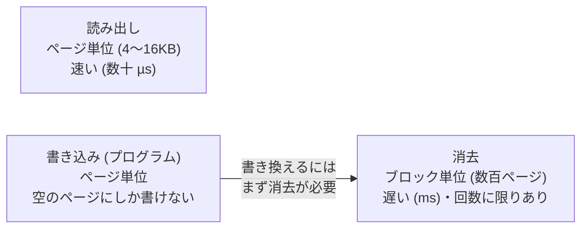
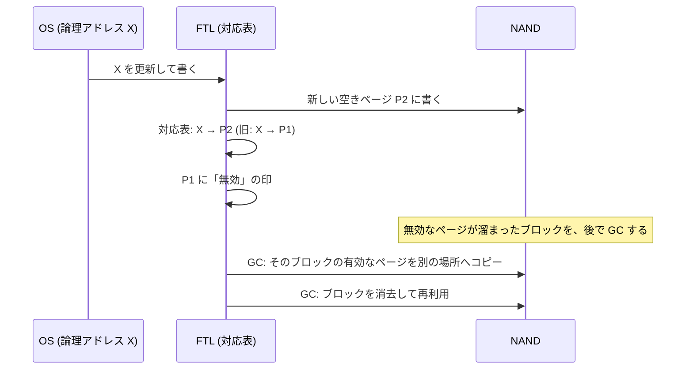
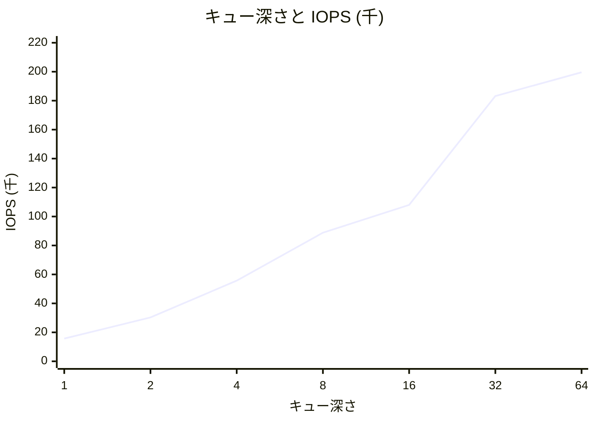

# 図1: ストレージの階層と SSD の仕組み

## 1. HDD と SSD の違い

| | HDD | SSD (NAND) |
|---|---|---|
| 構造 | 回転する円盤 + 動くヘッド | NAND フラッシュ + コントローラ(FTL) |
| ランダム読み | シーク + 回転待ち:数 ms | 数十 µs |
| 順次と、ランダムの差 | 約 100〜1000 倍 | 数倍〜 100 倍(並列度による) |
| 並列度の効果 | 小さい(ヘッドは1つ) | 大きい(内部に多数の NAND チップ) |
| 書き込みの制約 | 上書きできる | 上書きできない(ページ単位で書き、ブロック単位で消す) |

## 2. NAND の制約



## 3. FTL: アウトオブプレース更新とガベージコレクション

論理ブロック X を書き換える場合:



| 仕組み | 役割 |
|---|---|
| アウトオブプレース更新 | 上書きの代わりに、別のページへ書いて、対応表を更新する |
| ガベージコレクション | 無効ページが溜まったブロックから、有効ページをコピーして、ブロックを消去する |
| ウェアレベリング | 書き込みを分散し、特定のブロックの消耗を防ぐ |
| TRIM | ファイルシステムが「使っていないブロック」を伝え、GC の無駄なコピーを減らす |
| オーバープロビジョニング | 利用者に見せない余分な領域を持ち、GC の余裕を作る |

## 4. デバイス内の書き込み増幅

```
利用者が 1 GB 書く
  → NAND への実際の書き込み = 1 GB (利用者のデータ) + GC のコピー分
  → 例えば 3 GB になる (書き込み増幅 = 3)
```

- ランダムな小さい書き込みは、無効ページが散らばるので、GC のコピーが増える。
- 順次の書き込み(LSM-tree の SSTable など)は、ブロック全体が一度に無効になりやすく、コピーが少なくて済む。

## 5. キュー深さと IOPS(演習5の実測、Apple M5、4KB ランダム読み込み)



| キュー深さ | IOPS | 平均レイテンシ | p99 |
|---|---|---|---|
| 1 | 15,668 | 63.7 µs | 78 µs |
| 2 | 30,265 | 66.0 µs | 89 µs |
| 4 | 55,683 | 71.7 µs | 105 µs |
| 8 | 88,826 | 89.9 µs | 146 µs |
| 16 | 107,981 | 147.7 µs | 709 µs |
| 32 | 183,161 | 174.0 µs | 318 µs |
| 64 | 199,641 | 316.6 µs | 652 µs |

**Little の法則**: 並列度 = レイテンシ × スループット

- QD 1: 1 ÷ 63.7 µs ≒ 15.7k IOPS(測定値と一致)
- QD 64: 64 ÷ 316.6 µs ≒ 202k IOPS(測定値と一致)

読み方:

- QD 1 → 8: レイテンシがほぼ一定のまま IOPS が増える = デバイス内部が並列に処理している。
- QD 32 以降: IOPS は頭打ち。レイテンシだけが伸びる = 待ち行列の時間。

## 6. 順次とランダム(Apple M5)

| 方式 | 速度 |
|---|---|
| 順次読み込み(1 MiB ずつ) | 約 6,204 MB/s |
| ランダム 4KB、QD 64 | 約 200k IOPS ≒ 800 MB/s |
| ランダム 4KB、QD 1 | 約 15.7k IOPS ≒ 64 MB/s |

順次は QD 64 のランダムの約 8 倍、QD 1 のランダムの約 100 倍。
