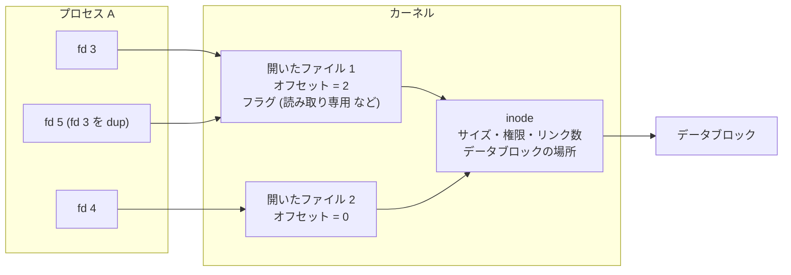
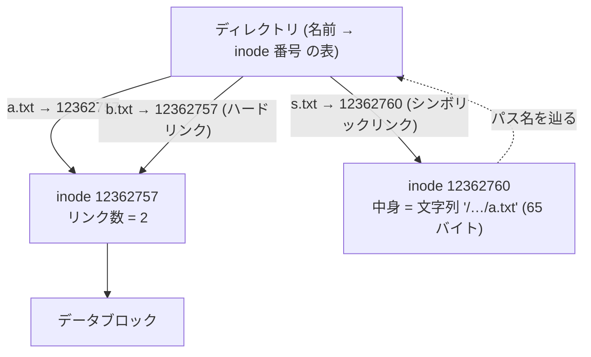
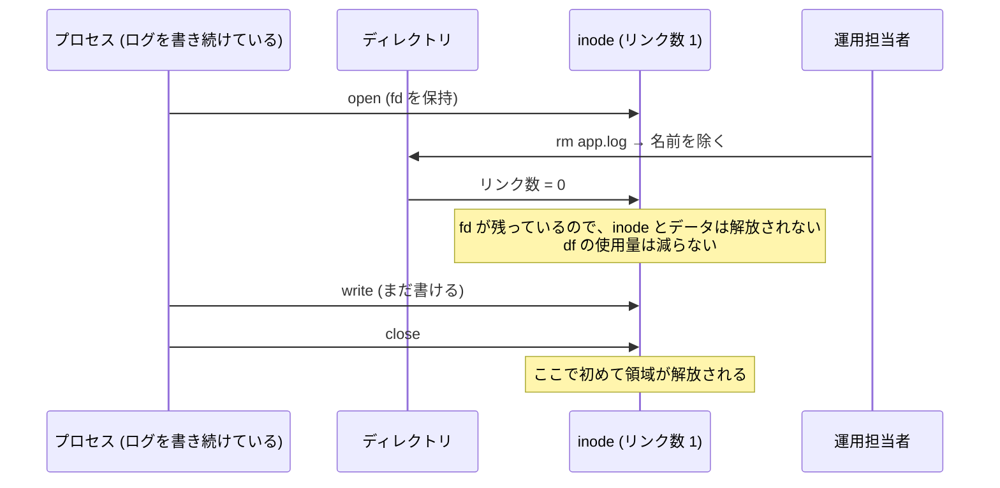
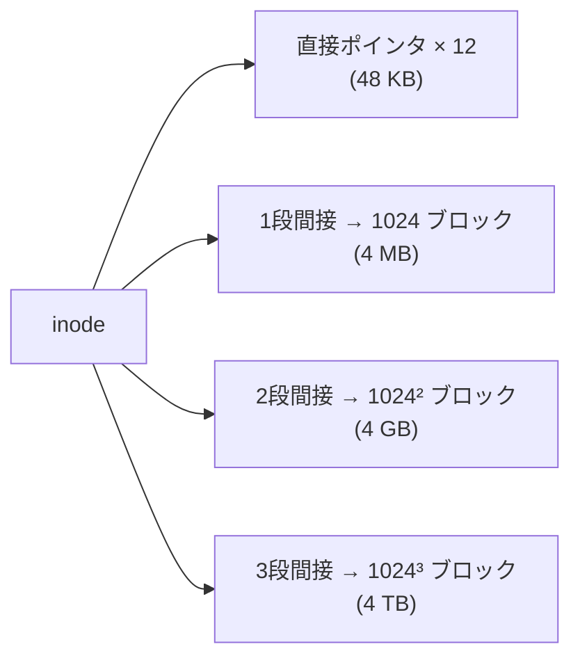
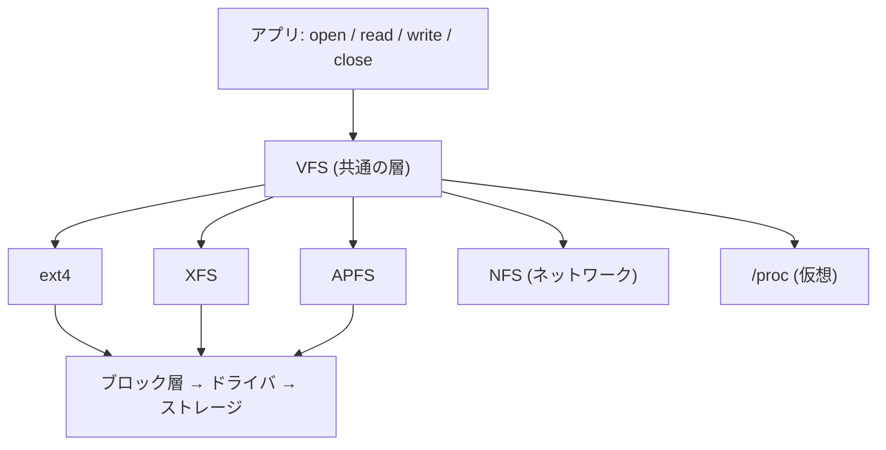

# 図2: fd、開いたファイル、inode、ディレクトリ

## 1. 3つの層



| 層 | 持つもの | 共有されるとき |
|---|---|---|
| fd | 整数。プロセスごとの表の添字 | プロセスごと |
| 開いたファイル | オフセット、開いたときのフラグ | `dup`、`fork` で共有。別に `open` すると別 |
| inode | ファイルの実体(メタデータ、ブロックの場所) | 同じファイルなら全員 |

演習1の結果: fd1 で2バイト読んだ後の位置は、fd1 = 2、別に `open` した fd2 = 0、`dup` した fd3 = 2。

## 2. 名前は inode の外にある



| 操作 | 何が起きるか |
|---|---|
| `link(a, b)` | ディレクトリに、同じ inode を指す名前を足す。リンク数 +1 |
| `symlink(a, s)` | パス名の文字列を中身に持つ、**新しい inode** を作る |
| `unlink(a)` | ディレクトリから名前を除き、リンク数 −1 |
| リンク数 = 0 かつ開いている fd なし | inode とデータブロックを解放 |

## 3. 「消したのに領域が戻らない」



演習1: 開いたまま `unlink` した後、`fstat` は **リンク数 0**、`pread` では中身が読めた。

見つけ方(Linux): `lsof +L1`。対策: プロセスにログを閉じさせる(ログローテーションの通知、再起動)。

## 4. inode からデータブロックを指す方法

**ポインタ方式**(ext2/3、ブロック 4KB、ポインタ 4 バイト):



**エクステント方式**(ext4、XFS、APFS など):

```
エクステント = (ファイル内の開始位置, ディスク上の開始ブロック, 連続するブロック数)
例: (0, 5000, 2048)  → ファイルの先頭 2048 ブロックは、ディスクのブロック 5000 から連続
```

大きな連続ファイルが、数個の項目で表せる。

## 5. スパースファイル(演習1)

```
ファイル: [ 穴 (書かれていない: ブロックなし, 読むとゼロ) ........ ][x]
           0                                                1 GiB   +1 バイト
st_size  = 1,073,741,825 バイト
実使用   = 4,096 バイト (末尾の 1 ブロックだけ)
```

`ls -l` のサイズと `du` の値が食い違う理由。

## 6. VFS


