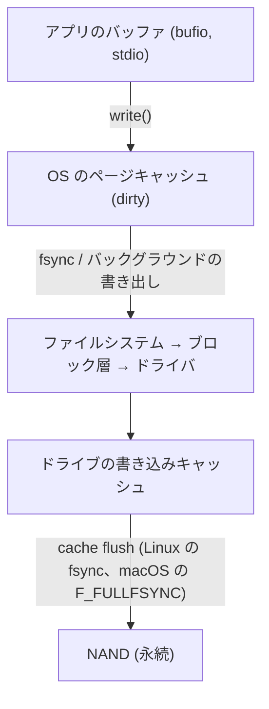
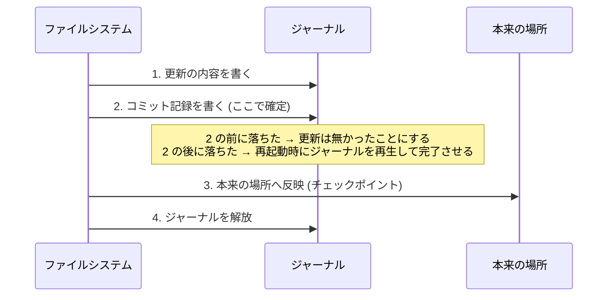
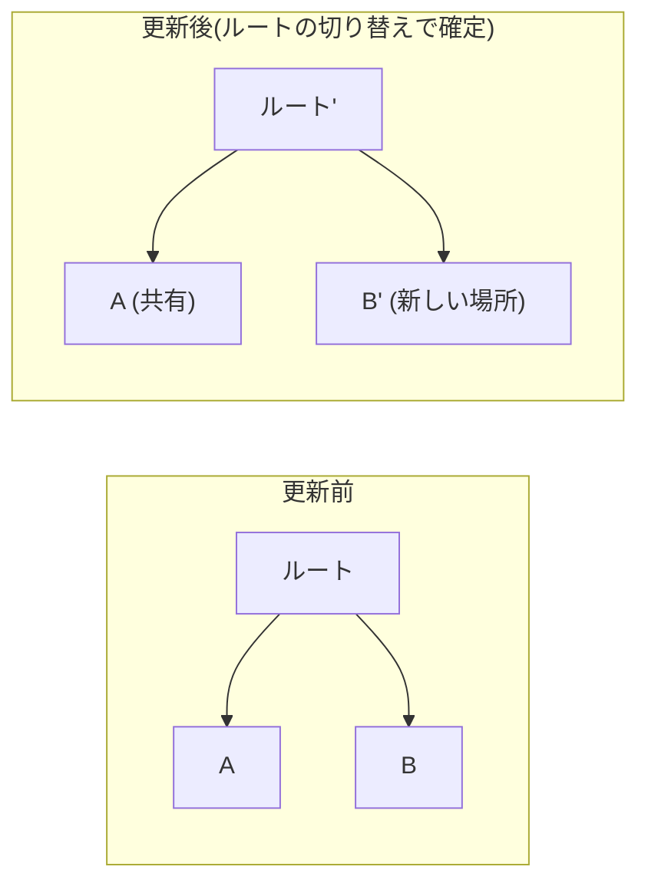
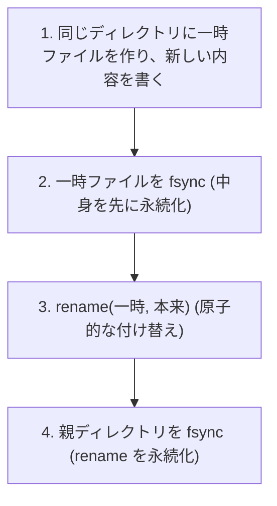

# 図3: 永続化とクラッシュ一貫性

## 1. 書き込みが通る層と、電源断で消えるもの



| 層 | 電源断で | プロセスが死んだとき |
|---|---|---|
| アプリのバッファ | 消える | 消える |
| ページキャッシュ(dirty) | **消える** | **残る**(OS が持っているので) |
| ドライブの書き込みキャッシュ(揮発性) | **消える** | 残る |
| NAND | 残る | 残る |

演習3の `SIGKILL` は、「プロセスが死んだ」場合の再現であり、電源断ではない。

## 2. 同期の呼び出しと、届く層(macOS の実測つき)

| 呼び出し | 届く層 | 実測(4KB 追記、Apple M5) |
|---|---|---|
| `write` のみ | ページキャッシュ | 3.7 µs |
| `fsync` | ストレージへ書き出しを要求(macOS ではドライブのキャッシュまでは流さない) | 33.0 µs |
| `F_FULLFSYNC`(macOS) | ドライブのキャッシュ → NAND | **3,748 µs**(`fsync` の約 114 倍) |
| まとめて 100,000 回書いて、最後に 1 回 | | 3.1 µs/回 + 最後に 4.4 ms |

## 3. 複数ブロックの更新とクラッシュ

ファイルへの追記 = 3つの更新

```
① データブロックに内容を書く
② inode を更新する (サイズ、ブロックへのポインタ)
③ 空きビットマップを更新する
```

| どこまで書けたか | 結果 |
|---|---|
| ①のみ | データが見えないだけ。ブロックが無駄になる |
| ②のみ | inode が、書かれていないブロックを指す → **ゴミが読める** |
| ③のみ | 使っていないブロックが使用中の扱い → **領域のリーク** |
| ②③のみ | ゴミが読める |
| ①③のみ | データが、どのファイルにも属さない |

## 4. ジャーナリング(WAL)



ext4 のジャーナルのモード:

| モード | ジャーナルに書くもの | 保証 |
|---|---|---|
| `journal` | データとメタデータ | 最も安全、データを 2 回書くので遅い |
| `ordered`(既定) | メタデータのみ。データは先に本来の場所へ | 「ゴミが読める」を防ぐ |
| `writeback` | メタデータのみ。順序の保証なし | ゴミが読めることがある |

## 5. コピーオンライト(CoW)



- 既存のブロックは上書きしない。
- 切り替え前に落ちれば旧い状態、切り替え後なら新しい状態。中間がない。
- ZFS、btrfs、APFS。代償は断片化と、ルートまでの経路の書き直し。

## 6. 安全なファイルの置き換え



**2 を省くと**: 電源断の後に「名前は新しいが、中身は空」の状態が残りうる。

## 7. 演習3の結果(10 MiB の新しい内容で、4 MiB の古い内容を置き換える途中で SIGKILL)

| 方式 | 手順 | 結果 |
|---|---|---|
| naive | ファイルを開く(中身が空になる) → 書く | **3 MiB。古い内容でも新しい内容でもない(壊れた)** |
| safe | 一時ファイル → fsync → rename → ディレクトリを fsync | **古い内容 4 MiB が完全に残った**(一時ファイル 3 MiB が余った) |

safe を最後まで実行すると、新しい内容に置き換わった。

## 8. WAL の末尾が切れたとき(演習4)

```
WAL: [rec1][rec2]...[rec999][rec1000 の途中で切れる]
                                  ↑ CRC と長さの検査で、壊れたと判定
再起動: rec1〜rec999 を再生 → rec1000 は捨てる → WAL を、壊れた位置で切り詰める
```

| 項目 | 結果 |
|---|---|
| 再生したレコード | 999 |
| 壊れた末尾を検出 | はい |
| key998 | あり |
| key999 | なし |
