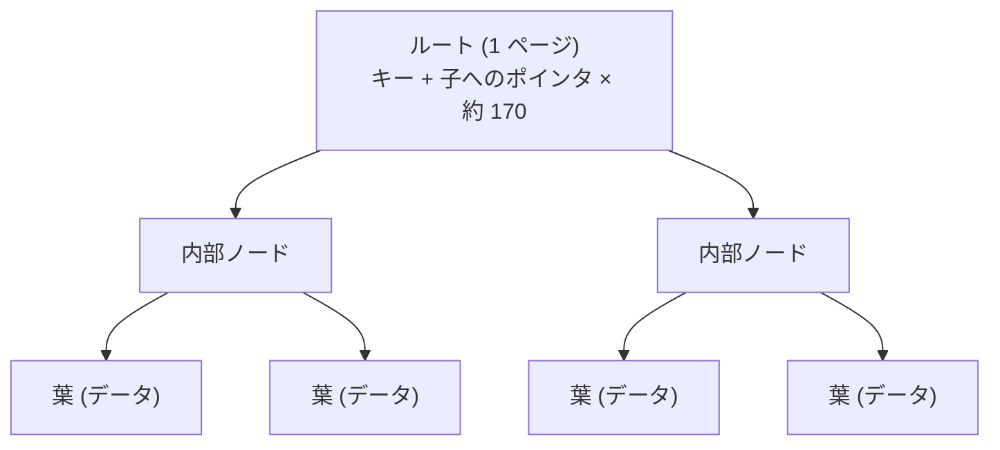
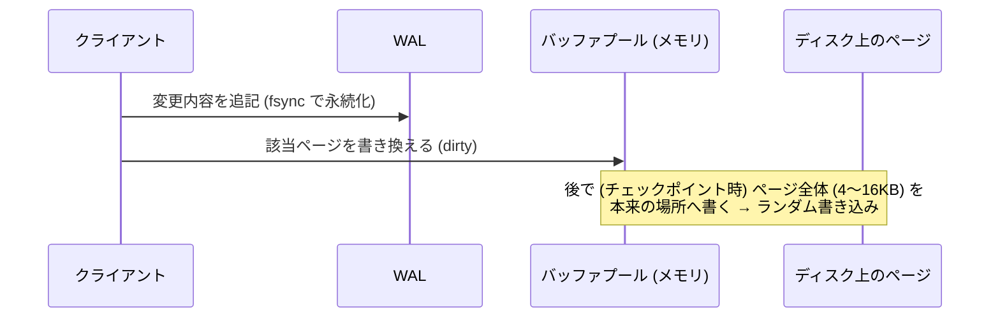
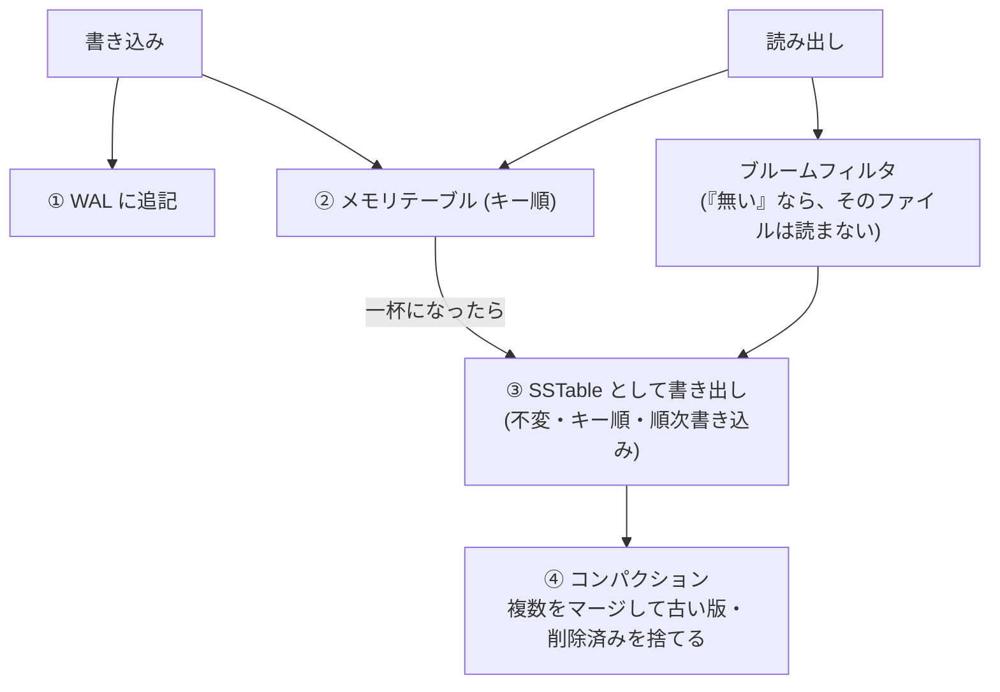
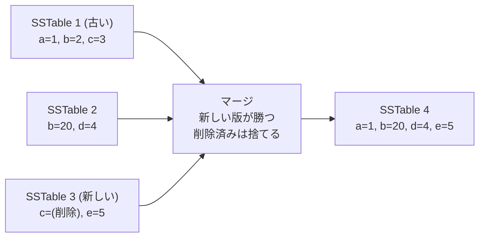

# 図4: B-tree と LSM-tree

## 1. B-tree の構造



4KB ページ、キー 16 バイト + ポインタ 8 バイトで、分岐数は約 170。

| 高さ | 扱える件数(概算) |
|---|---|
| 3 | 約 490 万 |
| 4 | 約 8 億 |

1回の検索 = 高さと同じ数のページ読み出し(上の方は、たいていキャッシュにある)。

## 2. B-tree の書き込み



100 バイトの更新でも、書くのはページ全体。書き込み増幅が大きい。

## 3. LSM-tree の書き込みと読み出し



SSTable の構造(演習4):

```
[レコード][レコード]...  (キー順)   ← 16 レコードごとに (キー, ファイル位置) をメモリに保持 (スパースインデックス)
レコード = キー長(4B) | 値長(4B, 0xFFFFFFFF なら削除の印) | キー | 値
```

読み出しは、スパースインデックスで該当ブロックを見つけ、そのブロック(最大 16 レコード)を読んで探す。

## 4. コンパクション



- 古い SSTable は、新しい SSTable が永続化された**後に**消す(逆順だと、間でクラッシュしたときに、データが失われる)。
- 同じデータを何度も書き直す → **書き込み増幅**。

## 5. 3つの増幅の比較

| | B-tree | LSM-tree |
|---|---|---|
| 書き込み増幅 | ページ全体の書き換え | WAL + 書き出し + **コンパクションの書き直し** |
| 読み出し増幅 | 少数のページ | 複数のファイル(ブルームフィルタで緩和) |
| 空間増幅 | ページ内の空き | コンパクションまで残る古い版 |
| 書き込みのパターン | ランダム | 順次 |
| 向く用途 | 読み出し中心、範囲検索 | 書き込み中心 |
| 例 | InnoDB、PostgreSQL、SQLite、LMDB | RocksDB、LevelDB、Cassandra、Bigtable |

## 6. 演習4の実測(Apple M5)

**書き込み増幅**(20 万回の上書き、キー空間 5 万):

| | バイト | 倍率 |
|---|---|---|
| 利用者が書いた量 | 22,200,000 | 1.00 |
| WAL | 24,600,000 | 1.11 |
| SSTable(書き出し 24 回、コンパクション 7 回) | 55,718,656 | 2.51 |
| 合計 | 80,318,656 | **3.62** |

**ブルームフィルタ**(存在しないキー 2 万個、25 個の SSTable):

| | ブロック読み出し | スキップ | 1検索あたり |
|---|---|---|---|
| なし | 250,271 | 0 | 約 5.5 µs |
| あり | **2,070** | 495,915 | 約 0.65 µs |

残った読み出しは、偽陽性(約 0.8%)。1 キーあたり 10 ビット、ハッシュ 7 個の設計から予想される約 1% と合う。

**同期の方針**(100 バイトの値):

| 方針 | 1件あたり | 1秒あたり |
|---|---|---|
| 同期なし | 1.7 µs | 605,176 |
| 100 件ごとに fsync | 2.4 µs | 419,039 |
| 1 件ごとに fsync | 17.0 µs | 58,659 |
| 1 件ごとに F_FULLFSYNC | 3,637 µs | 275 |

100 件ごとの同期は、最大 99 件を、クラッシュで失う可能性がある。耐久性と速度のトレードオフ。
