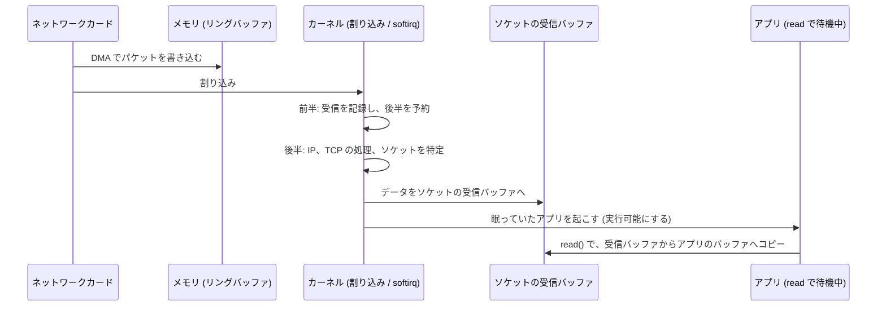
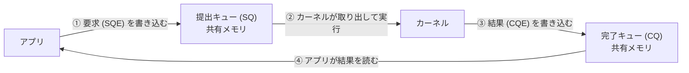

# 第6回 カーネルと I/O

> ステータス: 執筆済み(第1版)
> 前提: 第3回(システムコール、プロセスの状態)、第4回(ブロック、同期)、第5回(キュー深さ、ページキャッシュ)
> 演習言語: C と Go
> 所要目安: 本文 3時間 + 演習 5〜6時間
> **この回の実測は macOS(kqueue)で行った。Linux の epoll、io_uring、eBPF は、仕組みを説明するが、この環境では動かしていない(未確認)。**

## この回のゴール

この回を終えると、次のことが説明できるようになる。

1. システムコール1回は、なぜ数百 ns かかるのか。大きく読めば、なぜ速くなるのか。
2. ネットワークカードにパケットが届いてから、アプリケーションの `read()` が返るまで、何が起きるのか。割り込みと DMA は、何をしているのか。
3. 1万本の接続を扱うのに、なぜ「1接続1スレッド」ではなく、`epoll` や `kqueue` を使うのか。`poll` は、何が遅いのか。
4. `io_uring` は、`epoll` の何を変えるのか。
5. 「ゼロコピー」とは何で、どんなときに効き、どんなときに効かないのか。
6. Go の `conn.Read()` は、書き方はブロックするのに、なぜスレッドを占有しないのか。ディスクの読み込みでは、なぜ話が違うのか。

第3回で、システムコールが「カーネルに入る入り口」であることを見た。第5回で、ストレージの性能が並列度で決まることを見た。この回は、その間をつなぐ、**カーネルが I/O をどう扱うか**を扱う。次回からのネットワーク(第7〜10回)は、この回の「ソケットを通じて、データが出入りする」仕組みの上に載る。

---

## 1. システムコール

### 1.1 なぜカーネルを通すのか

第3回で見たとおり、アプリケーションは、ハードウェアを直接操作できない。ファイル、ネットワーク、メモリの確保などは、すべて**システムコール**でカーネルに依頼する。カーネルを通す理由は、次の3つである。

| 理由 | 内容 |
|---|---|
| 保護 | アプリのバグが、他のプロセスや OS を壊せないようにする |
| 共有 | 1つのディスクやネットワークカードを、多数のプロセスが公平に使えるようにする |
| 抽象化 | アプリは、ディスクの種類や、ネットワークカードの型番を知らなくてよい |

### 1.2 システムコール1回の中身

アプリが `read(fd, buf, n)` を呼ぶと、次のことが起きる。

1. C ライブラリが、システムコール番号と引数をレジスタに入れ、特別な命令(x86-64 は `syscall`、ARM64 は `svc`)を実行する。
2. CPU が、カーネルモードに切り替わり、カーネル内の入り口に飛ぶ。
3. カーネルは、**引数を検証する**。アプリから渡されたポインタ(`buf`)は信用できないので、アドレスが、アプリ自身のアドレス空間の中にあるか、書き込める権限があるかを確認する。
4. fd から、開いたファイルと inode をたどる(第5回)。
5. 実際の処理を行う。ページキャッシュにあれば、そこから、アプリのバッファへ**コピー**する(`copy_to_user`)。
6. 結果を返して、ユーザーモードに戻る。

この流れの全体の時間は、コピーの量によらない**固定のコスト**と、コピーの量に比例するコストの和になる。

**固定のコストの内訳**: モードの切り替え、引数の検証、fd の検索、ロックの取得などがある。Meltdown 対策(第2回の KPTI)や、Spectre 対策も、ここに上乗せされた。

### 1.3 実測: システムコールのコスト(演習1)

Apple M5 での結果を示す(200 万回の平均)。

| 操作 | 1回あたり |
|---|---|
| 関数呼び出し(基準) | 約 0.5〜0.6 ns |
| `getppid()` | 約 85〜88 ns |
| `clock_gettime()` | 約 15〜16 ns |
| `read(/dev/zero, 1バイト)` | 約 241〜245 ns |
| `pread(ファイル, 1バイト)` | 約 247〜264 ns |
| `write(/dev/null, 1バイト)` | 約 559〜563 ns |

分かることが3つある。

1. **システムコールは、普通の関数呼び出しの 100〜1000 倍**かかる。何もしない `getppid()` でも、約 85 ns である(第3回の測定と合う)。
2. **`clock_gettime()` は、約 15 ns**で、システムコールとしては速すぎる。多くの OS は、時刻を、カーネルに入らずに答える仕組みを持つ(Linux の **vDSO**、macOS の commpage)。カーネルが、時刻をユーザー空間から読めるメモリに書き出しておき、アプリがそれを読むだけである。「カーネルに入らずに済む」ことは、最も効く最適化である。
3. **`write(/dev/null, 1バイト)` が、`read(/dev/zero, 1バイト)` の約 2.3 倍遅かった**。何もしないはずの書き込みが、読み込みより遅い理由は、確認していない。macOS のデバイスドライバの実装の違いかもしれない。ここでは、「システムコールの種類によって、固定のコストが大きく違う」ことだけを読み取る。

### 1.4 「1回で運ぶ量」を増やす

固定のコストが約 240 ns なら、**1回あたりに運ぶ量を増やす**と、コストは薄まる。演習1で、ページキャッシュ上の 256 MiB のファイルを、バッファの大きさを変えて読んだ。

| バッファの大きさ | 速度 | 1回あたり |
|---|---|---|
| 1 バイト | **4.1 MB/s** | 247 ns |
| 16 バイト | 64.5 MB/s | 248 ns |
| 256 バイト | 976.5 MB/s | 262 ns |
| 4 KiB | 9,492 MB/s | 432 ns |
| 64 KiB | 20,906 MB/s | 3,135 ns |
| 1 MiB | 22,064 MB/s | 47,523 ns |

分かること:

- 1バイトずつ読むと、**4 MB/s**。1 MiB ずつ読むと **22,064 MB/s**。**約 5,400 倍**の差である。
- 1〜256 バイトでは、1回あたりの時間が、ほぼ一定(約 250 ns)。**時間は、運ぶ量ではなく、呼び出しの回数で決まっている**。
- 4 KiB を超えると、コピーの時間が、固定のコストを上回り始める。4 KiB のコピーに約 190 ns かかっており(432 − 247)、これは約 21 GB/s のメモリコピー速度に相当する。

**実務への含意**: `bufio`(Go)、`stdio`(C)などの、**バッファリングの層**は、この固定のコストを薄めるためにある。1バイトずつ `write` するコードは、極端に遅くなる。複数のバッファを1回で送る `writev`、複数のメッセージを1回で送る `sendmmsg`、あるいは後述の `io_uring` は、同じ発想を、さらに押し進めたものである(Soares & Stumm の FlexSC は、システムコールそのものを、まとめて出す方式を提案した)。

---

## 2. 割り込みとデバイス

### 2.1 割り込み

CPU は、デバイスのことを、常に監視してはいられない。そこで、デバイスのほうから CPU に**割り込み**を送って、知らせる(「ネットワークカードにパケットが届いた」「ディスクの読み込みが終わった」)。CPU は、実行中の処理を中断して、カーネルの**割り込みハンドラ**を実行し、終わったら、元の処理に戻る。

割り込みハンドラは、割り込みを受けている間、他の割り込みを受けにくいため、**できるだけ短くする**必要がある。そこで、処理を2つに分ける。

| 部分 | 内容 |
|---|---|
| 前半(top half) | 割り込みを受けて、最小限のこと(デバイスの状態の確認、受信したデータの目印を残す)だけを、すぐ行う |
| 後半(bottom half) | 時間のかかる処理(プロトコルの処理など)を、少し後で、割り込みを許した状態で行う(Linux の softirq、workqueue など) |

### 2.2 DMA

デバイスからデータを読むとき、CPU が1バイトずつコピーしていては、CPU が足りない。**DMA**(Direct Memory Access)では、デバイスが、CPU を介さずに、**メモリに直接読み書きする**。

ネットワークカードは、**リングバッファ**を使う。カーネルが、受信用のバッファの場所(記述子)を、リングに並べておく。パケットが届くと、カードは、リングの次のバッファに、**DMA でパケットを書き込み**、割り込みで知らせる。

### 2.3 ネットワーク受信の経路

パケットが届いてから、アプリの `read()` が返るまでの流れである(図は [diagrams/01-syscall-and-interrupt-path.md](diagrams/01-syscall-and-interrupt-path.md))。



アプリが `read()` で待っているのは、**眠っている**状態(第3回の Blocked)である。データが届くと、カーネルがそのプロセス(またはスレッド)を、実行可能にする。実際に走り出すのは、スケジューラ(第3回)が選んだときである。

### 2.4 割り込みの嵐とポーリング

パケットが毎秒数百万個届くと、そのたびに割り込みが起きて、CPU が割り込みの処理だけで埋まってしまう。極端な場合、**パケットを受け取る処理だけで CPU が使い切られ、受け取ったデータを使うアプリが全く走れなくなる**。これを**受信ライブロック**(receive livelock)と呼ぶ(Mogul & Ramakrishnan, 1996)。

対策は、**割り込みとポーリングの切り替え**である。

- 到着が少ないとき: 割り込みで知る(CPU を無駄にしない)。
- 到着が多いとき: **割り込みを止めて、CPU のほうから一定間隔でデバイスを見に行く(ポーリング)**。Linux の NAPI が、この方式である。
- 割り込みを**まとめる**(interrupt coalescing): 数個のパケットが届くまで、または一定時間待ってから、1回の割り込みで知らせる。**レイテンシを少し犠牲にして、スループットを上げる**。

さらに速さを求める場合は、カーネルを**迂回**して、アプリが、デバイスを直接ポーリングする(DPDK など)。§12 の論点で扱う。

---

## 3. I/O のモデル

アプリが I/O を行う方法には、複数のモデルがある。違いは、「**待つ間に、何をするか**」と「**何を通知してもらうか**」である。

| モデル | 待つ間 | 通知されるもの | 例 |
|---|---|---|---|
| **ブロッキング** | スレッドが眠る | I/O の完了(データが手に入った) | 普通の `read()` |
| **ノンブロッキング** | 待たずに、すぐ戻る(`EAGAIN`)。アプリが繰り返し試す | なし(アプリが、ポーリングする) | `O_NONBLOCK` + `read()` |
| **I/O 多重化** | 多数の fd を、まとめて待つ | **準備ができた**fd の一覧 | `select`、`poll`、`epoll`、`kqueue` |
| **シグナル駆動** | 別の仕事をする | 準備ができたというシグナル | `SIGIO` |
| **非同期 I/O** | 別の仕事をする | **I/O の完了**(データはすでにバッファにある) | POSIX AIO、`io_uring` |

### 3.1 準備通知と完了通知

大きな違いが、**何を通知されるか**にある。

- **準備通知**(readiness): 「この fd は、**今、読める**(または書ける)」。通知を受けた後、**アプリが、`read()` を自分で呼ぶ**。`epoll`、`kqueue`、`select`、`poll` がこれ。
- **完了通知**(completion): 「この I/O は、**終わった**。結果はここにある」。`read()` の呼び出しも含めて、カーネルが代わりに行う。`io_uring`、Windows の IOCP がこれ。

準備通知では、I/O のたびに、「待つ」と「読む」の2回のシステムコールが要る。完了通知では、1回で済む(または、まとめて出せる)。

### 3.2 通常のファイルには、準備通知が効かない

見落としやすい点がある。**`epoll` や `kqueue` は、通常のファイル(ディスク上のファイル)に対しては、役に立たない**。通常のファイルは、「常に読める」とみなされ、準備通知は、すぐ「準備できた」を返す。実際に `read()` を呼ぶと、ページキャッシュになければ、ディスクの読み込みが終わるまで、ブロックする。

つまり、ソケットとパイプは、準備通知で多重化できるが、**ディスクの I/O は、別の方法**(スレッドプールでブロッキング `read` を行う、`io_uring`、AIO)が要る。Node.js が、内部でディスク I/O のためのスレッドプールを持つ理由である。

---

## 4. C10K 問題と I/O 多重化

### 4.1 問題

1999 年、Dan Kegel が、**1台のサーバーで、1万の同時接続を扱うには、どうするか**という問題(C10K)を提起した。当時は、「1接続1スレッド」(または1プロセス)が主流で、これが限界にぶつかっていた。

### 4.2 実測: 3つの流儀(演習2)

演習2で、3種類のエコーサーバーを作り、比べた。

| 流儀 | 仕組み |
|---|---|
| threads | 1接続につき、1スレッド。ブロッキングの `read` で待つ |
| poll | 1スレッドで、`poll()` に全接続を渡して、準備ができたものを処理する |
| kqueue | 1スレッドで、`kqueue` に、接続を登録しておく |

クライアントは、N 本の接続を張るが、**実際に往復するのは 10 本だけ**で、残りは、つないだまま黙っている(現実のサーバーの「大半の接続は暇」という状況)。Apple M5 での結果を示す。

| 接続数(活発 10) | 流儀 | 往復/秒 | 平均往復時間 | サーバーのメモリ(RSS) | スレッド数 |
|---|---|---|---|---|---|
| 100 | threads | 220,774 | 45.3 µs | 2.7 MB | 101 |
| | poll | 229,831 | 43.5 µs | 1.2 MB | 1 |
| | kqueue | 258,860 | 38.6 µs | 1.1 MB | 1 |
| 1,000 | threads | 232,051 | 43.1 µs | 16.8 MB | 1,001 |
| | poll | **64,010** | 156.2 µs | 1.2 MB | 1 |
| | kqueue | 258,367 | 38.7 µs | 1.1 MB | 1 |
| 3,000 | threads | 228,925 | 43.7 µs | 48.0 MB | 3,001 |
| | poll | **21,987** | 454.8 µs | 1.2 MB | 1 |
| | kqueue | 255,389 | 39.2 µs | 1.1 MB | 1 |
| 5,000 | threads | 221,959 | 45.1 µs | 65.1 MB | **4,096(上限)** |
| | poll | **15,531** | 643.9 µs | 1.2 MB | 1 |
| | kqueue | 254,242 | 39.3 µs | 1.1 MB | 1 |

(接続数 100、全部が活発な場合は、threads 245,765、poll 294,451、kqueue 293,374 往復/秒。)

分かることが4つある。

**1. kqueue は、接続数が増えても、速度がほぼ変わらない**(約 255,000 往復/秒)。サーバーのメモリも、1.1 MB のままである。

**2. poll は、接続数に反比例して遅くなった**(100 本で 229,831 → 5,000 本で 15,531)。約 15 分の 1 である。理由は、`poll` が、毎回、**全部の fd の配列をカーネルに渡し、カーネルが全部を調べる**ため、1回の呼び出しの時間が接続数に比例する(**O(n)**)からである。活発なのが 10 本だけでも、5,000 本全部を調べる。

**3. threads は、活発な接続の速度は落ちなかった**(220,000〜232,000 往復/秒)。「スレッドは遅い」ではない。**問題は、数の上限とメモリ**である。

| 接続数 | threads のメモリ |
|---|---|
| 100 | 2.7 MB |
| 1,000 | 16.8 MB |
| 3,000 | 48.0 MB |
| 5,000 | 65.1 MB(スレッドは 4,096 で頭打ち) |

1スレッドあたり、約 16 KB の常駐メモリである(今回は、スタックを 64 KB に小さくしたうえで)。標準のスタックの大きさ(1 MB〜8 MB の仮想メモリを予約)では、10,000 本のスレッドは、仮想アドレス空間の予約の面でも、厳しくなる。この環境では、OS の上限(`kern.num_taskthreads` が 4,096)で、**5,000 接続のとき、スレッドが 4,096 本までしか作れず**、サーバーが警告を出した(「スレッドを作れなかった」)。活発な 10 本は、早い段階で接続されたため、影響を受けなかった。

**4. 活発な接続が多いときは、差が小さい**。100 本すべてが活発な場合、threads 245,765、poll 294,451、kqueue 293,374 往復/秒。スレッドの切り替えコスト(第3回)は、**同時に多数のスレッドが動いているとき**に効いてくるが、今回の条件(クライアントは1つのプロセスで、順に叩く)では、顕著に出なかった。

### 4.3 `select`、`poll`、`epoll`/`kqueue` の違い

| | select | poll | epoll(Linux)/ kqueue(BSD、macOS) |
|---|---|---|---|
| 関心のある fd の渡し方 | 毎回、ビットマップを渡す | 毎回、配列を渡す | **一度登録**する。カーネルが覚える |
| 1回の待ちのコスト | O(最大の fd の番号) | O(n) | **O(準備ができた数)** |
| fd の数の上限 | `FD_SETSIZE`(通常 1024) | なし | なし |
| カーネルの仕組み | 毎回、全部を走査 | 毎回、全部を走査 | 登録された fd を、カーネルが管理し、**準備ができたものを、準備完了リストに入れる** |

`epoll` の内部は、概念としては、2つの構造からできている。

1. **関心リスト**(interest list): 登録された fd の一覧(木構造)。`epoll_ctl` で追加、削除する。
2. **準備完了リスト**(ready list): 準備ができた fd のリスト。デバイスや、ソケットにデータが届いたとき、カーネルが、**そのイベントの発生時に**、ここに追加する。

`epoll_wait` は、準備完了リストを返すだけなので、**待っている fd の総数に依存しない**。これが、O(n) の `poll` との本質的な違いである。

図は [diagrams/02-io-models.md](diagrams/02-io-models.md)。

### 4.4 レベルトリガとエッジトリガ

準備通知には、2つの方式がある。

| 方式 | 通知されるとき |
|---|---|
| **レベルトリガ**(既定) | fd が「読める状態」である**間、毎回**通知される |
| **エッジトリガ** | 状態が**変化した瞬間だけ**、1回通知される |

エッジトリガでは、通知を受けたら、**`EAGAIN` が返るまで、読み切らなければならない**。途中で止めると、残りのデータについては、二度と通知が来ない。速いが、書き方を間違えると、接続が「止まる」バグになる。

### 4.5 イベントループの限界

1スレッドのイベントループは、メモリは少なく、競合もない(第4回)。ただし:

- **1つの遅い処理が、全体を止める**。あるハンドラが 100 ms 計算すると、その間、すべての接続が待たされる。
- **1つのコアしか使えない**。マルチコアを使うには、イベントループを複数(コアごと)起動し、`SO_REUSEPORT` で、複数のプロセスやスレッドが、同じポートを待ち受け、カーネルが接続を振り分ける。

nginx、Redis、Node.js は、この系統に属する(Redis は、コマンドの実行は単一スレッドである)。Go は、次の §8 で見る、別の道を取った。

注意: **この節の実測は kqueue(macOS)である**。Linux の `epoll` は、概念として同じ設計だが、この環境では測っていない。

---

## 5. io_uring(Linux)

### 5.1 動機

`epoll` を使っても、I/O 1回ごとに、システムコールが要る。

1. `epoll_wait`: 準備ができたものを知る。
2. `read` / `write`: 実際の I/O を行う。

さらに、§3.2 のとおり、**通常のファイルには使えない**。

**`io_uring`**(Linux 5.1、2019 年、Jens Axboe)は、この両方を解決する、非同期 I/O のインターフェースである。

### 5.2 仕組み

アプリとカーネルが、**共有メモリ上の2つのリングバッファ**を使ってやりとりする。



1. アプリは、要求(読む、書く、`accept` する、など)を、**提出キュー**に書き込む。
2. **1回のシステムコール**(`io_uring_enter`)で、複数の要求を、まとめてカーネルに渡せる。
3. カーネルが実行し、結果を、**完了キュー**に書く。
4. アプリは、完了キューを読む。**共有メモリを読むだけ**なので、システムコールが要らない。

さらに:

- **SQPOLL**: カーネルのスレッドが、提出キューを**ポーリング**する。アプリは、システムコールなしで要求を出せる。
- **登録済みのバッファとファイル**: 事前に登録して、毎回の検証のコストを省く。
- **通常のファイルにも使える**。

### 5.3 代償

- **複雑**で、使い方を誤りやすい。
- **攻撃面が大きい**。Google は 2023 年に、自社の脆弱性報奨金プログラムに寄せられたカーネルの脆弱性報告のうち、`io_uring` に関するものが大きな割合を占めたことを公表し、ChromeOS、Android、一部の本番サーバーで `io_uring` を無効にした。**速さと、攻撃面の広さのトレードオフ**である。

**この Mac では、`io_uring` を動かしていない(未確認)**。上の説明は、仕様と公開資料に基づく。

---

## 6. ゼロコピー

### 6.1 素朴な方法: read + write

ファイルの内容をソケットに送る、最も単純なコードは、次のとおり。

```c
while ((n = read(file, buf, size)) > 0) write(sock, buf, n);
```

この間に、データは、次のように移動する(図は [diagrams/03-zero-copy.md](diagrams/03-zero-copy.md))。

1. ディスク → ページキャッシュ(DMA、初回のみ)。
2. ページキャッシュ → **アプリのバッファ**(`read` の CPU によるコピー)。
3. アプリのバッファ → **ソケットの送信バッファ**(`write` の CPU によるコピー)。
4. ソケットの送信バッファ → ネットワークカード(DMA)。

**CPU によるコピーが2回**、システムコールが2回(のたびに、ユーザーとカーネルの間の行き来)。データを加工しないなら、アプリのバッファを通るのは無駄である。

### 6.2 mmap + write

`mmap` でファイルをアドレス空間に対応づけ(第2回)、そのメモリを `write` に渡す。ページキャッシュのページが、そのままアプリから見えるので、**`read` のコピーが1回減る**。代償は、ページテーブルの設定と、ページフォルト(第2回)である。

### 6.3 sendfile

`sendfile` は、**ファイルから、ソケットへの転送を、カーネルの中だけで行う**システムコールである。アプリのバッファを通らない。Linux では、ネットワークカードが、散らばった複数のメモリの領域をまとめて DMA で読める(scatter-gather)場合、**CPU によるコピーが 0 回**になる。

### 6.4 実測(演習3)

512 MiB のファイル(ページキャッシュ上)を、ループバックの TCP で、別のプロセスに送った。Apple M5 での結果を示す(3回の測定、それぞれ3回のうち最速の回)。

| 方法 | 速度 | 送信側の CPU(sys) |
|---|---|---|
| A. read + write(64 KiB ずつ) | 8,519〜8,710 MB/s | 約 0.060 秒 |
| B. mmap + write | 9,657〜9,884 MB/s | 約 0.054〜0.056 秒 |
| C. sendfile | **15,069〜15,962 MB/s** | **約 0.034〜0.036 秒** |

- sendfile は、read + write の **約 1.8 倍の速度**で、**送信側の CPU(sys)は約 4 割少ない**(0.060 → 0.035 秒)。
- mmap + write は、約 1.1〜1.2 倍で、間にある。
- user の CPU は、どの方法でも、ほぼ 0(コピーは、カーネルの中で起きている)。

**注意**: ここでの速度は、「送信側が、ソケットの送信バッファに送り込み終えるまで」の時間で測っている。実際のネットワークでは、ネットワークの速度が上限になり、この差は、速度ではなく、**CPU の使用量の差**として現れる(同じ CPU で、より多くの接続を処理できる)。

### 6.5 ゼロコピーの限界

- **データを加工するとき**は、ユーザー空間を通る必要がある。TLS で暗号化するとき(第9回)、アプリが暗号化するなら、データはユーザー空間を通る。Linux の **kTLS** は、暗号化を、カーネル(またはネットワークカード)に移して、`sendfile` と組み合わせられるようにした。
- 圧縮、チェックサムの計算など、加工が要る処理には使えない。
- `mmap` には、第2回で見た落とし穴がある。他のプロセスがファイルを切り詰めると、アクセスで `SIGBUS` が起きる。

### 6.6 mmap と read の比較(演習4)

ページキャッシュ上の 512 MiB のファイルを、全バイトの和を取りながら読んだ。Apple M5 での結果である(3回の実行の範囲)。

**順次**:

| 方法 | 速度 | ページフォルト |
|---|---|---|
| read(64 KiB ずつ) | 13,785〜17,674 MB/s | +4 |
| mmap(1回目の走査) | 16,393〜19,398 MB/s | **+32,768** |
| mmap(2回目の走査) | **69,597〜76,663 MB/s** | +0 |

**ランダム 4 KiB(20 万回)**:

| 方法 | 1回あたり | ページフォルト |
|---|---|---|
| pread | 609〜629 ns | +0 |
| mmap(1回目: 初めて触れる) | 349〜356 ns | +32,707 |
| mmap(2回目: 同じ場所) | **279〜282 ns** | +0 |

分かること:

- mmap の1回目の走査で、ページフォルトが **32,768 回**起きた(512 MiB ÷ 16 KiB のページ = 32,768、第2回と一致)。それでも、read と同程度か、少し速い。
- **mmap の2回目は、read の約 4〜5 倍速い**(約 70,000 MB/s)。コピーも、システムコールも、ページフォルトもない。メモリを直接読むだけだからである。
- ランダムアクセスでは、**mmap が pread の約 2 倍速い**(初回も、フォルトを含めて)。システムコールが要らないためである。

**ただし、mmap は、常に勝つわけではない**。ここでの条件は、ファイルが**すべてページキャッシュに載っている**ことである。ディスクから読む必要があるとき、ページフォルトは、**ブロックして待つ**(メジャーフォルト、第2回)。そのとき、プログラムは、どこで止まるか分からない(メモリ参照のどこでも止まりうる)。データベースが、mmap を避けることがある理由である(第2回の §7.3)。

---

## 7. ソケットバッファとバックプレッシャー

### 7.1 バッファがある

ソケットには、カーネル内に、2つのバッファがある。

- **送信バッファ**: `write()` したデータが、ネットワークに出ていくまで、一時的に溜まる。
- **受信バッファ**: 届いたデータが、アプリが `read()` するまで、溜まる。

`write()` は、データを**送信バッファに入れたら、すぐ返る**(相手に届いたかは、関係ない)。送信バッファが一杯なら、ブロッキングのソケットでは**ブロック**し、ノンブロッキングでは `EAGAIN` を返す。

### 7.2 受信側が遅いと、送信側が止まる

受信側のアプリが、`read()` を呼ばないと、受信バッファが一杯になる。すると TCP が、送信側に「もう送らないで」と伝える(**ウィンドウ**、第8回)。送信側の送信バッファも、いずれ一杯になり、**送信側の `write()` が、ブロックする**。

これが**バックプレッシャー**である。遅い受信側の遅さが、送信側に伝わる。第3回で見た、パイプの動き(読み手が追いつかないと、書き手が待たされる)と、同じ構造である。

### 7.3 ノンブロッキングの書き込みの扱い

ノンブロッキングのソケットでは、`write()` が、要求したバイト数の**一部しか**書けないことがある(部分書き込み)。書けなかった分は、アプリが**自分で溜めておき**、ソケットが書ける状態になったという通知(`EPOLLOUT`、`EVFILT_WRITE`)を待って、続きを書く。

**よくあるバグ**:

1. 書き込みの通知を、**常に**登録しておく。ソケットは、たいてい書ける状態なので、通知がすぐ戻り続け、CPU を使い続ける(ビジーループ)。**書き残しがあるときだけ**登録する。
2. 書けない分を、**無制限に溜める**。遅い相手のために、メモリが際限なく増え、OOM(第2回)で落ちる。**上限を決め**、超えたら、読み取りを止める、または、その接続を切る。

---

## 8. Go のネットワーク I/O

### 8.1 書き方はブロッキング、実体は非同期

Go の `net.Conn.Read` は、書き方としては、**ブロッキング**に見える。

```go
n, err := conn.Read(buf)   // データが届くまで、ここで待つ
```

しかし、Go のランタイムは、次のことをしている。

1. ソケットを**ノンブロッキング**にして、`epoll`(Linux)や `kqueue`(macOS)に登録しておく。
2. `Read` を呼んだとき、まだデータがなければ、**その goroutine を眠らせる**(第3回)。**OS スレッドは占有しない**。そのスレッドは、他の goroutine を走らせ続ける。
3. データが届くと、**ネットポーラ**(netpoller)が、`epoll`/`kqueue` で知り、眠っていた goroutine を実行可能にする。

つまり、**プログラマは、ブロッキングの素直な書き方をしたまま、イベント駆動の効率を得られる**。第3回の goroutine の軽さと、本回の I/O 多重化が、ランタイムの中で結びついている。

図は [diagrams/04-go-netpoller-and-eventloop.md](diagrams/04-go-netpoller-and-eventloop.md)。

### 8.2 実測: スレッドが増えるか(演習5)

演習5の結果である(Apple M5、3,010 本の接続)。

| 状況 | OS スレッド | goroutine | スタック使用 |
|---|---|---|---|
| 起動直後 | 5 | 1 | 0.2 MB |
| **A. 3,010 本の接続を、それぞれ goroutine が `Read` で待つ** | **11** | 3,012 | 6.4 MB |
| **B. さらに、生の `syscall.Read` で、パイプを待つ goroutine を 200 個追加** | **210** | 3,212 | 13.0 MB |

- **A**: 3,010 個の goroutine が、ネットワークの `Read` で待っていても、**OS スレッドは 5 から 11 に増えただけ**(約 6 個)。1 goroutine あたりのスタックは、約 2.1 KB(6.4 MB ÷ 3,012)である。
- **B**: ブロックする生のシステムコール(`syscall.Read`)で待つ goroutine を 200 個作ると、**OS スレッドが約 200 本増えた**(11 → 210)。ネットポーラが使えない待ちは、**スレッドごと止まる**ため、ランタイムが、他の goroutine を走らせるために、新しいスレッドを作る(第3回のハンドオフ)。

### 8.3 暇な接続が大量にあっても、活発な接続は速い

3,000 本の暇な接続があるまま、10 本の活発な接続が往復した結果は、**129,566 往復/秒(平均 77.2 µs)**だった。OS スレッドは、210 本のまま(B の後)で、速度は落ちていない。

演習2の kqueue サーバー(約 255,000 往復/秒、平均 39 µs)より遅いが、これは、**クライアントとサーバーが、同じプロセスの、同じ Go スケジューラで動いている**ためと考えられる(goroutine の切り替えと、ネットポーラを経由する分が、往復ごとに乗る)。設計の違う2つの測定なので、直接の優劣の比較には使わない。

### 8.4 ファイルの I/O は話が違う

§3.2 のとおり、**通常のファイルには、準備通知が効かない**。Go で、ディスク上のファイルを `Read` すると、それは**ブロッキングなシステムコール**になる。

- 多数の goroutine が、同時にディスクの読み込みを待つと、その数だけ**OS スレッドが増える**(演習5の B と同じ)。
- Go のスレッド数には上限がある(既定で 10,000 本。`debug.SetMaxThreads`)。超えるとクラッシュする。
- `GOMAXPROCS` は、**Go のコードを同時に実行できる数**であって、ブロックしたシステムコールのスレッド数の上限ではない。

大量のディスク I/O を並列に行うサービスでは、同時に発行する数を、セマフォ(バッファつきチャネル)で制限するのが定石である。

### 8.5 1接続1 goroutine の現実の制約

Go では、C10K は簡単である。ただし、現実の制約は残る。

| 制約 | 内容 |
|---|---|
| **メモリ** | 接続ごとの goroutine のスタック(約 2 KB〜)に加え、接続ごとのバッファ。数十万接続では、バッファが支配的になる |
| **fd の上限** | プロセスあたりの fd の数(`ulimit -n`)。Go は、起動時に、ソフトリミットをハードリミットまで引き上げる |
| **エフェメラルポート** | クライアント側の、使い捨てのポート番号の範囲(通常 約 16,000〜28,000 個)。同じ宛先への接続は、これに制限される。**今回の測定でも、ポートが枯渇した**(後述) |

---

## 9. 観測する

| 見たいもの | 方法 | 読み方 |
|---|---|---|
| システムコールの種類と時間 | Linux: `strace -c`(回数と時間の集計)、`strace -T`(各呼び出しの時間) | 回数が多すぎる(1バイトずつ読んでいる、など)。1回が遅い(`fsync`、`read` の待ち) |
| 割り込み | Linux: `/proc/interrupts`、`mpstat -I` | 特定のコアに、割り込みが偏っていないか |
| ソケットの状態 | Linux: `ss -tin`(`Recv-Q`、`Send-Q`)。macOS: `netstat -an` | `Recv-Q` が大きい = アプリが読んでいない。`Send-Q` が大きい = 相手が受け取っていない(バックプレッシャー) |
| 接続の数と状態 | `ss -s`、`netstat -an \| grep -c TIME_WAIT` | TIME_WAIT が多い = 短い接続を大量に張って、こちらから閉じている |
| fd の使用量 | `lsof -p <pid> \| wc -l`、`ulimit -n` | 上限に近い = `Too many open files` |
| ネットワーク処理の CPU | `top`、`mpstat` の `%soft`(softirq)、`%irq` | softirq が1コアに張り付いている = 受信処理の偏り |
| Go のスレッド数 | `/proc/<pid>/status` の `Threads:`、`runtime/pprof` の `threadcreate` | スレッドが増え続けている = ブロックするシステムコールが溜まっている(§8.4) |

### eBPF(概要)

**eBPF** は、Linux カーネルの中で、**安全に**、小さなプログラムを実行する仕組みである。カーネルに読み込む前に、**検証器**(verifier)が、プログラムが無限ループしないか、不正なメモリを触らないかを確認する。これにより、カーネルを再コンパイルせず、再起動もせずに、システムコール、スケジューラ、ネットワークスタックの動きを、**低いオーバーヘッドで観測**できる。

観測以外に、ネットワークのパケットを、ドライバの直後で処理する **XDP**(超高速のパケットフィルタ)や、セキュリティの監視などにも使われる。

この Mac では、eBPF を動かしていない(Linux のカーネルの機能)。ここでは、概念のみを示す。

---

## 10. 演習の実測結果と、つまずいた点

Apple M5(macOS、論理 CPU 10)、Go 1.26.5 での結果。

| 演習 | 内容 | 主な結果 |
|---|---|---|
| 1 | システムコールのコスト | `getppid` 約 85 ns、`clock_gettime` 約 15 ns。1バイトずつ読むと 4 MB/s、1 MiB ずつで 22,064 MB/s(約 5,400 倍) |
| 2 | エコーサーバー(3流儀) | 5,000 接続(活発 10)で、kqueue 254,242、threads 221,959(スレッドは 4,096 で頭打ち)、poll 15,531 往復/秒 |
| 3 | ゼロコピー | sendfile は read + write の約 1.8 倍の速度、送信側の sys CPU は約 4 割減 |
| 4 | mmap と read | mmap の 2 回目の走査は read の約 4〜5 倍。ランダム 4 KiB は mmap が pread の約 2 倍 |
| 5 | Go のネットポーラ | 3,010 接続の待機でスレッドは 5 → 11。ブロックする syscall 200 個で 210 本に |

手順と課題は [exercises/README.md](exercises/README.md)。

**測定でつまずいた点、確認できていない点**

- **演習3が、エフェメラルポートの枯渇で失敗し、プロセスが残った**。演習5を、暇な接続 20,000 本で試したところ、13,315 本でポートが尽きた(`can't assign requested address`)。直後に演習3を連続で実行すると、同じエラーで `connect` が失敗した。このとき、演習3は、**受信側の子プロセスを、終了せずに残したまま**、親だけが終了し、パイプラインが止まったままになった。失敗時に、子プロセスを必ず `kill` するように直した。**ポートの枯渇は、TIME_WAIT の接続が溜まっていたこと**が原因で、しばらく待つと解消した。演習2は、クライアントのソケットに `SO_LINGER`(0)を設定して、`close` で RST を送り、TIME_WAIT を残さないことで、これを避けた。
- **演習2の「スレッドを作れなかった」警告**は、標準エラー出力に、すぐ出るため、結果の表の先頭(5,000 接続の場面の前)に表示された。表示の順序と、実行の順序は、異なる。
- **`write(/dev/null)` が `read(/dev/zero)` の約 2.3 倍遅い**理由は、確認していない。
- **演習5の、Go の往復時間(77 µs)が、演習2の kqueue(39 µs)より長い**のは、クライアントとサーバーが、同じ Go のスケジューラを共有する構成の違いと考えているが、切り分けていない。
- **演習3と演習4の mmap は、すべてページキャッシュに載っている条件**での値である。ディスクから読む場合は、大きく違う。
- **Linux 用のコード**(演習2の `epoll`、演習3の Linux の `sendfile`)は、書いてあるが、**実行していない**。**`io_uring`、eBPF は、この環境では全く動かしていない**。

---

## 11. 博士レベルの論点

答えが定まっていない問い。口頭試問でも議論する。

1. **カーネルバイパス**: ソフトウェアのオーバーヘッド(システムコール、割り込み、コピー)が、デバイスの速度に比べて支配的になると、カーネルを迂回する設計(DPDK、SPDK、RDMA)が現れる。Arrakis と IX(OSDI 2014)は、OS を「制御の層」と「データの層」に分けた。Demikernel(SOSP 2021)は、マイクロ秒の単位のシステムのための OS を提案した。**カーネルバイパスで、何を失うか**(保護、共有、既存のツールの互換性)。
2. **割り込みとポーリング**: 低い負荷では割り込み、高い負荷ではポーリング、という切り替えは、最適か。切り替えの閾値は、どう決めるか。`io_uring` の SQPOLL は、CPU のコアを占有して、システムコールをなくす。この代償は、妥当か。
3. **非同期 I/O の安全性**: `io_uring` は、カーネルの攻撃面を広げた。eBPF の検証器は、どこまで信頼できるか(検証器自体のバグが、脆弱性になった例がある)。**速さと安全性**は、どう両立させるか。
4. **同期の見かけ、非同期の実体**: Go の goroutine、Java の仮想スレッド(Loom)は、同期的な書き方を保つ。Rust や JavaScript の `async/await` は、関数に「色」(同期か非同期か)を付ける(Nystrom, "What Color is Your Function?", 2015)。**ランタイムが隠す複雑さは、いつ漏れ出すか**(§8.4 のディスク I/O のように)。
5. **ゼロコピーの限界**: TLS、圧縮、チェックサムなど、データを加工する処理が、ゼロコピーを妨げる。kTLS やネットワークカードのオフロードは、どこまで解決できるか。そもそも、コピーが、本当に支配的なボトルネックか(メモリ帯域か、キャッシュのミスか)。
6. **スケジューラと I/O の共同設計**: 第3回の Shenango、Caladan、ghOSt は、スケジューラを、アプリと協調させた。I/O のイベントと、スケジューリングの判断を、どう結びつけるべきか。
7. **バッファの大きさ**: バッファが大きいほど、スループットは安定するが、レイテンシは悪化する(バッファブロート)。ソケットバッファ、NIC のリング、ネットワーク機器のキューの大きさは、どう決めるべきか(第8回の輻輳制御と関係する)。

---

## 12. 後続の回との接続

| この回の概念 | 再登場する回 | 内容 |
|---|---|---|
| ソケット、受信経路、割り込み | 第7回 | ネットワークスタックの、プロトコルの各層 |
| ソケットバッファ、バックプレッシャー、ウィンドウ | 第8回 | TCP のフロー制御、輻輳制御 |
| ゼロコピー、kTLS | 第9回 | TLS、HTTP のパフォーマンス |
| `SO_REUSEPORT`、イベントループ | 第10回 | ロードバランサ、リバースプロキシ(nginx、Envoy) |
| Go のネットポーラ、ブロックする syscall | 第11回 | Go ランタイム、GC、コンテナ |
| システムコールの観測、eBPF | 第11〜15回 | コンテナの観測、SRE、障害の調査 |
| 準備通知と完了通知 | 第12〜13回 | 非同期のメッセージ、タイムアウト、再試行 |

---

## 13. まとめ

- **システムコールは、約 85〜250 ns の固定のコスト**がある(普通の関数呼び出しの 100〜1000 倍)。**1回で運ぶ量を増やすと**、コストは薄まる(1 バイトずつ: 4 MB/s、1 MiB ずつ: 22,064 MB/s、約 5,400 倍)。`bufio` は、そのためにある。
- **割り込み**は、デバイスが CPU に知らせる仕組みで、**DMA** は、CPU を介さずにデータを運ぶ。到着が多いと、割り込みが CPU を食い尽くす(受信ライブロック)ので、**ポーリングに切り替える**(NAPI)。
- **I/O のモデル**は、ブロッキング、ノンブロッキング、多重化、非同期に分かれ、**準備通知**(epoll、kqueue)と**完了通知**(io_uring、IOCP)が違う。**通常のファイルには、準備通知が効かない**。
- **C10K**: 1接続1スレッドは、**数の上限とメモリ**が問題(4,096 スレッドで頭打ち、1スレッド約 16 KB)。**`poll` は O(n)** で、5,000 接続で 15 分の 1 に遅くなった。**`kqueue`/`epoll` は O(準備ができた数)** で、速度が変わらなかった。
- **io_uring** は、共有メモリのリングで、要求をまとめて出し、完了を、システムコールなしで受け取る。速いが、攻撃面が広い。
- **ゼロコピー**(`sendfile`)は、read + write の約 1.8 倍の速度、送信側の CPU は約 4 割減。ただし、データを加工する(TLS、圧縮)と使えない。**mmap** は、すべてがキャッシュにあれば、2回目以降は速い(約 4〜5 倍)が、ディスクを待つとき、どこで止まるか分からない。
- **バックプレッシャー**: 受信側が遅いと、送信側の `write` が止まる。ノンブロッキングでは、書き残しを、**上限つきで**溜める。
- **Go の `conn.Read`** は、書き方はブロッキングだが、**ネットポーラ**が、goroutine を眠らせるだけで、スレッドは占有しない(3,010 接続で、スレッドは 5 → 11)。ただし、**ブロックする生のシステムコールや、ディスクのファイル I/O では、スレッドが増える**(200 個で 210 本)。

次回(第7回)は、これらのソケットの下にある、**ネットワークスタック**を扱う。パケットは、どう作られ、どう運ばれ、どう届くのか。
