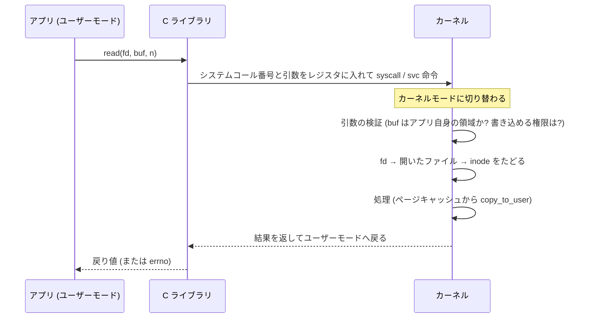
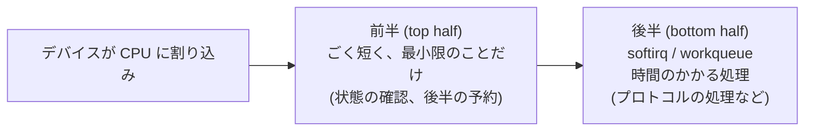
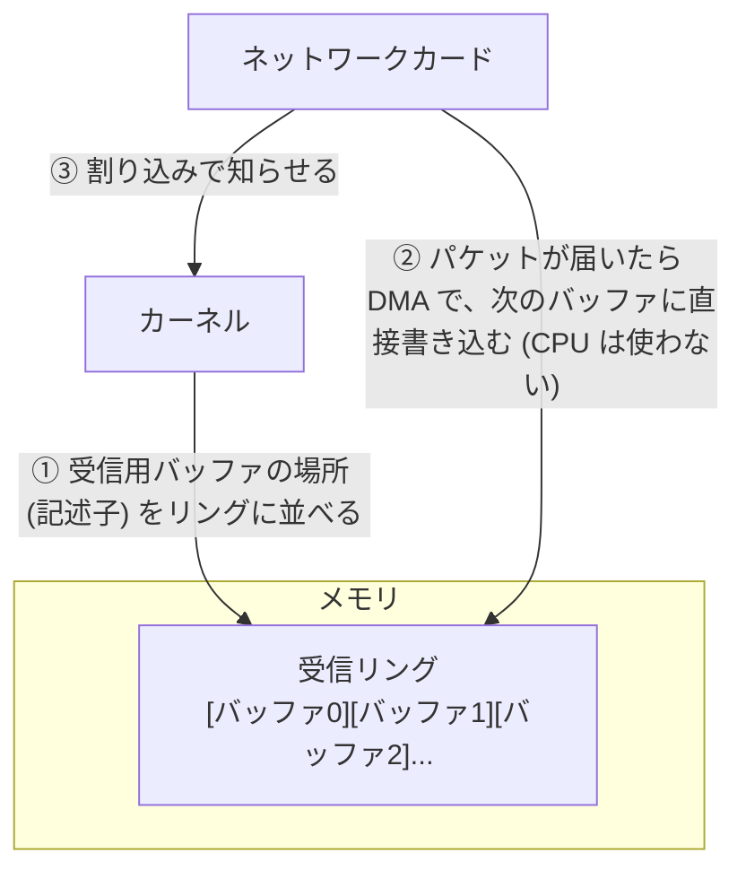
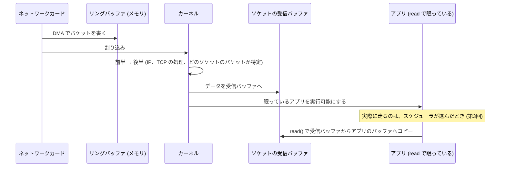
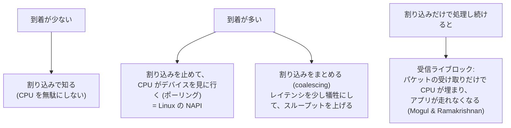

# 図1: システムコールと割り込みの経路

## 1. システムコール1回の流れ

固定のコスト(運ぶ量によらない)と、運ぶ量に比例するコスト(コピー)の和になる。

| 操作 | 実測(Apple M5) |
|---|---|
| 関数呼び出し | 約 0.5 ns |
| `clock_gettime`(カーネルに入らない) | 約 15 ns |
| `getppid` | 約 85〜88 ns |
| `read(/dev/zero, 1B)` | 約 241〜245 ns |

## 2. 1回で運ぶ量と、速度(演習1)

| バッファ | 速度 | 1回あたり |
|---|---|---|
| 1 B | 4.1 MB/s | 247 ns |
| 16 B | 64.5 MB/s | 248 ns |
| 256 B | 976.5 MB/s | 262 ns |
| 4 KiB | 9,492 MB/s | 432 ns |
| 64 KiB | 20,906 MB/s | 3,135 ns |
| 1 MiB | 22,064 MB/s | 47,523 ns |

1〜256 B では、1回あたりの時間がほぼ一定(約 250 ns)。**時間は、回数で決まっている**。1 B と 1 MiB で、速度は約 5,400 倍違う。

## 3. 割り込みの前半と後半

前半は、他の割り込みを受けにくい状態で動くので、短くする。

## 4. DMA とリングバッファ

## 5. ネットワーク受信の全経路

## 6. 割り込みの嵐と、ポーリングへの切り替え

