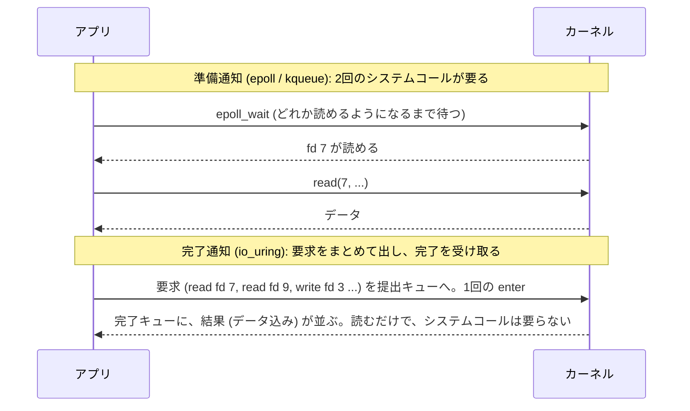
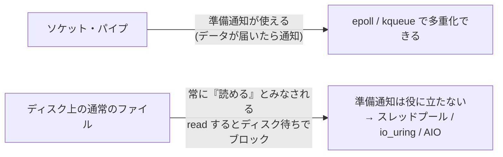
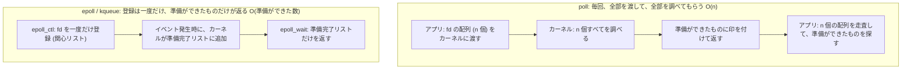
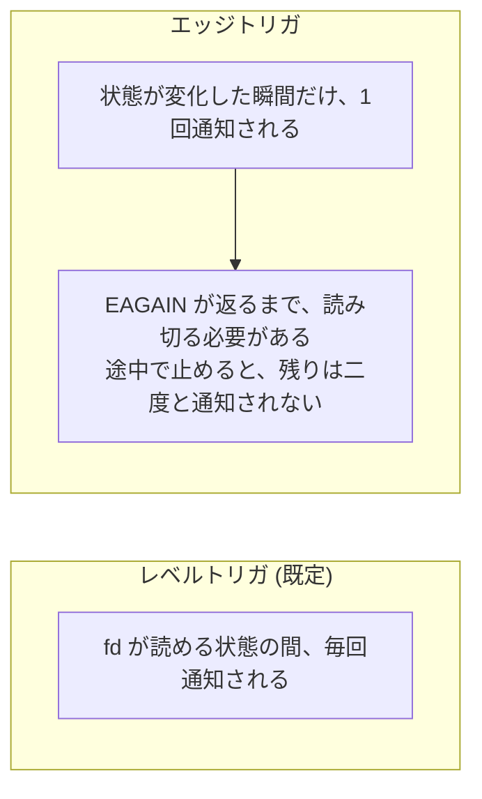
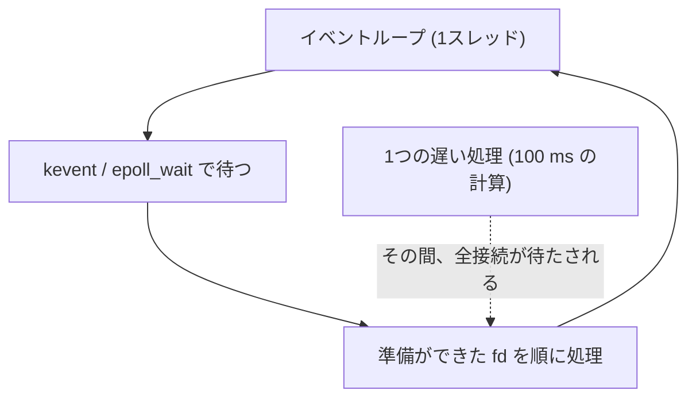

# 図2: I/O のモデルと、epoll / kqueue の仕組み

## 1. 5つのモデル

| モデル | 待つ間 | 通知されるもの | 例 |
|---|---|---|---|
| ブロッキング | スレッドが眠る | I/O の完了 | 普通の `read()` |
| ノンブロッキング | すぐ戻る (`EAGAIN`)。アプリが繰り返し試す | なし | `O_NONBLOCK` |
| I/O 多重化 | 多数の fd を、まとめて待つ | **準備ができた**fd の一覧 | select、poll、epoll、kqueue |
| シグナル駆動 | 別の仕事をする | 準備ができたというシグナル | SIGIO |
| 非同期 I/O | 別の仕事をする | **完了**(データはすでにバッファにある) | POSIX AIO、io_uring |

## 2. 準備通知と完了通知

## 3. 通常のファイルには、準備通知が効かない

## 4. poll と epoll/kqueue の違い

## 5. 実測(演習2、接続のうち活発なのは 10 本、Apple M5)

| 接続数 | threads | poll | kqueue |
|---|---|---|---|
| 100 | 220,774 | 229,831 | 258,860 |
| 1,000 | 232,051 | **64,010** | 258,367 |
| 3,000 | 228,925 | **21,987** | 255,389 |
| 5,000 | 221,959 (スレッド上限 4,096) | **15,531** | 254,242 |

(往復/秒。poll は接続数に反比例して遅くなった。kqueue は変わらない。threads は速度は落ちないが、メモリとスレッド数の上限がある。)

## 6. レベルトリガとエッジトリガ

## 7. 1スレッドのイベントループ

マルチコアを使うには、イベントループを複数(コアごと)起動し、`SO_REUSEPORT` で、同じポートを待ち受ける。
