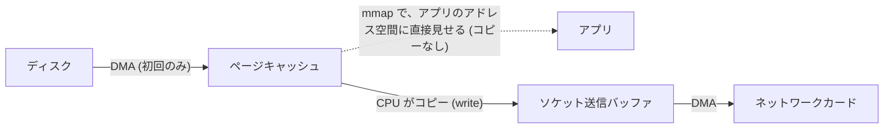
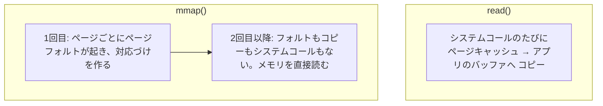

# 図3: ゼロコピー

ファイルの内容を、ソケットで送る。データが、どこをどう動くか。

## 1. read + write(素朴な方法)

- CPU によるコピー: **2回**
- システムコール: `read` と `write` が各1回(ループなので、何度も)

## 2. mmap + write

- CPU によるコピー: **1回**
- 代償: ページテーブルの設定、ページフォルト(第2回)

## 3. sendfile

- アプリのバッファを通らない。
- 1回のシステムコールで、大きな量を送れる。

## 4. 実測(演習3、512 MiB、ループバック TCP、Apple M5)

| 方法 | 速度 | 送信側の sys CPU |
|---|---|---|
| read + write | 8,519〜8,710 MB/s | 約 0.060 秒 |
| mmap + write | 9,657〜9,884 MB/s | 約 0.054〜0.056 秒 |
| sendfile | **15,069〜15,962 MB/s** | **約 0.034〜0.036 秒** |

sendfile は、read + write の約 1.8 倍の速度、送信側の CPU は約 4 割少ない。

## 5. ゼロコピーが使えない場面

| 場面 | 理由 |
|---|---|
| アプリが TLS で暗号化する | データが、ユーザー空間で加工される。kTLS(Linux)で、暗号化をカーネルに移すと緩和できる |
| 圧縮、チェックサムなどの加工 | データの中身に触る必要がある |
| `mmap` の落とし穴 | 他のプロセスがファイルを切り詰めると SIGBUS。ディスクを待つページフォルトで、どこで止まるか分からない |

## 6. mmap と read(演習4、ページキャッシュ上の 512 MiB)

| 方法 | 順次 | ページフォルト |
|---|---|---|
| read(64 KiB) | 13,785〜17,674 MB/s | +4 |
| mmap 1回目 | 16,393〜19,398 MB/s | +32,768 |
| mmap 2回目 | **69,597〜76,663 MB/s** | +0 |

| 方法 | ランダム 4 KiB | ページフォルト |
|---|---|---|
| pread | 609〜629 ns | +0 |
| mmap 1回目 | 349〜356 ns | +32,707 |
| mmap 2回目 | **279〜282 ns** | +0 |

これは、すべてがページキャッシュにある条件。ディスクから読むときのページフォルトは、ブロックして待つ。
