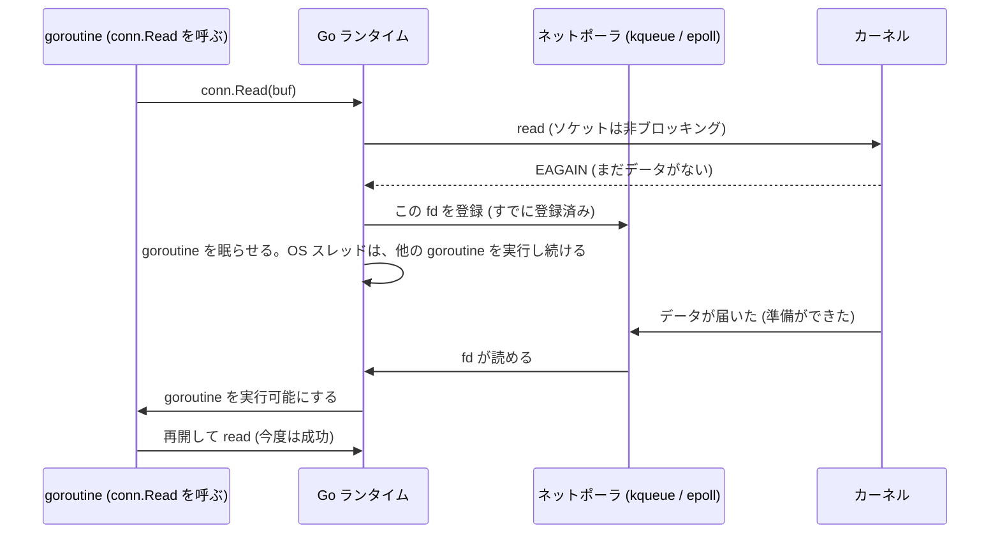
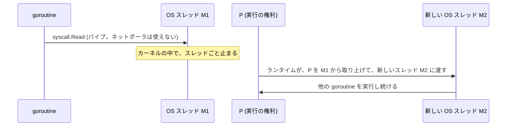

# 図4: Go のネットポーラと、スレッドの数

## 1. conn.Read の裏側

**プログラマは、ブロッキングの素直な書き方をしたまま、イベント駆動の効率を得る。**

## 2. ブロックするシステムコールの場合

ネットポーラが使えない待ち(通常のファイルのディスク I/O、生の `syscall.Read` など)は、**待つ数だけ、OS スレッドが増える**。

## 3. 実測(演習5、Apple M5)

| 状況 | OS スレッド | goroutine | スタック使用 |
|---|---|---|---|
| 起動直後 | 5 | 1 | 0.2 MB |
| **A. 3,010 本の接続を、goroutine が `Read` で待つ** | **11** | 3,012 | 6.4 MB |
| **B. さらに、ブロックする `syscall.Read` を 200 個** | **210** | 3,212 | 13.0 MB |
| 解放後 | 210 | 3,012 | 13.0 MB |

- A: 接続 3,010 本でも、スレッドは約 6 本増えただけ。1 goroutine あたりのスタックは約 2.1 KB。
- B: ブロックするシステムコール 200 個で、スレッドが約 200 本増えた。
- 解放した後も、スレッドは減らなかった(210 のまま)。ランタイムが、再利用のために保持していると考えられるが、確認していない。

**暇な接続 3,000 本があるまま、活発な 10 本が往復**: 129,566 往復/秒(平均 77.2 µs)。

## 4. 3つの流儀の比較(演習2、C)

## 5. 設計の選択

| 設計 | 長所 | 短所 | 例 |
|---|---|---|---|
| 1接続1スレッド | 書き方が素直 | 数の上限、メモリ、切り替え | 古い Apache(prefork/worker) |
| 1スレッドのイベントループ | メモリが少ない、競合がない | 遅い処理が全体を止める。1コアしか使えない | Redis、Node.js |
| コアごとのイベントループ(`SO_REUSEPORT`) | マルチコア | 複雑 | nginx |
| goroutine + ネットポーラ | 素直な書き方で、効率がよい | ブロックするシステムコール、メモリ(接続ごとのバッファ) | Go のサーバー全般 |
| `io_uring` | 準備通知と読み書きを一体化、ファイルにも使える | 複雑、攻撃面(Linux のみ) | 新しい高性能サーバー |
