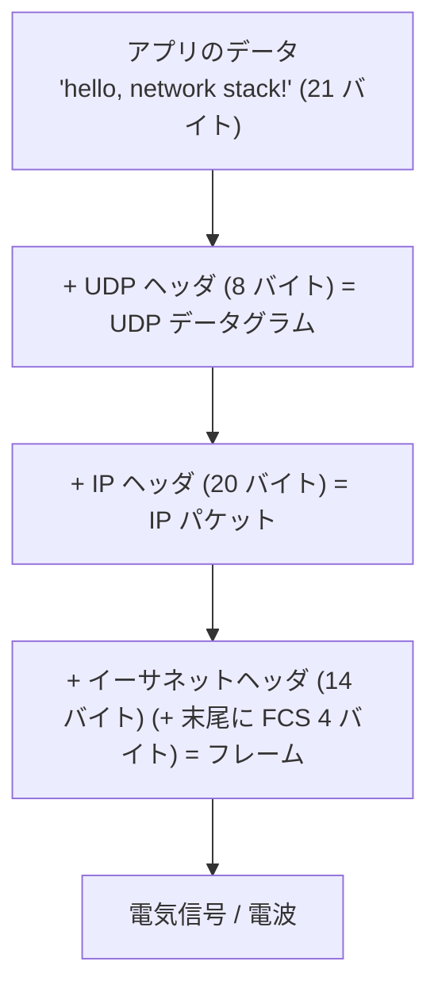
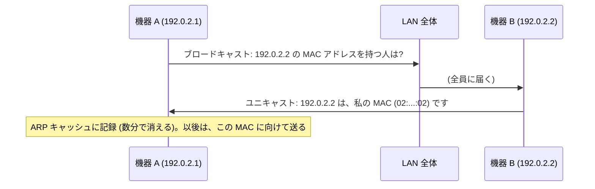
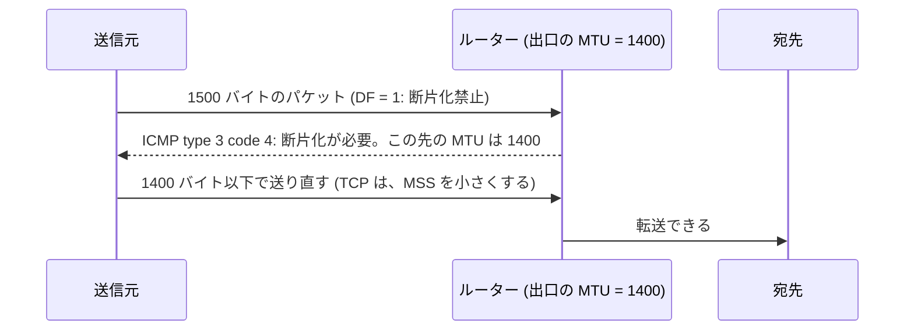
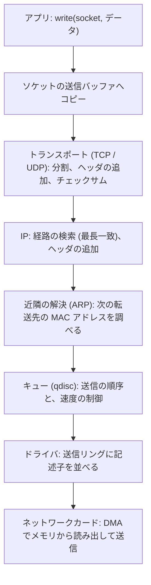

# 第7回 ネットワークスタック

> ステータス: 執筆済み(第1版)
> 前提: 第6回(ソケット、受信の経路、割り込み、DMA)
> 演習言語: Go
> 所要目安: 本文 3時間 + 演習 4〜5時間
> **この環境ではパケットの取得(`tcpdump`、raw ソケット)ができない(管理者権限が要る)。実際のパケットの観察は、説明のみで、手元の演習は、パケットを自分で組み立てる形で行った。**

## この回のゴール

この回を終えると、次のことが説明できるようになる。

1. ネットワークが「層」に分かれている理由と、各層が何を担当するのか。データが各層を通るとき、何が起きるのか(カプセル化)。
2. イーサネットのフレーム、IPv4 のヘッダ、UDP のヘッダを、バイト単位で読める。
3. ARP とスイッチは、何を学習し、何を解決しているのか。
4. IP アドレスの割り当て、サブネット、NAT の仕組み。IPv4 と IPv6 の違い。
5. MTU、断片化、MSS、経路 MTU 探索。VPN の中で「なぜか大きな通信だけが止まる」という障害の原因。
6. ルーターは、宛先に対して、どうやって次の転送先を決めるのか(最長一致)。それを高速に行う方法。
7. UDP と TCP の、使う側から見た違い。

第6回で、パケットがネットワークカードに届き、ソケットのバッファを経て、アプリの `read()` に届くところまで見た。この回では、そのパケットの**中身と、運ばれ方**を扱う。第8回の TCP、第9回の TLS と HTTP、第10回の DNS とロードバランサは、すべて、この回の仕組みの上に載る。

---

## 1. 層構造とカプセル化

### 1.1 なぜ層に分けるのか

ネットワークの仕事は、膨大である。電気信号の波形、Wi-Fi の電波、ケーブルの種類、世界中の機器を経由する経路、届かなかったときの再送、暗号化、ウェブのページの形式。これらを、1つの巨大なプログラムとして作ると、誰も全体を理解できず、何か1つ変えるたびに、全部が壊れる。

そこで、仕事を**層**に分け、各層は、**すぐ下の層が提供する機能だけを使い、すぐ上の層に、機能を提供する**。層の間の約束(インターフェース)だけを守れば、各層の中身は、自由に入れ替えられる。

| 層 | 役割 | 例 | 運ぶ単位の呼び名 |
|---|---|---|---|
| アプリケーション | 利用者の用途のためのデータの形式 | HTTP、DNS、TLS(の上) | メッセージ |
| トランスポート | **プロセスからプロセス**へ。ポート番号で区別する | TCP、UDP | セグメント(TCP)、データグラム(UDP) |
| ネットワーク(インターネット) | **機器から機器**へ。複数のネットワークをまたぐ。経路を選ぶ | IP(IPv4、IPv6)、ICMP | パケット |
| リンク | **同じネットワークの中**の、隣の機器へ | イーサネット、Wi-Fi | フレーム |
| 物理 | 電気、光、電波の信号 | ケーブル、電波 | ビット |

OSI 参照モデルは 7 層(物理、データリンク、ネットワーク、トランスポート、セッション、プレゼンテーション、アプリケーション)だが、実際のインターネットは、上の表のような **TCP/IP の 4〜5 層**で動いている。実務では、「L2(リンク)」「L3(ネットワーク)」「L4(トランスポート)」「L7(アプリケーション)」という呼び方を使う(ロードバランサの「L4 と L7」は、第10回)。

### 1.2 砂時計モデル

インターネットの設計の特徴は、**真ん中の IP が、細くて、全員が同じ**ことである。

```
        アプリ: HTTP, DNS, SMTP, SSH, ...      ← 多様
       トランスポート: TCP, UDP, QUIC
                  IP                            ← ここだけ、1つ (細い腰)
       リンク: イーサネット, Wi-Fi, 4G/5G, 光   ← 多様
```

上の層も下の層も、新しいものがどんどん現れたが、**IP だけは、変えずに済んだ**。新しいアプリは、IP の上に載せるだけでよく、新しいリンクは、IP パケットを運べればよい。これが、インターネットが成長できた理由であり、同時に、**IP より下や上を変えるのが難しい**(IPv6 への移行が遅い)理由でもある。

### 1.3 エンドツーエンド原則

Saltzer、Reed、Clark(1984)の**エンドツーエンド原則**は、設計の指針である。

> ある機能が、通信の両端でしか正しく実現できないなら、その機能を、途中のネットワークで実現しても、完全にはならない。途中でやるのは、性能のための最適化に限るべきである。

例えば、「ファイルが正しく届いたか」は、途中の各リンクがチェックしても、最後に、受け取った側が検証しなければ保証できない(途中の機器のメモリが壊すかもしれない)。だから IP は、**単純に、ベストエフォートで運ぶだけ**(届く保証も、順序の保証も、ない)にして、信頼性は、両端の TCP に任せた。

### 1.4 カプセル化

データは、層を下りるたびに、**ヘッダが付けられる**。受け取る側は、層を上るたびに、ヘッダを外す。



演習1で、この3つのヘッダを自分で組み立てた。21 バイトのデータを送るのに、**14 + 20 + 8 = 42 バイトのヘッダ**が付き、全体で 63 バイトになる。データより、ヘッダのほうが大きい。**小さいメッセージほど、ヘッダのオーバーヘッドの割合が大きい**。

図は [diagrams/01-layers-and-encapsulation.md](diagrams/01-layers-and-encapsulation.md)。

---

## 2. リンク層: イーサネット、ARP、スイッチ

### 2.1 イーサネットのフレーム

同じ LAN の中の、隣の機器に、データを届ける仕組みが、リンク層である。イーサネットのフレームは、次の形をしている。

| フィールド | 大きさ | 内容 |
|---|---|---|
| 宛先 MAC アドレス | 6 バイト | 届け先の機器 |
| 送信元 MAC アドレス | 6 バイト | 送り元の機器 |
| EtherType | 2 バイト | 中身の種類。0x0800 = IPv4、0x86DD = IPv6、0x0806 = ARP |
| データ | 46〜1500 バイト | 上の層のデータ(IP パケット) |
| FCS | 4 バイト | 誤り検出用の CRC |

**MTU**(Maximum Transmission Unit)は、リンクが1回に運べる、**データ部の最大の大きさ**で、イーサネットでは通常 **1500 バイト**。

**MAC アドレス**は、ネットワークカードごとの、48 ビットのアドレス(例: `02:00:00:00:00:01`)である。最初の1バイトの、下位 2 ビットに意味がある。

| ビット | 意味 |
|---|---|
| 最下位ビット(0x01) | 1 ならマルチキャスト(全員宛の `ff:ff:ff:ff:ff:ff` も、これに含まれる) |
| 次のビット(0x02) | 1 なら、ローカルに管理されたアドレス(製造元が割り当てたものではない) |

演習1の MAC アドレス `02:00:00:00:00:01` は、先頭が `02` で、ローカル管理のアドレスである(実在の機器と衝突しない)。

### 2.2 スイッチ

昔の**ハブ**は、受け取ったフレームを、全部のポートに流していた。現代の**スイッチ**は、MAC アドレスを**学習**して、必要なポートにだけ流す。

1. フレームが届いたら、**送信元 MAC アドレス**と、**届いたポート**を、**学習表**に記録する。
2. **宛先 MAC アドレス**が、学習表にあれば、そのポートにだけ転送する。
3. 学習表にない(未知)、またはブロードキャスト宛なら、**届いたポート以外の全ポートに流す**(フラッディング)。

学習表の項目は、一定時間(数分)使われないと消える。スイッチの間に**輪**(ループ)があると、フレームが、永遠に回り続ける(ブロードキャストストーム)ので、**STP**(スパニングツリープロトコル)などで、輪を断つ。

### 2.3 ARP

IP パケットを、同じ LAN の相手に送るには、**相手の MAC アドレス**が要る。アプリが知っているのは、IP アドレスだけである。この対応を調べるのが **ARP**(Address Resolution Protocol)である。



- 宛先が**同じ LAN の外**なら、宛先 IP の MAC ではなく、**デフォルトゲートウェイ(ルーター)の MAC**を ARP で調べて、そこに送る。
- ARP には**認証がない**。誰でも嘘の応答を返せる(ARP スプーフィング)。

図は [diagrams/02-ethernet-arp-switch.md](diagrams/02-ethernet-arp-switch.md)。

### 2.4 MTU の実際

演習5で、この Mac のネットワークインターフェースの MTU を見た。

| インターフェース | MTU | 意味 |
|---|---|---|
| lo0(ループバック) | **16,384** | 自分自身への通信。物理的な制約がない |
| en0(有線または Wi-Fi の、通常のインターフェース) | **1,500** | イーサネットの標準 |
| utun(VPN などのトンネル) | **1,380 など**(1,000〜2,000 と、まちまち) | カプセル化のヘッダの分だけ、小さくなる |

トンネルの MTU が小さいのは、トンネルが、**元の IP パケットを、さらに別の IP パケットの中に入れる**ため、外側のヘッダの分だけ、中に入れられる量が減るからである。**この「MTU が違う経路がある」ことが、§3.5 の障害の原因になる**。

---

## 3. ネットワーク層: IP

### 3.1 IPv4 ヘッダ

IPv4 のヘッダは、最小で **20 バイト**である。

| フィールド | ビット | 内容 |
|---|---|---|
| バージョン | 4 | 4 |
| ヘッダ長(IHL) | 4 | 4 バイト単位。通常 5(= 20 バイト) |
| DSCP / ECN | 8 | 優先度の印、輻輳の通知(第8回) |
| 全体の長さ | 16 | ヘッダ + データ。最大 65,535 |
| 識別子 | 16 | 断片化したとき、同じパケットの断片を見分ける |
| フラグ | 3 | **DF**(断片化禁止)、MF(まだ続きがある) |
| 断片のオフセット | 13 | 8 バイト単位 |
| **TTL** | 8 | 1 つのルーターを通るたびに 1 減る。0 になったら破棄 |
| プロトコル | 8 | 中身の種類。1 = ICMP、6 = TCP、17 = UDP |
| ヘッダチェックサム | 16 | ヘッダの誤り検出 |
| 送信元アドレス | 32 | |
| 宛先アドレス | 32 | |

演習1で組み立てた、実際のヘッダを読む。

```
45 00 00 31 1c 46 40 00 40 11 9a 72 c0 00 02 01 c0 00 02 02
│  │  └─┬─┘ └─┬─┘ └─┬─┘ │  │  └─┬─┘ └───┬───┘ └───┬───┘
│  │  全体長 識別子 DF   TTL プロトコル チェックサム 送信元    宛先
│  │   49     0x1c46     64   17(UDP)   0x9a72   192.0.2.1  192.0.2.2
│  DSCP/ECN = 0
バージョン 4、ヘッダ長 5 語
```

全体の長さ 0x31 = 49 = 20(IP)+ 8(UDP)+ 21(データ)。フラグの `40 00` は、DF ビット(断片化禁止)が立っている。

**アドレスの区分**:

| 範囲 | 用途 |
|---|---|
| 10.0.0.0/8、172.16.0.0/12、192.168.0.0/16 | プライベート(インターネットでは使えない) |
| 127.0.0.0/8 | ループバック(自分自身) |
| 169.254.0.0/16 | リンクローカル(DHCP が使えないときの自己割り当て) |
| 100.64.0.0/10 | キャリアグレード NAT 用 |
| 192.0.2.0/24、198.51.100.0/24、203.0.113.0/24 | 文書の例用(実在しない。演習1が使用) |

### 3.2 CIDR とサブネット

アドレスは、**ネットワーク部**と**ホスト部**に分かれる。その境目を、**プレフィックス長**(`/24` など)で表す。`192.0.2.0/24` は、上位 24 ビットが `192.0.2` で固定、下位 8 ビットが自由で、256 個のアドレスを含む(ネットワークアドレスとブロードキャストアドレスを除くと、254 台)。

昔は、アドレスを、固定の長さのクラス(A、B、C)に分けていたが、無駄が大きかった。1993 年の **CIDR**(Classless Inter-Domain Routing)で、任意のプレフィックス長を使えるようになり、ルーティング表の項目を、まとめて(集約して)減らせるようになった。

### 3.3 NAT

IPv4 のアドレスは、約 43 億個しかなく、2011 年には、中央の在庫(IANA)が尽きた。そこで、家庭や企業は、内部でプライベートアドレスを使い、外に出るときだけ、1つの公開アドレスに**変換**する。これが **NAT**(Network Address Translation)である。

**NAPT**(ポート変換つきの NAT)の動き:

1. 内部の `10.0.0.5:50000` から、外部の `203.0.113.9:443` へ、パケットが出る。
2. NAT 機器が、送信元を `公開アドレス:ポート(例えば 40001)` に書き換え、対応を**表に記録**する。
3. 返事が `公開アドレス:40001` に届いたら、表を引いて、`10.0.0.5:50000` に書き換えて、内部に渡す。

NAT の代償:

- **内側から出る接続しか、受け付けない**(表に記録がないパケットは、行き先が分からない)。外から内部のサーバーに接続するには、ポートの転送設定が要る。
- NAT 機器は、**接続の状態を覚えている**。状態が失われる(再起動、タイムアウト)と、既存の接続が切れる。
- IP アドレスが、アプリのデータの中に書かれている場合(古い FTP など)、壊れる。
- **エンドツーエンド原則を崩す**。両端が、直接、通信できない。

### 3.4 IPv6

IPv6 は、アドレスを **128 ビット**にして、枯渇を解決した。ヘッダも整理された。

| | IPv4 | IPv6 |
|---|---|---|
| アドレス | 32 ビット | 128 ビット |
| ヘッダ | 20 バイト以上(可変) | **40 バイト固定** |
| ヘッダチェックサム | あり | **なし**(上の層に任せる) |
| 途中のルーターでの断片化 | する(DF がなければ) | **しない**(送信元だけ) |
| アドレス解決 | ARP | NDP(ICMPv6 の一部) |

ヘッダチェックサムが廃止されたのは、各ルーターが、TTL を減らすたびに、再計算していた(§3.6)のが、無駄だったためである。

### 3.5 ICMP、TTL、traceroute

**ICMP**(Internet Control Message Protocol)は、IP の**制御用**のメッセージである。主なものは次のとおり。

| type | 内容 |
|---|---|
| 8 / 0 | エコー要求 / エコー応答(**ping**) |
| 3 | 宛先に届けられない。code 4 は「断片化が必要だが DF が立っている」 |
| 11 | **TTL 超過**(time exceeded) |

**traceroute** は、TTL を使う。

1. TTL = 1 のパケットを、宛先に向けて送る。最初のルーターが、TTL を 0 にして、パケットを捨て、**「TTL 超過」の ICMP を送り返す**。送り主のアドレスから、最初のルーターが分かる。
2. TTL = 2 で送る。2 つ目のルーターが、同じことをする。
3. 宛先に届くまで、TTL を増やす。

TTL は、ルーティングの誤りで、パケットが輪を永遠に回らないようにするための、**安全装置**でもある。

### 3.6 チェックサム

IP ヘッダの誤り検出に、**インターネットチェックサム**(RFC 1071)が使われる。**16 ビットの語を、すべて足し(桁あふれは下位に足し戻し)、結果のビットを反転**したものである。

演習1で実装し、Wikipedia の有名な例(ヘッダ `45 00 00 73 00 00 40 00 40 11 .. .. c0 a8 00 01 c0 a8 00 c7`)で、**0xb861** になることを確認した(期待値と一致)。

**検証**は、受け取った側が、チェックサム欄も含めて全体を合計し直し、**0 になれば正しい**とする。

演習1で、次のことも確かめた。

| 状況 | 検出できたか |
|---|---|
| データの 1 ビットを反転 | **検出できた** |
| 16 ビットの語を 2 つ入れ替え | **検出できなかった**(足し算は、順序を気にしないため) |

チェックサムは、**単純な偶発的な誤りを検出するための、弱い仕組み**である。強い検出が必要なら、上の層(TLS、アプリのチェックサム)で行う(第9回)。

**TTL を減らすたびの再計算**: ルーターは、TTL を 1 減らすため、チェックサムを更新する必要がある。ヘッダ全体を足し直さなくても、**変わった語の差分だけで更新**できる(RFC 1624)。演習1で、TTL を 64 → 63 に変えたとき、差分で更新した値(0x9b72)が、最初から計算し直した値と、**一致**した。ルーターが、1秒に何百万ものパケットを処理できる理由の1つである。

### 3.7 実際のパケットのチェックサム(演習5)

演習5で、`ping` を自分で作った。カーネルが返した**実際の ICMP 応答**に対して、演習1と同じチェックサムの実装で検算すると、**一致した**(ICMP のチェックサムが正しい)。自作の実装が、本物のパケットでも通ることを確認できた。

一方、**IP ヘッダのチェックサム欄は 0x0000** で、検算は成り立たなかった。ループバックのインターフェースは、**チェックサムのオフロード**(`TXCSUM`、`RXCSUM`、`ifconfig lo0` に表示される)を使っており、**チェックサムを計算せずに、省略している**ためである。同じマシンの中を通るだけなら、ビットの誤りは起きないので、計算が無駄だからである(§7)。

### 3.8 断片化と経路 MTU 探索

**MTU を超える大きさのパケット**は、そのままでは、リンクを通れない。方法は2つある。

**断片化**: ルーターが、パケットを小さく切り分ける(識別子、フラグ、オフセットで、断片を印づける)。最終的な宛先が、すべての断片を集めて、元に戻す(**再構成**)。

断片化は、問題が多い。

- **1個の断片が失われると、パケット全体が失われる**(TCP が再送すると、また全部を断片化する)。
- 再構成のために、宛先が、メモリを使って待つ(攻撃にも使われる)。
- 後ろの断片には、ポート番号がなく、ファイアウォールが扱いにくい。

そこで、現代は、**経路 MTU 探索**(PMTUD)を使う。



- パケットに **DF** を立てて送る。
- 途中で、MTU より大きいパケットが来たルーターは、DF が立っていれば、**捨てて、ICMP で「この先の MTU は N」と知らせる**。
- 送信元は、その大きさに合わせる。

**MSS**(Maximum Segment Size)は、TCP が1個のセグメントに入れるデータの最大値で、**MTU − IP ヘッダ(20)− TCP ヘッダ(20)**。イーサネットでは、1500 − 40 = **1460 バイト**である(IPv6 は 1440)。

### 3.9 「大きな通信だけが止まる」障害(PMTU ブラックホール)

VPN やトンネルを通る経路で、**小さな通信(ping、ログイン)は動くのに、大きな通信(大きなファイルの転送、HTTPS のハンドシェイクの一部)だけが、途中で止まる**ことがある。原因は、次のとおり。

1. 経路の途中に、MTU が小さい区間(トンネル、1,380 など)がある。
2. 大きなパケット(DF 付き)が、その区間で捨てられる。
3. 本来は ICMP「断片化が必要」が返るが、**ファイアウォールが ICMP を全部ブロックしている**ため、送信元に届かない。
4. 送信元は、パケットが失われたとしか分からず、**同じ大きさで再送し続ける**。

**ICMP を、一律にブロックしてはいけない**(少なくとも type 3 code 4 は通す)。対策として、TCP の MSS を、ルーターで強制的に小さく書き換える(**MSS クランピング**)方法がよく使われる。

---

## 4. ルーティング

### 4.1 転送と経路制御

2つの別の仕事がある。

| | 転送(forwarding) | 経路制御(routing) |
|---|---|---|
| 内容 | **パケット1個ごと**に、次の出口を決める | **ルーティングテーブルを作る** |
| 頻度 | パケットごと(毎秒、数百万〜数十億回) | 変化があったとき(秒〜分の単位) |
| 層 | データプレーン | コントロールプレーン |

転送は、ルーティングテーブルを引くだけである。経路制御は、OSPF、IS-IS(組織の内部)、**BGP**(組織の間、第10回)などのプロトコルで、ルーター同士が情報を交換して、テーブルを作る。

### 4.2 最長一致

ルーティングテーブルは、「プレフィックス → 次の転送先」の対応の集まりである。宛先アドレスに対して、**複数のプレフィックスが一致する**ことがある。

| プレフィックス | 次の転送先 |
|---|---|
| 0.0.0.0/0(デフォルト) | ルーター A |
| 10.0.0.0/8 | ルーター B |
| 10.1.0.0/16 | ルーター C |
| 10.1.2.0/24 | ルーター D |

宛先 `10.1.2.7` は、4つすべてに一致する。**最も長く(最も具体的に)一致するもの**、すなわち `/24` を選ぶ。これが**最長一致**(longest prefix match)である。デフォルトルートは、他のどれにも一致しなかったときの、最後の砦である。

### 4.3 実装と性能(演習3)

100 万ものエントリ(現在のインターネットの全経路は、IPv4 で約 100 万個)に対して、1秒に数億回の検索を行う必要がある。演習3で、3つの実装を比べた。

| 実装 | 方法 | 検索のコスト |
|---|---|---|
| naive | 全エントリを順に調べる | O(エントリ数) |
| trie | アドレスのビットを、上から順にたどる2進の木 | O(32)(最大 32 回の参照) |
| dir248 | 上位 24 ビットで、2^24 個(1,677 万個)の表を、一度で引く | O(1) |

Apple M5 での結果(1 回の検索あたり、ランダムな宛先)を示す。

| エントリ数 | naive | trie | dir248 | trie のノード数 |
|---|---|---|---|---|
| 100 | 73.2 ns | 18.8 ns | 2.9 ns | 1,457 |
| 1,000 | 688.1 ns | 25.9 ns | 2.8 ns | 12,087 |
| 10,000 | 6,801.1 ns | 41.2 ns | 2.9 ns | 90,262 |
| 100,000 | **69,708.6 ns** | 64.1 ns | 2.7 ns | 672,217 |
| 200,000 | **136,468.6 ns** | 80.2 ns | 2.7 ns | 1,200,675 |

(正しさは、10,000 エントリ、20 万個のランダムな宛先で、naive と全く別の実装との照合を行い、**不一致 0** だった。)

分かること:

- **naive は、エントリ数に比例して遅くなる**(200,000 個で 136 µs)。1秒に数千回しか検索できず、ルーターには使えない。
- **trie は、対数的にしか遅くならない**(18.8 → 80.2 ns)。ただし、ノードが増えると、キャッシュに載らなくなり、少しずつ遅くなる。
- **dir248 は、エントリ数によらず、約 2.8 ns で一定**。ただし、**64 MiB の表**を使い、/25 より長いプレフィックスに対応するには、追加の仕組み(第2段の表)が要る。**メモリを使って、時間を買う**設計である。

**測定でつまずいた点**: 最初の版は、`dir248` が **0.2 ns** と出た(1 サイクルの時間未満で、不可能)。検索結果を使っていなかったため、コンパイラが、メモリ読み出しを**消して**しまっていた(境界チェックだけが残っていた)。結果を大域変数に書くように直して、2.7〜2.9 ns になった。第1回(分岐予測)、第2回(TLB)、第4回(カウンタ)と、同じ種類の落とし穴である。

また、dir248 の 2.8 ns は、**互いに独立な検索を、連続して行ったときのスループット**であり、CPU が、複数のメモリ読み出しを重ねて処理できる(第1回の MLP)ためである。1回の検索の、依存した待ち時間(レイテンシ)ではない。

### 4.4 ハードウェアの工夫

専用のルーターは、**TCAM**(Ternary Content-Addressable Memory)を使う。メモリの全項目を、**並列に**照合し、1回で最長一致を返す。非常に速いが、消費電力と価格が大きい。

### 4.5 ECMP

同じ宛先に至る経路が複数あるとき、パケットを、複数の経路に分散できる(**ECMP**: Equal-Cost Multi-Path)。このとき、**同じ接続のパケットは、同じ経路を通す**ために、**5つ組**(送信元 IP、宛先 IP、送信元ポート、宛先ポート、プロトコル)の**ハッシュ**で、経路を選ぶ。パケットが別々の経路を通ると、順序が入れ替わり、TCP の性能が落ちる(第8回)。

図は [diagrams/03-ip-header-fragmentation-routing.md](diagrams/03-ip-header-fragmentation-routing.md)。

---

## 5. トランスポート層入門

### 5.1 ポートと 5 つ組

IP アドレスは、**機器**を指す。1台の機器で、多数のプロセスが通信しているので、さらに**ポート番号**(16 ビット、0〜65,535)で、プロセスを区別する。接続は、**5つ組**で識別される。

```
(プロトコル, 送信元 IP, 送信元ポート, 宛先 IP, 宛先ポート)
```

サーバーは、決まったポート(HTTPS なら 443)で待ち、クライアントは、OS が割り当てる、使い捨てのポート(**エフェメラルポート**)を使う。第6回で、この範囲が尽きることを、実際に経験した。

### 5.2 UDP

UDP は、IP の上に、**ポート番号**と**チェックサム**だけを足した、薄い層である。ヘッダは **8 バイト**。

| フィールド | 大きさ |
|---|---|
| 送信元ポート | 2 バイト |
| 宛先ポート | 2 バイト |
| 長さ | 2 バイト |
| チェックサム | 2 バイト |

**UDP のチェックサム**は、データだけでなく、**疑似ヘッダ**(送信元 IP、宛先 IP、プロトコル、UDP の長さ)も含めて計算する。これにより、**IP ヘッダが壊れて、別の宛先に届いたパケット**を、UDP の層でも検出できる。

UDP は、次の性質を持つ。

- **メッセージの境界が保たれる**(1回の送信 = 1個のデータグラム = 1回の受信)。
- **信頼性がない**(届かない、重複する、順序が入れ替わる)。
- **接続がない**(事前の手続きなし)。

### 5.3 TCP

TCP は、**信頼できる、順序の保たれた、バイトの流れ**を提供する。ヘッダは、最小 **20 バイト**。詳細は、第8回で扱う。

### 5.4 UDP と TCP の違いを、ソケットで確かめる(演習2)

**A. メッセージの境界**: 10、20、30 バイトを、3回に分けて送った。

| プロトコル | 受信 |
|---|---|
| UDP | **10 バイト、20 バイト、30 バイト**(送ったとおりの境界で、3回) |
| TCP | **60 バイト**(1回で全部) |

TCP は、**バイトの流れ**で、メッセージの区切りを知らない。TCP でメッセージをやりとりするアプリは、**区切りを自分で決める**必要がある(長さを先頭に付ける、改行で区切る、など。HTTP も、この問題を解いている)。

**B. UDP の受信バッファあふれ**: 512 バイトのデータグラムを 10,000 個、一気に送り、受信側は 300 ms 読まない。

| 受信バッファ | 受信できた個数 | 損失 |
|---|---|---|
| 8,192 バイト | 15 | 99.8% |
| 65,536 バイト | 120 | 98.8% |
| 1,048,576 バイト | 1,927 | 80.7% |
| 8,388,608 バイト | 10,000 | 0.0% |

UDP は、受信バッファが一杯になると、**黙ってデータグラムを捨てる**。送信側にも、通知されない。バッファの大きさと受信できた個数の比(8,192 ÷ 15、65,536 ÷ 120、1,048,576 ÷ 1,927)は、どれも約 545 バイトで、**1個あたり、512 バイトのデータに、約 33 バイトの管理用の領域が加算されて、バッファに計上されている**と考えられる(確認はしていない)。

TCP は、同じ状況で、受信側のバッファが一杯になると、**送信側を止める**(ウィンドウ、第8回)ので、データを捨てない。**UDP を使うアプリは、受信の速度が追いつくことと、失われたときの扱いを、自分で設計する必要がある**。

**C. データグラムの最大サイズ**: この Mac では、**9,216 バイトまで**送れ、**9,217 バイトで `message too long` のエラー**になった(`net.inet.udp.maxdgram` が 9,216)。IPv4 の理論上の上限は 65,507 バイト(65,535 − 20 − 8)だが、**OS の設定で、もっと小さく制限される**。さらに、実際には、MTU(1,500)を超えると、断片化されるため、1,472 バイト(1,500 − 20 − 8)を超えるデータグラムは、避けるのが定石である。

---

## 6. バイト順序

多バイトの数(ポート番号、IP アドレス、長さ)を、ネットワークに送るとき、どちらの端のバイトから送るかが問題になる。インターネットは、**上位のバイトから送る**(**ビッグエンディアン**)と決めた。これを**ネットワークバイトオーダー**と呼ぶ。

x86 や ARM(通常の設定)は、**リトルエンディアン**(下位のバイトから)なので、送受信のたびに、変換が要る(C の `htons`、`htonl`、Go の `binary.BigEndian`)。演習1で、`binary.BigEndian.PutUint16` を使っているのは、このためである。

---

## 7. カーネルの中の、パケットの旅

アプリが `write()` したデータが、ネットワークカードから出るまでの流れ(送信側)を示す。受信側は、第6回で見た。



### 7.1 オフロード

CPU の負担を減らすため、ネットワークカードに、一部の処理を任せる。

| 機能 | 内容 |
|---|---|
| **チェックサムオフロード** | チェックサムの計算を、カードが行う。**演習5のループバックは、これを使って、IP ヘッダのチェックサムを省いていた** |
| **TSO / GSO**(セグメンテーションオフロード) | OS は、64 KB などの**大きなデータの塊**をカードに渡し、**カードが、MTU の大きさに分割**して、ヘッダを付けて送る |
| **GRO / LRO**(受信側の統合) | 受信した、小さなセグメントを、OS に渡す前に、1つの大きな塊にまとめる |

TSO と GRO により、**ホストの OS が扱うパケットの数が、ネットワーク上のパケットの数より、ずっと少なくなる**。第6回で見た、システムコールとコピーの固定のコストが、数十分の1になる。

**よくある混乱**: 送信側のホストで `tcpdump` すると、**MTU(1500)を超える**、例えば 64,000 バイトの「パケット」が見えることがある。それは、TSO のため、**カードに渡される前の塊**を見ているからで、実際にネットワークに出るときは、1500 バイト以下に分割される。

### 7.2 パケットのバッファ

Linux のカーネルは、パケットを `sk_buff` という構造で扱う。データの前に、**ヘッダ用の空き領域**を確保しておき、各層は、データをコピーせずに、前にヘッダを書き足していく。コピーを避ける工夫である(第6回のゼロコピーと、同じ考え方)。

### 7.3 Netfilter と接続追跡

Linux では、パケットの経路の、いくつかの点に、フックがあり、ファイアウォール(iptables、nftables)や、NAT が、そこで動く。NAT は、**接続追跡**(conntrack)で、接続ごとの状態(§3.3 の表)を保持する。接続の数が多いと、この表が溢れ、**新しい接続が失敗する**(`nf_conntrack: table full`)ことがある。

図は [diagrams/04-packet-path-in-kernel.md](diagrams/04-packet-path-in-kernel.md)。

---

## 8. パケットのコスト: 小さいパケットは高い

### 8.1 実測(演習4)

UDP のデータグラムの大きさを変えて、1 秒間、できるだけ多く送った(ループバック)。Apple M5 での結果を示す。

| データ | 送信 pps | 受信 pps | 受信 MB/s | 損失 |
|---|---|---|---|---|
| 16 B | 583,557 | 583,557 | 9.3 | 0.0% |
| 64 B | 556,618 | 556,618 | 35.6 | 0.0% |
| 256 B | 570,998 | 570,998 | 146.2 | 0.0% |
| 1,024 B | 559,975 | 475,248 | 486.7 | 15.1% |
| 1,472 B | 559,833 | 522,051 | 768.5 | 6.7% |
| 4,096 B | 515,130 | 515,130 | 2,110.0 | 0.0% |
| 8,192 B | 501,450 | 501,450 | 4,107.9 | 0.0% |

分かること:

- **1秒あたりのパケット数は、16 バイトから 8,192 バイトまで、ほぼ一定(約 50〜58 万)**。パケットの大きさが 512 倍になっても、送れる個数は 14% 減っただけである。
- そのため、**運べるバイト数は、データの大きさに比例して増える**(9.3 MB/s → 4,108 MB/s、約 440 倍)。
- つまり、コストは、**パケット1個あたり**にかかり(システムコール、IP と UDP の処理)、**バイトにはほとんどかからない**。第6回で見た、システムコールの固定のコストと、同じ構造である。
- 1,024 B と 1,472 B で、受信側の損失(15.1%、6.7%)が出たのは、送信側が速すぎて、受信側(同じプロセスの別の goroutine)が追いつかなかったためと考えられる。サイズによる傾向ではなく、**実行ごとのばらつき**の可能性が高い(複数回の測定はしていない)。

### 8.2 高速リンクでの予算

100 Gbps のリンクで、最小のイーサネットフレーム(64 バイト + プリアンブルなどの 20 バイト = 84 バイト)が、隙間なく流れると、**毎秒 約 1 億 4,880 万パケット**になる。1パケットに使える時間は、**約 6.7 ns**である。

1回のシステムコールだけで、約 85 ns(第6回)かかる。カーネルのネットワークスタックを通る方式では、**この速度は、1コアでは、到底処理できない**。専用ハードウェア、カーネルを迂回する方式(DPDK など、第6回)、複数のコアへの分散、オフロードが、必要になる。

---

## 9. 観測する

| 見たいもの | Linux | macOS |
|---|---|---|
| インターフェース、アドレス、MTU | `ip addr`、`ip link` | `ifconfig`、`networksetup` |
| ルーティングテーブル | `ip route`、`ip route get <宛先>` | `netstat -rn`、`route get <宛先>` |
| ARP(近隣)テーブル | `ip neigh` | `arp -an` |
| 経路 | `traceroute`、`mtr` | `traceroute` |
| ping(MTU の確認も) | `ping -M do -s <サイズ>`(DF を立てて送る) | `ping -D -s <サイズ>` |
| パケットの取得 | `tcpdump -i <if> -n`、`tshark`(**root が要る**) | 同左(**root が要る**。この環境では実行していない) |
| ソケット | `ss -tunap` | `netstat -an`、`lsof -i` |
| 統計 | `netstat -s`、`nstat`、`/proc/net/snmp` | `netstat -s` |
| オフロードの設定 | `ethtool -k <if>` | `ifconfig <if>`(options 欄) |

**経路 MTU の確認方法**(DF を立てて、大きさを変えて ping):

```bash
# macOS (1472 = 1500 − 20 − 8)。実在の宛先を指定する。この環境では実行していない
ping -D -s 1472 <宛先>     # 通れば、経路の MTU は 1500 以上
ping -D -s 1473 <宛先>     # 失敗すれば、MTU が 1500 であることが分かる
```

**tcpdump の読み方**: 実際のパケットの取得は、権限が要る。**TSO のため、送信側では MTU より大きい「パケット」が見えること**(§7.1)、**ループバックのチェックサムが、不正と表示されること**(§3.7、オフロードのため、実際には問題ない)に、注意する。

---

## 10. 演習の実測結果と、つまずいた点

Apple M5(macOS、論理 CPU 10)、Go 1.26.5 での結果。

| 演習 | 内容 | 主な結果 |
|---|---|---|
| 1 | パケットのヘッダ | Wikipedia の IPv4 の例で 0xb861 と一致。1 ビットの反転は検出、16 ビット語の入れ替えは検出できず。TTL の差分更新は、再計算と一致 |
| 2 | UDP と TCP | UDP は境界が保たれ、TCP は 60 バイトにまとまる。UDP の受信バッファが小さいと 99.8% が損失。最大 9,216 バイト |
| 3 | 最長一致 | 200,000 エントリで naive 136 µs、trie 80 ns、dir248 2.7 ns。実装間の不一致 0 |
| 4 | UDP のコスト | 16 B〜8,192 B で、pps はほぼ一定(50〜58 万)。MB/s は 9.3 → 4,108 |
| 5 | ping | 実際の ICMP 応答のチェックサムが、自作の実装で一致。IP ヘッダのチェックサム欄は 0(オフロード)。ループバックの往復は中央値 89.7 µs |

手順と課題は [exercises/README.md](exercises/README.md)。

**測定でつまずいた点、確認できていない点**

- **演習3の `dir248` が、最初 0.2 ns と出た**。検索結果を使わなかったため、コンパイラがメモリ読み出しを消した。結果を大域変数に書くようにして直した(§4.3)。
- **演習5の「IP ヘッダのチェックサム検算」は、失敗(false)と表示された**。バグではなく、**ループバックがオフロードで、チェックサムを省いている**ためと考えられる(`ifconfig lo0` に `TXCSUM` と表示)。実際のネットワークのインターフェースでは、別の結果になるはずだが、**この環境では確認していない**(パケットの取得に権限が要る)。
- **演習1の UDP チェックサムは、自作の実装で、実際のパケットとの照合はしていない**。ICMP のチェックサム(同じ関数)は、実際のカーネルのパケットで照合できたが、UDP の**疑似ヘッダ**の部分は、自己整合の確認にとどまる。
- **演習4の、1,024 B と 1,472 B の損失**は、1回の実行の結果で、ばらつきと考えられる。複数回の測定はしていない。
- **演習2の「約 545 バイト、1個あたり」の、約 33 バイトの内訳**は、推測である。
- **パケットの取得(`tcpdump`)、raw ソケット、実際の ARP、実際のルーティングの動作**は、この環境では扱っていない。第9回以降で、可能な範囲で補う。
- **演習5は、自分自身(127.0.0.1)にしか ping していない**。外部のホストへの測定(往復時間、MTU の確認)は、していない。

---

## 11. 博士レベルの論点

答えが定まっていない問い。口頭試問でも議論する。

1. **エンドツーエンド原則の、現在**: NAT、ファイアウォール、ロードバランサ、DPI(ディープパケットインスペクション)などの**ミドルボックス**が、ネットワークの途中で、パケットを書き換え、検査する。Honda ら(2011)は、実際のインターネットで、TCP の拡張が、どれだけ途中で壊されるかを測った。**ネットワークが、特定のプロトコル(TCP と UDP の特定の使い方)にしか対応しなくなる(硬直化、ossification)**。QUIC(第8回)が、暗号化して、UDP の上に載るのは、この対策でもある。
2. **砂時計の腰は、変えられるか**: IPv6 の導入に、20 年以上かかっている。「細い腰」は、強さであり、足かせでもある。Beck(2019)の、砂時計モデルの再検討を読む。
3. **ルーティングの規模**: インターネットの全経路は、IPv4 で約 100 万個。ルーターのメモリ(TCAM)と、BGP の収束の時間は、どこまで耐えられるか。CIDR による集約は、今も効いているか。
4. **プログラマブルなデータプレーン**: P4(Bosshart ら、2014)は、パケットの処理を、プログラムで定義できるスイッチを目指した。ルーターの機能が、固定のプロトコルから、**ソフトウェアで定義される**ようになる。何を失うか(性能、検証のしやすさ)。
5. **チェックサムの限界**: 16 ビットのチェックサムは、弱い。Stone & Partridge(2000)は、実際のネットワークで、リンク層の CRC を通過した後でも、**TCP のチェックサムが検出する誤りが、予想より多い**ことを示した。エンドツーエンドの完全性は、どの層で、どの強さで検査すべきか。
6. **パケットあたりの予算**: 100 Gbps で、1パケット 6.7 ns。カーネルの汎用のスタックは、これに耐えられない。**汎用の OS と、専用の高速パスを、どう共存させるか**(第6回のカーネルバイパス、XDP)。
7. **データセンターのネットワーク**: 多数の経路(ECMP)と、フラットな構造(Clos、fat-tree、Al-Fares ら 2008)が、データセンターで使われる。**ハッシュによる経路選択は、大きな流れ同士が衝突すると、負荷が偏る**。第10回、第14回で再訪する。

---

## 12. 後続の回との接続

| この回の概念 | 再登場する回 | 内容 |
|---|---|---|
| ポート、5つ組、MSS | 第8回 | TCP の接続、セグメント、ウィンドウ、輻輳制御 |
| MTU、PMTUD、MSS クランピング | 第8〜9回 | TCP の性能、QUIC のパケットサイズ |
| チェックサムの弱さ | 第9回 | TLS による、完全性の保証 |
| DNS(名前から IP へ)、BGP、ECMP、NAT | 第10回 | DNS、CDN、ロードバランサ、BGP |
| ルーティング、最長一致 | 第10回 | ロードバランサ、Anycast |
| TSO、GRO、オフロード | 第11回 | コンテナのネットワーク(veth、ブリッジ、オーバーレイ) |
| ネットワークの遅延、パケットの損失 | 第12〜13回 | 分散システムの故障モデル、タイムアウト |
| パケットあたりのコスト | 第14〜15回 | RPC のバッチ、スループットと遅延 |

---

## 13. まとめ

- ネットワークは、**層**(リンク、ネットワーク、トランスポート、アプリケーション)に分かれ、データは、層を下りるたびに**ヘッダが付く**(カプセル化)。演習1の 21 バイトのデータは、**42 バイトのヘッダ**が付いて 63 バイトになった。
- 設計の背骨は、**細い腰の IP**(ベストエフォート)と、**エンドツーエンド原則**(信頼性は両端で)。
- **イーサネット**は、MAC アドレスで隣へ。**スイッチ**は、送信元 MAC を学習し、**ARP** は、IP から MAC を調べる。MTU は、通常 1,500 バイト(トンネルは、それより小さい)。
- **IPv4** のヘッダは 20 バイトで、**TTL**(ルーティングの輪の防止、traceroute の仕組み)と、**DF**(断片化禁止)を持つ。**NAT** は、アドレスの枯渇を、**状態を持つ変換**で凌ぐ。IPv6 は 128 ビットで、ヘッダチェックサムを廃止した。
- **断片化は避け**、**経路 MTU 探索**(ICMP)を使う。**ICMP を一律にブロックすると、「大きな通信だけが止まる」障害**になる。MSS = MTU − 40 = 1,460。
- **チェックサム**は、1 ビットの誤りは検出するが、16 ビット語の入れ替えは検出できない。TTL の更新は、**差分で行える**。
- **ルーティング**は、**最長一致**。naive は 200,000 エントリで 136 µs、trie は 80 ns、直接引きの表は 2.7 ns。**メモリを使って、時間を買う**。
- **UDP** は、境界が保たれ、信頼性がなく、受信バッファがあふれると**黙って捨てる**。**TCP** は、バイトの流れで、境界がない。
- **パケット 1 個あたりのコストが支配的**。16 バイトでも 8,192 バイトでも、1秒に送れる個数は、ほぼ同じ(約 50〜58 万)。
- 100 Gbps で、1パケット 6.7 ns。**オフロード**(チェックサム、TSO、GRO)と、カーネルバイパスが、必要になる。

次回(第8回)は、IP の上で、**信頼できる通信**を作る、**TCP** を扱う。パケットが失われ、順序が入れ替わるネットワークの上で、どうやって、バイトの流れを正しく届けるのか。そして、ネットワークを溢れさせないために、どう送る速さを決めるのか。
