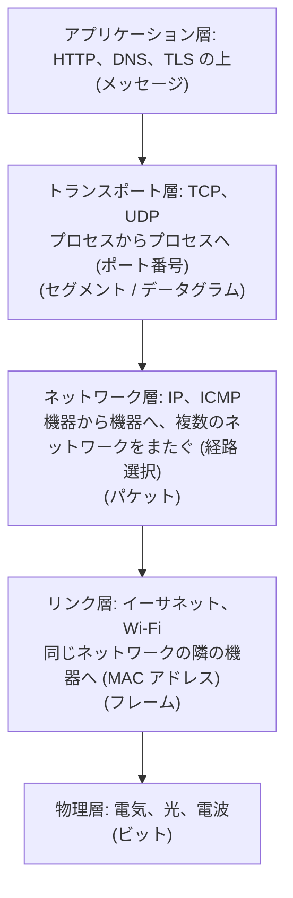
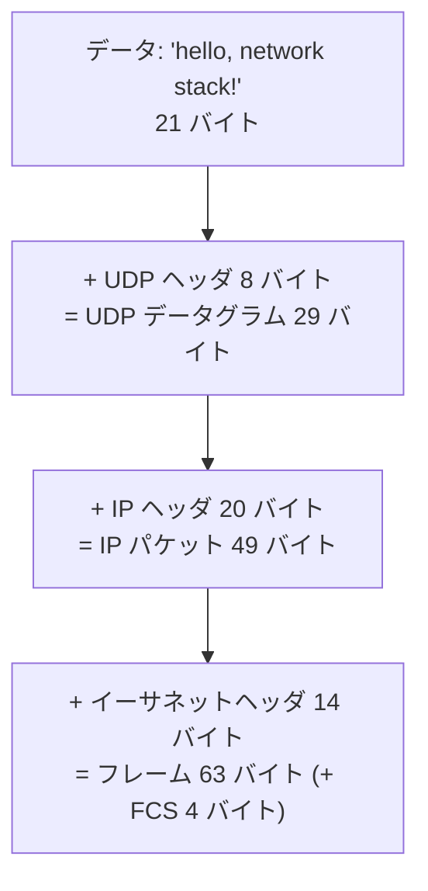
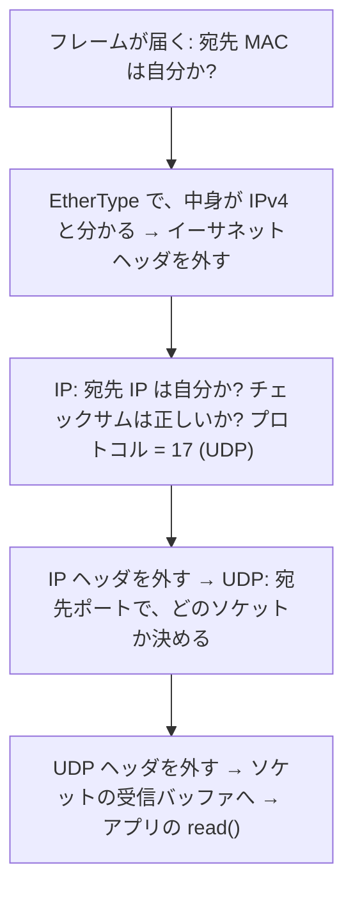

# 図1: 層構造とカプセル化

## 1. 層と、運ぶ単位



| 呼び方 | 層 | 例 |
|---|---|---|
| L7 | アプリケーション | HTTP、DNS |
| L4 | トランスポート | TCP、UDP |
| L3 | ネットワーク | IP |
| L2 | リンク | イーサネット、スイッチ |

## 2. 砂時計モデル

```
         アプリ:  HTTP   DNS   SMTP   SSH   ...        ← 多様
       トランスポート:   TCP   UDP   QUIC
                        IP                             ← 全員が同じ (細い腰)
       リンク:  イーサネット  Wi-Fi  4G/5G  光          ← 多様
```

上も下も、新しいものが現れたが、IP は変わらなかった。成長できた理由であり、IPv6 への移行が遅い理由でもある。

## 3. カプセル化(演習1で組み立てた実際のパケット)



```
 イーサネット (14)            IP (20)                          UDP (8)              データ (21)
 [宛先MAC 6][送信元MAC 6][0800] [45 00 0031 1c46 4000 40 11 9a72 送信元IP 宛先IP] [3039 0035 001d 7e46] [hello, ...]
```

| 層 | ヘッダの大きさ |
|---|---|
| イーサネット | 14 バイト(+ 末尾の FCS 4 バイト) |
| IPv4 | 20 バイト(オプションなし) |
| UDP | 8 バイト |
| TCP | 20 バイト(オプションなし) |

21 バイトのデータに、42 バイトのヘッダ。**小さいメッセージほど、ヘッダの割合が大きい**。

## 4. 受け取る側(逆の手順)



## 5. エンドツーエンド原則

> ある機能が、通信の両端でしか正しく実現できないなら、途中のネットワークで実現しても、完全にはならない。途中でやるのは、性能のための最適化に限るべき。(Saltzer, Reed, Clark 1984)

| 機能 | 途中のネットワーク | 両端 |
|---|---|---|
| 届いたことの保証 | 各リンクで、誤りを検査 (最適化) | **TCP と、アプリの検証 (本質)** |
| 暗号化 | 区間ごとの暗号化 | **TLS (両端の間)** |
| 経路の選択 | **IP (ここだけが得意)** | — |

IP は、単純に、ベストエフォートで運ぶだけにして、信頼性は両端(TCP)に任せた。
