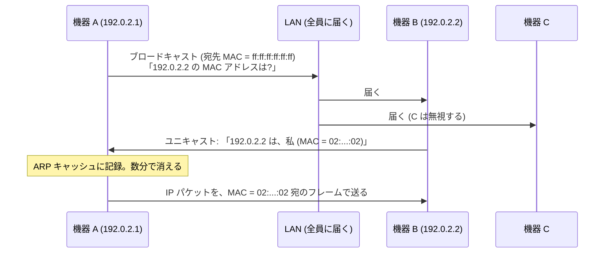
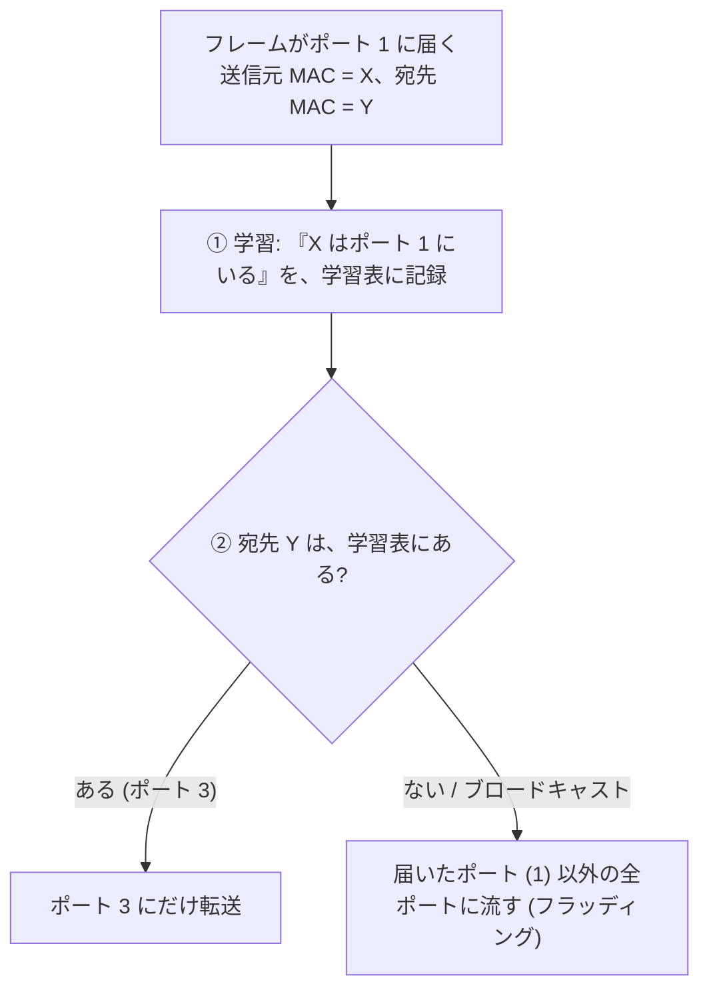

# 図2: イーサネット、ARP、スイッチ

## 1. イーサネットのフレーム

```
 | 宛先 MAC | 送信元 MAC | EtherType | データ (46〜1500 バイト) | FCS |
 |  6 バイト |  6 バイト  |  2 バイト  |  上の層 (IP パケットなど)  | 4 B |
```

| EtherType | 中身 |
|---|---|
| 0x0800 | IPv4 |
| 0x86DD | IPv6 |
| 0x0806 | ARP |

MTU = データ部の最大 = 通常 1500 バイト。

## 2. MAC アドレスの最初のバイト

```
 例: 02:00:00:00:00:01
      ^^
      02 = 0000 0010
            |      +-- 最下位ビット (0x01): 1 なら マルチキャスト (全員宛 ff:ff:ff:ff:ff:ff を含む)
            +--------- 次のビット   (0x02): 1 なら ローカルに管理されたアドレス (製造元の割り当てではない)
```

演習1の `02:00:00:00:00:01` は、ローカル管理のアドレス。

## 3. ARP



- 宛先が**同じ LAN の外**なら、宛先 IP の MAC ではなく、**デフォルトゲートウェイの MAC** を ARP で調べて、そこに送る。
- ARP には認証がない(ARP スプーフィング)。

## 4. スイッチの学習



| 学習表 | |
|---|---|
| MAC アドレス | ポート |
| X | 1 |
| Y | 3 |

- 項目は、使われないと数分で消える。
- スイッチの間に輪があると、フレームが永遠に回る(ブロードキャストストーム)→ STP で輪を断つ。

## 5. ハブとスイッチ

| | ハブ | スイッチ |
|---|---|---|
| 転送 | 全ポートに流す | 学習して、必要なポートにだけ |
| 衝突 | 共有の媒体で衝突する | ポートごとに独立 |
| 盗み見 | 全員がフレームを見られる | 宛先のポートにしか流れない(ただしフラッディングの間は別) |

## 6. MTU(演習5、この Mac のインターフェース)

| インターフェース | MTU |
|---|---|
| lo0 (ループバック) | 16,384 |
| en0 (通常のインターフェース) | 1,500 |
| utun (VPN などのトンネル) | 1,380 など(まちまち) |

トンネルの MTU が小さいのは、元の IP パケットを、さらに別の IP パケットの中に入れるので、外側のヘッダの分だけ、中に入れられる量が減るため。
