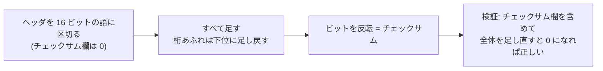
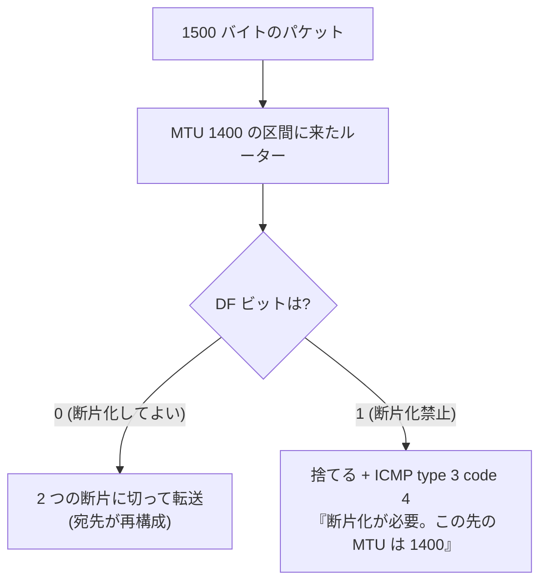
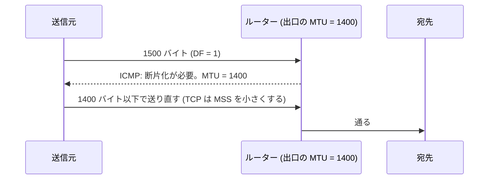
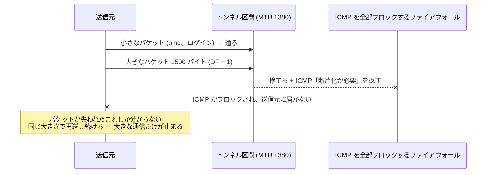
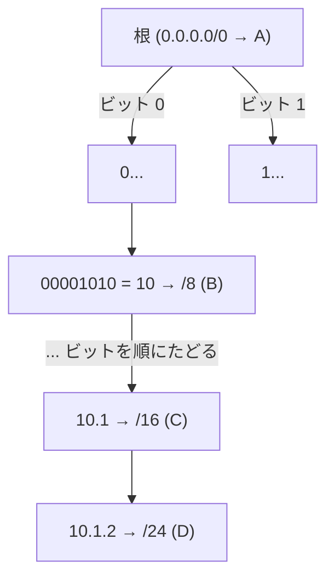
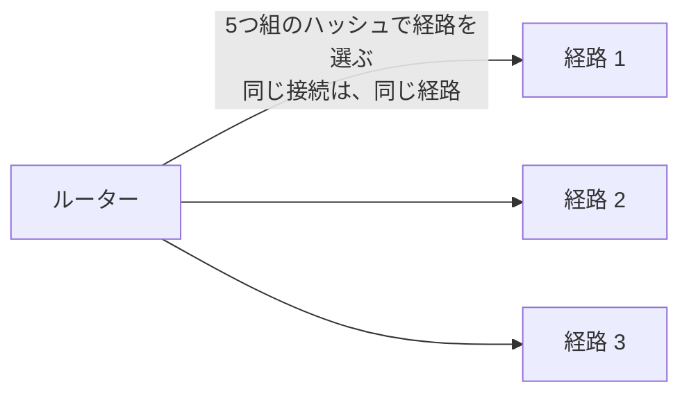

# 図3: IP ヘッダ、断片化と MTU、ルーティング

## 1. IPv4 ヘッダ(20 バイト、32 ビット幅で 5 行)

```
  0                   1                   2                   3
  0 1 2 3 4 5 6 7 8 9 0 1 2 3 4 5 6 7 8 9 0 1 2 3 4 5 6 7 8 9 0 1
 +-------+-------+---------------+-------------------------------+
 |Version|  IHL  |  DSCP / ECN   |         全体の長さ            |
 +-------+-------+---------------+---+---------------------------+
 |           識別子              |Flg|     断片のオフセット      |
 +---------------+---------------+---+---------------------------+
 |      TTL      |   プロトコル  |      ヘッダチェックサム       |
 +---------------+---------------+-------------------------------+
 |                         送信元アドレス                        |
 +---------------------------------------------------------------+
 |                         宛先アドレス                          |
 +---------------------------------------------------------------+
   Flg = [予約 | DF (断片化禁止) | MF (後ろに断片が続く)]
```

演習1で組み立てた実際のヘッダ:

```
45 00 00 31  1c 46 40 00  40 11 9a 72  c0 00 02 01  c0 00 02 02
Ver4/IHL5     識別子 DF    TTL64 UDP    チェックサム   192.0.2.1   192.0.2.2
全体の長さ 49
```

## 2. インターネットチェックサム



| 演習1の結果 | |
|---|---|
| Wikipedia の IPv4 の例 | 0xb861 と一致 |
| データの 1 ビット反転 | 検出できた |
| 16 ビットの語を 2 つ入れ替え | **検出できなかった** |
| TTL 64 → 63 の差分更新 (0x9a72 → 0x9b72) | 最初から計算し直した値と一致 |

## 3. MTU を超えるパケット



**経路 MTU 探索 (PMTUD)**:



| 値 | 計算 |
|---|---|
| イーサネットの MTU | 1500 |
| TCP の MSS (IPv4) | 1500 − 20 (IP) − 20 (TCP) = **1460** |
| TCP の MSS (IPv6) | 1500 − 40 (IPv6) − 20 (TCP) = 1440 |
| UDP の、断片化しない最大データ | 1500 − 20 − 8 = **1472** |

## 4. PMTU ブラックホール



対策: ICMP type 3 code 4 は通す。ルーターで TCP の MSS を書き換える(MSS クランピング)。

## 5. ルーティング: 最長一致

| プレフィックス | 次の転送先 |
|---|---|
| 0.0.0.0/0 (デフォルト) | ルーター A |
| 10.0.0.0/8 | ルーター B |
| 10.1.0.0/16 | ルーター C |
| 10.1.2.0/24 | ルーター D |

宛先 `10.1.2.7` は、4 つすべてに一致する → **最も長く一致する `/24`(ルーター D)** を選ぶ。

## 6. 2進のトライ木(演習3)



宛先のビットを、上から順にたどり、**途中で通った最後の(最も長い)一致**を覚えておく。最大 32 回の参照。

## 7. 3つの実装の比較(演習3、ランダムな宛先、Apple M5)

| エントリ数 | naive (全探索) | trie | dir248 (2^24 の表) |
|---|---|---|---|
| 100 | 73.2 ns | 18.8 ns | 2.9 ns |
| 1,000 | 688.1 ns | 25.9 ns | 2.8 ns |
| 10,000 | 6,801.1 ns | 41.2 ns | 2.9 ns |
| 100,000 | 69,708.6 ns | 64.1 ns | 2.7 ns |
| 200,000 | 136,468.6 ns | 80.2 ns | 2.7 ns |

- naive: エントリ数に比例。
- trie: 緩やかに遅くなる(ノードが増えて、キャッシュに載らなくなる)。
- dir248: 一定。ただし 64 MiB の表を使う(メモリで時間を買う)。

## 8. ECMP(複数の経路への分散)



同じ接続のパケットを別々の経路に流すと、順序が入れ替わり、TCP の性能が落ちる(第8回)。
