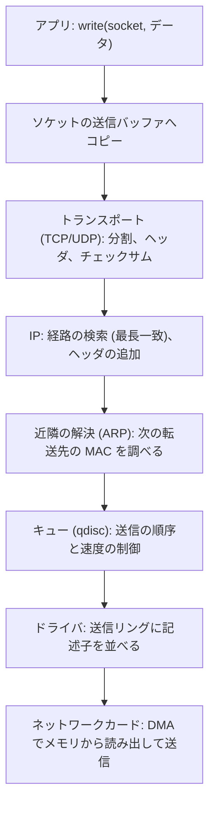
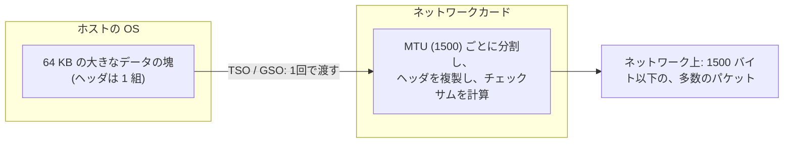
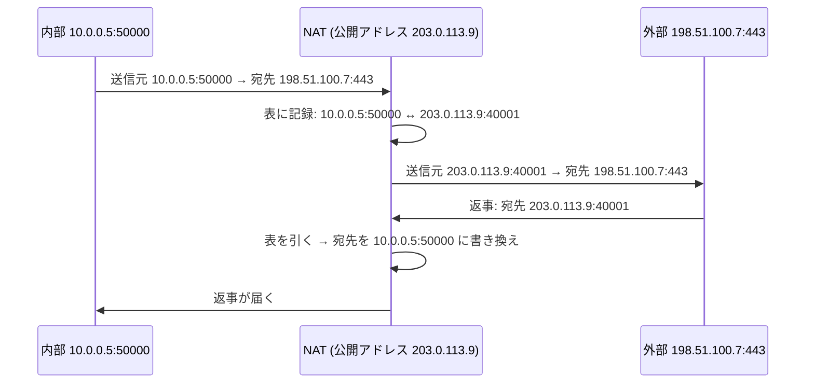

# 図4: カーネルの中のパケットの旅(送信側)と、オフロード

## 1. 送信の経路



受信側は、第6回の図1を参照。

## 2. オフロード



| 機能 | 内容 | 効果 |
|---|---|---|
| チェックサムオフロード | チェックサムの計算を、カードが行う | CPU の節約。ループバックでは、省略される (演習5) |
| TSO / GSO | 大きな塊を、カードが分割して送る | OS が扱うパケット数が、数十分の 1 に |
| GRO / LRO | 受信した小さなセグメントを、OS に渡す前に、まとめる | 受信側の、システムコールとコピーの固定のコストの削減 |

**tcpdump の混乱**: 送信側のホストで見ると、MTU(1500)を超える、64,000 バイトの「パケット」が見える。カードに渡す前の塊を見ているため。実際のネットワーク上では、1500 バイト以下に分割されている。

## 3. ループバックのチェックサム(演習5)

```
ifconfig lo0:  options=1203<RXCSUM,TXCSUM,TXSTATUS,SW_TIMESTAMP>
```

- 同じマシンの中を通るだけなので、ビットの誤りは起きず、チェックサムの計算は無駄。
- 演習5で、実際の ICMP 応答の **IP ヘッダのチェックサム欄は 0x0000**(検算すると不一致)。
- **ICMP のチェックサムは、一致した**(自作の実装が、実際のカーネルのパケットで通った)。

## 4. NAT と接続追跡



| 代償 | 内容 |
|---|---|
| 外からの接続を受けられない | 表に記録がないパケットは、行き先が分からない |
| 状態を持つ | NAT 機器の再起動やタイムアウトで、既存の接続が切れる |
| 接続追跡の表が溢れる | 新しい接続が失敗する (`nf_conntrack: table full`) |
| アドレスがデータの中にあるプロトコルが壊れる | 古い FTP など |

## 5. パケットあたりの予算

| リンク速度 | 最小フレームでの、毎秒のパケット数 | 1パケットに使える時間 |
|---|---|---|
| 10 Gbps | 約 1,488 万 | 約 67 ns |
| 100 Gbps | 約 1 億 4,880 万 | **約 6.7 ns** |

(最小フレーム 64 バイト + プリアンブルなど 20 バイト = 84 バイト = 672 ビット。)

演習4の実測: 16 バイトから 8,192 バイトまで、1秒に送れる個数は、ほぼ一定(約 50〜58 万)。コストはパケット1個あたりにかかり、バイトにはほとんどかからない。

| データ | 送信 pps | 受信 MB/s |
|---|---|---|
| 16 B | 583,557 | 9.3 |
| 256 B | 570,998 | 146.2 |
| 4,096 B | 515,130 | 2,110.0 |
| 8,192 B | 501,450 | 4,107.9 |
