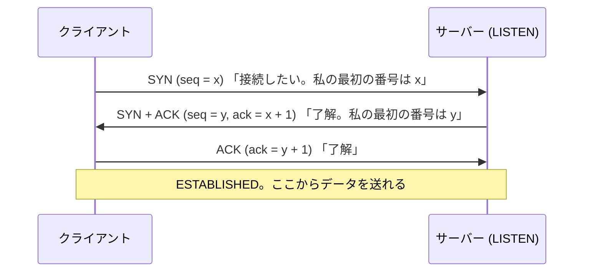
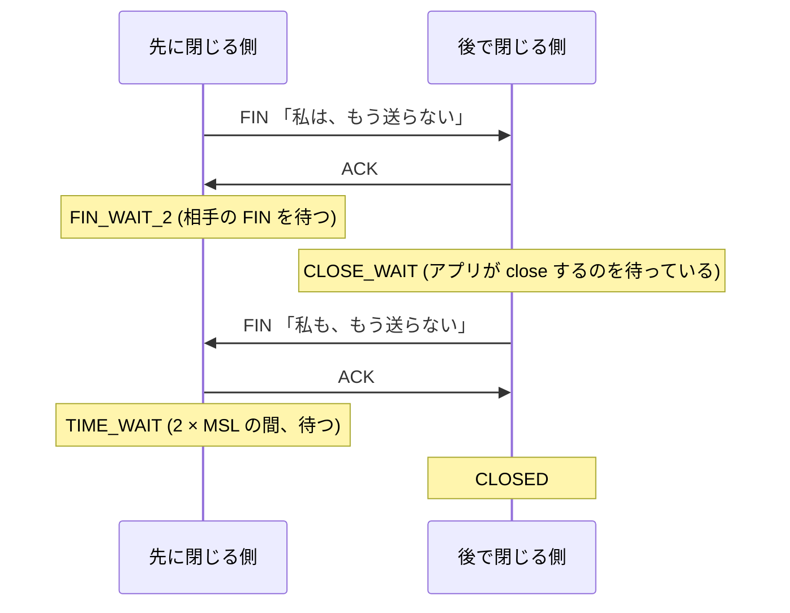

# 第8回 TCP と輻輳制御

> ステータス: 執筆済み(第1版)
> 前提: 第6回(ソケット、バッファ、バックプレッシャー)、第7回(IP、MTU、MSS、パケット)
> 演習言語: C と Go
> 所要目安: 本文 3〜4時間 + 演習 5時間
> **この環境では、遅延や損失を人工的に作れない(管理者権限が要る)ので、輻輳制御の振る舞いは、シミュレータで確かめた。実際の TCP の測定は、ループバックでの、接続、状態、ウィンドウの観察に限られる。**

## この回のゴール

この回を終えると、次のことが説明できるようになる。

1. IP は、パケットを失い、順序を入れ替えるのに、TCP は、なぜ「信頼できるバイトの流れ」を作れるのか。何を保証し、何を保証しないのか。
2. 3ウェイハンドシェイクと、接続の終了の手順。TIME_WAIT と CLOSE_WAIT は、何を意味し、大量に溜まったとき、何を疑うか。
3. フロー制御(受信側のため)と、輻輳制御(ネットワークのため)は、何が違うのか。ウィンドウは、どう決まるのか。
4. スロースタートと AIMD(のこぎり波)の仕組み。バッファの大きさは、なぜ BDP を目安にするのか。
5. 損失率が上がると、スループットが、なぜ急に落ちるのか(Mathis の式)。CUBIC と BBR は、Reno の何を変えたのか。
6. Nagle のアルゴリズムと、遅延 ACK は、何をするのか。`TCP_NODELAY` は、いつ必要か。
7. 「接続が切れたのに、アプリが何分も気づかない」ことが起きる理由。

第7回で、IP は、「ベストエフォートで運ぶだけ」で、信頼性を、両端に任せることを見た(エンドツーエンド原則)。この回は、その両端の仕事、**TCP** を扱う。第9回の TLS と HTTP、第10回のロードバランサ、第12〜13回の分散システムの、タイムアウトと再試行は、すべて、この回の TCP の性質の上に載る。

---

## 1. TCP は何を保証するか

### 1.1 保証すること

TCP は、IP の上に、次の性質を持つ**バイトの流れ**(ストリーム)を作る。

| 保証 | 仕組み |
|---|---|
| 欠落がない | 番号付けと、確認応答(ACK)、再送 |
| 順序が保たれる | 番号で並べ直す |
| 重複がない | 番号で、重複を捨てる |
| 誤りが(ある程度)検出される | チェックサム(第7回で見たとおり、弱い) |
| 受信側が溢れない | フロー制御(受信ウィンドウ) |
| ネットワークが溢れない | 輻輳制御(輻輳ウィンドウ) |

### 1.2 保証しないこと

TCP が保証しない、重要なことがある。

| 保証されないこと | 実務への含意 |
|---|---|
| **遅延の上限** | 損失があれば、再送のため、数百 ms〜数秒、遅れる。「何秒以内に届く」は、保証されない |
| **スループット** | 損失と RTT で、大きく変わる(§6.5) |
| **メッセージの境界** | 第7回で見たとおり、バイトの流れ。区切りは、アプリが決める |
| **相手のアプリが、処理したこと** | ACK は、**相手の OS が受け取った**ことを示すだけ。アプリが `read()` したことも、処理したことも、意味しない |
| **接続がまだ生きていること** | 相手が突然消えても、こちらは、しばらく気づかない(§9) |

最後から2つ目が重要である。`write()` が成功し、ACK が返ってきても、**相手のアプリがクラッシュして、データを処理しなかった**ことは、ありうる。確実に「処理された」と知るには、**アプリのレベルの応答**(「受け取りました」というメッセージ)が要る。第13回の、分散システムでの合意につながる考え方である。

---

## 2. TCP のヘッダ

TCP のヘッダは、最小で **20 バイト**である(UDP の 8 バイトの 2.5 倍)。

| フィールド | 大きさ | 内容 |
|---|---|---|
| 送信元ポート、宛先ポート | 各 2 バイト | 第7回の 5 つ組の一部 |
| **シーケンス番号** | 4 バイト | このセグメントの、**最初のバイトの番号** |
| **確認応答番号** | 4 バイト | 「**次に、この番号のバイトが欲しい**」(ここまでは、全部受け取った) |
| データオフセット | 4 ビット | ヘッダの長さ(オプションを含む) |
| フラグ | 8 ビット | SYN、ACK、FIN、RST、PSH、URG、ECE、CWR |
| **ウィンドウ** | 2 バイト | 受信側が、**あと何バイト受け取れるか** |
| チェックサム | 2 バイト | 疑似ヘッダを含む |
| 緊急ポインタ | 2 バイト | (ほとんど使われない) |
| オプション | 可変 | MSS、ウィンドウ拡大、SACK、タイムスタンプ |

### 2.1 シーケンス番号は、バイトを数える

TCP の番号は、**セグメントの番号ではなく、バイトの番号**である。1460 バイトのデータを運ぶセグメントのシーケンス番号が 1000 なら、次のセグメントのシーケンス番号は 2460 になる。確認応答番号 2460 は、「999 番までのバイトは、すべて受け取った。次は、2460 番(正確には、1000 から 2459 までを受け取ったので、2460)から欲しい」という意味である。

最初の番号(**ISN**: 初期シーケンス番号)は、**ランダム**に選ぶ。古い接続の、遅れて届いたセグメントを、新しい接続のものと、取り違えないため(と、攻撃者に推測されないため)である。

### 2.2 重要なオプション

| オプション | 内容 |
|---|---|
| **MSS** | 受け取れる、データの最大の大きさ。SYN の中で伝える(第7回: 1460 など)。演習3の、ループバックでは **16,332 バイト** |
| **ウィンドウ拡大** | ウィンドウのフィールドは 16 ビット(最大 65,535)で、現代には小さすぎる。2 の n 乗倍して読む(n は最大 14 → 最大約 1 GiB)。演習3で、送受信とも 6(= 64 倍)だった |
| **SACK** | 「どの範囲を、受け取ったか」を、飛び飛びで伝える(§4.3)。演習3で有効 |
| **タイムスタンプ** | 往復時間(RTT)の、正確な測定と、古いセグメントの識別。演習3で有効 |

図は [diagrams/01-tcp-header-and-handshake.md](diagrams/01-tcp-header-and-handshake.md)。

---

## 3. 接続の確立と終了

### 3.1 3ウェイハンドシェイク



**なぜ 3 回なのか**: 双方が、**自分の ISN を相手に伝え、相手がそれを受け取ったことを確認する**必要があるから。2 回では、サーバーが、「クライアントが、自分の SYN+ACK を受け取った」ことを知れない。また、古い SYN が遅れて届いた場合に、サーバーが、誤って接続を作ってしまうのを、クライアントが拒否できる(RST で返す)。

**コスト**: データを送る前に、**最低 1 往復**(RTT)が要る。クライアントは、SYN を送ってから、SYN+ACK が返るまで待ち、ACK と同時に、最初のデータを送れる。さらに TLS(第9回)は、その上で、追加の往復を要する。往復が遠い(RTT 100 ms)と、接続を張るだけで 100 ms、TLS を含めると数百 ms かかる。

**演習1の実測(ループバック)**:

| 方式 | 1リクエストの時間 |
|---|---|
| 毎回、新しい接続を張って 1 リクエスト | 約 71〜73 µs(うち、Dial = ハンドシェイクが約 39〜40 µs) |
| 1 本の接続を、使い回して 1 リクエスト | 約 16〜18 µs |

**新しい接続は、使い回しの約 4〜4.6 倍**かかった。ループバックの RTT はほぼ 0 なので、これは、カーネルの処理(ソケットの作成、状態の初期化、システムコール)だけの差である。**実際のネットワークでは、これに、少なくとも 1 RTT が加わる**。だから、HTTP の keep-alive や、データベースの接続プールのように、**接続を使い回す**。

### 3.2 SYN フラッド、accept キュー

サーバーは、SYN を受け取ると、半分開いた接続(SYN_RCVD)の状態を、メモリに作る。攻撃者が、大量の SYN を、送信元を偽って送ると、この表が溢れ、本物の接続が受け付けられなくなる(**SYN フラッド**)。対策の **SYN cookie** は、状態を保存せず、ISN に、必要な情報を、暗号的に埋め込む。ACK が戻ってきたときに、検証して初めて、接続を作る。

また、ハンドシェイクが終わった接続は、**accept キュー**に入り、アプリが `accept()` で取り出すのを待つ。アプリが遅くて、キューが一杯になると、新しい接続は、拒否または無視される(第6回の `listen` の backlog)。

### 3.3 接続の終了



TCP は、**双方向が独立**している。片方が `close`(FIN)しても、もう片方は、まだ送り続けられる(**半クローズ**)。`RST` は、即座の、強制的な切断である(存在しない接続へのパケット、異常、`SO_LINGER` の 0)。

### 3.4 TIME_WAIT

先に閉じた側は、最後の ACK を送った後、**TIME_WAIT** 状態に、**2 × MSL**(最大セグメント寿命)の間、留まる。この環境の `net.inet.tcp.msl` は 15,000 ms なので、**30 秒**である(Linux は、通常 60 秒固定)。

**理由は2つ**:

1. **最後の ACK が失われたとき**に備える。相手が FIN を再送してきたら、再び ACK を返せるようにする。
2. **古い接続の、遅れて届いたセグメント**が、**同じ 5 つ組の、新しい接続**に紛れ込まないよう、ネットワークから消えるまで待つ。

**実務での影響**:

- **先に閉じた側**に残る。サーバーが先に閉じると、サーバー側(ポート 443 など)に、接続ごとに TIME_WAIT が溜まる。クライアントが先に閉じれば、クライアントの、使い捨てのポートに残る。
- 短い接続を、大量に張り、こちらから閉じると、**エフェメラルポート**(第6〜7回)が、TIME_WAIT で埋まり、新しい接続を作れなくなる(第6回で実際に経験した)。

**演習1の実測(`SO_REUSEADDR` なしで待ち受け、再起動を試す)**:

| 先に閉じた側 | `SO_REUSEADDR` なしで、同じポートで再起動 | `SO_REUSEADDR` ありで再起動 |
|---|---|---|
| **サーバー** | **失敗: `address already in use`** | bind できた |
| クライアント | bind できた | bind できた |

サーバーが先に閉じると、**サーバーのポートに TIME_WAIT が残り**、`SO_REUSEADDR` なしでは、そのポートを使えない。これが、「サーバーを再起動したら、`Address already in use` で起動できない」という、よくある現象の正体である。クライアントが先に閉じた場合は、TIME_WAIT は、クライアントの側(別のポート)にあるため、サーバーは、すぐ再起動できる。**多くのサーバーは、`SO_REUSEADDR` を、既定で有効にしている**(Go の `net.Listen` も)。

### 3.5 状態の観察: CLOSE_WAIT

演習1で、`lsof` で、接続の状態を観察した(`netstat` は、この環境で、ループバックの接続を表示しなかったため)。

| 時点 | 観察された状態 |
|---|---|
| listen した直後 | `LISTEN` |
| 接続が確立 | `ESTABLISHED`(サーバー側とクライアント側の 2 行) |
| クライアントが先に close | サーバー側が **`CLOSE_WAIT`** |
| サーバーも close | 接続は消え、`LISTEN` だけ |

`CLOSE_WAIT` は、「**相手は閉じたが、こちらのアプリが、まだ `close()` していない**」状態である。

**CLOSE_WAIT が大量に溜まっているなら、自分のアプリのバグ**を疑う。相手が閉じたのに、自分が閉じていない = ソケットを閉じ忘れている(リーク)。対して、TIME_WAIT の大量は、(通常)正常な接続の終了の結果で、**短い接続が多い**ことを示す。この2つの状態は、原因が、逆の側にある。

先に閉じた側の `FIN_WAIT_2` は、`close` した後は、ソケットが、プロセスの管理から外れる(カーネルだけが持つ)ため、`lsof` には出ない。TIME_WAIT も同様である。

状態遷移の全体図は [diagrams/02-tcp-state-machine.md](diagrams/02-tcp-state-machine.md)。

---

## 4. 信頼性: 再送

### 4.1 累積 ACK

受信側は、**途切れずに受け取った最後のバイト**までを、確認応答する(**累積 ACK**)。

```
送信:   [1-1000] [1001-2000] [2001-3000] [3001-4000]
                      ✗ (失われた)
受信側の ACK:  ack=1001  ack=1001(重複)  ack=1001(重複)
```

2番目のセグメントが失われると、3番目、4番目が届いても、受信側は、「1001 から欲しい」という ACK を、**繰り返し**返す(**重複 ACK**)。

### 4.2 再送のきっかけ

| きっかけ | 内容 |
|---|---|
| **タイムアウト**(RTO) | ACK が、一定時間こなければ、再送する。遅いが、確実 |
| **高速再送** | **3 回の重複 ACK** を受け取ったら、タイムアウトを待たずに、すぐ再送する |

**RTO の決め方**(RFC 6298): 往復時間(RTT)の、平滑化した平均(SRTT)と、ばらつき(RTTVAR)から、**RTO = SRTT + 4 × RTTVAR**。短すぎると、無駄な再送が増え、長すぎると、損失の回復が遅れる。再送したセグメントの ACK では、RTT を測らない(Karn のアルゴリズム。どちらの送信に対する ACK か、分からないため)。

タイムアウトした場合は、RTO を**倍に**する(指数バックオフ)。タイムアウトは、輻輳が激しいことを示すので、cwnd を 1 に戻す(§6)。

### 4.3 SACK

累積 ACK だけでは、「どれが失われたか」しか分からず、**飛び飛びに失われたとき、効率が悪い**。**SACK**(Selective Acknowledgment)は、「1001 から 2000 は無いが、2001 から 4000 は受け取った」と、**範囲を明示**する。送信側は、失われた範囲だけを再送できる。演習3の実際の接続で、SACK が有効になっていることを確認した。

### 4.4 順序の入れ替わり

ネットワークが、パケットの順序を入れ替える(ECMP の別経路、第7回)と、重複 ACK が出て、送信側が、「失われた」と誤解して、**無駄に再送**し、cwnd を縮めてしまう。現代の実装(Linux の RACK など)は、時間の情報も使って、これを緩和している。

---

## 5. フロー制御

### 5.1 受信ウィンドウ

**受信側のバッファが溢れないよう**にする仕組みが、**フロー制御**である。受信側は、ACK のたびに、「**あと、何バイト受け取れるか**」(受信ウィンドウ、rwnd)を、ヘッダのウィンドウのフィールドで、送信側に伝える。送信側は、**確認応答されていないデータ**(飛行中のデータ)を、rwnd 以下に抑える。

第6回の、バックプレッシャーと同じ構造である。受信側のアプリが `read()` しないと、バッファが埋まり、ウィンドウが縮み、0 になり、送信側が止まる。

### 5.2 実測(演習3)

受信側が、1 秒間 `read` しない状態で、送信側が、どんどん書き込んだ。Apple M5(ループバック)で、送信側のソケットの状態を観察した。

| 経過 | 送った量 | 相手のウィンドウ | 送信バッファ |
|---|---|---|---|
| 0.1 ms | 0.3 MB | 408,320 B | 327,212 B |
| 0.1 ms | 0.3 MB | **81,408 B** | 0 B |
| 259 ms | 0.7 MB | **16,128 B** | 343,596 B |
| 520 ms | 0.7 MB | 16,128 B | 343,596 B |
| 776 ms | 0.7 MB | 16,128 B | 343,596 B |
| **1,027 ms** | **152.8 MB** | 1,371,840 B | 17,424 B |

分かること:

- 受信側が読まない間、**相手のウィンドウが、408,320 → 81,408 → 16,128 バイトと縮んだ**。16,128 は、MSS(16,332)より小さい。小さすぎるウィンドウでは、送れないため、**実質的に止まった**(受信側が、小さな空きを広告しないのは、**愚かなウィンドウ症候群**の回避のため)。
- 送信側は、**約 0.7 MB を書き込んだところで止まった**。これは、「送信側のバッファ + 受信側のバッファ」の合計である。**TCP を通じて、ネットワークに送り出せる量は、両端のバッファの大きさで決まる**。
- 約 1 秒後に、受信側が読み始めると、ウィンドウが再び開き、**1.0 秒の時点で 152.8 MB まで進んだ**。

ここで見ているのは、**フロー制御**である。ネットワークが混んでいるからではなく、**受信側が遅い**から、送信側が止まった。

### 5.3 BDP: 必要なウィンドウ

高速で遠い(往復が長い)ネットワークで、**ウィンドウが小さいと、帯域を使い切れない**。送信側は、ウィンドウ分のデータを送ると、ACK が返るまで、待つしかない。1 RTT で送れるのは、最大でウィンドウ 1 つ分である。

$$\text{スループットの上限} = \frac{\text{ウィンドウ}}{\text{RTT}}$$

帯域を使い切るには、ウィンドウが、**帯域遅延積(BDP)**以上である必要がある。

$$\text{BDP} = \text{帯域} \times \text{RTT}$$

| 帯域 | RTT | BDP |
|---|---|---|
| 100 Mbps | 50 ms | 625 KB |
| 1 Gbps | 100 ms | 12.5 MB |
| 10 Gbps | 100 ms | 125 MB |

ウィンドウ拡大なし(最大 64 KB)では、RTT 50 ms なら、**最大 64 KB ÷ 50 ms = 約 10 Mbps** にしかならない。ウィンドウ拡大と、バッファの自動調整(OS が、必要に応じて、バッファを大きくする)が、必須の理由である。

---

## 6. 輻輳制御

### 6.1 なぜ必要か

フロー制御は、受信側を守る。**ネットワークの途中**(ルーターのキュー)を守る仕組みが、**輻輳制御**である。

1980 年代、インターネットで、**輻輳崩壊**が起きた。全員が、損失を、すぐに再送して、ネットワークがさらに混み、さらに損失が増え、ほぼ誰の通信も進まなくなった。Van Jacobson(1988)が、これを解決する、スロースタートと輻輳回避を導入し、今の TCP の基礎になった。

### 6.2 輻輳ウィンドウ

送信側は、**輻輳ウィンドウ**(cwnd)を持つ。飛行中のデータの上限は、**min(cwnd、rwnd)** である。

cwnd は、**ネットワークの容量を推定**して調整される。ネットワークは、混んでいるかどうかを、直接は教えてくれない。送信側は、**損失**(パケットが捨てられた)を、「混んでいる」の合図として使う。

### 6.3 スロースタート

接続の開始時、容量は分からない。cwnd を、**小さく始めて、指数的に増やす**。

- **初期ウィンドウ**(IW): 10 セグメント(RFC 6928)。
- **ACK 1 つ受け取るたびに、cwnd を 1 セグメント増やす** → 1 RTT で、**cwnd が 2 倍**になる。
- 損失が起きる、または閾値(ssthresh)に達するまで続ける。

**演習3の実測**で、実際の接続の cwnd を観察した(ループバック)。

| 送った量 | cwnd |
|---|---|
| 接続直後 | 163,320 バイト(= **10.0 セグメント**、MSS 16,332 の 10 倍) |
| 1.0 MB | 441,068 バイト |
| 8.4 MB | 1,119,860 バイト |
| 16.8 MB | 1,674,940 バイト |
| 25.2 MB | 2,979,160 バイト |
| 33.6 MB | 3,848,240 バイト |
| 41.9 MB 以降 | **4,194,240 バイト**(この値で頭打ち) |

初期ウィンドウが、実際に **10 セグメント**で、そこから、損失なしで、cwnd が育つ様子が見えた(4 MiB の上限は、この OS の設定による)。ssthresh は、ほぼ無限(約 1 GiB)で、損失がないため、輻輳回避に入っていない。**ループバックは、損失も遅延もないため、損失で cwnd が縮むところまでは、実機では見えない**(§6.8 のシミュレータで補う)。

### 6.4 輻輳回避と AIMD

ssthresh に達した後、またはその後は、増やし方を、**慎重にする**。

- **輻輳回避**: 1 RTT ごとに、cwnd を **1 セグメントだけ**増やす(線形)。
- **損失を検出**したら、cwnd を**半分**にする(乗法的な減少)。

これを **AIMD**(Additive Increase, Multiplicative Decrease: 加算的に増やし、乗算的に減らす)と呼ぶ。Chiu & Jain(1989)は、**AIMD が、複数のフローを、公平な配分に収束させる**ことを示した。

**Reno** は、これに高速再送と、高速回復(損失後、cwnd を半分にして、すぐ続ける)を組み合わせた方式である。タイムアウトの場合は、cwnd を 1 に戻して、スロースタートからやり直す。

### 6.5 損失とスループット: Mathis の式

Reno の定常状態のスループットは、次の式で近似される(Mathis ら、1997)。

$$\text{スループット} \approx \frac{\text{MSS}}{\text{RTT}} \cdot \frac{1.22}{\sqrt{p}}$$

p はパケット損失率である。**損失率が 100 倍になると、スループットは 10 分の 1 になる。RTT が 2 倍になると、スループットは半分になる**。

| 含意 | |
|---|---|
| 損失が少し増えるだけで、急に遅くなる | p = 0.01% → 0.1% で、スループットは約 3 分の 1 |
| 遠い相手との通信は、不利 | RTT が大きいほど、同じ損失率で、遅い |
| 無線(Wi-Fi、携帯)の、ランダムな損失を、輻輳と誤解する | 実際は、混んでいないのに、cwnd を縮めてしまう |

### 6.6 シミュレータ: のこぎり波とバッファの大きさ(演習4)

演習4のシミュレータ(簡易モデル)で、単独の Reno のフローを、リンク 100 Mbps、往復の伝搬遅延 50 ms で動かした。BDP は **416 パケット**(624 KB)である。

**A. バッファ = 1 BDP のときの cwnd**:

| 項目 | 結果 |
|---|---|
| スループット | 100.0 Mbps(**利用率 100%**) |
| 平均のキューの遅延 | 30.5 ms |
| 10 秒以降の cwnd の範囲 | **416 〜 822 パケット** |

cwnd は、損失の直後に **半分(416)**になり、そこから、1 RTT あたり 1 パケットずつ増え、**BDP + バッファ = 832 パケット**に近づいたとき、再び損失が起きる。約 31 秒周期ののこぎり波になった。**損失の直後の cwnd(= 832 の半分 = 416)が、ちょうど BDP と等しいので、リンクが空にならず、利用率が 100% になる**。

これが、**バッファは BDP を目安にする**という、古典的な経験則(ルーターのバッファの大きさ)の根拠である。

**B. バッファの大きさと、利用率 / キューの遅延**(単独のフロー、60 秒):

| バッファ | Reno | CUBIC | BBR(簡易) |
|---|---|---|---|
| 0.05 BDP | 76.4% / 0.8 ms | 89.6% / 1.0 ms | 97.6% / 1.8 ms |
| 0.10 BDP | 80.1% / 1.1 ms | 92.8% / 2.7 ms | 98.3% / 2.8 ms |
| 0.25 BDP | 87.9% / 3.5 ms | 97.7% / 7.3 ms | 100.0% / 2.7 ms |
| 0.50 BDP | 96.0% / 10.5 ms | 100.0% / 17.5 ms | 100.0% / 12.1 ms |
| 1.00 BDP | 100.0% / 30.5 ms | 100.0% / 39.9 ms | 100.0% / 28.9 ms |
| 2.00 BDP | 100.0% / 66.7 ms | 100.0% / 84.8 ms | 100.0% / 30.3 ms |
| 4.00 BDP | 100.0% / 103.8 ms | 100.0% / 174.1 ms | 100.0% / 30.3 ms |

- バッファが小さい(0.05 BDP)と、Reno は利用率が **76.4%** に落ちる(損失で、cwnd が頻繁に半分になり、リンクが空く)。
- バッファが **BDP 以上**なら、Reno も CUBIC も、利用率は 100%。
- **しかし、バッファが大きいほど、キューの遅延が増える**(Reno: 4 BDP で 103.8 ms、CUBIC: 174.1 ms)。損失ベースの方式は、**バッファが一杯になるまで、送り続ける**ためである。

### 6.7 バッファブロート

深いバッファと、損失ベースの輻輳制御の組み合わせは、**常に、バッファを満杯近くに保つ**。その結果、**遅延が、常に大きくなる**。これが**バッファブロート**(bufferbloat)である(Gettys、2011)。

大きなファイルをダウンロードしている間、同じ回線の、ビデオ会議や、ゲームの遅延が、急に増える、という現象の原因である。対策は、

- **AQM**(Active Queue Management): キューが長くなったら、**一杯になる前に**、パケットを捨てる、またはマークして、送信側に、早めに知らせる。CoDel、FQ-CoDel など。
- **ECN**(Explicit Congestion Notification): パケットを捨てる代わりに、ヘッダの ECN ビットで、輻輳を知らせる(第7回の DSCP/ECN フィールド)。
- **遅延ベースまたはモデルベースの輻輳制御**(BBR など)。

### 6.8 CUBIC と BBR

**CUBIC**(Linux の既定、2006 年から)は、Reno の問題に対処した。高速で遠い(BDP が大きい)ネットワークでは、Reno の「1 RTT で 1 パケット」の成長が、遅すぎる。CUBIC は、**最後の損失の時点の cwnd を中心とした、3 次関数**で、cwnd を増やす。損失の直後は急に戻り、以前のウィンドウの近くでは、慎重に進み、それを超えたら、再び加速する。成長が、**RTT に依存しない**(時間で決まる)ことも特徴である。

**BBR**(Google、2016 年)は、発想が違う。**損失を、輻輳の合図に使わない**。代わりに、次の 2 つを、**測定して推定**する。

- **ボトルネックの帯域**(BtlBw): 最近の、配送速度の最大値。
- **往復の伝搬遅延**(RTprop): 最近の、RTT の最小値。

そして、**BtlBw × RTprop = BDP** に合わせて、送る速度(ペーシング)と、飛行中のデータ量を決める。**バッファを満たさず、BDP の近くで動く**ことを目指す。

#### シミュレータの結果

**C. ランダムな損失と、スループット**(単独のフロー、バッファ = 1 BDP、100 Mbps、RTT 50 ms):

| 損失率 | Reno | CUBIC | BBR(簡易) | Mathis の式 |
|---|---|---|---|---|
| 0 | 100.0 Mbps | 100.0 Mbps | 100.0 Mbps | |
| 0.01% | 37.2 Mbps | 80.4 Mbps | 100.0 Mbps | 29.3 Mbps |
| 0.1% | **9.1 Mbps** | 14.0 Mbps | 99.9 Mbps | **9.3 Mbps** |
| 1% | 3.3 Mbps | 3.3 Mbps | 99.0 Mbps | 2.9 Mbps |
| 5% | 1.4 Mbps | 1.2 Mbps | 90.7 Mbps | 1.3 Mbps |

- **Reno は、Mathis の式とよく合った**(0.1% の損失で 9.1 Mbps、予測 9.3 Mbps)。シミュレータが、基本的な性質を、再現していることの確認になる。
- **損失が 0.1% あるだけで、100 Mbps のリンクで、Reno は 9 Mbps** しか出ない(利用率 9%)。
- CUBIC は、損失が低い領域(0.01%)で、Reno の約 2 倍(80.4 対 37.2 Mbps)。損失が大きくなると、差はなくなる。
- **BBR(簡易)は、5% の損失でも、90.7 Mbps** を保った。損失を合図にしないからである。ただし、**これは、損失が、輻輳によるものではなく、ランダムな場合**に限る(輻輳による損失を無視すると、他のフローを圧迫する)。

**D. 複数のフローが共有する場合**(100 Mbps):

| 組み合わせ | スループット | 比 |
|---|---|---|
| Reno(RTT 20 ms)と Reno(RTT 100 ms) | 81.6 Mbps と 18.4 Mbps | 4.43 対 1 |
| Reno(RTT 50 ms)と Reno(RTT 50 ms) | 50.3 Mbps と 49.7 Mbps | 1.01 対 1 |
| Reno と CUBIC(RTT 50 ms) | 8.1 Mbps と 91.9 Mbps | 11.41 対 1 |
| Reno と BBR(簡易)(バッファ 1 BDP) | 2.8 Mbps と 97.2 Mbps | 34.64 対 1 |
| Reno と BBR(簡易)(バッファ 4 BDP) | 11.9 Mbps と 88.1 Mbps | 7.39 対 1 |
| BBR(簡易)と BBR(簡易) | 43.0 Mbps と 57.0 Mbps | 1.32 対 1 |

- **同じ方式で、RTT が同じなら、ほぼ均等**(Reno どうし、50.3 対 49.7)。AIMD の公平性である。
- **RTT が違うと、不公平になる**(20 ms の Reno が、100 ms の Reno の約 4.4 倍)。RTT が短いほど、1 秒あたりの増加が多いため、**RTT に反比例して**取る。
- **方式が違うと、不公平になる**。CUBIC は、Reno より攻撃的に、BBR は、さらに攻撃的に、帯域を取った。

**重要な注意**: このシミュレータは、**簡易モデル**である。特に、**簡易 BBR は、実際の BBR より、攻撃的に振る舞っている可能性が高い**。実際の BBR が、Reno や CUBIC と共存するとき、バッファの深さによって、結果が大きく変わることが、研究で報告されている(Hock ら、2017、Ware ら、2019)。**ここで示した、Reno と BBR の比(34:1 など)を、実際の値として、受け取らないこと**。実機と照合は、していない。シミュレータの価値は、**定性的な傾向**(バッファの大きさ、損失への反応、RTT による不公平)を、確認することにある。

図は [diagrams/04-congestion-control.md](diagrams/04-congestion-control.md)。

### 6.9 データセンターの輻輳制御

データセンターは、RTT が極めて短く(数十 µs)、バッファが浅く、同時に多数の流れが衝突する(インキャスト)。インターネット向けの方式は、うまく働かない。**DCTCP**(Alizadeh ら、2010)は、**ECN で、輻輳の「程度」を知らせ**、cwnd を、その程度に比例して縮める。半分ではなく、必要な分だけ縮めるので、バッファを浅く保てる。Homa(Montazeri ら、2018)など、受信側が主導する方式も研究されている。第14〜15回で再訪する。

---

## 7. 小さな書き込みと遅延: Nagle と遅延 ACK

### 7.1 2つの最適化

**小さなデータを、1つずつ送ると、無駄が多い**(40 バイトのヘッダに、1 バイトのデータ)。そこで、2つの最適化がある。

| 最適化 | 何をするか | 側 |
|---|---|---|
| **Nagle のアルゴリズム** | **未確認(ACK が来ていない)のデータがあるとき、小さなデータは、すぐには送らず**、溜めておく。ACK が来たら、まとめて送る | 送信側 |
| **遅延 ACK** | データを受け取っても、ACK を**すぐには返さず**、少し待つ(応答のデータに便乗するか、2 つ目のセグメントを待つ) | 受信側 |

### 7.2 組み合わさると

この2つが組み合わさると、止まることがある。

1. クライアントが、リクエストを、**2 回の `write`**(ヘッダ、本体)で送る。
2. 1 回目の `write` は、すぐ送られる。2 回目は、1 回目の**ACK を待つ**(Nagle)。
3. サーバーは、1 回目を受け取っても、**ACK を遅らせる**(遅延 ACK)。応答を返す準備ができていないため、便乗できない。
4. 双方が、相手を待つ。遅延 ACK のタイマー(数十〜数百 ms)が切れるまで、止まる。

これが、「**ネットワークは速いのに、特定の通信パターンだけ、40 ms 遅い**」という、古典的な問題である。

### 7.3 対策: `TCP_NODELAY`

`TCP_NODELAY` を有効にすると、Nagle が無効になり、書いた分が、すぐ送られる。**RPC、HTTP、データベースのクライアントなど、遅延に敏感な通信は、通常、`TCP_NODELAY` を有効にする**。Go の `net` パッケージは、**既定で `TCP_NODELAY` を有効にしている**。

もう1つの対策は、**ヘッダと本体を、1 回の `write`(または `writev`)で送る**ことである。小さな書き込みを、アプリ側でまとめる(第6回の、バッファリングと同じ発想)。

### 7.4 実測(演習2)— 再現できなかった

演習2で、リクエスト(104 バイト)を、ヘッダ 4 バイトと、本体 100 バイトの、2 回の `write` で送り、1 バイトの応答を待った(ループバック、各 100 回)。

| 方式 | 平均の往復時間 |
|---|---|
| Nagle あり、2 回の write | 0.043 ms |
| Nagle なし(`TCP_NODELAY`)、2 回の write | 0.027 ms |
| Nagle あり、1 回の write | 0.025 ms |

**古典的な「40 ms の停止」は、この環境(macOS のループバック)では、再現しなかった**。Nagle による差は、約 16 µs(0.043 対 0.027 ms)で、「まとめて 1 回で送る」ほうが、さらに速かった。この環境の `net.inet.tcp.delayed_ack` は 3 である(値の意味は、確認していない)。macOS のスタックが、ループバックでは、ACK をすぐ返すのか、Nagle の実装が違うのかは、**確認していない**。

**停止が起きる環境(Linux などの、実際のネットワーク)は、この環境では測っていない**。ここから言えるのは、「**停止が起きるかどうかは、OS と、ネットワークによって違う**」ことと、「**起きない環境でも、`TCP_NODELAY` と、書き込みのまとめ方で、遅延が減る**」ことの、2つである。

---

## 8. 観測する

| 見たいもの | Linux | macOS |
|---|---|---|
| 接続の状態の一覧 | `ss -tan`、`ss -s` | `lsof -nP -iTCP`(**この環境では、`netstat` が、ループバックの接続を表示しなかった**) |
| 状態ごとの数 | `ss -tan \| awk '{print $1}' \| sort \| uniq -c` | `netstat -an` の集計 |
| 1 接続の内部(cwnd、RTT、再送) | `ss -ti`(cwnd、rtt、retrans など) | `TCP_CONNECTION_INFO`(演習3) |
| 再送、損失の統計 | `netstat -s`、`nstat -az` | `netstat -s -p tcp` |
| 輻輳制御の方式 | `sysctl net.ipv4.tcp_congestion_control` | (この環境では、該当する設定項目を確認できなかった) |
| 接続の確立の遅さ | `curl -w '%{time_connect}'` | 同左 |
| パケットの取得 | `tcpdump`(root) | 同左(root) |

**状態から、原因を絞る**:

| 症状 | 疑うもの |
|---|---|
| `CLOSE_WAIT` が増え続ける | **自分のアプリが、`close()` していない**(リーク) |
| `TIME_WAIT` が大量にある | 短い接続を、大量に張って、こちらから閉じている。接続の使い回し、接続プール |
| `SYN_RECV` が大量にある | SYN フラッド、または、accept が追いつかない |
| 再送が多い(`retrans`) | ネットワークの損失、または、輻輳 |
| `Recv-Q` が大きい | **アプリが、読んでいない**(第6回) |
| `Send-Q` が大きい | 相手が受け取っていない、または、ネットワークが詰まっている |

---

## 9. 現実の運用: 切れたことに気づかない

### 9.1 TCP は、接続が生きているか、教えてくれない

相手のマシンが、**電源を落とした、ネットワークが切れた、クラッシュした**場合、**FIN も RST も届かない**。こちらは、接続が生きていると思い続ける。

- **何も送っていない**接続では、何も起きない。気づかない。
- **データを送った**場合は、ACK が返らず、再送を繰り返し、最終的に諦める。Linux の既定(`tcp_retries2` = 15)では、**十数分**かかる。
- **新しい接続を張る**場合は、SYN が返らず、再送を繰り返す。Linux の既定(`tcp_syn_retries` = 6)では、**約 2 分**かかる(OS の既定値は、アプリの感覚より、ずっと長い)。

### 9.2 対策

| 対策 | 内容 |
|---|---|
| **アプリのタイムアウト** | 接続、読み込み、書き込みに、**明示的に、短いタイムアウト**を設定する。OS の既定に頼らない |
| **TCP keepalive** | 何も送らない接続に、定期的に、確認のパケットを送る。Linux の既定は、**2 時間**後に開始(長い)。調整が必要 |
| **アプリの心拍**(ハートビート) | アプリのレベルで、定期的に、メッセージを送りあう。**より確実** |
| **ロードバランサ、NAT の、アイドルタイムアウト** | 中間の機器は、一定時間(数分)使われない接続を、黙って切る(第7回の NAT の表が、状態を持つことの帰結)。keepalive の間隔は、これより短く |

**この性質は、分散システムの、故障検出の難しさの出発点**である。「相手が遅いのか、死んでいるのか、ネットワークが切れているのか」を、区別できない(第12回)。

---

## 10. QUIC(概観)

TCP には、構造的な限界がある。

- **ハンドシェイク**: TCP の 1 RTT + TLS の 1〜2 RTT。
- **ヘッド・オブ・ライン・ブロッキング**: 1 つの TCP 接続に、複数のリクエスト(HTTP/2)を載せると、**1 つのパケットの損失が、全部のリクエストを止める**(TCP は、順序を保つため)。
- **カーネルの中にある**: 改良するには、OS の更新が要る。
- **硬直化**(第7回): 途中の機器が、TCP の拡張を壊す。

**QUIC**(RFC 9000)は、UDP の上に、これらを作り直した。

| QUIC の特徴 | 内容 |
|---|---|
| **TLS 1.3 を統合** | 暗号化と接続の確立を、1 RTT で(再接続は 0 RTT も) |
| **ストリームごとの独立** | 1 つのストリームの損失が、他のストリームを止めない |
| **ユーザー空間で動く** | アプリが、輻輳制御を含めて、更新できる |
| **ほぼ全部を暗号化** | 途中の機器が、中身を見られず、壊せない |
| **接続の移行** | 接続 ID で識別するので、IP アドレスが変わっても(Wi-Fi から携帯へ)、接続が続く |

第9回で、HTTP/3 と一緒に、詳しく扱う。

---

## 11. 演習の実測結果と、つまずいた点

Apple M5(macOS、論理 CPU 10)、Go 1.26.5 での結果。

| 演習 | 内容 | 主な結果 |
|---|---|---|
| 1 | 状態と接続のコスト | サーバーが先に閉じると、サーバーのポートが TIME_WAIT で再利用できない(`SO_REUSEADDR` なし)。新しい接続は、使い回しの約 4〜4.6 倍 |
| 2 | Nagle と遅延 ACK | 40 ms の停止は、再現しなかった。Nagle の差は約 16 µs。1 回の write が最速 |
| 3 | TCP の内部の状態 | 初期 cwnd = 10 セグメント(163,320 B)。cwnd は 4 MiB まで成長。受信側が読まないと、相手のウィンドウが縮み、約 0.7 MB で停止 |
| 4 | 輻輳制御のシミュレータ | Reno の利用率: バッファ 0.05 BDP で 76.4%、1 BDP で 100%。損失 0.1% で Reno 9.1 Mbps(Mathis の式 9.3)、BBR(簡易)99.9 Mbps |

手順と課題は [exercises/README.md](exercises/README.md)。

**測定でつまずいた点、確認できていない点**

- **`netstat` を、Go のプログラムから呼んでも、ループバックの接続が表示されなかった**。`netstat -an -p tcp` は、出力が空だった。原因は特定できていない(この環境の制約と考えられる)。`lsof` では、状態が見えたので、演習1は `lsof` に切り替えた。**`lsof` には、プロセスに属さない状態(TIME_WAIT、FIN_WAIT_2)は出ない**ので、TIME_WAIT は、`SO_REUSEADDR` なしの `bind` の成否という、**動作から**確かめた。
- **Nagle と遅延 ACK による、40 ms の停止は、再現できなかった**。この環境では、起きないと考えられるが、原因は確認していない。**Linux や、実際のネットワークでは、測っていない**。
- **演習3のフロー制御の観察で、相手のウィンドウは、完全な 0 にならず、16,128 バイトで止まった**。MSS 未満の小さなウィンドウは、実質的に使えないため、止まった状態として扱ったが、「ゼロウィンドウ」の状態そのものは、観察していない。**また、表示の列の意味(「相手のウィンドウ」と「自分のウィンドウ」)を、最初の版で取り違えかけたため、列の名前を直した**。
- **演習4は、実際の TCP の測定ではなく、シミュレータである**。次の点が、実機と違う。
  - 簡易 BBR は、実際の BBR の実装ではない(ProbeRTT なし)。**Reno と BBR の比(34:1 など)は、実際より極端である可能性が高い**。
  - タイムアウト、SACK、遅延 ACK は、扱っていない。損失の検出は、「1 RTT 後に分かる」と、抽象化している。
  - パケットは、全部 1,500 バイト。乱数の種は、固定(1 回の実行)。
  - **実際の OS の TCP の振る舞いとの、照合は、していない**(損失や遅延を作るには、管理者権限が要る)。Reno が Mathis の式と一致したことが、唯一の、外部との整合の確認である。
- **この環境では、実際のネットワーク(WAN)の測定、`tc netem`(損失と遅延の注入)、Linux の `ss -ti` は、扱っていない**。

---

## 12. 博士レベルの論点

答えが定まっていない問い。口頭試問でも議論する。

1. **公平性とは何か**: TCP の輻輳制御は、**フローごとの速度の公平**を目指す。しかし、1 人の利用者が 100 本のフローを開けば、100 倍の帯域を取れる。Briscoe(2007)は、「フローの速度の公平は、公平の定義として、不適切」と主張した。**何を公平とするべきか**(利用者、コスト、遅延)。
2. **学習による輻輳制御**: Remy(Winstein & Balakrishnan、2013)は、輻輳制御のアルゴリズムを、**機械的に最適化**して作った。PCC(Dong ら、2015、2018)は、オンラインで学習する。人手で設計した方式(Reno、CUBIC、BBR)との差は、どこにあるか。**想定外の状況で、壊れないか**。
3. **BBR の共存**: BBR は、損失ベースのフローと、公平に共存できるか。バッファの深さによって、結果が逆転する(Hock ら、2017、Ware ら、2019)。BBR v2、v3 は、これをどう解決しようとしているか。
4. **データセンターの輻輳制御**: DCTCP は、ECN を使う。Homa は、受信側が主導する。**ネットワークの中の機器の協力**(ECN、INT、プログラマブルなスイッチ)を前提にしてよいか。
5. **QUIC と、輻輳制御のユーザー空間化**: アプリが、輻輳制御を選べると、**攻撃的な方式を使う誘惑**が生まれる(「競争の底辺」)。インターネット全体の、安定性を、誰が守るか。
6. **バッファの大きさの理論**: Appenzeller ら(2004)は、**多数のフローが通る**バックボーンのルーターでは、バッファは BDP ではなく、**BDP ÷ √(フロー数)** で十分と示した。現代の、深いバッファのルーターは、これに従っていない。なぜ、そうなったか(§6.7 のバッファブロート)。
7. **TCP の性能モデル**: Padhye ら(1998)は、タイムアウトも含む、より精密な式を導いた。**現代の、CUBIC や BBR に対して、同様の、閉じた式は作れるか**。
8. **マルチパス**: Multipath TCP(RFC 8684)は、1 つの接続で、複数の経路(Wi-Fi と携帯)を、同時に使う。輻輳制御は、複数の経路の間で、どう協調すべきか。

---

## 13. 後続の回との接続

| この回の概念 | 再登場する回 | 内容 |
|---|---|---|
| 接続の確立のコスト、使い回し | 第9回 | TLS のハンドシェイク、HTTP の keep-alive、HTTP/2、HTTP/3(QUIC) |
| ウィンドウ、BDP、損失とスループット | 第9回 | HTTP の性能、CDN の効果 |
| TCP keepalive、アイドルタイムアウト | 第10回 | ロードバランサ、NAT のタイムアウト、接続の再利用 |
| TIME_WAIT、ポートの枯渇、接続プール | 第10〜11回 | リバースプロキシ、コンテナのネットワーク |
| ACK は「OS が受け取った」だけ | 第12〜13回 | 分散システムでの、確認応答と、合意 |
| 故障検出の難しさ、タイムアウト | 第12回 | 故障モデル、故障検出器 |
| タイムアウト、再試行、輻輳崩壊 | 第14〜15回 | RPC の再試行の嵐、バックオフ、負荷の制限、SRE |

---

## 14. まとめ

- **TCP は、信頼できるバイトの流れ**を作る。欠落、順序、重複、受信側の溢れ、ネットワークの溢れ、を扱う。**遅延の上限、メッセージの境界、アプリが処理したこと、接続が生きていること**は、保証しない。
- **3ウェイハンドシェイク**は、最低 1 RTT かかる。ループバックでも、新しい接続は、使い回しの **約 4〜4.6 倍**。接続は使い回す。
- **TIME_WAIT は、先に閉じた側に残る**(演習1: サーバーが先に閉じると、`SO_REUSEADDR` なしでは再起動できない)。**CLOSE_WAIT の大量は、自分のアプリが close していないバグ**。
- **フロー制御**(受信ウィンドウ)は、受信側を守る。受信側が読まないと、ウィンドウが縮み、送信が止まる(演習3)。**スループットの上限 = ウィンドウ ÷ RTT**。必要なウィンドウは **BDP**。
- **輻輳制御**は、ネットワークを守る。**スロースタート**(初期 10 セグメント、1 RTT で倍)と、**AIMD**(のこぎり波)。**バッファが BDP のとき、Reno の利用率が 100%**(シミュレータ)。バッファが小さい(0.05 BDP)と 76%、**大きいとバッファブロート**(4 BDP で 104 ms)。
- **損失とスループット**: Reno は、損失率の平方根に反比例(Mathis)。**損失が 0.1% で、100 Mbps のリンクでも 9 Mbps**。CUBIC は、高速遠距離で成長が速い。**BBR は、損失を合図にせず、帯域と RTT を推定**するが、共存に課題がある。
- **Nagle と遅延 ACK** は、小さな書き込みで、停止を起こしうる(今回は、macOS のループバックで、再現しなかった)。**遅延に敏感な通信は `TCP_NODELAY`**、書き込みは、まとめる。
- **TCP は、接続が切れたことを、すぐには教えてくれない**。アプリの明示的なタイムアウトと、心拍が必要。
- **QUIC** は、UDP の上で、TLS の統合、ストリームの独立、ユーザー空間の更新を実現した。

次回(第9回)は、TCP の上に載る、**TLS、HTTP、ウェブ**を扱う。暗号化された通信は、どう確立され、HTTP/1.1、HTTP/2、HTTP/3 は、TCP の性質に、どう対処してきたのか。
