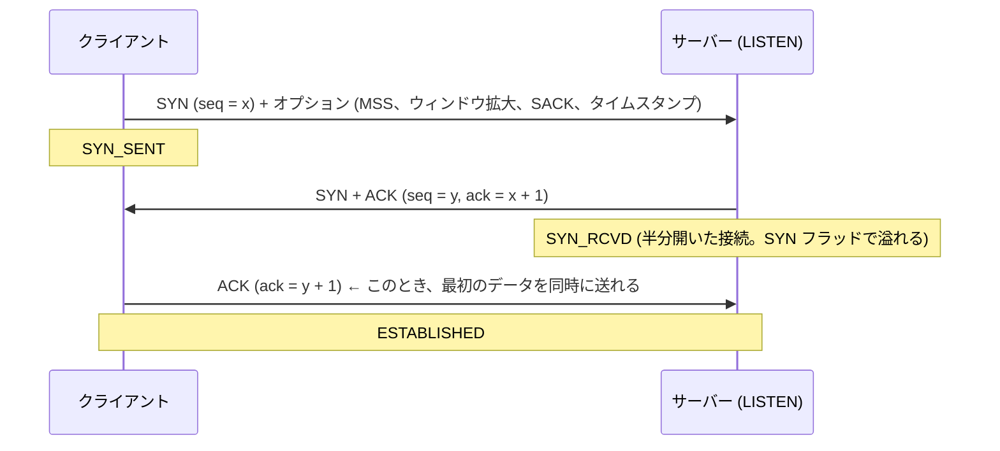

# 図1: TCP のヘッダと、ハンドシェイク

## 1. TCP ヘッダ(最小 20 バイト)

```
  0                   1                   2                   3
  0 1 2 3 4 5 6 7 8 9 0 1 2 3 4 5 6 7 8 9 0 1 2 3 4 5 6 7 8 9 0 1
 +-------------------------------+-------------------------------+
 |        送信元ポート           |         宛先ポート            |
 +-------------------------------+-------------------------------+
 |                    シーケンス番号 (32 ビット)                  |
 +---------------------------------------------------------------+
 |                  確認応答番号 (32 ビット)                      |
 +-------+-------+---------------+-------------------------------+
 |オフセット|予約  |C E U A P R S F|        ウィンドウ             |
 |       |       |W C R C S S Y I|                               |
 |       |       |R E G K H T N N|                               |
 +-------+-------+---------------+-------------------------------+
 |         チェックサム          |         緊急ポインタ          |
 +-------------------------------+-------------------------------+
 |                   オプション (可変: MSS、ウィンドウ拡大、SACK、タイムスタンプ)   |
 +---------------------------------------------------------------+
```

| フィールド | 意味 |
|---|---|
| シーケンス番号 | このセグメントの、**最初のバイトの番号** |
| 確認応答番号 | 「次に、この番号のバイトが欲しい」(ここまでは全部受け取った) |
| ウィンドウ | 受信側が、あと何バイト受け取れるか(ウィンドウ拡大で、2^n 倍) |
| フラグ | SYN(接続開始)、ACK、FIN(終了)、RST(強制切断)、PSH、URG、ECE/CWR(輻輳通知) |

## 2. シーケンス番号は、バイトを数える

```
 セグメント 1:  seq = 1000, データ 1460 バイト (1000〜2459)
 セグメント 2:  seq = 2460, データ 1460 バイト (2460〜3919)

 受信側の ACK:  ack = 2460  →  「1000〜2459 は受け取った。次は 2460 から」
```

ISN(最初の番号)は、ランダムに選ぶ。古い接続の、遅れて届いたセグメントとの取り違えと、推測による攻撃を防ぐため。

## 3. 3ウェイハンドシェイク



| 論点 | 内容 |
|---|---|
| なぜ 3 回か | 双方が、自分の ISN を伝え、相手が受け取ったことを確認するため |
| コスト | データを送る前に、最低 1 RTT |
| SYN フラッド対策 | SYN cookie: 状態を保存せず、ISN に情報を埋め込む |
| accept キュー | ハンドシェイクが終わった接続は、アプリが `accept()` するまで待つ |

## 4. 実測(演習1、ループバック)

| 方式 | 1リクエスト |
|---|---|
| 毎回、新しい接続 | 約 71〜73 µs(Dial が約 39〜40 µs) |
| 使い回し | 約 16〜18 µs |

新しい接続は、約 4〜4.6 倍。実際のネットワークでは、最低 1 RTT が上乗せされる。

## 5. 演習3: 実際の接続のオプション(ループバック)

| 項目 | 値 |
|---|---|
| MSS | 16,332 バイト |
| 初期 cwnd | 163,320 バイト = 10.0 セグメント |
| ssthresh | 1,073,725,440 バイト (ほぼ無限) |
| ウィンドウ拡大 | 送信 6 / 受信 6 (64 倍) |
| オプション | タイムスタンプ 有、SACK 有、ウィンドウ拡大 有、ECN 無 |

## 6. TCP の保証と、保証しないこと

| 保証する | 保証しない |
|---|---|
| 欠落がない、順序、重複なし | 遅延の上限 |
| 受信側が溢れない (フロー制御) | スループット |
| ネットワークが溢れない (輻輳制御) | メッセージの境界 |
| | **相手のアプリが処理したこと** (ACK は OS が受け取っただけ) |
| | **接続が、まだ生きていること** |
