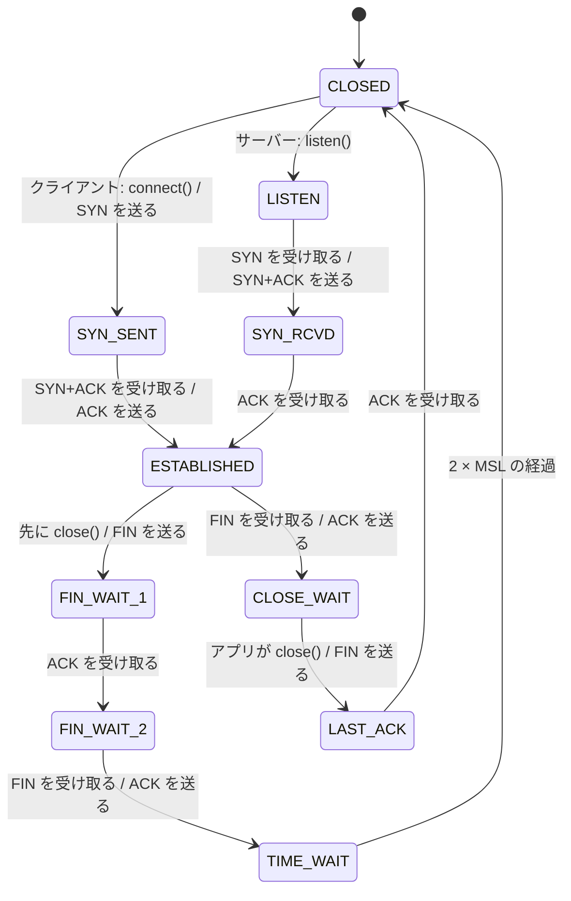
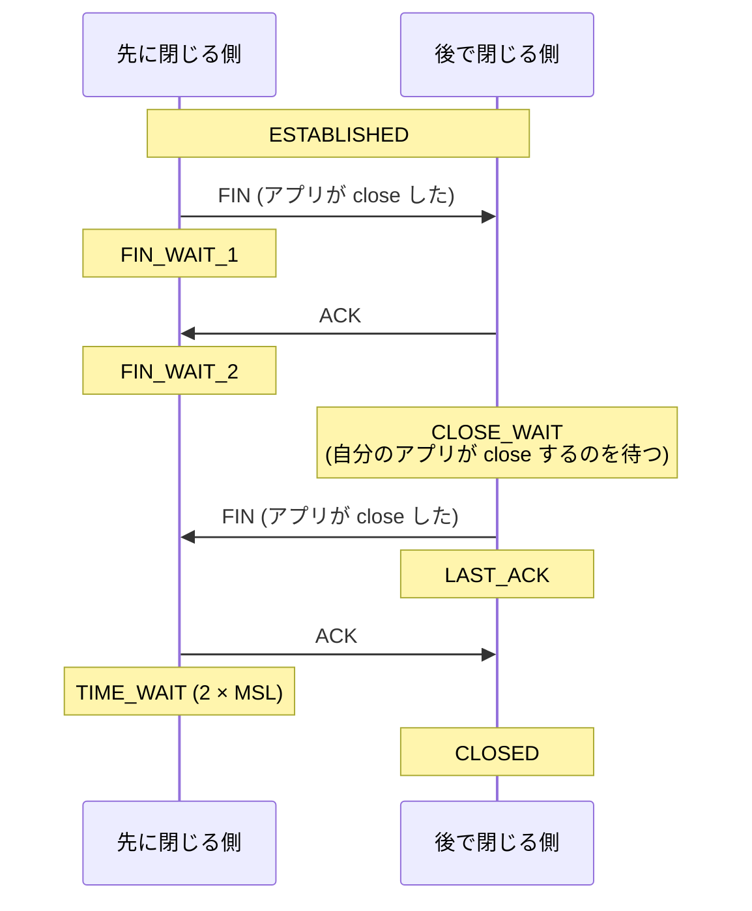
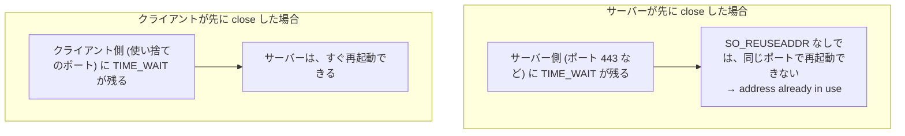

# 図2: TCP の状態遷移と、TIME_WAIT

## 1. 状態遷移図



## 2. 閉じる手順(先に閉じる側と、後で閉じる側)



## 3. 状態が溜まるときの、原因

| 状態 | 溜まる原因 | 疑う場所 |
|---|---|---|
| **CLOSE_WAIT** | 相手は閉じたが、**自分のアプリが close していない** | **自分のアプリのバグ** (ソケットのリーク) |
| **TIME_WAIT** | **自分から閉じた**接続が、2 × MSL の間残る | 短い接続を、大量に張っている (接続プール、keep-alive) |
| FIN_WAIT_2 | 相手が、FIN を返さない | 相手のアプリが close していない (相手の CLOSE_WAIT) |
| SYN_RCVD | SYN フラッド、または accept が追いつかない | 攻撃、アプリの accept の遅れ |
| ESTABLISHED が多すぎる | 長寿命の接続が多い | 想定どおりか、リークか |

## 4. TIME_WAIT

```
 TIME_WAIT の長さ = 2 × MSL
   この環境 (macOS): net.inet.tcp.msl = 15,000 ms → 30 秒
   Linux: 通常 60 秒 (固定)
```

理由:

1. 最後の ACK が失われたとき、相手が FIN を再送してきたら、再び ACK を返せるようにする。
2. 古い接続の、遅れて届いたセグメントが、同じ 5 つ組の新しい接続に紛れ込むのを防ぐ。

## 5. 先に閉じた側にだけ、TIME_WAIT が残る(演習1)



| 先に閉じた側 | SO_REUSEADDR なしで再起動 | あり |
|---|---|---|
| サーバー | **失敗: address already in use** | bind できた |
| クライアント | bind できた | bind できた |

## 6. lsof で観察した状態(演習1、クライアントが先に close)

| 時点 | 状態 |
|---|---|
| listen した直後 | `LISTEN` |
| 接続の確立 | `ESTABLISHED` × 2 (サーバー側、クライアント側) |
| クライアントが close した後 | サーバー側が `CLOSE_WAIT` |
| サーバーも close した後 | `LISTEN` だけ |

`FIN_WAIT_2` と `TIME_WAIT` は、プロセスの管理から外れた(カーネルだけが持つ)ので、`lsof` には出ない。

## 7. エフェメラルポートの枯渇

```
 エフェメラルポートの範囲 (macOS の既定): 49152 〜 65535 = 約 16,000 個
 短い接続を、1 秒に 1,000 本、こちらから閉じて張り続けると:
   TIME_WAIT (30 秒) × 1,000 本/秒 = 30,000 個 > 16,000 個
   → 新しい接続が失敗する (can't assign requested address)  ← 第6回で実際に経験した
```

対策: 接続の使い回し、接続プール、`SO_LINGER`(0)で RST で閉じる(ただし、データを捨てる)、範囲の拡大。
