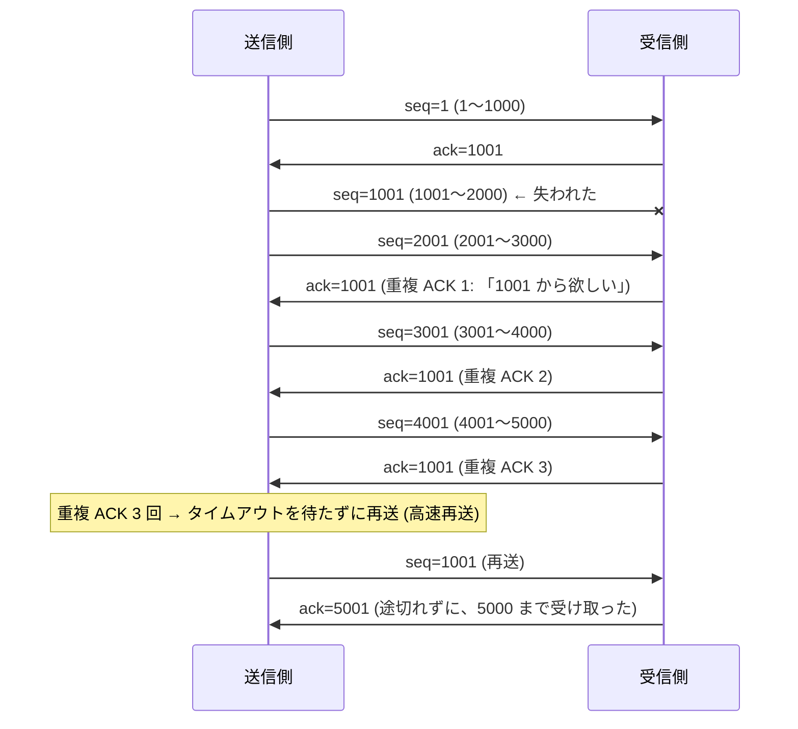
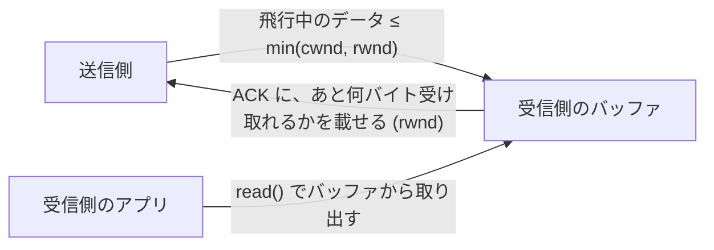
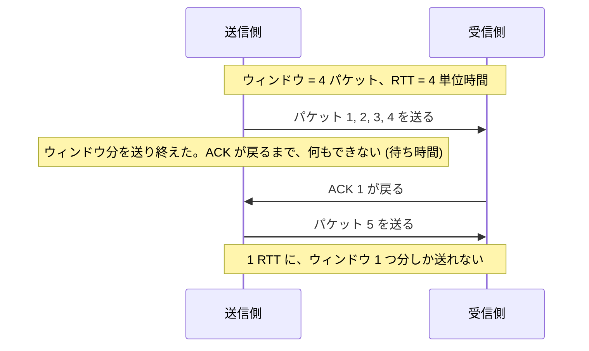
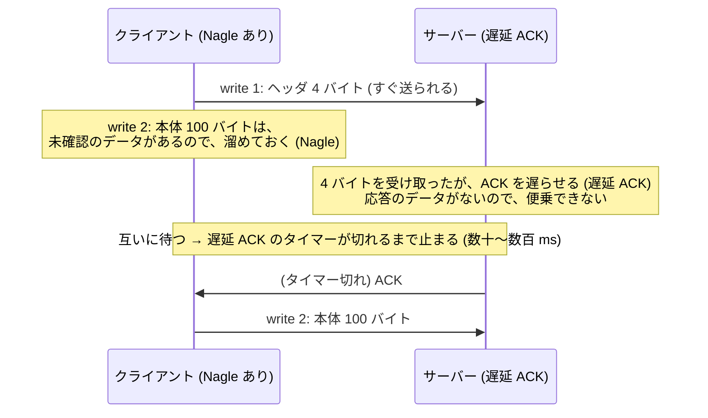

# 図3: 信頼性とフロー制御

## 1. 累積 ACK と、高速再送



| 再送のきっかけ | 速さ | cwnd への影響 |
|---|---|---|
| 3 回の重複 ACK(高速再送) | 速い(約 1 RTT) | 半分にする |
| タイムアウト(RTO) | 遅い | 1 に戻す(スロースタートからやり直し) |

## 2. SACK

```
 累積 ACK だけ:  ack=1001  → 「1001 から欲しい」 (何が失われたかしか分からない)
 SACK あり:      ack=1001, SACK=2001〜4000  → 「1001〜2000 は無いが、2001〜4000 は受け取った」
                                              失われた範囲だけを再送できる
```

## 3. RTO の決め方

```
 SRTT   = 平滑化した RTT の平均
 RTTVAR = RTT のばらつき
 RTO    = SRTT + 4 × RTTVAR
```

- 短すぎると、無駄な再送が増え、長すぎると、損失の回復が遅れる。
- 再送したセグメントの ACK では、RTT を測らない(Karn のアルゴリズム)。
- タイムアウトするたびに、RTO を倍にする(指数バックオフ)。

## 4. フロー制御: 受信ウィンドウ



受信側のアプリが `read()` しないと、バッファが埋まり、rwnd が縮み、0 に近づき、送信側が止まる。

## 5. 演習3: 受信側が 1 秒間 read しない(ループバック)

| 経過 | 送った量 | 相手のウィンドウ | 送信バッファ |
|---|---|---|---|
| 0.1 ms | 0.3 MB | 408,320 B | 327,212 B |
| 0.1 ms | 0.3 MB | **81,408 B** | 0 B |
| 259 ms | 0.7 MB | **16,128 B** | 343,596 B |
| 776 ms | 0.7 MB | 16,128 B | 343,596 B |
| **1,027 ms** | **152.8 MB** | 1,371,840 B | 17,424 B |

- 受信側が読まない間、相手のウィンドウが縮み、送信側は約 0.7 MB で止まった(送信バッファ + 受信バッファの合計)。
- 16,128 B は、MSS(16,332 B)より小さい → 実質的に送れない(愚かなウィンドウ症候群の回避)。
- 受信側が読み始めると、再び流れ出した。

## 6. BDP: 必要なウィンドウ

```
 スループットの上限 = ウィンドウ ÷ RTT
 BDP (必要なウィンドウ) = 帯域 × RTT
```

| 帯域 | RTT | BDP |
|---|---|---|
| 100 Mbps | 50 ms | 625 KB |
| 1 Gbps | 100 ms | 12.5 MB |
| 10 Gbps | 100 ms | 125 MB |

ウィンドウ拡大なし (最大 64 KB) で、RTT 50 ms:

```
 64 KB ÷ 50 ms = 約 1.3 MB/s = 約 10 Mbps
```

→ ウィンドウ拡大と、バッファの自動調整が必須。



## 7. 小さな書き込み: Nagle と遅延 ACK



| 演習2(ループバック、macOS) | 平均の往復 |
|---|---|
| Nagle あり、2 回の write | 0.043 ms |
| Nagle なし (`TCP_NODELAY`) | 0.027 ms |
| Nagle あり、1 回の write | 0.025 ms |

**この環境では、40 ms の停止は、再現しなかった。** 対策は、`TCP_NODELAY` と、書き込みをまとめること。
