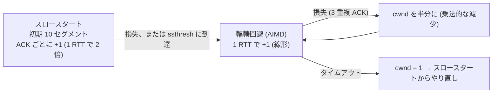
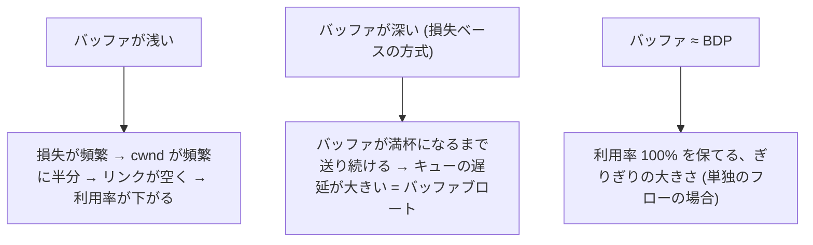
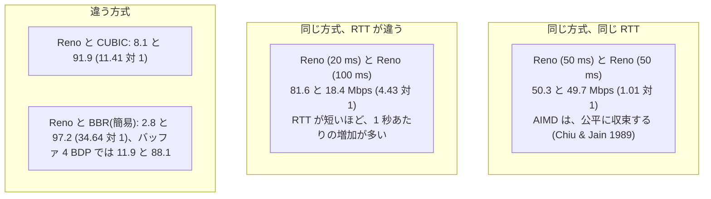
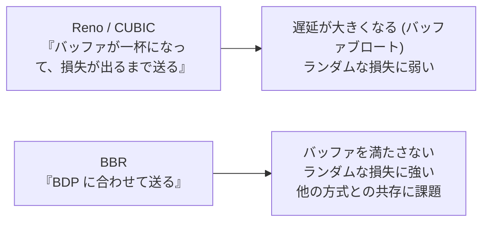

# 図4: 輻輳制御

**注意**: この図の数値は、実機ではなく、演習4のシミュレータ(簡易モデル)の結果である(演習3の、初期 cwnd と成長を除く)。

## 1. cwnd の成長(スロースタートと輻輳回避)



## 2. Reno ののこぎり波(シミュレータ、100 Mbps、RTT 50 ms、バッファ 1 BDP)

```
 BDP = 416 パケット   バッファ = 416 パケット   BDP + バッファ = 832 パケット

 cwnd
  832 ┤        /|        /|
      │       / |       / |
      │      /  |      /  |      ← 約 31 秒周期。1 RTT ごとに +1
  416 ┤  ___/   |_____/   |___   ← 損失で半分 (832 → 416 = BDP)
      │                          416 = BDP なので、リンクは空かない
      └──────────────────────→ 時間
```

| 項目 | 結果 |
|---|---|
| スループット | 100.0 Mbps (利用率 100%) |
| 平均のキューの遅延 | 30.5 ms |
| 10 秒以降の cwnd の範囲 | 416 〜 822 パケット |
| 周期 | 約 31 秒 (1 秒あたり約 11 パケットずつ増加) |

**損失の直後の cwnd = (BDP + バッファ) ÷ 2 が、BDP 以上なら、リンクが空かない → バッファ ≥ BDP が、経験則の根拠。**

## 3. バッファの大きさと、利用率 / キューの遅延(単独のフロー、シミュレータ)

| バッファ | Reno | CUBIC | BBR(簡易) |
|---|---|---|---|
| 0.05 BDP | 76.4% / 0.8 ms | 89.6% / 1.0 ms | 97.6% / 1.8 ms |
| 0.10 BDP | 80.1% / 1.1 ms | 92.8% / 2.7 ms | 98.3% / 2.8 ms |
| 0.25 BDP | 87.9% / 3.5 ms | 97.7% / 7.3 ms | 100.0% / 2.7 ms |
| 0.50 BDP | 96.0% / 10.5 ms | 100.0% / 17.5 ms | 100.0% / 12.1 ms |
| 1.00 BDP | 100.0% / 30.5 ms | 100.0% / 39.9 ms | 100.0% / 28.9 ms |
| 2.00 BDP | 100.0% / 66.7 ms | 100.0% / 84.8 ms | 100.0% / 30.3 ms |
| 4.00 BDP | 100.0% / 103.8 ms | 100.0% / 174.1 ms | 100.0% / 30.3 ms |



## 4. Mathis の式と、損失(シミュレータ、100 Mbps、RTT 50 ms、バッファ 1 BDP)

```
 スループット ≒ (MSS / RTT) × (1.22 / √p)
```

| 損失率 p | Reno | CUBIC | BBR(簡易) | Mathis |
|---|---|---|---|---|
| 0 | 100.0 | 100.0 | 100.0 | |
| 0.0001 | 37.2 | 80.4 | 100.0 | 29.3 |
| 0.001 | **9.1** | 14.0 | 99.9 | **9.3** |
| 0.01 | 3.3 | 3.3 | 99.0 | 2.9 |
| 0.05 | 1.4 | 1.2 | 90.7 | 1.3 |

(単位: Mbps。Reno は、Mathis の式とよく合った。)

- p が 100 倍 → スループットは 10 分の 1。
- RTT が 2 倍 → スループットは半分。
- BBR(簡易)は、損失を合図に使わないので、ランダムな損失に強い。ただし、輻輳による損失も無視するので、他のフローを圧迫しうる。

## 5. 公平性(シミュレータ、100 Mbps)



**簡易 BBR は、実際の BBR より攻撃的な可能性が高く、この比は、実際の値として受け取らない。** 傾向(RTT による不公平、方式による不公平)の確認のために使う。

## 6. 実際の TCP の cwnd 成長(演習3、ループバック、macOS)

| 送った量 | cwnd |
|---|---|
| 接続直後 | 163,320 B (10.0 セグメント) |
| 1.0 MB | 441,068 B |
| 8.4 MB | 1,119,860 B |
| 16.8 MB | 1,674,940 B |
| 25.2 MB | 2,979,160 B |
| 33.6 MB | 3,848,240 B |
| 41.9 MB 以降 | 4,194,240 B (頭打ち) |

ループバックは、損失も遅延もないので、損失で縮むところは見えない。

## 7. 3つの方式の考え方

| 方式 | 輻輳の合図 | 成長 | 損失への反応 |
|---|---|---|---|
| Reno | 損失 | 1 RTT で +1 (線形) | 半分に |
| CUBIC | 損失 | 最後の損失の時点の cwnd を中心とした、3 次関数 (時間で決まる) | 0.7 倍に |
| BBR | (使わない。帯域と RTT の推定) | BDP に合わせてペーシング | 縮めない |


