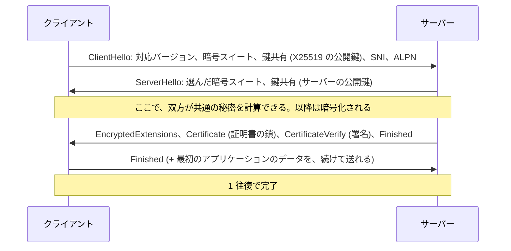
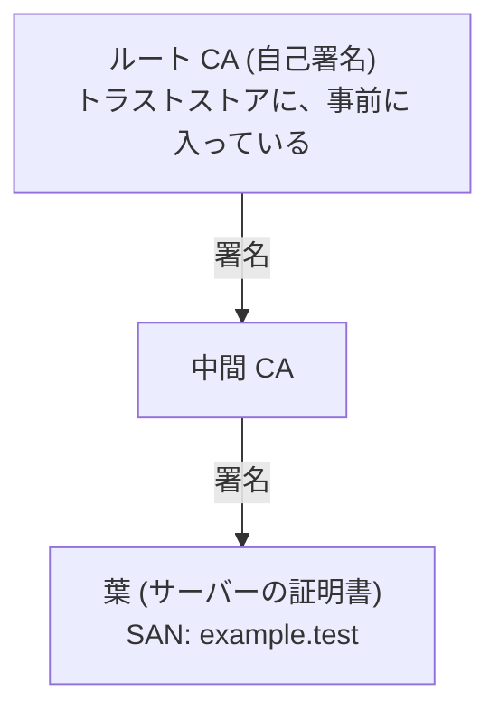

# 第9回 TLS・HTTP・ウェブ

> ステータス: 執筆済み(第1版)
> 前提: 第7回(IP、パケット)、第8回(TCP、RTT、ハンドシェイクのコスト、HOL ブロッキング)
> 演習言語: Go
> 所要目安: 本文 3〜4時間 + 演習 5時間
> **演習はすべてループバックで行い、外部のサイトには接続していない。往復時間は、人工的に加えた(帯域の制限と、実際の損失はない)。HTTP/3(QUIC)は、動かしていない。**

## この回のゴール

この回を終えると、次のことが説明できるようになる。

1. TLS は、何を、どの攻撃から守り、何を守らないのか。機密性、完全性、認証は、どの部品が担当するのか。
2. TLS 1.3 のハンドシェイクで、何が、どの順序で起きるのか。なぜ 1 往復で済み、なぜ前方秘匿性が得られるのか。
3. 証明書の鎖は、どう検証されるのか。検証が失敗する典型的な原因と、`InsecureSkipVerify` が危険な理由。
4. TLS のコスト(往復、CPU、バイト数)を、数値で見積もれる。
5. HTTP/1.1、HTTP/2、HTTP/3 は、何が違い、各バージョンは、前のバージョンの何を解決したのか。
6. キャッシュ(ETag)と圧縮は、何をどれだけ節約するのか。
7. ブラウザが URL を開いてから、最初のバイトが届くまでに、何往復かかるのか。

第7回でパケット、第8回で TCP を見た。この回では、その上に載る**暗号化(TLS)**と、ウェブの言語である **HTTP** を扱う。第10回(DNS、CDN、ロードバランサ)、第11回(コンテナのネットワーク)、第12〜15回(分散システム、RPC)は、この回の上に載る。

---

## 1. TLS が解く問題

### 1.1 TCP だけでは、何が足りないか

第8回の TCP は、**信頼できるバイトの流れ**を作るが、**盗み見、書き換え、なりすまし**は、防がない。通信の途中(Wi-Fi の機器、ルーター、プロバイダ、ロードバランサ)は、すべて、パケットの中身を見られ、書き換えられる。

| 脅威 | 内容 | TLS の対策 |
|---|---|---|
| **盗聴** | 通信の途中で、中身を読まれる | **暗号化**(機密性) |
| **改ざん** | 通信の途中で、中身を書き換えられる | **認証つき暗号**(完全性)。1 ビットでも変わると、検出する |
| **なりすまし** | 相手が、本物のサーバーだと、偽られる | **証明書**による、サーバーの認証 |

TLS は、**TCP の上、HTTP の下**に位置する(HTTP + TLS = HTTPS)。アプリから見ると、「暗号化された TCP」のように使える。

### 1.2 TLS が守らないこと

| 守らないこと | 理由 |
|---|---|
| **通信している事実**、相手の IP アドレス、データの量、タイミング | 暗号化されるのは、中身だけ。パケットの大きさと間隔から、推測されうる |
| **サーバー名**(SNI) | ClientHello の中に、平文で書かれる(ECH という拡張で、暗号化できる) |
| **サーバー側での、データの扱い** | TLS は、「経路」を守る。サーバーが、データを盗む、漏らす場合は、守らない |
| **端末が、乗っ取られている場合** | 暗号化の前後で、データが読まれる |
| **実装のバグ** | 2014 年の Heartbleed は、TLS の実装(OpenSSL)の、メモリの読み出しの誤りで、秘密鍵が漏れた |

---

## 2. 暗号の部品(必要な範囲で)

この回は、暗号の数学ではなく、**部品の役割**を理解する。

| 部品 | 役割 | 例 |
|---|---|---|
| **対称鍵暗号**(AEAD) | 同じ鍵で、暗号化と復号。**速い**。完全性の検証(認証タグ)も、同時に行う | AES-GCM、ChaCha20-Poly1305 |
| **鍵交換** | 通信する2者が、**盗聴者に知られずに、共通の秘密を作る** | ECDHE(X25519、P-256) |
| **デジタル署名** | 「この鍵の持ち主が、確かに、これを作った」ことを証明する | ECDSA、RSA、Ed25519 |
| **ハッシュ、HMAC、HKDF** | データの指紋、鍵の導出 | SHA-256、HKDF |

**役割の分担**:

- **鍵交換**で、共通の秘密を作る(相手が誰かは、まだ分からない)。
- **署名と証明書**で、相手が本物だと確認する。
- **対称暗号**で、実際のデータを、速く暗号化する(非対称の演算は、遅い。後述の実測)。

### 2.1 前方秘匿性

**鍵交換に、毎回、新しい使い捨ての鍵**(一時鍵、ephemeral)を使うと、**後で、サーバーの長期の秘密鍵が漏れても、過去の通信は、復号できない**。これが**前方秘匿性**(forward secrecy)である。

古い TLS(1.2 まで)には、**RSA 鍵交換**(クライアントが、サーバーの公開鍵で、秘密を暗号化して送る)があった。これだと、サーバーの秘密鍵が、後で漏れると、**記録しておいた過去の通信を、全部復号できる**。TLS 1.3 は、これを廃止し、**一時鍵の鍵交換だけ**にした。

---

## 3. TLS 1.3 のハンドシェイク

### 3.1 流れ



要点:

1. **ClientHello の中で、鍵交換の公開鍵まで送る**(クライアントは、サーバーが、どの曲線を選ぶかを、**推測して**、先に鍵共有を載せる)。これで、**1 往復**になる。
2. サーバーは、ServerHello で自分の鍵共有を返す。**ここから先は、すべて暗号化される**(証明書も)。
3. **Certificate**: サーバーの証明書の鎖。**CertificateVerify**: サーバーが、ここまでの通信の全体に、自分の秘密鍵で署名する。これで、サーバーが、その秘密鍵の持ち主であると証明する。
4. **Finished**: ここまでの通信の全体の、ハッシュ(MAC)。**ハンドシェイクが、途中で書き換えられていない**ことを、双方が確認する。

### 3.2 TLS 1.2 との違い

| | TLS 1.2 | TLS 1.3 |
|---|---|---|
| 往復 | **2 往復** | **1 往復** |
| 鍵交換 | RSA 鍵交換も可(前方秘匿性なし) | **一時鍵の鍵交換のみ**(前方秘匿性が必須) |
| 証明書 | 平文で流れる | **暗号化される** |
| 暗号 | CBC、RC4 など、弱いものも | **AEAD のみ**(AES-GCM、ChaCha20-Poly1305) |
| 設計 | 長年の追加で、複雑 | 弱い選択肢を削除。形式的な検証が行われた |

### 3.3 実測: 往復の数(演習1)

ハンドシェイクで、クライアントから見た、送受信の塊を記録した(`→` が送信、`←` が受信)。

| バージョン | 塊 | クライアントが、データを送り始められるまで |
|---|---|---|
| TLS 1.2 | → 241 B、← 1,156 B、→ 93 B、← 81 B | **2 往復** |
| TLS 1.3 | → 247 B、← 1,307 B、→ 64 B | **1 往復** |

TLS 1.3 では、クライアントの最後の塊(Finished、64 バイト)の直後に、アプリケーションのデータを送り始められる。TLS 1.2 では、鍵交換の後にも、もう 1 往復(`→ 93 B`、`← 81 B`)が要る。

### 3.4 実測: 往復時間 50 ms での、ハンドシェイクの時間

演習1で、往復時間を 50 ms に人工的に設定して、TLS ハンドシェイクの時間を測った(TCP の接続の分は含まない。各 5 回の中央値)。

| 方式 | 時間 |
|---|---|
| TLS 1.2(全体) | **106.4 ms**(約 2 RTT) |
| TLS 1.2(再開) | 53.3 ms(約 1 RTT) |
| TLS 1.3(全体) | **54.4 ms**(約 1 RTT) |
| TLS 1.3(再開) | 54.2 ms(約 1 RTT) |

さらに、TCP の 3 ウェイハンドシェイク(1 RTT = 50 ms)が、前に加わる。つまり、接続を張って、最初のリクエストを送れるまで、**TLS 1.2 では約 3 RTT(150 ms)、TLS 1.3 では約 2 RTT(100 ms)**である。

**この結果の注意**: TLS 1.3 の再開が、全体と同じ約 1 RTT なのは、再開しても、**往復の数は減らない**ためである(再開が減らすのは、証明書の送信と検証、署名の CPU)。往復をゼロにするのは、**0-RTT**(後述)で、この演習の Go のクライアントでは、使っていない。

### 3.5 セッションの再開と 0-RTT

**再開**: 最初のハンドシェイクの後、サーバーが、**セッションチケット**(暗号化された、セッションの情報)をクライアントに渡す。次の接続で、クライアントは、チケットを提示して、**証明書の送信と検証、署名の計算を省ける**(PSK: 事前共有鍵)。

**0-RTT**(early data): 再開のとき、クライアントは、**ClientHello と同時に、最初のアプリのデータを送れる**(暗号化は、前回のセッションの鍵から導く)。往復が 0 になる。ただし、**リプレイ攻撃**に弱い。攻撃者が、0-RTT のデータを記録して、同じものを、別のときに再送すると、サーバーは、二度処理する可能性がある。**0-RTT で送ってよいのは、冪等なリクエスト**(GET など)だけである。

### 3.6 SNI と ALPN

ClientHello には、2つの重要な拡張が入る。

- **SNI**(Server Name Indication): 「どのホスト名に接続したいか」。1つの IP アドレスで、多数のサイトを提供するサーバー(CDN、共有ホスティング)が、**どの証明書を返すか**を決めるために要る。**平文**で流れる(§1.2)。
- **ALPN**(Application-Layer Protocol Negotiation): 「どの上位のプロトコルを話したいか」。`h2`(HTTP/2)、`http/1.1`。**TLS のハンドシェイクの中で、HTTP のバージョンが決まる**ので、追加の往復が要らない。演習4で、`h2` が選ばれることを確認した。

図は [diagrams/01-tls13-handshake.md](diagrams/01-tls13-handshake.md)。

---

## 4. 認証と PKI

### 4.1 証明書

**証明書**(X.509)は、「**この公開鍵は、このドメイン名の持ち主のものである**」という、**認証局(CA)の署名つきの宣言**である。

演習3で、実際の証明書の中身を見た。

| 項目 | 内容(演習3の葉の証明書) |
|---|---|
| 主体(Subject) | `example.test` |
| **SAN**(Subject Alternative Name) | `example.test`、`www.example.test`(**ホスト名の検証は、この欄で行う**。昔の CN は、使われない) |
| 発行者(Issuer) | 中間 CA |
| 有効期間 | 90 日間 |
| CA か | いいえ |
| 鍵の用途 | DigitalSignature、拡張鍵用途: ServerAuth |
| 署名のアルゴリズム | ECDSA-SHA256 |
| 大きさ | 478 バイト |

### 4.2 証明書の鎖

サーバーの証明書(葉)は、**中間 CA** が署名し、中間 CA の証明書は、**ルート CA** が署名する。ルート CA の証明書は、**自己署名**で、OS やブラウザの**トラストストア**に、あらかじめ入っている。



**サーバーは、葉と中間を送り、ルートは、送らない**(クライアントが、すでに持っているので)。ルートの秘密鍵は、オフラインで厳重に保管し、日常の署名は、中間 CA が行う(ルートの秘密鍵が、危険にさらされるのを避けるため)。

### 4.3 検証の手順

クライアントは、次を確認する。

1. 葉の署名が、中間 CA の公開鍵で、検証できるか。中間の署名が、(トラストストアの)ルートの公開鍵で、検証できるか(**鎖が、信頼できるルートまで繋がるか**)。
2. **有効期間**の中か。
3. **ホスト名**が、葉の SAN に含まれるか。
4. **用途**が合っているか(サーバー認証 ServerAuth)。
5. **失効**していないか(§4.5)。
6. 鎖の途中の証明書が、CA として署名してよいか(CA フラグ)。

### 4.4 実測: 検証が失敗する場合(演習3)

| 状況 | 結果 |
|---|---|
| 正常(中間をサーバーが送った) | 成功(example.test → 中間 CA → ルート CA) |
| SAN にある別名(www) | 成功 |
| **中間が足りない**(サーバーが送り忘れ) | 失敗: `certificate signed by unknown authority` |
| **ホスト名が違う** | 失敗: `certificate is valid for example.test, www.example.test, not evil.test` |
| 検証の時刻が、有効期間を過ぎた(+100 日) | 失敗: `certificate has expired or is not yet valid` |
| **信頼していないルート** | 失敗: `certificate signed by unknown authority` |
| 期限切れの証明書 | 失敗: `certificate has expired or is not yet valid` |
| まだ有効でない証明書 | 失敗: 同上 |
| クライアント認証の用途で検証 | 失敗: `certificate specifies an incompatible key usage` |

実務で最もよく起きるのは、次の3つである。

- **期限切れ**: 証明書の更新を忘れた(自動化で防ぐ。§4.6)。
- **中間証明書の送り忘れ**: ブラウザは、足りない中間を、自力で探して補うことがあるが、**他のクライアント(curl、Java、Go)は補えず、失敗する**。「ブラウザでは見えるのに、APIクライアントが失敗する」の原因。
- **ホスト名の不一致**: 別名やワイルドカードの設定の誤り。

エラーメッセージが、「unknown authority」だけでは、**中間が足りないのか、ルートが信頼されていないのか**が、区別できない。`openssl s_client -showcerts` で、サーバーが何を送っているかを確認する。

### 4.5 InsecureSkipVerify の危険

演習3で、ホスト名が合わない接続を試した。

| 設定 | 結果 |
|---|---|
| `ServerName = "example.test"`、検証あり | 接続できた |
| `ServerName = "other.test"`、検証あり | **接続失敗**(証明書は、`other.test` に有効でない) |
| `ServerName = "other.test"`、**`InsecureSkipVerify = true`** | **接続できてしまった** |

`InsecureSkipVerify` は、**証明書の検証を、すべて切る**。暗号化は、されるが、**相手が本物かを、確認しない**。中間者が、自分の証明書で応答しても、そのまま接続してしまう。**開発中の一時的な回避として、書かれたコードが、そのまま本番に残る**事故が、非常に多い。

### 4.6 失効、CT、自動化

**失効**: 秘密鍵が漏れた証明書を、期限前に無効にする仕組み。

| 仕組み | 内容 | 問題 |
|---|---|---|
| CRL | 失効した証明書の一覧 | 大きい。更新が遅い |
| OCSP | 1つの証明書の状態を、CA に問い合わせる | 遅い。CA に、閲覧履歴が漏れる。**失敗したとき、接続を許すか**(ソフトフェイル) |
| **OCSP stapling** | サーバーが、OCSP の応答を、証明書と一緒に送る | |
| **短い有効期間** | 数日〜90 日にして、失効に頼らない | 自動更新が必須 |

失効は、実際には、あまりうまく機能していない。そのため、**有効期間を短くする**方向に進んでいる。

**Certificate Transparency**(CT): CA が発行した証明書を、**公開された、追記専用のログ**に記録する。**誤って、または不正に発行された証明書**を、ドメインの持ち主が、ログを監視して、見つけられる。

**ACME**(Let's Encrypt など): 証明書の発行と更新を、**自動化**する。90 日の有効期間で、自動更新するのが、標準になった。

---

## 5. TLS のコスト

### 5.1 往復

§3.4 のとおり、**TCP 1 RTT + TLS 1.3 で 1 RTT** = 2 RTT。TLS 1.2 なら 3 RTT。RTT が 100 ms なら、**接続を張るだけで、200〜300 ms**。接続を使い回す(第8回)、再開、0-RTT、QUIC(§8)で、削減する。

### 5.2 CPU

演習1で、ハンドシェイク 1 回あたりの、CPU の時間を測った(クライアントとサーバーの両方の計算を含む。メモリ内でつなぐ。Apple M5、TLS 1.3)。

| 条件 | 1回あたり | 1秒あたり |
|---|---|---|
| ECDSA P-256 証明書、X25519 | 0.35 ms | 約 2,830 回 |
| ECDSA P-256 証明書、P-256 で鍵交換 | 0.23 ms | 約 4,370 回 |
| **RSA 2048** 証明書、X25519 | 0.83 ms | 約 1,200 回 |
| **RSA 3072** 証明書、X25519 | **2.05 ms** | 約 490 回 |
| ECDSA P-256 証明書(**再開**) | **0.21 ms** | 約 4,730 回 |

分かること:

- **RSA は、ECDSA より遅い**(2048 ビットで約 2.4 倍、3072 ビットで約 5.9 倍)。RSA の署名(秘密鍵の演算)は、鍵が大きくなるほど、急に重くなる。
- **再開は、全体より約 4割安い**(0.35 → 0.21 ms)。証明書の検証と、署名の計算が、不要になるため。
- **鍵交換の曲線の違い**(X25519 より、P-256 が速かった)は、**この実装(Go)と、この CPU(arm64)での、結果**である。X25519 のほうが速い、という一般的な通説は、実装と CPU による。**数値は、環境で変わる**。

1 コアで、毎秒、数千回のハンドシェイクを処理できる。**ハンドシェイクの CPU は、接続を使い回していれば、通常、ボトルネックではない**。ただし、接続の数が非常に多い(数百万)サーバー、または、新しい接続が殺到するとき(再起動の直後)には、重要になる。

実際のデータの暗号化(AES-GCM)は、現代の CPU の命令(AES-NI、ARM の暗号拡張)により、1コアで、毎秒数 GB の速度が出る(この回では測っていない)。**データの暗号化のコストは、通常、小さい**。

### 5.3 バイト数

ハンドシェイクで流れる、バイト数の合計と、証明書の鎖の大きさ(TLS 1.3、葉 + 中間)。

| 鍵の種類 | 鎖の大きさ | ハンドシェイク全体 |
|---|---|---|
| **ECDSA P-256** | 941 B | **1,615 B** |
| RSA 2048 | 1,733 B | 2,593 B |
| RSA 3072 | 2,244 B | 3,232 B |
| RSA 4096 | 2,757 B | 3,873 B |

ECDSA の証明書の鎖は、RSA 2048 の約 54% で、ハンドシェイク全体は、約 62% である。**RTT が大きく、初期ウィンドウ(第8回: 10 セグメント)の範囲に収まるかが、効く**ので、小さいことは、利点になる。

---

## 6. HTTP/1.1

### 6.1 基本

HTTP/1.1 は、**テキストの、リクエストとレスポンス**である。演習4で、生の TCP で話した。

```
GET /fixed HTTP/1.1\r\n
Host: x\r\n
\r\n
```

- **リクエスト行**: メソッド(GET、POST…)、パス、バージョン。
- **ヘッダ**: `名前: 値` の行。`Host` は、HTTP/1.1 で必須(1 つの IP で複数のサイトを扱うため)。
- 空行(`\r\n\r\n`)で、ヘッダが終わる。本体が続く。

**レスポンスの区切り**: クライアントは、レスポンスの本体が、どこで終わるかを知る必要がある(TCP は、メッセージの境界を持たない。第7〜8回)。2つの方法がある。

| 方法 | 内容 | 演習4の観察 |
|---|---|---|
| **Content-Length** | 本体の長さを、先に宣言する | `Content-Length: 11`、`hello world` |
| **Transfer-Encoding: chunked** | **長さが事前に分からない**とき、塊ごとに、`長さ(16進)\r\n データ\r\n` を送り、長さ 0 の塊で終わる | `5\r\nhello\r\n6\r\n world\r\n0\r\n\r\n` |

**keep-alive**: 1 つの TCP 接続で、複数のリクエストを、順に処理する(HTTP/1.1 の既定)。第8回で見たとおり、接続の確立は高いので、使い回す。

### 6.2 HTTP/1.1 の限界: 応答が来るまで、次を送れない

1 つの接続では、**リクエストを送って、レスポンスが返るまで、次のリクエストを送れない**(パイプラインは、仕様にはあるが、実際には、先頭のレスポンスが遅いと、後ろが全員待たされる(HOL ブロッキング)ため、ブラウザは使っていない)。

回避策として、ブラウザは、**同じホストに、6 本程度の接続を並行して張る**。しかし、接続を増やすと、それぞれに、TCP と TLS のハンドシェイクが要り、各接続が、スロースタート(第8回)から始まる。

### 6.3 実測: HTTP/1.1 の、接続の使い方(演習2)

往復時間 50 ms、10 KB のリソースを 60 個、TLS で取得する(TCP の接続の分も含む)。

| 条件 | 全体の時間 | 接続数 |
|---|---|---|
| **1. keep-alive、接続 1 本、順番に** | **3,337 ms** | 1 |
| 2. keep-alive、接続 6 本、並行 | 809 ms | 14 |
| 3. 毎回、新しい接続、6 並行 | 1,622 ms | 60 |

- **1 本で順番に**: 約 62 RTT(60 往復 + TCP 1 + TLS 1)。3,337 ms は、62 × 54 ms と一致する。
- **6 本並行**: 約 4 分の 1 になる。**ただし、接続数は 14 本**(上限 6 本を設定したのに)。Go の標準ライブラリは、待っているリクエストのために、**余分に接続を張る**ことがあり、実行ごとに、8〜14 本と、ばらついた。
- **毎回新しい接続**: 約 1.6 秒。各リクエストに、TCP + TLS + リクエストの、3 RTT(約 162 ms)かかる。

---

## 7. HTTP/2

### 7.1 何を変えたか

HTTP/2(RFC 9113)は、HTTP の**意味**(メソッド、ステータス、ヘッダ)を保ったまま、**運び方**を変えた。

| 変更 | 内容 |
|---|---|
| **バイナリのフレーム** | テキストではなく、9 バイトのヘッダを持つ、バイナリのフレーム |
| **多重化**(ストリーム) | **1 つの接続**の中に、複数の**ストリーム**(リクエストとレスポンスの組)を、**同時に**流す。フレームに、ストリーム番号が付く |
| **ヘッダ圧縮**(HPACK) | 静的な表と、動的な表を使い、繰り返されるヘッダを、短い番号で表す |
| **フロー制御** | ストリームごと、接続ごとに、ウィンドウで制御する(TCP とは別に) |
| ALPN で決まる | TLS のハンドシェイクの中で、`h2` が選ばれる |

### 7.2 実測: フレームを読む(演習4)

生の TLS で `h2` を選び、プリフェース(`PRI * HTTP/2.0\r\n\r\nSM\r\n\r\n`)、SETTINGS、HEADERS を、自分で組み立てて送り、サーバーのフレームを読んだ。

**受信したフレーム**:

| フレーム | ストリーム | 内容 |
|---|---|---|
| SETTINGS(長さ 30) | 0 | `MAX_CONCURRENT_STREAMS=250`、`INITIAL_WINDOW_SIZE=1,048,576`、`MAX_FRAME_SIZE=1,048,576`、`HEADER_TABLE_SIZE=4,096`、`MAX_HEADER_LIST_SIZE=1,048,896` |
| WINDOW_UPDATE | 0 | 増加量 983,041(接続全体のウィンドウを、広げた) |
| SETTINGS(確認応答) | 0 | 我々の SETTINGS への、確認 |
| HEADERS(長さ 49) | 1 | 先頭バイト **0x88** = 静的表の 8 番 = `:status 200` |
| DATA(長さ 13) | 1 | 本体 `hello from h2`(END_STREAM) |

**リクエストのバイト数**:

| 形式 | 大きさ |
|---|---|
| HTTP/1.1 のテキスト(`GET / HTTP/1.1\r\nHost: localhost\r\n\r\n`) | 35 バイト |
| HTTP/2 の HEADERS(ヘッダブロック) | **14 バイト**(+ フレームヘッダ 9 バイト) |

HTTP/2 のヘッダブロックは、`0x82`(`:method GET`)、`0x87`(`:scheme https`)、`0x84`(`:path /`)のように、**静的表の番号 1 バイト**で、ヘッダ全体を表せる。ブラウザのリクエストは、Cookie や User-Agent など、数百〜数千バイトのヘッダを、毎回送るので、動的な表による圧縮の効果は、さらに大きい。

### 7.3 実測: 多重化の効果(演習2)

同じ条件(往復 50 ms、10 KB を 60 個)で、HTTP/2 を加える。

| 条件 | 全体の時間 | p50 | 接続数 |
|---|---|---|---|
| 1. HTTP/1.1、接続 1 本、順番に | 3,337 ms | 54 ms | 1 |
| 2. HTTP/1.1、接続 6 本 | 809 ms | 54 ms | 14 |
| 3. HTTP/1.1、毎回新しい接続 | 1,622 ms | 162 ms | 60 |
| **4. HTTP/2、接続 1 本、60 個を同時** | **165 ms** | 165 ms | **1** |

- **HTTP/2 は、60 個を、約 165 ms で取得した**(HTTP/1.1 の 6 本並行の約 5 分の 1、1 本順番の約 20 分の 1)。
- 165 ms は、**TCP 1 RTT + TLS 1 RTT + リクエスト 1 RTT = 3 RTT**にほぼ等しい。**60 個を、同時に出して、全部が、1 往復で返る**。
- 接続が **1 本**で済むので、TCP と TLS のハンドシェイクも、スロースタートも、1 回で済む。

**注意**: この実験は、**帯域の制限がない**。実際には、帯域が限られていれば、60 個のデータ量の合計が、時間を決める。また、HTTP/1.1 の 6 本並行で、ブラウザは、重要なリソースを先に取るなど、優先度を工夫している。数値は、**往復が支配する場合**の、上限の効果である。

### 7.4 HTTP/2 の弱点: TCP のヘッド・オブ・ライン・ブロッキング

HTTP/2 は、**1 本の TCP 接続**に、全部のストリームを載せる。TCP は、**順序を保つ**ため、1 つのパケットが失われると、**その後ろのデータは、再送が届くまで、アプリに渡されない**(第8回)。**ストリームは独立でも、TCP は、全ストリームを、まとめて止める**。

演習2の 5 と 6 で、これを模擬した。サーバー → クライアントの方向で、累積 100 KB を超えたときに、**1 回だけ、200 ms**、配送を止める(パケットが失われ、再送を待つ間の、停止の模擬)。

| 条件 | 全体の時間 | p50 | p95 | 最大 |
|---|---|---|---|---|
| 2. HTTP/1.1、6 本 | 809 ms | 54 ms | 165 ms | 165 ms |
| **5. 2 に、1 回の停止を加える** | 846 ms | 54 ms | 163 ms | **308 ms** |
| 4. HTTP/2、1 本 | 165 ms | 165 ms | 165 ms | 165 ms |
| **6. 4 に、1 回の停止を加える** | **367 ms** | **366 ms** | 366 ms | 366 ms |

- **HTTP/1.1(6 本)**: 停止は、**1 本の接続にだけ**影響する。他の 5 本は、そのまま進む。全体は、809 → 846 ms(+37 ms)。最大のリクエストは、308 ms になった。
- **HTTP/2(1 本)**: 停止が、**全部のストリーム**に影響した。**全リクエストが、約 200 ms 遅れた**(p50 が 165 → 366 ms)。全体は、165 → 367 ms。
- ただし、**停止があっても、HTTP/2 の全体(367 ms)は、HTTP/1.1 の 6 本(846 ms)より、速かった**。

分かること: HTTP/2 は、**往復が支配する場合の、全体の時間**を、大きく減らす。しかし、**損失があるとき、全ストリームが、同時に止まる**。損失が多いネットワーク(携帯、Wi-Fi)では、これが、HTTP/2 の弱点になる。

**注意**: この停止は、**模擬**である(実際のパケット損失ではない。停止の長さと位置は、任意)。実際の TCP の再送の挙動(第8回)は、扱っていない。

---

## 8. HTTP/3 と QUIC

**HTTP/3**(RFC 9114)は、**QUIC**(RFC 9000、**UDP の上**に作られた、新しいトランスポート)の上で、HTTP を運ぶ。

| QUIC / HTTP/3 の特徴 | 解決する問題 |
|---|---|
| **ストリームごとの、独立した損失回復** | 1 つのストリームのパケットが失われても、**他のストリームは、止まらない**(HTTP/2 + TCP の弱点を解決) |
| **TLS 1.3 を統合** | 接続の確立と暗号化を、**1 往復**で(再接続は 0-RTT も)。TCP 1 RTT + TLS 1 RTT = 2 RTT が、**1 RTT** になる |
| **接続 ID** | IP アドレスではなく、ID で接続を識別する。Wi-Fi から携帯に変わっても、**接続が続く** |
| **ほぼ全部を暗号化** | 途中の機器が、中身を見られず、壊せない(第7〜8回の硬直化への対策) |
| **ユーザー空間で動く** | カーネルの更新を待たずに、アプリが、輻輳制御などを更新できる |
| **QPACK** | HTTP/3 用のヘッダ圧縮(HPACK を、順序が入れ替わっても動くように改良) |

**この演習では、HTTP/3 を、動かしていない**(Go の標準ライブラリは、QUIC を含まない)。上の効果は、仕様と、公開資料に基づく説明で、この環境では、測っていない。

---

## 9. キャッシュと圧縮

### 9.1 キャッシュ

最も速いリクエストは、**送らないリクエスト**である。

| 仕組み | 内容 |
|---|---|
| **`Cache-Control: max-age=N`** | N 秒間は、サーバーに確認せず、保存したものを使ってよい |
| **`Cache-Control: no-cache`** | 保存はしてよいが、**使う前に、必ずサーバーに確認する**(名前が紛らわしい) |
| **`Cache-Control: no-store`** | 保存してはならない(機密データ) |
| **`ETag`**(と `If-None-Match`) | リソースの「指紋」。**変わっていなければ、本体を送らない** |
| `Last-Modified`(と `If-Modified-Since`) | 時刻による、同様の仕組み |
| `Vary` | キャッシュの鍵に含めるヘッダ(例: `Accept-Encoding`) |

### 9.2 実測: 条件付きリクエスト(演習5)

200 KB の JSON を、`ETag` つきで配信した。ネットワークで実際に流れたバイト数を、数えた。

| リクエスト | ステータス | ネットワークで受信 | 送信 |
|---|---|---|---|
| 1回目(キャッシュなし) | 200 | **204,990 B** | 77 B |
| 2回目(`If-None-Match` で、ETag を送る) | **304** | **117 B** | 112 B |
| ETag が古い(不一致) | 200 | 204,990 B | 99 B |

**304 Not Modified** は、本体なしで、**117 バイト**で済んだ(204,990 → 117 B、約 1,750 分の 1)。ただし、往復は、1 回要る(確認のため)。**確認すら省く**のが、`max-age` である。

### 9.3 圧縮

テキストは、圧縮で、大きく小さくなる。

| データ(各 1 MiB) | レベル | 圧縮後 | 比率 | 速度 |
|---|---|---|---|---|
| JSON | 1 | 167,568 B | 16.0% | 369 MB/s |
| JSON | 6 | 145,989 B | 13.9% | 163 MB/s |
| JSON | 9 | 145,099 B | 13.8% | **56 MB/s** |
| ランダム | 1〜9 | 約 1,048,700 B | **100%** | — |
| 繰り返しの多い人工テキスト | 6 | 3,166 B | 0.3% | — |

分かること:

- **JSON は、約 14〜16% まで小さくなる**(約 6〜7 分の 1)。
- **レベルを上げても、圧縮率は、ほとんど改善しない**(レベル 6 → 9 で 13.9% → 13.8%)のに、**速度は、163 → 56 MB/s と約 3 分の 1 になる**。**通常は、レベル 1〜6 が、現実的**である。
- **ランダムなデータは、全く圧縮できない**(100%)。**圧縮済みの画像や動画に、圧縮をかけても、CPU の無駄**である。
- 「繰り返しの多い人工テキスト」の 0.3% は、**演習のために、単純な繰り返しで作った、非現実的なデータ**で、実際のテキストでは、もっと大きい。

HTTP では、`Accept-Encoding: gzip, br`(クライアントの対応)と `Content-Encoding: gzip`(サーバーの選択)で、交渉する。Brotli(br)や zstd は、gzip より圧縮率が高い。

### 9.4 圧縮と暗号の組み合わせの危険

**暗号化の前に、圧縮すると、情報が漏れうる**。圧縮後の大きさは、**データの内容に依存する**(同じ文字列が繰り返されると、小さくなる)。攻撃者が、リクエストに、推測した文字列を混ぜて送り、**圧縮後の大きさの変化**(暗号文の長さは見える)を観察すると、秘密(Cookie など)を、1 文字ずつ、推測できる(**CRIME**、**BREACH**)。TLS 自身の圧縮は、廃止された。HTTP/2 の HPACK は、この攻撃を避けるように、設計されている(Huffman 符号と、表のみで、一般的な圧縮はしない)。

---

## 10. HTTP のメッセージの区切りと、スマグリング

### 10.1 問題

HTTP/1.1 では、本体の長さを、`Content-Length` または `Transfer-Encoding: chunked` で示す(§6.1)。**両方が書かれていたら、どちらを信じるか**。RFC 9112 は、「`Transfer-Encoding` を優先し、これは、エラーとして扱うべき」と定める。

**複数の機器**(ロードバランサ、プロキシ、サーバー)が、同じ HTTP の流れを、**別々に解釈**し、**解釈が食い違う**と、**リクエストの境界の認識が、ずれる**。これを悪用するのが、**HTTP リクエストスマグリング**である(Linhart ら 2005、Kettle 2019)。

### 10.2 演習4の観察(簡易パーサー)

`Content-Length: 37` と `Transfer-Encoding: chunked` の両方を持つ、114 バイトの流れを、2つの解釈で読んだ。

| 解釈 | 結果 |
|---|---|
| 前段(Content-Length を優先) | **1 個**のリクエスト(`POST /a`) |
| 後段(Transfer-Encoding を優先) | **2 個**のリクエスト(`POST /a` と **`GET /admin`**) |

前段は、「1 個の POST」と見て通す。**前段の検査(アクセス制御など)を通っていない `GET /admin`** が、後段に届く。

### 10.3 実際の Go のサーバー

自分で起動した、ループバックのサーバーに、同じ流れを送ると、Go の `net/http` のサーバーは、**`POST /a` と `GET /admin` の両方を処理した**(応答は 200 OK)。つまり、**Go のサーバーは、`Transfer-Encoding` を優先して解釈する**。RFC に沿った動作だが、**前段のプロキシが、`Content-Length` を優先していれば、この構成は、脆弱になる**。

**対策**: 前段で、両方を持つメッセージを、**拒否**する。ヘッダを正規化して、後段に転送する。**前段と後段の間も、HTTP/2(または、1 リクエストごとに、新しい接続)にする**(HTTP/2 には、この曖昧さがない。フレームの長さが、明確)。

**注意**: ここでの簡易パーサーは、概念の説明のためで、実際の攻撃の手順の、完全な再現ではない。

---

## 11. ブラウザが、ページを開くとき

URL を開いてから、最初のバイトが届くまでの、往復の数を見積もる。

| 段階 | 往復 | 内容 |
|---|---|---|
| DNS の解決 | 1〜数回 | 名前から IP アドレスを調べる(第10回) |
| TCP の接続 | **1 RTT** | 3 ウェイハンドシェイク |
| TLS 1.3 のハンドシェイク | **1 RTT** | 証明書の確認と鍵交換 |
| HTTP のリクエスト | **1 RTT** | リクエストを送り、最初のバイトが返る |

RTT が 50 ms なら、DNS を除いても、**約 150 ms**。演習2の HTTP/2 の結果(165 ms)と一致する。その後、HTML を解析して、必要なリソース(CSS、JavaScript、画像)を見つけ、**それぞれを取得する**。リソースの取得が、前のリソースの内容に依存すると(CSS が、フォントを参照する、など)、**往復が、さらに連鎖する**。

**短縮する方法**:

| 方法 | 効果 |
|---|---|
| 接続の使い回し(keep-alive、HTTP/2) | TCP + TLS の 2 RTT を、2回目以降は不要に |
| **CDN**(第10回) | RTT そのものを、短くする(近くのサーバーが応答) |
| TLS 1.3、再開、0-RTT | TLS の往復を、1 → 0 に |
| **QUIC / HTTP/3** | TCP + TLS を、1 RTT に統合 |
| `preconnect`、`dns-prefetch` | 事前に、接続を開始しておく |
| キャッシュ(`max-age`) | リクエストそのものを、省く |

---

## 12. 観測する

| 見たいもの | 方法 |
|---|---|
| サーバーが送る証明書の鎖 | `openssl s_client -connect ホスト:443 -showcerts` |
| 証明書の中身 | `openssl x509 -in cert.pem -noout -text` |
| 接続の各段階の時間 | `curl -w 'dns: %{time_namelookup}  tcp: %{time_connect}  tls: %{time_appconnect}  first byte: %{time_starttransfer}\n' -o /dev/null -s URL` |
| HTTP のバージョン、ヘッダ | `curl -v --http2 URL`、`curl -I URL` |
| ブラウザ | 開発者ツールの「ネットワーク」(各リクエストの、DNS、接続、TLS、待ち、受信の内訳) |
| TLS の通信の中身(自分の通信) | Wireshark + `SSLKEYLOGFILE`(ブラウザが、セッションの鍵を書き出し、Wireshark が復号する) |
| Go の HTTP/2 のデバッグ | `GODEBUG=http2debug=1` |
| 証明書の期限の監視 | 期限の N 日前に警告する(自動更新の失敗を検出するため) |

**この環境では、外部のサイトへの測定は、していない**。上のコマンドは、一般的な方法で、この講義では、実行していない(`curl` の `-w` による時間の内訳が、本文 §11 の表と、対応する)。

---

## 13. 演習の実測結果と、つまずいた点

Apple M5(macOS、論理 CPU 10)、Go 1.26.5 での結果。

| 演習 | 内容 | 主な結果 |
|---|---|---|
| 1 | TLS ハンドシェイク | TLS 1.3 は 1 往復、1.2 は 2 往復。RTT 50 ms で、1.3 は 54.4 ms、1.2 は 106.4 ms。ECDSA 0.35 ms、RSA 3072 は 2.05 ms。ECDSA の鎖は RSA 2048 の約 54% |
| 2 | HTTP のバージョン | 60 個を、1.1 の 1 本で 3,337 ms、6 本で 809 ms、HTTP/2 で 165 ms。停止の模擬で、HTTP/2 の p50 は 165 → 366 ms |
| 3 | 証明書の鎖 | 9 つの検証のうち、7 つの失敗の場合のエラーメッセージを確認。`InsecureSkipVerify` で、ホスト名が合わなくても接続できる |
| 4 | HTTP の実際のバイト | HTTP/2 のフレーム、HPACK の `0x88` = `:status 200`。ヘッダ 35 B → 14 B。Go のサーバーは、CL と TE の両方があると TE を優先 |
| 5 | キャッシュと圧縮 | 304 は 117 B(204,990 B から)。JSON は gzip で約 14〜16%。レベル 9 は、遅いのに、ほぼ改善しない |

手順と課題は [exercises/README.md](exercises/README.md)。

**測定でつまずいた点、確認できていない点**

- **演習2の、遅延を加える仕組みが、最初、動かなかった**。HTTP/1.1 の「毎回新しい接続」で、すべてのリクエストが `EOF` で失敗した。原因は、`crypto/tls` が、**close_notify を送った直後に、書き込みの期限を「今」に設定する**(「以降の書き込みは失敗させる」ため)ことだった。遅延させた書き込みは、後で、下の接続に書かれるので、この期限に引っかかり、**黙って失敗**していた(エラーを捨てていた)。書き込みの期限を、下の接続に渡さないように直した。**非同期の層を挟むと、下の層の、期限やエラーの扱いが、食い違う**。
- **演習1の最初の版は、往復時間の測定が、半分だった**。遅延を、クライアント → サーバーの方向にだけ加え、サーバー → クライアントには加えていなかった。TLS 1.3 が 28 ms(約 0.5 RTT)と出たので、気づいた。**両方向に遅延を加える**ように直し、54 ms(約 1 RTT)になった。**予想(1 往復 = 50 ms)と、結果が合わないときは、測定の仕組みを疑う**。
- **演習2の、接続数が、実行ごとに、ばらついた**(6 本の上限で、8〜14 本)。Go の標準ライブラリが、待っているリクエストのために、余分な接続を張るため。「6 本並行」の、厳密な模擬ではない。
- **演習5の「テキスト」は、単純な繰り返しで作った、人工のデータ**(0.3% まで圧縮される)。実際のテキストの代表ではない。
- **演習2の「停止」は、模擬**で、実際のパケット損失ではない。帯域の制限もない。**HTTP/3(QUIC)は、動かしていない**ので、HTTP/3 の効果は、測っていない。
- **TLS 1.3 の 0-RTT は、測っていない**(Go のクライアントが、早期データを送らないため)。
- **この演習の ClientHello は 247 バイト**で、ポスト量子の(ハイブリッド)鍵交換の鍵共有(約 1 KB)を含んでいないと考えられる。実際のブラウザは、含めることが増えている。
- **外部のサイトには接続しておらず**、実際の証明書(公開 CA が発行したもの)、実際の CDN、実際のブラウザは、扱っていない。鍵と証明書は、すべて、演習のために作った、使い捨てのものである。
- **TLS の CPU の比較は、Go の実装と arm64 での結果**で、OpenSSL など、他の実装、x86 では、違う。

---

## 14. 博士レベルの論点

答えが定まっていない問い。口頭試問でも議論する。

1. **TLS 1.3 の形式検証**: TLS 1.3 は、標準化の過程で、形式手法による検証が行われた(Cremers ら、2017、Bhargavan ら、2017)。**プロトコルの設計が、数学的に検証される**ようになった。しかし、**実装のバグ**(Heartbleed)や、**サイドチャネル**は、残る。どこまで、実装を検証できるか。
2. **PKI の信頼の構造**: 数百の CA が、どのドメインにも、証明書を発行できる。**1 つの CA の過ちが、全体の信頼を壊す**。Certificate Transparency は、不正を事後に検出する。**事前に防ぐ**には、何が必要か(CAA レコード、名前の制約)。
3. **失効の失敗**: 失効は、実際には、あまり機能していない(OCSP のソフトフェイル)。CRLite のような、全部の失効を、ブラウザに配る方式は、実現できるか。**証明書の有効期間の短縮**(段階的に 47 日まで短くする方針が、2025 年に決まった)は、失効の代わりになるか。自動化に、全部が依存してよいか。
4. **耐量子暗号**: 将来の量子コンピュータは、現在の鍵交換(ECDHE)と署名(ECDSA、RSA)を破る。**今、記録した通信を、将来、復号する**攻撃(harvest now, decrypt later)に備え、**ハイブリッド鍵交換**(古典 + 耐量子)が、導入され始めた。鍵共有が、約 1 KB 大きくなる代償(§13 の ClientHello の大きさ)は、許容できるか。署名の耐量子化は、証明書の鎖を、さらに大きくする(§5.3)。
5. **プライバシー**: SNI は平文で、どのサイトに接続したかが、途中で見える。**ECH**(Encrypted Client Hello)は、これを暗号化するが、CDN などの、大きなサービスにしか実用的でない(多数のサイトで共有される、IP アドレスが必要)。**通信のメタデータの秘匿**は、どこまで可能か。
6. **QUIC と硬直化**: QUIC は、ほぼ全部を暗号化して、途中の機器が壊せないようにした。**しかし、それは、ネットワークの運用者が、通信を観測し、診断する能力も、奪う**(輻輳の検出、DDoS の防御)。**暗号化と運用性**は、どう両立させるか。
7. **HTTP/2 の優先度と、サーバープッシュ**: HTTP/2 は、リソースの優先度を、ストリームの依存関係の木で表したが、ほとんど実装されなかった(複雑)。サーバープッシュは、実際には、あまり役に立たず、ブラウザは、サポートを外した。**設計の複雑さと、実際の効果**は、どう測るか。
8. **ウェブのセキュリティの、全体像**: 本講義は、通信路(TLS)を扱ったが、ウェブのセキュリティは、同一オリジンポリシー、CORS、CSP、Cookie の属性、など、ブラウザ側の仕組みが、大きい。**通信路の安全は、必要条件であって、十分条件ではない**。

---

## 15. 後続の回との接続

| この回の概念 | 再登場する回 | 内容 |
|---|---|---|
| TLS の終端、証明書、SNI、ALPN | 第10回 | ロードバランサ、リバースプロキシ、CDN での TLS の終端、証明書の管理 |
| 接続の使い回し、HTTP/2 の多重化 | 第10回 | ロードバランサでの接続の再利用、L7 の振り分け |
| 往復の数、RTT | 第10回 | CDN、Anycast による、RTT の短縮 |
| TLS、mTLS | 第11回 | コンテナ間の通信の暗号化、サービスメッシュ |
| HTTP/2 の多重化、ストリーム | 第14〜15回 | gRPC(HTTP/2 の上の RPC)、ストリーミング |
| タイムアウト、再試行、冪等性 | 第12〜13回 | 0-RTT の冪等性の要件は、分散システムの再試行の要件と、同じ |
| 証明書の自動更新、有効期間 | 第15回 | 運用の自動化、障害(証明書の期限切れによる障害) |

---

## 16. まとめ

- **TLS** は、TCP の上で、**盗聴、改ざん、なりすまし**を防ぐ。**鍵交換**(共通の秘密)、**署名と証明書**(認証)、**対称暗号**(データ)の、分担。**一時鍵**で、前方秘匿性を得る。
- **TLS 1.3 のハンドシェイクは、1 往復**(1.2 は 2 往復)。RTT 50 ms で、**54.4 ms 対 106.4 ms**。TCP の 1 RTT が前に付くので、接続して最初のリクエストまで、**TLS 1.3 で約 2 RTT**。再開は CPU を減らす(往復は減らない)。0-RTT は、往復を 0 にするが、**リプレイに注意**(冪等なリクエストのみ)。
- **証明書の鎖**は、葉 → 中間 → ルート(トラストストア)。検証は、署名、期限、**SAN のホスト名**、用途。**失敗の典型は、期限切れ、中間の送り忘れ、ホスト名の不一致**。**`InsecureSkipVerify` は、相手が本物かを確認しない**(中間者に、そのまま接続できてしまう)。
- **コスト**: ECDSA 0.35 ms、**RSA 3072 は 2.05 ms**(約 6 倍)。再開は約 4割安い。ECDSA の証明書の鎖は、RSA 2048 の約 54%。接続を使い回せば、通常は、CPU は、ボトルネックではない。
- **HTTP/1.1**: テキスト。長さは `Content-Length` か `chunked`。1 接続で、応答を待ってから、次。**60 個を、1 本で順番に 3,337 ms**、6 本で 809 ms。
- **HTTP/2**: バイナリのフレーム、**多重化**、HPACK。**60 個を、1 本の接続で 165 ms**(3 RTT)。ただし、**TCP の HOL ブロッキング**で、1 回の停止(200 ms)が、**全ストリームを止める**(p50 165 → 366 ms)。
- **HTTP/3 / QUIC**: UDP の上で、**ストリームごとの損失回復**、TLS 統合(1 RTT)、接続 ID。(今回は、動かしていない。)
- **キャッシュ**: 304 は、**117 バイト**(200 KB のところ)。**圧縮**: JSON は約 14〜16%。**レベルを上げても、ほとんど改善せず、遅くなる**。圧縮済みデータは、圧縮できない。
- **メッセージの区切りの曖昧さ**は、複数の機器の間で、**スマグリング**を生む。前段で、曖昧なメッセージを拒否する。

次回(第10回)は、ここまでの通信が、**インターネットの規模で**、どう成り立つかを扱う。**DNS**(名前から IP へ)、**CDN**、**ロードバランサ**、**BGP**。ユーザーのリクエストは、どのサーバーに届くのか。
