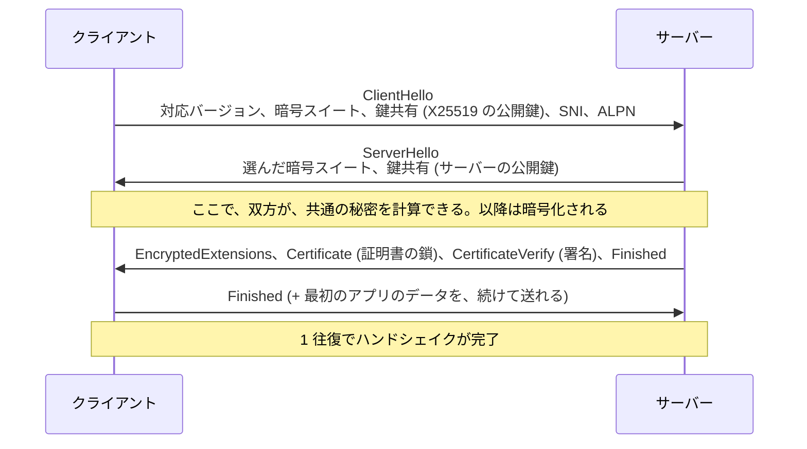
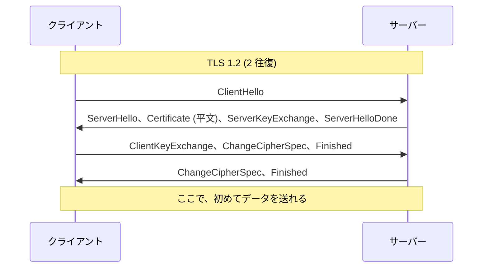
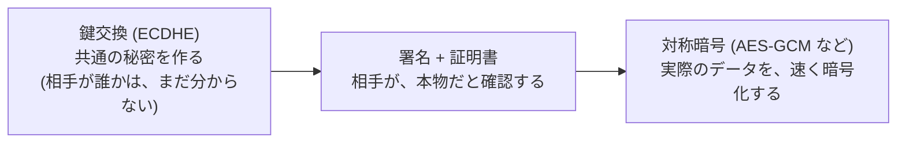
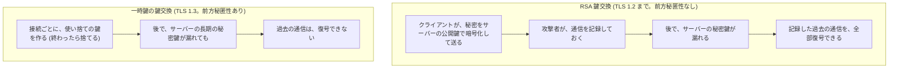

# 図1: TLS 1.3 のハンドシェイク

## 1. TLS 1.3 の流れ(1 往復)

| メッセージ | 役割 |
|---|---|
| ClientHello の鍵共有 | クライアントが、サーバーの選ぶ曲線を推測して、先に公開鍵を送る → 1 往復になる |
| Certificate | サーバーの証明書の鎖(葉 + 中間。ルートは送らない) |
| CertificateVerify | ここまでの通信全体に、サーバーの秘密鍵で署名 → 鍵の持ち主であることの証明 |
| Finished | ここまでの通信全体の MAC → ハンドシェイクが書き換えられていないことの確認 |

## 2. TLS 1.2 との比較

| | TLS 1.2 | TLS 1.3 |
|---|---|---|
| 往復 | 2 | **1** |
| 鍵交換 | RSA 鍵交換も可 (前方秘匿性なし) | 一時鍵のみ (前方秘匿性が必須) |
| 証明書 | 平文で流れる | 暗号化される |
| 暗号 | CBC、RC4 なども | AEAD のみ |

## 3. 演習1の実測

**送受信の塊**(クライアントから見て。→ 送信、← 受信):

| バージョン | 塊 | データを送り始められるまで |
|---|---|---|
| TLS 1.2 | → 241 B、← 1,156 B、→ 93 B、← 81 B | 2 往復 |
| TLS 1.3 | → 247 B、← 1,307 B、→ 64 B | 1 往復 |

**往復時間 50 ms での、ハンドシェイクの時間**(TCP の分は含まない):

| 方式 | 時間 |
|---|---|
| TLS 1.2(全体) | 106.4 ms(約 2 RTT) |
| TLS 1.2(再開) | 53.3 ms |
| TLS 1.3(全体) | 54.4 ms(約 1 RTT) |
| TLS 1.3(再開) | 54.2 ms |

TCP 1 RTT が前に付く → **接続して最初のリクエストを送れるまで: TLS 1.2 で約 3 RTT、TLS 1.3 で約 2 RTT**。

## 4. 役割の分担

## 5. 前方秘匿性

## 6. 再開と 0-RTT

| | 内容 | 往復 | CPU |
|---|---|---|---|
| 全体のハンドシェイク | 証明書の送信と検証、署名 | 1 RTT | 演習1: 0.35 ms |
| **再開** (セッションチケット) | チケットを提示して、証明書と署名を省く | 1 RTT | 演習1: **0.21 ms** |
| **0-RTT** (early data) | 再開 + ClientHello と同時にデータを送る | **0 RTT** | 再開と同じ。**リプレイに弱い** → 冪等なリクエストのみ |

演習1: 再開は、全体より約 4 割安い(CPU)が、往復は減らない(TLS 1.3 で 54.2 ms)。Go のクライアントは 0-RTT を使わないので、測っていない。

## 7. ClientHello の拡張: SNI と ALPN

| 拡張 | 内容 | 注意 |
|---|---|---|
| **SNI** | 接続したいホスト名。サーバーが、どの証明書を返すかを決める | **平文**で流れる(ECH で暗号化できる) |
| **ALPN** | 話したい上位のプロトコル (`h2`、`http/1.1`) | TLS の中で決まる → 追加の往復なし。演習4で `h2` が選ばれた |

## 8. ハンドシェイクのバイト数と CPU(演習1)

| 鍵の種類 | 鎖の大きさ | ハンドシェイク全体 | CPU (1回) |
|---|---|---|---|
| ECDSA P-256 | 941 B | 1,615 B | 0.35 ms |
| RSA 2048 | 1,733 B | 2,593 B | 0.83 ms |
| RSA 3072 | 2,244 B | 3,232 B | 2.05 ms |
| RSA 4096 | 2,757 B | 3,873 B | (未測定) |
