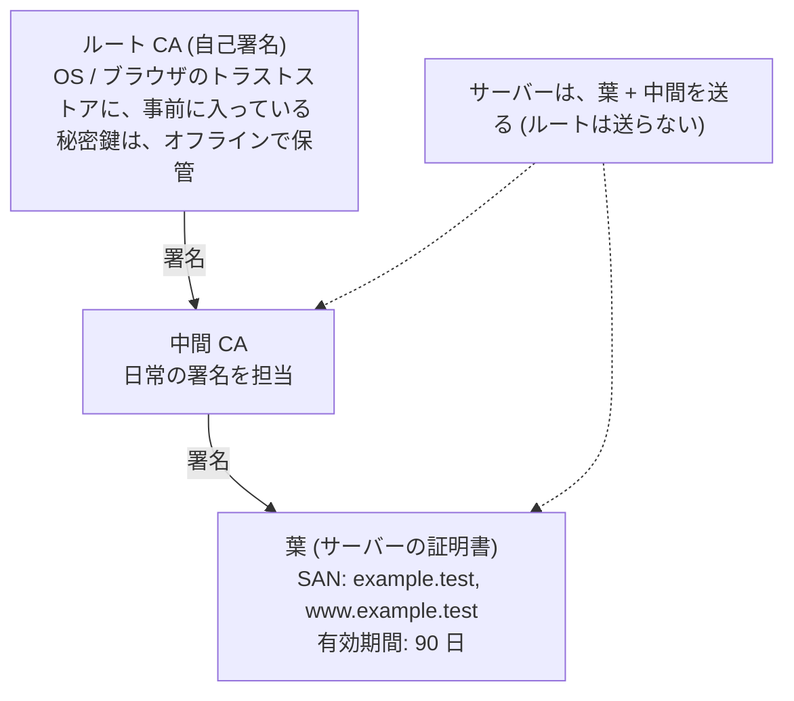
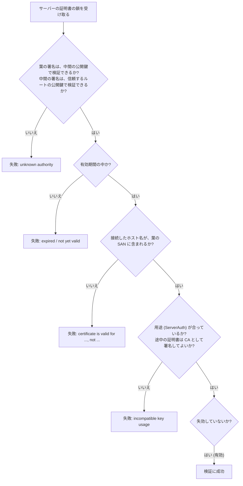
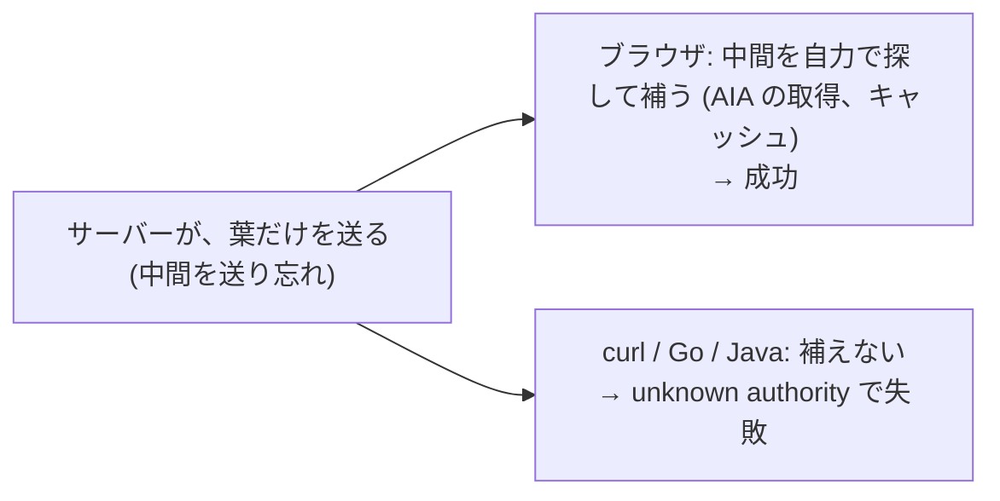
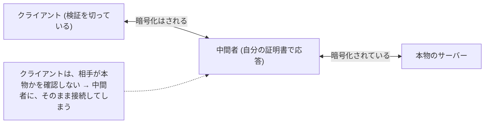

# 図2: 証明書の鎖と、検証

## 1. 証明書の鎖

## 2. 証明書の中身(演習3)

| 項目 | 葉 | 中間 CA | ルート CA |
|---|---|---|---|
| 主体 | example.test | 演習用 中間 CA | 演習用ルート CA |
| 発行者 | 中間 CA | ルート CA | ルート CA (自己署名) |
| SAN | example.test, www.example.test | — | — |
| 有効期間 | 90 日 | 5 年 | 10 年 |
| CA か | いいえ | **はい** | **はい** |
| 鍵の用途 | DigitalSignature | CertSign, CRLSign | CertSign, CRLSign |
| 拡張鍵用途 | ServerAuth | — | — |
| 署名 | ECDSA-SHA256 | ECDSA-SHA256 | ECDSA-SHA256 |
| 大きさ | 478 B | 498 B | 466 B |

**ホスト名の検証は SAN で行う**(古い CN は使わない)。

## 3. 検証の手順

## 4. 検証の結果(演習3)

| 状況 | 結果 |
|---|---|
| 正常 | 成功 (example.test → 中間 → ルート) |
| SAN にある別名 | 成功 |
| 中間が足りない | 失敗: unknown authority |
| ホスト名が違う | 失敗: valid for example.test, www.example.test, not evil.test |
| 有効期間を過ぎた (+100 日) | 失敗: expired or not yet valid |
| 信頼していないルート | 失敗: unknown authority |
| 期限切れ | 失敗: expired or not yet valid |
| まだ有効でない | 失敗: expired or not yet valid |
| クライアント認証の用途で検証 | 失敗: incompatible key usage |

「unknown authority」だけでは、**中間が足りないのか、ルートを信頼していないのか**が、区別できない。`openssl s_client -showcerts` で、サーバーが何を送っているかを見る。

## 5. 「ブラウザでは見えるのに、API クライアントは失敗する」

## 6. InsecureSkipVerify(演習3)

| 設定 | 結果 |
|---|---|
| ServerName = example.test、検証あり | 接続できた |
| ServerName = other.test、検証あり | **接続失敗** (証明書は other.test に有効でない) |
| ServerName = other.test、**InsecureSkipVerify = true** | **接続できてしまった** |

## 7. 失効、CT、自動化

| 仕組み | 内容 | 問題・特徴 |
|---|---|---|
| CRL | 失効した証明書の一覧 | 大きい。更新が遅い |
| OCSP | 1 つの証明書の状態を、CA に問い合わせる | 遅い。閲覧履歴が漏れる。失敗時に許す (ソフトフェイル) |
| OCSP stapling | サーバーが、OCSP の応答を、証明書と一緒に送る | |
| **短い有効期間** | 数日〜90 日にして、失効に頼らない | 自動更新が必須 |
| **Certificate Transparency** | 発行した証明書を、公開された追記専用のログに記録 | 誤発行・不正な発行を、ドメインの持ち主が見つけられる |
| **ACME** (Let's Encrypt) | 発行と更新を自動化 | 90 日の有効期間で、自動更新が標準に |

実務で最も多い失敗: **期限切れ**(更新の自動化が、止まっていたことに、気づかなかった)。期限の N 日前に、警告を出す監視を置く。
