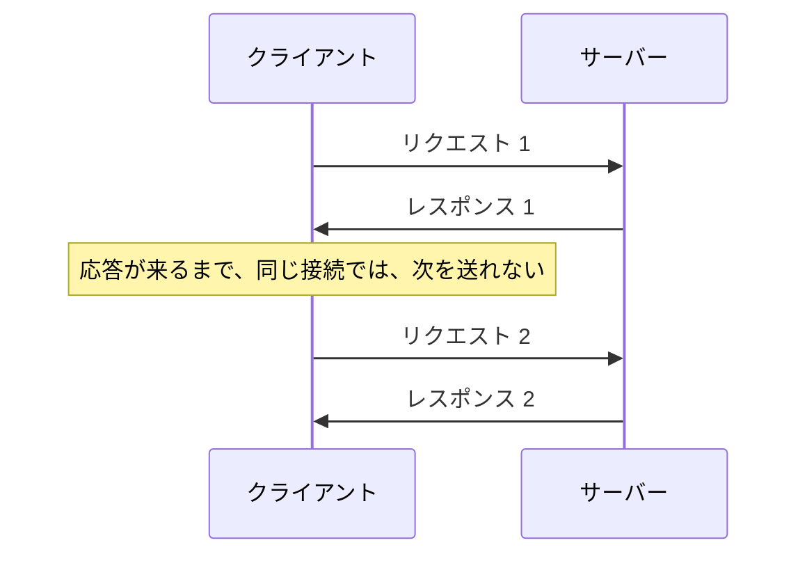
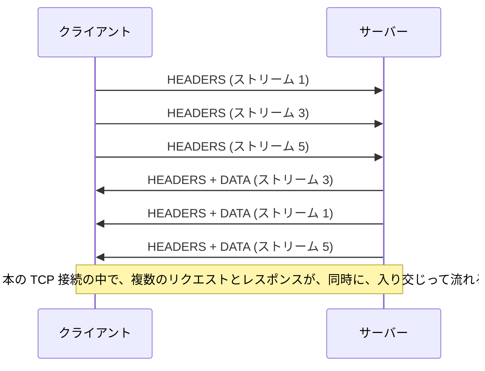
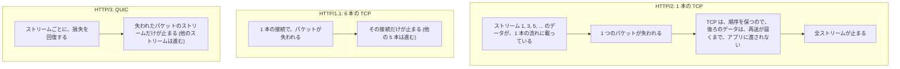

# 図3: HTTP/1.1、HTTP/2、HTTP/3

## 1. HTTP/1.1 のメッセージ(演習4)

```
 リクエスト:   GET /fixed HTTP/1.1\r\n
               Host: x\r\n
               \r\n

 レスポンス (長さが分かっている):
               HTTP/1.1 200 OK\r\n
               Content-Length: 11\r\n
               ...\r\n
               \r\n
               hello world

 レスポンス (長さが事前に分からない: chunked):
               HTTP/1.1 200 OK\r\n
               Transfer-Encoding: chunked\r\n
               \r\n
               5\r\nhello\r\n          ← 長さ (16進) + データ
               6\r\n world\r\n
               0\r\n\r\n               ← 長さ 0 で終わり
```

## 2. HTTP/1.1 の限界



回避: ブラウザは、同じホストに、6 本程度の接続を並行して張る。→ 各接続に、TCP と TLS のハンドシェイクと、スロースタートが要る。

## 3. HTTP/2: 1 本の接続に、多重化



## 4. HTTP/2 のフレーム(9 バイトのヘッダ)

```
 +-----------------------------------------------+
 |   長さ (24 ビット)   | 種類 (8) | フラグ (8) |
 +-----------------------------------------------+
 | R (1) |        ストリーム ID (31 ビット)       |
 +-----------------------------------------------+
 |                 ペイロード (長さ分)            |
 +-----------------------------------------------+
```

| 種類 | 名前 | 用途 |
|---|---|---|
| 0 | DATA | 本体 |
| 1 | HEADERS | ヘッダ (HPACK で圧縮) |
| 3 | RST_STREAM | ストリームの中止 |
| 4 | SETTINGS | 接続の設定 (流れの上限、ウィンドウなど) |
| 6 | PING | 生存確認、RTT の測定 |
| 7 | GOAWAY | 接続を終了する予告 |
| 8 | WINDOW_UPDATE | フロー制御のウィンドウを広げる |

**演習4で、実際に受信したフレーム**:

| フレーム | ストリーム | 内容 |
|---|---|---|
| SETTINGS (30 B) | 0 | MAX_CONCURRENT_STREAMS=250、INITIAL_WINDOW_SIZE=1,048,576、MAX_FRAME_SIZE=1,048,576、HEADER_TABLE_SIZE=4,096、MAX_HEADER_LIST_SIZE=1,048,896 |
| WINDOW_UPDATE | 0 | 増加量 983,041 |
| SETTINGS (確認応答) | 0 | |
| HEADERS (49 B) | 1 | 先頭バイト 0x88 = 静的表の 8 番 = `:status 200` |
| DATA (13 B) | 1 | `hello from h2` (END_STREAM) |

## 5. HPACK(ヘッダ圧縮)

```
 静的表 (抜粋):  1 = :authority    2 = :method GET    4 = :path /    7 = :scheme https    8 = :status 200

 演習4で送ったヘッダブロック (14 バイト):
   0x82                 → 2 番: :method GET
   0x87                 → 7 番: :scheme https
   0x84                 → 4 番: :path /
   0x41 0x09 localhost  → 「1 番 (:authority) を名前に持つ、リテラルの値 'localhost' (9 バイト)」

 同じ内容の HTTP/1.1 のテキスト: GET / HTTP/1.1\r\nHost: localhost\r\n\r\n = 35 バイト
```

動的な表は、一度送ったヘッダを、番号で参照する(Cookie などの、長い繰り返しに効く)。

## 6. 演習2: 60 個のリソース、往復 50 ms

| 条件 | 全体 | p50 | p95 | 接続数 |
|---|---|---|---|---|
| 1. HTTP/1.1、接続 1 本、順番 | 3,337 ms | 54 | 55 | 1 |
| 2. HTTP/1.1、接続 6 本 | 809 ms | 54 | 165 | 14 |
| 3. HTTP/1.1、毎回新しい接続 | 1,622 ms | 162 | 164 | 60 |
| **4. HTTP/2、接続 1 本** | **165 ms** | 165 | 165 | **1** |

```
 1:  |TCP|TLS|req1|res1|req2|res2| ...  × 60  → 約 62 RTT
 4:  |TCP|TLS|req1..req60 同時|res1..res60| → 3 RTT (= 150 ms + 処理)
```

## 7. TCP の HOL ブロッキング(演習2の模擬)



**演習2: 累積 100 KB で、1 回、200 ms 止める(サーバー → クライアント)**

| 条件 | 全体 | p50 | 最大 |
|---|---|---|---|
| HTTP/1.1、6 本 (停止なし) | 809 ms | 54 | 165 |
| HTTP/1.1、6 本 (停止あり) | 846 ms | 54 | **308** |
| HTTP/2 (停止なし) | 165 ms | 165 | 165 |
| HTTP/2 (停止あり) | **367 ms** | **366** | 366 |

- HTTP/1.1: 停止の影響は、1 本の接続だけ(最大のリクエストが 308 ms)。
- HTTP/2: **全リクエストが、約 200 ms 遅れた**。
- それでも、HTTP/2 の全体(367 ms)は、HTTP/1.1 の 6 本(846 ms)より速い。

(この停止は模擬。実際のパケット損失ではなく、停止の長さと位置は任意。HTTP/3 は、動かしていない。)

## 8. 3 つのバージョンの比較

| | HTTP/1.1 | HTTP/2 | HTTP/3 |
|---|---|---|---|
| 形式 | テキスト | バイナリのフレーム | バイナリのフレーム (QUIC のストリーム) |
| 多重化 | なし (接続を増やす) | あり (1 本に多重化) | あり |
| ヘッダ圧縮 | なし | HPACK | QPACK |
| トランスポート | TCP | TCP | **QUIC (UDP)** |
| 接続の確立 | TCP 1 RTT + TLS 1 RTT | 同左 | **1 RTT (TLS 統合)** |
| 損失の影響 | その接続だけ | **全ストリーム** (TCP の HOL) | 損失したストリームだけ |
| 規格 | RFC 9112 | RFC 9113 | RFC 9114 (QUIC は RFC 9000) |
