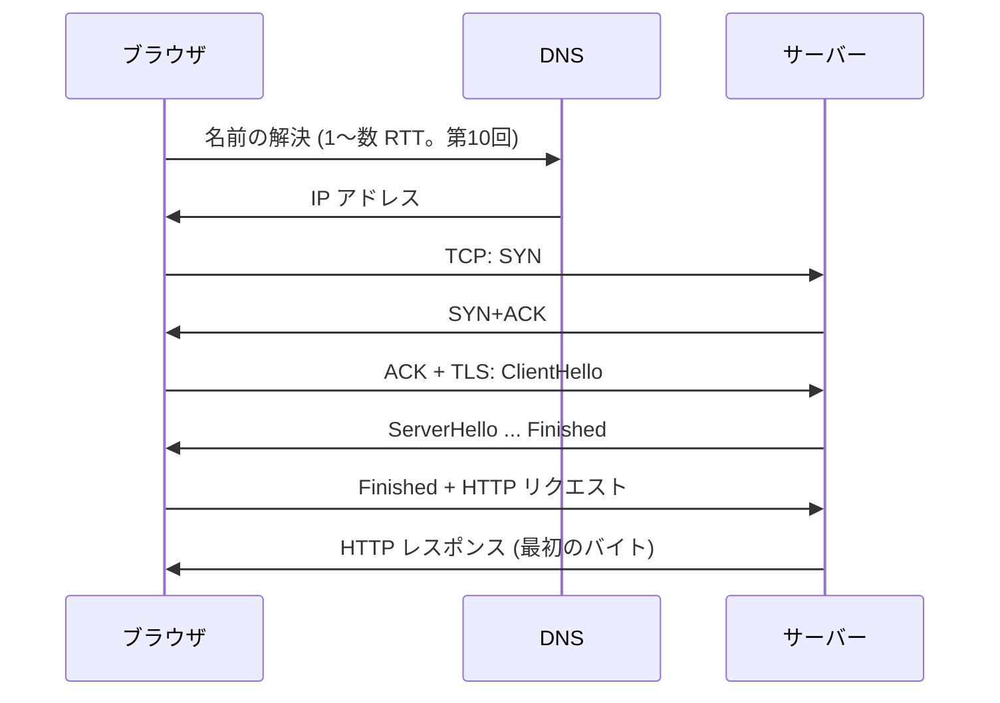
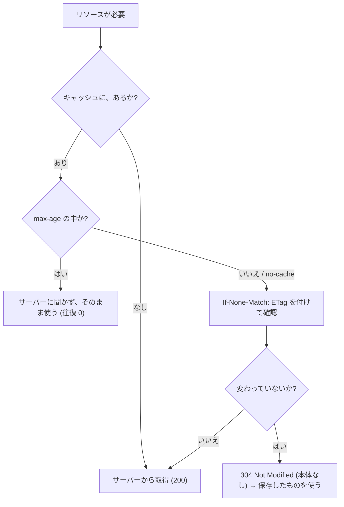
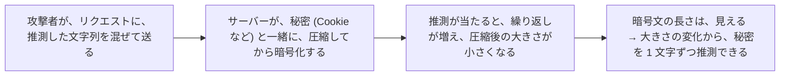
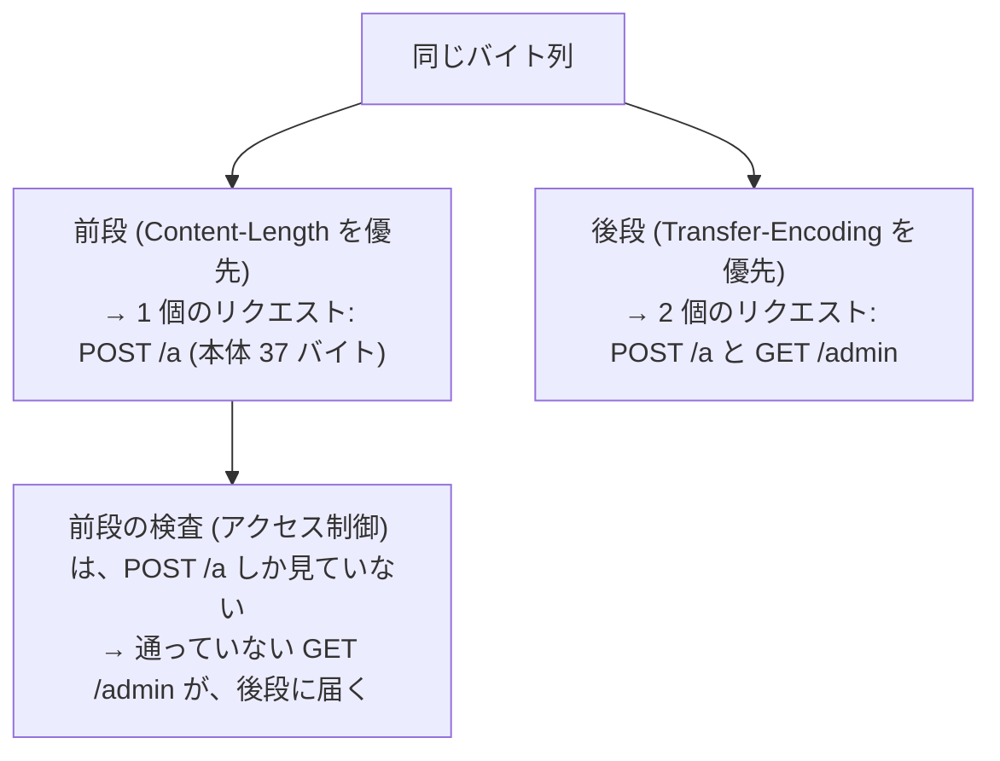

# 図4: ページの読み込み、キャッシュと圧縮、スマグリング

## 1. URL を開いてから、最初のバイトまで



| 段階 | 往復 |
|---|---|
| DNS | 1〜数回 |
| TCP | 1 RTT |
| TLS 1.3 | 1 RTT |
| HTTP リクエスト | 1 RTT |
| **合計 (DNS を除く)** | **3 RTT** (RTT 50 ms なら約 150 ms。演習2の HTTP/2 の 165 ms と一致) |

## 2. 短縮する方法

| 方法 | 効果 |
|---|---|
| 接続の使い回し (keep-alive、HTTP/2) | 2 回目以降、TCP + TLS が不要 |
| CDN | RTT そのものを短くする |
| TLS 1.3、再開、0-RTT | TLS の往復を減らす |
| QUIC / HTTP/3 | TCP + TLS を、1 RTT に統合 |
| `preconnect`、`dns-prefetch` | 事前に接続を始める |
| キャッシュ (`max-age`) | リクエスト自体を省く |

## 3. キャッシュの判断



## 4. 演習5: 条件付きリクエスト(200 KB のリソース)

| リクエスト | ステータス | ネットワークで受信 | 送信 |
|---|---|---|---|
| 1回目 | 200 | 204,990 B | 77 B |
| 2回目 (`If-None-Match`) | **304** | **117 B** | 112 B |
| ETag が不一致 | 200 | 204,990 B | 99 B |

304 で、受信が約 1,750 分の 1。ただし、確認のための 1 往復は、必要。

## 5. Cache-Control の主な値

| 値 | 意味 |
|---|---|
| `max-age=N` | N 秒間は、サーバーに確認せず使ってよい |
| `no-cache` | 保存はしてよいが、**使う前に必ず確認する**(名前が紛らわしい) |
| `no-store` | 保存してはならない (機密データ) |
| `immutable` | 変わらない (ファイル名にハッシュを含める資産向け) |
| `private` / `public` | 共有キャッシュ (CDN など) に保存してよいか |

## 6. 圧縮(演習5、各 1 MiB)

| データ | レベル | 圧縮後 | 比率 | 速度 |
|---|---|---|---|---|
| JSON | 1 | 167,568 B | 16.0% | 369 MB/s |
| JSON | 6 | 145,989 B | 13.9% | 163 MB/s |
| JSON | 9 | 145,099 B | 13.8% | 56 MB/s |
| ランダム | 1〜9 | 約 1,048,700 B | 100% | — |

- レベル 6 → 9 で、圧縮率の改善は 0.1 ポイントなのに、速度は約 3 分の 1。
- ランダム(圧縮済みの画像や動画に相当)は、圧縮できない。

## 7. 圧縮 + 暗号の危険(CRIME、BREACH)



TLS 自身の圧縮は、廃止された。HPACK は、一般的な圧縮ではなく、静的表と動的表だけを使い、この攻撃を避ける。

## 8. リクエストスマグリングの原理(演習4、簡易パーサー)

```
 1 本のバイト列 (114 バイト):
   POST /a HTTP/1.1
   Host: x
   Content-Length: 37            ← 両方を持つ
   Transfer-Encoding: chunked    ←
   (空行)
   0                             ← chunked では、ここで本体が終わる
   (空行)
   GET /admin HTTP/1.1           ← Content-Length の 37 バイトの中に入る
   Host: x
   (空行)
```



**実際の Go の net/http のサーバー**(自分で起動した、ループバックのサーバー): **`POST /a` と `GET /admin` の両方を処理した**(Transfer-Encoding を優先)。

**対策**:

- 前段で、両方を持つメッセージを**拒否**する。
- ヘッダを正規化して、後段に転送する。
- 前段と後段の間を、HTTP/2 にする(フレームの長さが明確で、曖昧さがない)。
- 1 リクエストごとに、新しい接続を使う(接続の再利用による、ずれを避ける)。

(ここでの簡易パーサーは、概念の説明のための、メモリ内のもの。)
