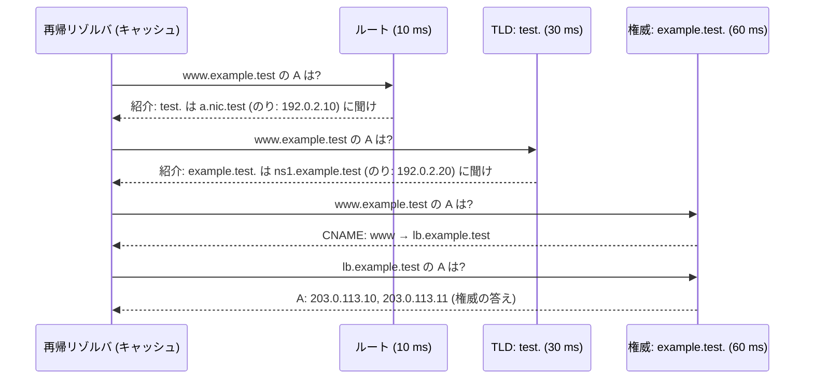
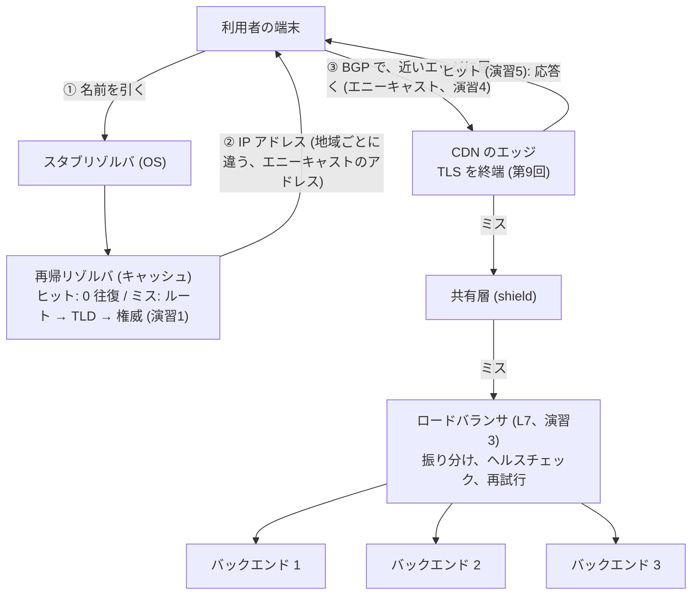

# 第10回 DNS・CDN・ロードバランシング

> ステータス: 執筆済み(第1版)
> 前提: 第7回(IP、ルーティング、最長一致)、第8回(TCP、タイムアウト)、第9回(TLS、HTTP、キャッシュ)
> 演習言語: Go
> 所要目安: 本文 4時間 + 演習 5〜6時間
> **演習はすべて、ループバック上の、自作のサーバーと、シミュレーション。実在の DNS サーバー、CDN、BGP のルーターには、一切、接続していない。BGP は、13 個の AS の簡易モデル。**

## この回のゴール

この回を終えると、次のことが説明できるようになる。

1. ブラウザに `www.example.com` と打ってから、IP アドレスが分かるまでに、何が起きるのか。キャッシュと TTL は、何を決めるのか。
2. DNS のメッセージは、バイト単位で、どう書かれているのか。なぜ、UDP が切り詰められて、TCP でやり直すことがあるのか。
3. ロードバランサは、L4 と L7 で、何が違い、どんなコストがかかるのか。ラウンドロビンが、なぜ、簡単に崩れるのか。
4. P2C(2つ選んで空いている方)は、なぜ、実用的なのか。一貫性ハッシュは、何を解決するのか。
5. CDN は、どう、近くのサーバーに誘導し、どれだけ、オリジンの負荷を減らすのか。キャッシュのヒット率は、何で決まるのか。
6. BGP は、どう経路を選ぶのか。経路の乗っ取りと、リーク、エニーキャストは、どう起きるのか。
7. 1 回のリクエストが、利用者から、バックエンドに届くまでに通る、各段階の、失敗の仕方と、対策。

第7回で、パケットが、IP アドレスで運ばれ、ルーターが最長一致で次の転送先を決めることを見た。第9回で、その上の TLS と HTTP を見た。この回は、その手前の問い、**「どの IP アドレスに、どのサーバーに、どう届くか」**を扱う。**名前から、場所、サーバーへ**、3 段階の振り分けがある。

---

## 1. 全体像: 3 つの振り分け

利用者のリクエストが、実際の処理をするサーバーに届くまでに、**3 段階の振り分け**がある。

| 段階 | 仕組み | 何を決めるか | 粒度、更新の速さ |
|---|---|---|---|
| ① 名前 → アドレス | **DNS** | どの IP アドレスに行くか(複数、地域ごとに別の答えも) | 粗い。TTL(数十秒〜数時間)で、キャッシュされる。変更は、遅い |
| ② アドレス → 場所 | **BGP**(とエニーキャスト) | その IP アドレスへ、どの経路で、どの場所(拠点)に着くか | 同じアドレスが、複数の場所にあってもよい。変更は、数十秒〜数分 |
| ③ アドレス → 個々のサーバー | **ロードバランサ** | どの 1 台に、リクエストを渡すか | 細かい(リクエスト単位)。変更は、即時 |
| (補助) | **CDN** | リクエストに、キャッシュから答える(オリジンまで行かない) | 物件単位 |

この 3 つは、**粒度と、反応の速さが、逆**になっている。DNS は、遅いが、世界規模で安い。ロードバランサは、速いが、1 つの拠点の中だけ。**階層的に、組み合わせて使う**。

---

## 2. DNS

### 2.1 名前空間と、委任

DNS は、**木構造の名前空間**を持つ分散データベースである。

```
                      . (ルート)
             /         |         \
          com         org         jp   ...   ← TLD (トップレベルドメイン)
         /    \                    |
    example   google              co
       |
      www                                     ← ホスト名
```

- **ゾーン**: 木の、ある部分(例: `example.com.` 以下)の、管理の単位。
- **権威サーバー**: そのゾーンの、**正式な答え**を持つサーバー。
- **委任**: 親のゾーンが、「この子ゾーンは、このサーバーに聞け」と、**NS レコード**で指す。
- **のり**(glue): 委任先のサーバー自身の名前が、そのゾーンの中にあるとき(`ns1.example.com` が `example.com` の権威)、名前から IP アドレスを調べようがない(循環する)。そこで、親が、**IP アドレスも、一緒に渡す**。
- **ルート**: 13 組のアドレス(A〜M)が、世界に知られている。それぞれが、**エニーキャスト**(§5)で、世界中の多数の場所に置かれている。

**3 種類の登場人物**:

| 役 | 内容 |
|---|---|
| **スタブリゾルバ** | OS(アプリ)の中の、小さな部品。再帰リゾルバに、「答えを持ってきて」と頼むだけ |
| **再帰リゾルバ** | 利用者に代わって、ルートから順に聞いて回り、**答えをキャッシュする**。ISP が運営するもの、8.8.8.8 などの公開のもの |
| **権威サーバー** | ゾーンの正式な答えを持つ。再帰はしない |

### 2.2 DNS のメッセージ(演習1 A)

演習1で、DNS のメッセージを、バイト単位で組み立てた。`www.example.test.` の A レコードを聞く質問は、**34 バイト**である。

```
12 34 | 01 00 | 00 01 | 00 00 | 00 00 | 00 00      ← ヘッダ (12 バイト)
ID    フラグ   質問数   回答数   権威数   追加数
03 'www' 07 'example' 04 'test' 00                 ← 名前 (ラベルの長さ + 文字列、最後に 0)
00 01 | 00 01                                       ← 型 (A)、クラス (IN)
```

- **ヘッダの 12 バイト**: ID(質問と応答の対応づけ)、フラグ(QR=応答か、AA=権威か、TC=切り詰められたか、RD=再帰を希望、RA=再帰可能、RCODE=結果の種類)、各セクションの個数。
- **名前**: ドット区切りではなく、**ラベルの長さ + 文字列**の列。

**応答**(`api.example.test.` の A、50 バイト)の、回答の名前は、**`c0 0c`** である。これは、**名前の圧縮**(ポインタ)で、「メッセージの先頭から 12 バイト目にある名前を、もう一度使う」という意味(上位 2 ビットが 11 = ポインタ)。同じ名前を、何度も書かずに済む。

### 2.3 UDP と TCP

DNS は、通常 **UDP の 53 番**で動く。1 回の問い合わせと応答で済み、接続の確立(第8回)が要らない。

しかし、**応答が大きいと、UDP では送れない**。従来の DNS の UDP の応答は、**512 バイトまで**である(EDNS0 という拡張で、大きくできる)。超える場合、サーバーは、応答を切り詰めて、**TC ビット**を立てる。クライアントは、**TCP でやり直す**。

演習1で、12 個の TXT レコード(各 100 文字)を持つ名前を引いた。完全な応答は **1,390 バイト**で、UDP の応答は **34 バイト**(ヘッダと質問だけ、TC ビット付き)に切り詰められ、TCP でやり直した。

| 状況 | 問い合わせの回数 | 所要時間(権威サーバーの RTT が 60 ms) |
|---|---|---|
| 普通の応答(UDP で収まる) | 1 回 | 約 61 ms |
| 大きな応答(UDP が切り詰められる) | 2 回(UDP + TCP) | **約 183 ms**(UDP 60 + TCP の接続 60 + TCP の問い合わせ 60) |

**大きな応答は、3 倍遅い**。DNSSEC の署名や、多数のレコードで、応答が大きくなるときに、効く。

### 2.4 解決の流れ(演習1 B・C)

演習1で、3 階層の DNS(ルート → TLD → 権威)を、ループバックに作り、自作の再帰リゾルバ(キャッシュ付き)で、名前を引いた。往復時間は、ルート 10 ms、TLD 30 ms、権威 60 ms とした。



**測定結果**:

| 状況 | サーバーへの問い合わせ | 所要時間 |
|---|---|---|
| 1. **冷えた状態**(キャッシュなし)。CNAME を含む | **4 回** | **166.0 ms**(= 10 + 30 + 60 + 60) |
| 2. もう一度(すべてキャッシュ) | **0 回** | 0.0 ms |
| 3. 同じゾーンの別の名前(NS はキャッシュにある) | 1 回 | 61.4 ms |
| 4. 存在しない名前(NXDOMAIN) | 1 回 | 61.6 ms |
| 5. 存在しない名前を、もう一度(**否定キャッシュ**) | 0 回 | 0.0 ms |
| 6. TTL が 2 秒の名前 | 1 回 | 61.5 ms |
| 7. もう一度(まだ TTL の中) | 0 回 | 0.0 ms |
| 8. 2.2 秒待ってから(**TTL の期限切れ**) | 1 回 | 61.7 ms |

分かること:

- **冷えた状態の解決は、階層の数だけ、往復が要る**(166 ms は、各段の往復時間の合計)。しかも、CNAME があると、別名の先を、**改めて引く**。
- **キャッシュで、0 回になる**。実際の再帰リゾルバは、多数の利用者で共有されるので、人気のある名前は、ほぼ、常にキャッシュにある。
- **NS のキャッシュ**が重要である。同じゾーンの、別の名前を引くとき、**ルートと TLD を飛ばして**、権威サーバーに直接、聞ける(3. の 1 回)。
- **存在しないことも、キャッシュされる**(否定キャッシュ)。この期間は、権威サーバーの SOA レコードの、最後の項目(`minimum`、演習では 30 秒)で決まる。
- **TTL が切れると、また聞きに行く**(8.)。

### 2.5 TTL とトレードオフ

TTL(Time To Live)は、**答えを、キャッシュしてよい秒数**である。

| TTL | 利点 | 欠点 |
|---|---|---|
| **短い**(数十秒) | 変更が、すぐ反映される。障害時に、別のサーバーへ素早く切り替えられる | 権威サーバーへの問い合わせが増える(負荷)。**名前解決の遅さ**が、利用者に、頻繁に見える(§2.4 の 61 ms) |
| **長い**(数時間) | 負荷が小さい。解決が速い | **変更が、反映されるまで、時間がかかる** |

**「DNS の変更は、伝播する」という言い方は、誤解を招く**。変更は、どこにも伝播しない。**世界中の、各リゾルバのキャッシュが、それぞれの TTL の期限で、順に、古い答えを捨てる**だけである。TTL が 1 時間なら、変更後、**最大 1 時間、古い答えが返り続ける**(ただし、全員が、一斉にではなく、各自の期限で)。

実務での注意:

- **移行の前に、TTL を短くしておく**(例えば、1 日前から 60 秒に)。移行後に、戻す。
- **TTL を無視する、または、下限を設ける**リゾルバやアプリがある(「最小 TTL」)。短い TTL に頼った切り替えは、完全には機能しない。
- Java の `networkaddress.cache.ttl` のように、**アプリが、独自に、DNS の結果を長くキャッシュする**場合がある(§第3回のプロセス内の話)。

### 2.6 レコードの種類

| 型 | 内容 | 注意 |
|---|---|---|
| A / AAAA | 名前 → IPv4 / IPv6 アドレス | 複数あれば、複数返る |
| **CNAME** | 別名(正規の名前への、リダイレクト) | **ゾーンの頂点(`example.com` そのもの)には置けない**。解決に、追加の引きが要る(演習1の 4 回目)。ALIAS / ANAME は、プロバイダ独自の回避策 |
| NS | そのゾーンの権威サーバー(委任) | |
| MX | メールの配送先 | 優先度つき |
| TXT | 任意の文字列 | SPF、DKIM、ドメインの所有確認 |
| SOA | ゾーンの管理情報。**否定キャッシュの TTL** | |
| SRV | サービスの場所(ホストとポート) | |

### 2.7 DNS による、振り分けと、その限界

DNS 自体が、**ロードバランシングの手段**として使われる。

| 方式 | 内容 |
|---|---|
| **ラウンドロビン DNS** | 同じ名前に、複数の A レコード。リゾルバが、順番を回して返す(または、クライアントが、選ぶ) |
| **重みづけ** | 一部のアドレスを、多く返す |
| **ジオ DNS** | 質問者の場所(の推定)に応じて、**近いサーバーのアドレス**を返す。リゾルバの場所は、利用者の場所と、違うことがある(EDNS Client Subnet で、補う) |
| **ヘルスチェック連動** | 故障したサーバーのアドレスを、答えから外す |

**限界**: **TTL でキャッシュされる**ので、細かい制御と、素早い切り替えは、できない。故障したサーバーを外しても、**TTL の間は、古い答え(故障したアドレス)が、キャッシュに残る**。また、クライアントが、複数のアドレスから、どれを選ぶかは、クライアント次第である(Happy Eyeballs: 複数に、並行して接続を試みる)。

だから、DNS は、**粗い振り分け**(どの拠点か)に使い、**細かい振り分け**(その拠点のどのサーバーか)は、ロードバランサに任せる。

### 2.8 DNS のセキュリティと、現実

| 論点 | 内容 |
|---|---|
| **平文** | 従来の DNS は、平文の UDP。途中で、問い合わせ内容(どのサイトに行くか)が見え、書き換えられる |
| **DoT / DoH** | DNS を、TLS(DoT)、HTTPS(DoH)の上で行う。盗聴と改ざんを防ぐが、**運用者から見えなくなる**。大手のリゾルバへの集中を促す、という批判もある |
| **DNSSEC** | 答えに、**デジタル署名**を付ける。ルートから、署名の鎖(第9回の証明書の鎖に似る)で、検証する。**改ざんは検出できるが、普及は低い**。応答が大きくなる(§2.3) |
| **キャッシュポイズニング** | リゾルバに、偽の答えを、キャッシュさせる攻撃。ID と、ポート番号のランダム化で、対策 |
| **DDoS による、DNS 自体の停止** | 2016 年に、IoT 機器のボットネット(Mirai)による、DNS プロバイダ(Dyn)への大規模な攻撃で、**多数の有名サイトが、同時に、名前解決できなくなった**。サイト自体は、動いていたが、**名前が引けないと、到達できない**。単一の DNS プロバイダへの依存の危険 |

---

## 3. ロードバランサ

### 3.1 何のためにあるか

| 目的 | 内容 |
|---|---|
| **スケール** | 1 台では捌けない負荷を、複数台に分ける |
| **可用性** | 1 台が落ちても、他の台に回す |
| **保守性** | サーバーを、1 台ずつ、止めて更新できる(ローリングアップデート) |

配置の方法は、いくつかある。

| 配置 | 内容 |
|---|---|
| DNS | §2.7。粗い |
| **L4 ロードバランサ** | TCP(UDP)の接続を、バックエンドに振り分ける |
| **L7 ロードバランサ**(リバースプロキシ) | HTTP を解釈して、リクエストごとに振り分ける |
| **クライアント側** | クライアント(ライブラリ)が、バックエンドの一覧を持ち、自分で選ぶ(gRPC など) |
| サービスメッシュ | 各サービスの横に、プロキシ(サイドカー)を置く(第11回) |

### 3.2 L4 と L7: 何が違い、何がかかるか(演習3 A)

| | L4 | L7 |
|---|---|---|
| 見るもの | IP アドレス、ポート(**TCP の接続**単位) | **HTTP の中身**(パス、ヘッダ、Cookie) |
| TLS | そのまま通す(パススルー)。中身は見えない | **終端する**(復号して、HTTP を読む) |
| 振り分けの単位 | **接続**(1 つの接続は、1 台のバックエンドに、固定される) | **リクエスト**(同じ接続でも、別のバックエンドに送れる) |
| 機能 | 単純。高速 | パス/ヘッダによるルーティング、再試行、圧縮、認証、レート制限、メトリクス |
| コスト | 小さい | 大きい(HTTP の解析、接続の管理) |

演習3で、実際に作って測った(ループバック、バックエンドは処理時間 0、32 並行、各 2 秒)。

| 経路 | リクエスト/秒 | 平均 | p50 | p99 |
|---|---|---|---|---|
| **直接**(1 台のバックエンド) | **136,943** | 233 µs | 185 µs | 812 µs |
| **L4 プロキシ**(3 台に、接続ごとに RR) | 77,792 | 411 µs | 381 µs | 987 µs |
| **L7 プロキシ**(バックエンドへの接続を使い回す) | 44,472 | 719 µs | 739 µs | 1,680 µs |
| **L7 プロキシ**(バックエンドへ、**毎回、新しい接続**) | **21,347** | 1,499 µs | 1,455 µs | 2,960 µs |

分かること:

- **ホップが 1 つ増えるごとに、遅延が増える**。p50 は、直接 185 µs → L4 381 µs(約 2 倍)→ L7 739 µs(約 4 倍)。
- **L7 は、L4 の約 6 割のスループット**(44,472 対 77,792)。HTTP の解析と、接続の管理のコストである。
- **バックエンドへの接続を使い回す**ことが、決定的に重要である。**毎回、新しい接続を張ると、スループットが半分以下**(21,347 対 44,472、約 2.1 倍の差)。第8回で見た、接続の確立のコストである。
- **p99 も、段階的に悪化する**(812 µs → 2,960 µs)。

**この結果の注意**: クライアント、プロキシ、バックエンドが、**同じマシンの、同じ CPU を共有**しているので、絶対値(リクエスト/秒)は、意味を持たない。**比**(L4 は直接の約 57%、L7 は約 32%、など)と、傾向だけを使う。実際のロードバランサは、専用の機器やサーバーで動き、バックエンドとは、別のマシンである。また、実際の L7 プロキシ(nginx、Envoy など)は、この自作より、はるかに最適化されている。

### 3.3 振り分けのアルゴリズム(演習2 A)

| 方式 | 内容 | 必要な情報 |
|---|---|---|
| **ラウンドロビン** | 順番に | なし |
| **ランダム** | ランダムに | なし |
| **最小接続** | 処理中のリクエストが最も少ないサーバーへ | **全サーバーの状態**(中央集権) |
| **P2C**(Power of Two Choices) | **ランダムに 2 つ選び**、空いている方へ | 2 つのサーバーの状態だけ |
| 加重ラウンドロビン | 能力の大きなサーバーに、多く | 重み |

演習2で、10 台のサーバー、ポアソン到着で、シミュレーションした(応答時間 = 待ち + サービス。単位は、サービス時間の平均)。

**サービス時間が指数分布(ばらつき小)**:

| 方式 | 稼働率 70%: 平均 / p99 | 稼働率 90%: 平均 / p99 |
|---|---|---|
| ラウンドロビン | 2.01 / 9.25 | 5.56 / 26.60 |
| ランダム | 3.36 / 15.43 | 10.04 / 45.75 |
| **最小接続** | **1.16 / 5.29** | **1.93 / 8.17** |
| **P2C** | 1.67 / 6.86 | 2.90 / 10.11 |

**サービス時間が、裾の重い分布(ばらつき大)**:

| 方式 | 稼働率 70%: 平均 / p99 | 稼働率 90%: 平均 / p99 |
|---|---|---|
| ラウンドロビン | 10.34 / 102.67 | **36.62 / 215.67** |
| ランダム | 10.57 / 91.80 | 36.80 / 212.11 |
| **最小接続** | **1.44 / 15.77** | **3.59 / 30.42** |
| **P2C** | 2.97 / 28.08 | 7.14 / 49.87 |

分かること:

- **ラウンドロビンとランダムは、リクエストの重さが、ばらつくと、崩れる**。裾の重い分布、稼働率 90% で、平均が **36.6**(最小接続の約 10 倍)。ラウンドロビンは、「均等に分ける」が、**「均等な負荷」を保証しない**。重いリクエストが、たまたま、同じサーバーに重なる。
- **ランダムとラウンドロビンは、裾の重い分布では、ほぼ同じ**(36.80 対 36.62)。**順番に回すことの、利点は、消える**。
- **最小接続は、最も良い**が、**全サーバーの状態を、知る必要がある**(1 台の LB が、全部を管理するから、できる。複数の LB に分散すると、難しい)。
- **P2C は、「2 つだけ見る」のに、ランダムより、はるかに良い**(裾の重い分布、稼働率 90% で、36.80 → 7.14)。最小接続には及ばないが、**必要な情報が、2 台分だけ**で、**分散した LB でも使える**。これが、実用的な理由である。Mitzenmacher(2001)の、「**2 つの選択肢の力**」として、知られる(ランダムに、1 つ選ぶ代わりに、2 つ選んで良い方を取るだけで、最大の負荷が、指数的に小さくなる)。

**この結果の注意**: モデルである。実際は、リクエストの大きさが、事前に分からず、「処理中のリクエスト数」は、重さを反映しない。新しいサーバーを加えたとき、最小接続は、**空のサーバーに、リクエストが殺到する**(スロースタートで、緩和する)。

### 3.4 遅いサーバーが、1 台いるとき(演習3 B)

実際に作った L7 プロキシで、バックエンドの 1 台を遅くした(50 ms。他の 2 台は 1 ms)。32 並行、3 秒。

| 方式 | リクエスト/秒 | 平均 | p99 | 振り分け(速い、速い、遅い) |
|---|---|---|---|---|
| ラウンドロビン | **1,787** | **17.7 ms** | 51.0 ms | 1,816、1,817、1,816 |
| **最小接続** | **15,789** | **2.0 ms** | 50.2 ms | 23,781、23,376、**601** |

- **ラウンドロビンは、遅いサーバーにも、3 分の 1 を振り分ける**(1,816 回)。32 並行のうち、約 3 分の 1 が、遅いサーバーで詰まり、**全体のスループットが、約 9 分の 1**(1,787 対 15,789)。
- **最小接続は、遅いサーバーに、ほとんど送らない**(601 回)。遅いサーバーは、処理中の数が多いので、避けられる。
- ただし、**p99 は、ほぼ同じ**(50 ms 前後)。遅いサーバーに、少しでも、送られると、そのリクエストは遅い。

**1 台の遅いサーバー(または、遅い依存先)が、ラウンドロビンの下で、全体を引きずる**。第15回の、障害の連鎖の、典型的な入口である。

### 3.5 一貫性ハッシュ(演習2 B)

キャッシュや、シャーディング(データを分割して、複数のサーバーに置く)では、**同じキーを、いつも同じサーバーに送りたい**。単純な方法は、**剰余**(`hash(key) % サーバー数`)だが、**サーバー数が変わると、ほとんどのキーが、別のサーバーに移る**。

演習2で、10 万個のキーで、**サーバーを 10 台 → 11 台に増やした**ときと、**10 台 → 9 台に減らした**ときの、移動した割合を測った。

| 方式 | 増やす(10→11) | 減らす(10→9) | 負荷の偏り(最大/平均) |
|---|---|---|---|
| **剰余** | **90.9%** | **89.9%** | 1.02 |
| 一貫性ハッシュ(仮想ノード 1) | 9.6% | 11.3% | 1.59 |
| 一貫性ハッシュ(仮想ノード 10) | 13.0% | 9.0% | 1.45 |
| 一貫性ハッシュ(仮想ノード 100) | 9.4% | 10.0% | 1.20 |
| 一貫性ハッシュ(仮想ノード 1,000) | 9.0% | 10.2% | 1.06 |
| **ランデブーハッシュ** | **9.1%** | 9.9% | **1.01** |

(理想: 増やす = 1/11 = 9.1%、減らす = 1/10 = 10.0%。)

- **剰余は、ほぼ全部のキーが移る**(約 90%)。キャッシュなら、**全部が、一斉に、ミスする**(キャッシュの雪崩、§4.5)。
- **一貫性ハッシュは、理想(約 9〜10%)に近い**。サーバーの追加・削除で、**そのサーバーが担当していた分だけ**が移る。
- ただし、**仮想ノードが少ないと、負荷が偏る**(仮想ノード 1 で、最大/平均 1.59)。**仮想ノードを増やすと、偏りが減る**(1,000 で 1.06)。
- **ランデブーハッシュ**(キーごとに、全サーバーの重みを計算して、最大のものを選ぶ)は、**仮想ノードなしで、移動が理想に近く、偏りも最小**(1.01)。ただし、**検索のたびに、全サーバー分を計算する**(サーバーが多いと遅い)。

**一貫性ハッシュは、キャッシュ、分散データベース(第14回の Dynamo など)、ロードバランサ(Maglev)で、広く使われる**。

### 3.6 ヘルスチェックと再試行(演習3 C)

| | 内容 |
|---|---|
| **アクティブなヘルスチェック** | LB が、定期的に、バックエンドに、確認のリクエストを送る |
| **パッシブなヘルスチェック** | 実際のリクエストの失敗から、故障を判断する |
| **再試行** | 失敗したリクエストを、別のバックエンドで、やり直す |

演習3で、3 台のバックエンドの 1 台を、**1 秒後に落とした**(3 秒間、32 並行、各リクエスト 1 ms)。

| プロキシの設定 | 成功 | 失敗 | 失敗の割合 |
|---|---|---|---|
| 再試行なし、ヘルスチェックなし | 67,701 | **22,148** | **24.65%** |
| 再試行あり、ヘルスチェックなし | 73,806 | 0 | 0.00% |
| 再試行あり、ヘルスチェックあり(失敗したら 2 秒外す) | 75,619 | 0 | 0.00% |

- **再試行なしでは、落ちたバックエンドへの振り分け分(約 3 分の 1 × 残り 2 秒)が、すべて失敗した**(24.65%)。
- **再試行で、失敗が 0 になった**(クライアントからは、見えない)。
- **ヘルスチェックを加えると、スループットが上がった**(73,806 → 75,619)。落ちたバックエンドに、**毎回、試して失敗する**無駄が、なくなるため。

**再試行の注意**:

- **冪等でないリクエスト**(支払いなど)を、再試行すると、**二重に実行される**可能性がある。再試行してよいのは、GET のような、冪等なリクエスト、または、冪等キーを持つもの(第12〜13回)。
- **再試行の嵐**(retry storm): バックエンドが遅くなると、タイムアウトが増え、**再試行が、さらに負荷を増やし、崩壊を加速する**。対策: 再試行の**予算**(全体の 10% まで、など)、**指数バックオフ + ジッタ**(第15回)。
- **全部のバックエンドが、不健康と判断されたとき**: 全部外すと、サービスが、完全に止まる。**「全部ダメなら、全部に送る」(fail-open)**にする設計が、一般的である。

### 3.7 接続の管理

| 論点 | 内容 |
|---|---|
| **アイドルタイムアウトの不一致** | LB が、アイドルな接続を、60 秒で切り、バックエンドは、75 秒で切る場合、LB が、**すでに切った接続に、リクエストを送って**、502 になることがある。タイムアウトは、**上流(LB)を、下流(バックエンド)より、短く**する |
| **ドレイン** | サーバーを止める前に、新しいリクエストを送らず、処理中のものの完了を待つ |
| **クライアントの IP** | LB を通すと、バックエンドから見た送信元は、LB になる。`X-Forwarded-For` ヘッダや、PROXY プロトコルで、元の IP を伝える |
| **HTTP/2 と偏り** | HTTP/2 は、1 つの接続に、多数のリクエストを載せ、**長く使う**(第9回)。**接続の単位で振り分ける**(L4)と、1 本の重い接続が、1 台に、偏る |

### 3.8 L4 ロードバランサの実現

専用の機器ではなく、ソフトウェアで L4 の LB を作る方法も、発達した。

| 方式 | 内容 |
|---|---|
| **DSR**(Direct Server Return) | リクエストは LB を通るが、**応答は、バックエンドから、直接、クライアントへ**(LB を通らない)。応答は、通常、リクエストより、はるかに大きい |
| **Maglev**(Google) | **ECMP**(第7回)で、複数の LB に分散し、各 LB は、**一貫性ハッシュ**の表(Maglev ハッシュ)で、バックエンドを決める。LB が、変わっても、**同じ接続が、同じバックエンドに行く** |
| IPVS、eBPF/XDP(Katran など) | カーネル(またはカーネルの入り口)で処理する(第6回) |

---

## 4. CDN

### 4.1 何のためにあるか

CDN(Content Delivery Network)は、**世界中に配置したキャッシュサーバー(エッジ)**で、利用者の近くから、コンテンツを返す。

| 目的 | 内容 |
|---|---|
| **RTT の短縮** | 遠いオリジンではなく、近いエッジが応答する(第9回の、往復の数 × RTT) |
| **オリジンの負荷の削減** | キャッシュが、ほとんどのリクエストに答える |
| **DDoS の吸収** | 攻撃の通信を、世界中のエッジに、分散して受ける |
| **TLS の終端を、近くで** | TLS のハンドシェイクの往復(第9回)が、短くなる |

利用者を、近いエッジに導く方法は、DNS(ジオ DNS)と、**エニーキャスト**(§5)である。

### 4.2 ヒット率を決めるもの(演習5 A)

アクセスの分布は、**非常に偏っている**。少数の人気の物件が、大半のリクエストを占める(**Zipf 分布**)。演習5で、10 万個の物件、150 万回の要求で、シミュレーションした(物件はすべて同じ大きさ。キャッシュの大きさは、物件の個数で表す)。

**偏りの強さ α = 1.0** の場合のヒット率:

| キャッシュの大きさ(カタログに対して) | LRU | FIFO | LFU | 上限(理論) |
|---|---|---|---|---|
| 0.1% | 29.0% | 25.0% | 40.1% | 42.9% |
| **1%** | **50.6%** | 46.5% | **59.3%** | 61.9% |
| 5% | 66.5% | 62.6% | 72.7% | 75.2% |
| 10% | 73.7% | 70.1% | 78.4% | 81.0% |

**偏りの強さ α の違い**(キャッシュ 1%、LRU):

| α | ヒット率 |
|---|---|
| 0.8(偏りが弱い) | 20.4% |
| 1.0 | 50.6% |
| 1.2(偏りが強い) | **79.5%** |

分かること:

- **カタログのわずか 1% を置くだけで、リクエストの約 50% に答えられる**(α = 1.0)。これが、CDN が成り立つ理由である。
- **偏りが強いほど、効く**(α = 1.2 で 79.5%)。偏りが弱い(α = 0.8)と、1% では 20.4% にとどまる。
- **キャッシュを 10 倍にしても、ヒット率は、10 倍にならない**(1% → 10% で、50.6% → 73.7%)。収穫が逓減する。
- **FIFO は、LRU より、常に悪い**(46.5% 対 50.6%)。**LFU が、最も良い**(59.3%)。上限(61.9%)に、近い。
- ただし、この「LFU が最良」は、**人気が、時間で変化しない**(独立参照モデル)という、仮定のもとの結果である。**実際のトラフィックは、人気が時間で変わる**(昨日の人気が、今日は消える)ので、LFU は、**古い人気物件に居座る**弱点がある。実際の CDN は、LRU の変種や、TinyLFU など、両者の中間の方式を使う。

**物件の大きさが、ばらつく場合**(対数正規、中央値 10 KB、σ=1.5。カタログ全体 3.1 GB、平均 30 KB):

| キャッシュ | 物件のヒット率 | **バイトのヒット率** |
|---|---|---|
| 全体の 1% | 50.0% | **44.3%** |
| 全体の 5% | 66.1% | 64.0% |
| 全体の 10% | 73.5% | 72.0% |

**バイトのヒット率は、物件のヒット率より低い**(特に、小さなキャッシュで)。大きな物件は、多くの容量を食い、ヒットしにくいからである。**オリジンの帯域を減らす目的なら、バイトのヒット率を見る。リクエストの数なら、物件のヒット率。**

### 4.3 階層(演習5 B)

エッジ 8 台(それぞれ、カタログの 1%)の構成を比べた(α = 1.0)。

| 構成 | エッジのヒット率 | **オリジンへの要求の割合** |
|---|---|---|
| エッジだけ(利用者は、どのエッジにも、ランダムに) | 50.5% | **49.5%** |
| **エッジ + 共有層(shield、カタログの 5%)** | 50.5% | **34.1%** |
| **物件を、ハッシュで、エッジに振り分ける**(エッジだけ) | **71.3%** | **28.7%** |

- **エッジだけ**: 各エッジが、**同じ人気の物件を、別々に、覚える**。8 台あっても、実質的な容量は、1 台分と同じ(ヒット率は、単独の 1% と同じ)。
- **共有層を加える**: 複数のエッジの失敗を、**共有層が、まとめて受ける**。オリジンへの要求が、**49.5% → 34.1%** に減る。
- **ハッシュで振り分ける**: 各物件が、**1 台のエッジにだけ**置かれるので、**全体の容量が 8 倍**に使える。エッジのヒット率が **71.3%** に上がる(代償: 人気の物件が、1 台に集中し、**そのエッジが、過負荷になる**。§3.5 の一貫性ハッシュ)。

### 4.4 スタンピード(演習5 C)

人気の物件のキャッシュが、**期限切れになった瞬間**(または、冷えた状態)に、多数の要求が、**同時に**来ると、**全員が、ミスして、全員が、オリジンに取りに行く**。オリジンが、過負荷になる。これを、**キャッシュスタンピード**(thundering herd)と呼ぶ。

演習5で、実際のオリジン(処理に 100 ms)に、200 個の要求を、同時に送った。

| 方式 | オリジンへの要求 | クライアントの平均 | 最大 |
|---|---|---|---|
| 1. 冷えたキャッシュ。**まとめない** | **187** | 93.5 ms | 105.7 ms |
| 2. 冷えたキャッシュ。**リクエストを合流**させる | **1** | 101.9 ms | 102.0 ms |
| 3. 期限切れの古いものがある。合流させる | 1 | 101.6 ms | 101.7 ms |
| 4. 期限切れの古いものがある。**合流 + 古いものを返しながら更新** | **1** | **0.0 ms** | 0.1 ms |

- **まとめないと、約 200 回**、オリジンに行く(187 回なのは、一部の要求が、最初の応答が戻った後に、始まったため)。
- **合流**(coalescing: すでに取りに行っている要求があれば、**その結果を待つ**)で、**オリジンへの要求は 1 回**になる。クライアントの待ち時間は、約 100 ms で、変わらない。
- **stale-while-revalidate**(期限切れの古いものを、**すぐ返し**、裏で更新する)で、**クライアントの待ち時間が、ほぼ 0** になる(0.0 ms)。オリジンへの要求は、1 回のまま。**鮮度を、少し犠牲にして、遅延と安定性を得る**。

**一貫性ハッシュで、サーバーを追加したとき**(§3.5)も、同様の雪崩が起きる(移動したキーが、全部ミスする)。

### 4.5 CDN の他の論点

| 論点 | 内容 |
|---|---|
| **キャッシュキー** | URL だけか、ヘッダ(`Accept-Encoding`、`Cookie`)も含めるか。含めすぎると、ヒット率が落ち、含めないと、誤った内容を返す(`Vary`) |
| **無効化(purge)** | 更新したコンテンツを、全エッジから消す。世界中に伝わるのに、数秒かかる。**ファイル名にハッシュを含める**(`app.3f9a.js`)と、無効化が不要 |
| **動的コンテンツ** | キャッシュできない。CDN は、TLS の終端と、オリジンへの、最適化された経路を、提供する |
| **ロングテール** | 一度しか要求されない物件(one-hit wonder)が、キャッシュを汚す。2 回目の要求で、初めて、キャッシュに入れる(admission) |

---

## 5. BGP とエニーキャスト

### 5.1 BGP

インターネットは、**AS**(Autonomous System: 自律システム)の集まりである。ISP、大学、企業、クラウド事業者などが、それぞれ、AS 番号を持つ。AS の間で、**どのプレフィックス(IP アドレスの範囲)に、どの経路で行けるか**を交換するプロトコルが、**BGP**(Border Gateway Protocol)である。

BGP は、**パス・ベクトル**型である。経路は、**AS パス**(そこに至るまでに通る、AS の列)を持つ。AS パスは、**ループの検出**(自分の番号が含まれていたら、捨てる)と、**経路の比較**(短いほうを好む)に使われる。

### 5.2 経済的な関係と、方針

AS の間には、**経済的な関係**がある。

| 関係 | 内容 |
|---|---|
| **顧客 → プロバイダ** | 顧客が、プロバイダに、**お金を払って**、通信を運んでもらう(トランジット) |
| **ピア** | 対等な AS が、互いの顧客の通信を、**無料で**交換する |

この関係から、経路の選び方と、広告の規則が決まる(**Gao–Rexford**)。

| | 規則 |
|---|---|
| **選ぶ順序** | ① **顧客**から学んだ経路 > ② **ピア**から > ③ **プロバイダ**から(お金を、もらう方を、優先する)。② AS パスが短い。③ 隣の AS 番号が小さい |
| **広告** | **顧客から学んだ経路**(と、自分の経路)は、**誰にでも**広告する。**ピアやプロバイダから学んだ経路は、顧客にだけ**広告する(**「谷」を作らない**: 無料のピアや、お金を払うプロバイダに、他人の通信を、タダで運ばされるのを避ける) |

BGP の選択は、**最短経路ではなく、経済的な方針**が支配する。

### 5.3 実測: 正常な経路(演習4)

13 個の AS(最上位 T1・T2・T3 が互いにピア、地域の事業者 A1・A2・B1・C1・C2、末端 S1〜S5)の、簡易モデルで、S4 が `203.0.113.0/24` を広告した。

```
S1 → A1 → T1 → T3 → C1 → S4     (S1 から S4 へ。上り (顧客→プロバイダ) → 最上位のピア → 下り)
```

**「谷なし」(valley-free)**: 経路は、**上り(顧客 → プロバイダ)**、**高々 1 回のピア**、**下り(プロバイダ → 顧客)**の形になる。

### 5.4 乗っ取り(演習4)

BGP には、**広告を、検証する仕組みが、本来ない**。誰かが、「このプレフィックスは、私のものだ」と広告すれば、受け入れられてしまう。

**同じ長さの乗っ取り**(S1 が、S4 と同じ `/24` を広告した):

| 結果(S4、S1 以外の 11 個の AS) | |
|---|---|
| S1(攻撃者)へ流れた | **7 個** |
| S4(正当)へ流れた | 4 個 |

どちらに流れるかは、**各 AS から見た、顧客/ピア/プロバイダの関係と、AS パスの長さ**で決まる。**攻撃者に近い AS が、攻撃者を選ぶ**。

**より具体的なプレフィックスの乗っ取り**(S1 が、`/25`(`203.0.113.0/25`)を広告した。S4 は `/24` のまま):

| 結果(11 個の AS、宛先 203.0.113.10) | |
|---|---|
| S1(攻撃者)へ流れた | **11 個(全部)** |

第7回の、**最長一致**である。**`/25` は、`/24` より長いので、AS パスの長さや、関係の優先度に関係なく、必ず勝つ**。別のプレフィックスとして扱われるため。**より具体的な経路の広告は、最も強力な乗っ取りの手段**になる。

**現実の事例**: 2008 年、パキスタンの通信事業者が、国内で YouTube を遮断するために、YouTube のプレフィックスの、**より具体的な(`/24`)経路**を、内部で広告した。これが、誤って外部に漏れ、**世界中の YouTube への通信が、パキスタンに吸い込まれて、YouTube が、約 2 時間、世界的に、到達不能になった**。

### 5.5 ROV(起点の検証)

**RPKI**(Resource Public Key Infrastructure)は、「このプレフィックスは、この AS が、起点として、広告してよい」という、署名つきの宣言(**ROA**)を、公開する。**ROV**(Route Origin Validation)は、受け取った経路の起点が、ROA に合うか検証し、**合わない経路を、捨てる**。

演習4で、ROA を「`203.0.113.0/24` の起点は S4、最大の長さは `/24`」とした。`/25` の広告は、長さが超過するので、**起点が S1 でなくても、無効**になる。

| 誰が ROV を行うか | `/25` の乗っ取り | `/24` の乗っ取り |
|---|---|---|
| なし | S1 へ **11 個** | S1 へ 7 個、S4 へ 4 個 |
| **最上位(T1・T2・T3)だけ** | S1 へ **4 個**、S4 へ 7 個 | S1 へ 4 個、S4 へ 7 個 |
| **すべての事業者**(最上位 + 地域。末端は行わない) | **S4 へ 11 個**(乗っ取りは、完全に失敗) | S4 へ 11 個 |

- **最上位だけが ROV**を行うと、被害は、11 個 → 4 個に減るが、**攻撃者の近く(A1 と、その顧客、ピア)は、まだ影響を受ける**。
- **すべての事業者が ROV**を行うと、**乗っ取りは、完全に防げる**。ROV は、**普及するほど、効く**。

**注意**: ROV は、**起点(誰が広告したか)**を検証するが、**経路そのもの**(途中の AS)は、検証しない。起点を偽り、かつ、ROA の起点と、同じ AS の番号を、AS パスの末尾に、偽って付ける攻撃には、弱い。経路まで検証する BGPsec は、普及していない。

### 5.6 エニーキャスト

**エニーキャスト**: **同じ IP アドレス(プレフィックス)を、複数の場所から、同時に広告する**。BGP が、各 AS から**最も好ましい(通常は、近い)場所**への経路を、選ぶ。

演習4で、`198.51.100.0/24` を、S1、S3、S5 の 3 か所から、同時に広告した。

| 場所 | 流れる AS の数(3 か所以外の 10 個) |
|---|---|
| S1 | 2 個 |
| S3 | 4 個 |
| S5 | 4 個 |

**S3 が落ちた**(広告を取り下げた)ときの、11 個の AS(S3 を含む)は、**S1 へ 6 個、S5 へ 5 個**に、自動的に、振り替わった。

**エニーキャストが使われるところ**: DNS のルートサーバー(多数の場所に、同じアドレス)、公開 DNS リゾルバ(8.8.8.8 など)、CDN。**利点**: 利用者が、自動的に、近い場所に行く。1 つの場所が落ちても、BGP が、他の場所に導く。DDoS を、多数の場所に、分散して吸収できる。

**注意**: **TCP との相性**。経路が変わると(BGP の変化、ECMP のハッシュの変化)、**同じ利用者の通信が、途中で、別の場所に切り替わり**、TCP の接続が、切れる。**短い通信**(DNS の UDP、短い HTTP)に向く。長い接続では、場所ごとに、固有のアドレスも併用するなどの工夫が要る。

### 5.7 経路のリーク(演習4)

**経路のリーク**: 本来、広告してはならない経路を、広告してしまう誤り。典型は、**顧客が、あるプロバイダから学んだ経路を、別のプロバイダに、広告してしまう**(§5.2 の規則違反)。

演習4で、S3(A2 と B1 の顧客)が、リークした。S4 宛ての経路が、**S3 を通る AS は、0 個 → 4 個**(B1・C2・S5・T2)になった。**末端の AS が、意図せず、他人の通信を運ぶ役(トランジット)を、引き受けてしまう**。その回線は、通信量に耐えられず、**輻輳し、広範囲に影響する**。

**現実の事例**: 2021 年、Facebook は、設定の変更の誤りで、**自社のネットワークの BGP の経路を、取り下げてしまった**。公開された事後報告によれば、Facebook の DNS サーバーは、データセンターへの接続が失われたと判断すると、**自らの BGP の広告を取り下げる**設計だった。そのため、**DNS の権威サーバー自体に、到達できなくなり**、数時間、Facebook(と、傘下のサービス)の名前が、解決できなくなった。**DNS と BGP の、依存**の例である。

---

## 6. 全体像: 1 回のリクエストの旅



**各段階の、失敗の仕方と、対策**:

| 段階 | 失敗の仕方 | 対策 |
|---|---|---|
| DNS | 権威サーバーが、攻撃や障害で、到達不能。TTL が長く、切替が遅い | 複数の DNS プロバイダ。切替に備えた、TTL の設計。キャッシュ(古い答えを、障害時に使う) |
| BGP | 乗っ取り、リーク、広告の取り下げ | ROV、経路の監視、フィルタ、複数の上流 |
| CDN | キャッシュの雪崩、ヒット率の低下 | 合流、stale-while-revalidate、キャッシュキーの設計、共有層 |
| LB | 遅いバックエンドへの偏り、再試行の嵐、全滅時の判断 | 最小接続 / P2C、再試行の予算とバックオフ、fail-open |
| バックエンド | 過負荷 | 負荷の制限、バックプレッシャー(第6回) |

---

## 7. 観測する

| 見たいもの | 方法 |
|---|---|
| 名前の解決の内訳 | `dig www.example.com`(答え、TTL、問い合わせ時間)。`dig +trace`(ルートから、順に聞く) |
| 各リゾルバの答え | `dig @8.8.8.8 名前`、`dig +norecurse @権威サーバー 名前` |
| TTL の残り | `dig` を、続けて 2 回(キャッシュされていれば、TTL が減る) |
| 経路 | `traceroute`、`mtr`。AS の経路は、looking glass(公開の BGP の観測サービス) |
| プレフィックスと AS | whois、公開の BGP のデータ(RIPE RIS、RouteViews)、RPKI の検証サービス |
| CDN のヒット | 応答ヘッダ(`Age`、`X-Cache`、`CF-Cache-Status` など、CDN ごと) |
| ロードバランサ | アクセスログの、上流への応答時間、ステータス(502/503/504)、各バックエンドへの振り分け |
| 接続の内訳 | `curl -w`(`time_namelookup`、`time_connect`、`time_appconnect`) |

**この環境では、実在の DNS サーバー、CDN、BGP のデータには、アクセスしていない**。上のコマンドは、一般的な方法で、この講義では実行していない。`dig +trace` などは、実際に、外部の DNS サーバーに問い合わせるため、自分の責任で、使う。

---

## 8. 演習の実測結果と、つまずいた点

Apple M5(macOS、論理 CPU 10)、Go 1.26.5 での結果。

| 演習 | 内容 | 主な結果 |
|---|---|---|
| 1 | DNS | 質問 34 B。冷えた解決は 4 回の問い合わせ、166.0 ms。キャッシュで 0 回。大きな応答は、UDP が切り詰められ、TCP でやり直し、183.4 ms |
| 2 | LB のアルゴリズム | 裾の重い分布、稼働率 90%: RR 36.62、最小接続 3.59、P2C 7.14。一貫性ハッシュは、約 9〜10% が移動(剰余は 90.9%) |
| 3 | リバースプロキシ | 直接 136,943、L4 77,792、L7 44,472、L7(毎回新規)21,347 req/s。遅い 1 台で、RR は最小接続の約 9 分の 1。落ちた 1 台で、再試行なしは 24.65% が失敗 |
| 4 | BGP | 同長の乗っ取りで 11 個中 7 個、/25 で 11 個全部。ROV を、全事業者が行うと、0 個。エニーキャスト 3 か所の分担と、再収束 |
| 5 | CDN | キャッシュ 1% で、LRU 50.6%、LFU 59.3%。階層で、オリジンへの要求 49.5% → 34.1% → 28.7%。スタンピード 187 → 1 回、SWR で 0.0 ms |

手順と課題は [exercises/README.md](exercises/README.md)。

**測定でつまずいた点、確認できていない点**

- **演習1の最初の版は、2 回目の `www.example.test` の A が、CNAME だけを返した**(A レコードが、欠けた)。「CNAME だけを返す応答」を、「A の答え」として、キャッシュしていたため。CNAME は、別のキャッシュ(別名の表)にだけ入れ、**その型の答えとしては保存しない**ように直した。**キャッシュの鍵と、中身の型が、一致しているか**を、確認する。
- **演習3の絶対値(リクエスト/秒)は、意味を持たない**。クライアント、プロキシ、バックエンドが、**1 台のマシンの、同じ CPU を共有**している。比と傾向だけを使う。
- **演習5 C の「まとめない」が、200 ではなく 187 だった**。一部の要求が、最初のオリジンの応答が戻った後に、始まり、キャッシュにヒットしたため。「200 個が、完全に同時」ではない。
- **演習4で、メッセージの文字(「10 個の AS」)が、実際の数(11 個)と、食い違っていた**ので、直した。表示する数を、ハードコードせず、計算した値にする。
- **すべて、簡易モデルか、ループバック**である。次の点は、扱っていない。
  - 実在の DNS サーバー、リゾルバ、CDN。DNSSEC、EDNS0、DoH。
  - BGP は、**13 個の AS** の簡易モデル。実際の BGP の、多数の属性、収束の時間、約 10 万の AS は、扱っていない。ROV は、「起点の検査」の簡易版。
  - **LB のアルゴリズム(演習2)は、モデル**。「処理中の数」で振り分けるが、リクエストの重さは、知らない。
  - **CDN のヒット率(演習5 A、B)は、独立参照モデル**(人気が、時間で変化しない)。実際は、時間で変わる。LFU の優位は、この仮定による。
- **TTL の期限切れ(演習1)は、実時間で、2 秒を待って測った**。

---

## 9. 博士レベルの論点

答えが定まっていない問い。口頭試問でも議論する。

1. **DNS の集中と、レジリエンス**: 少数の DNS プロバイダ(Dyn 2016)と、少数の公開リゾルバ(DoH による集中)に、依存が集まる。**効率(キャッシュ、専門性)と、単一障害点**の、バランスは、どこにあるか。
2. **DNSSEC の普及の低さ**: 署名は、設計上、正しい。しかし、運用の難しさ(鍵の更新、失敗時の影響)、応答の大きさ(§2.3)、利点の見えにくさで、普及が低い。**セキュリティの仕組みが、普及する条件**は何か(第9回の、証明書の自動化と比べる)。
3. **BGP のセキュリティ**: ROV は、起点を検証するが、経路は、検証しない。BGPsec は、経路を検証するが、**全員が対応しないと、効かない**(段階的導入の難しさ)。**分散した、相互不信の組織の間で、経路の正しさを、どう保証するか**。
4. **エニーキャストと TCP**: 経路の変化が、接続を切る。QUIC の接続 ID(第8〜9回)は、これを緩和できるか。**状態を持つ通信を、状態のない経路選択の上で、どう扱うか**。
5. **ロードバランシングの理論**: P2C は、2 つの選択肢で、最大の負荷を、指数的に小さくする(Mitzenmacher)。**遅延の裾**(第15回)を、小さくするには、**ヘッジされたリクエスト**(遅いとき、別のサーバーに、同じリクエストを送る。Dean & Barroso "The Tail at Scale")が有効だが、**負荷が増える**。どこまで、許されるか。
6. **キャッシュの理論**: 最適な方式(Belady)は、未来を知る必要がある。**未来を、学習で予測する**キャッシュ(機械学習による admission、eviction)は、実用的か。**one-hit wonder** を、どう避けるか(TinyLFU)。
7. **一貫性ハッシュと、接続の維持**: Maglev は、LB が増減しても、同じ接続が、同じバックエンドに行くよう、設計されている。**バックエンドの増減との、両立**には、限界がある(一部の接続は、切れる)。**どこまで、保証できるか**。
8. **インターネットの集中**: 大手の CDN とクラウドが、トラフィックの大半を担う。効率は上がるが、**少数の事業者の障害が、広範囲に及ぶ**(2021 年の、複数の大規模障害)。**インターネットの、分散という設計原則は、保たれているか**。

---

## 10. 後続の回との接続

| この回の概念 | 再登場する回 | 内容 |
|---|---|---|
| ロードバランサ、L4 と L7、ヘルスチェック | 第11回 | Kubernetes の Service、kube-proxy、Ingress、サービスメッシュ(サイドカーが、LB の役を担う) |
| DNS、サービスディスカバリ | 第11回 | コンテナの名前解決(CoreDNS)、サービスの発見 |
| 故障の検出、タイムアウト、ヘルスチェック | 第12回 | 分散システムの故障検出器、タイムアウトの設計 |
| 一貫性ハッシュ、シャーディング | 第14回 | Dynamo、Cassandra、分散キャッシュ、データの配置 |
| 再試行の嵐、バックオフ、ヘッジ | 第15回 | 障害の連鎖、負荷の制限、SRE |
| DNS と BGP の障害 | 第15回 | 障害事例(2016 年の Dyn、2021 年の Facebook)の、事後分析 |
| キャッシュの雪崩、スタンピード | 第14〜15回 | 分散システムでの、同種の問題(コールドスタート、再起動後の、一斉アクセス) |

---

## 11. まとめ

- 利用者のリクエストは、**3 段階の振り分け**を経て、サーバーに届く。**DNS(名前 → アドレス。粗い、TTL で遅い)**、**BGP とエニーキャスト(アドレス → 場所)**、**ロードバランサ(アドレス → 個々のサーバー。細かい、即時)**。
- **DNS** は、ルート → TLD → 権威の**階層と委任**。冷えた解決は、階層の数だけ往復が要る(演習1: **4 回、166 ms**)が、**キャッシュで 0 回**になる。**否定キャッシュ**、**NS のキャッシュ**も効く。**DNS の変更は、伝播せず、各キャッシュの TTL の期限で、古い答えが消える**。大きな応答は、UDP が切り詰められ、**TCP でやり直し、3 倍遅い**(183 ms 対 61 ms)。
- **ロードバランサ**: **ホップごとに、遅延が増える**(p50: 直接 185 µs → L4 381 µs → L7 739 µs)。**バックエンドへの接続の使い回しが決定的**(毎回新規だと、スループットが半分以下)。
- **ラウンドロビンは、リクエストが重さでばらつくと崩れる**(平均 36.6 対 最小接続 3.6)。**P2C**(2 つ選んで空いている方)は、2 台分の情報だけで、ランダムよりはるかに良い(7.14)。**遅い 1 台**で、ラウンドロビンは、最小接続の**約 9 分の 1**のスループット。
- **一貫性ハッシュ**: サーバーの増減で、移動するキーは、**約 9〜10%**(剰余は約 90%)。**仮想ノード**を増やすと、偏りが減る。
- **ヘルスチェックと再試行**で、落ちた 1 台の影響が、**24.65% の失敗から、0%** になった。ただし、**冪等性**と、**再試行の嵐**に注意。
- **CDN**: **カタログの 1% で、リクエストの約 50%**(α=1.0)。収穫は逓減する。**共有層**と**ハッシュ振り分け**で、オリジンへの要求が減る(49.5% → 34.1% → 28.7%)。**スタンピード**は、**合流**で 1 回に、**stale-while-revalidate**で、待ち時間を 0 にできる。
- **BGP** は、**経済的な関係**(顧客 > ピア > プロバイダ)で経路を選ぶ。**広告の検証が、本来ない**ので、**乗っ取り**(同長で 7/11、**より具体的な `/25` は、最長一致で 11/11**)と、**リーク**が起きる。**ROV** は、普及するほど効く(全事業者で 0 個)。**エニーキャスト**は、同じアドレスを、複数の場所から広告して、自動的に、近い場所へ導く(TCP との相性に注意)。

次回(第11回)は、ここまでの、**サーバーの中**、すなわち**ランタイム、GC、コンテナ**を扱う。Go のランタイムは、メモリをどう管理し、コンテナは、プロセスを、どう隔離するのか。
