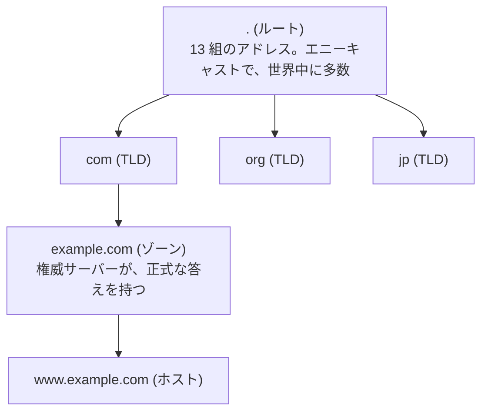
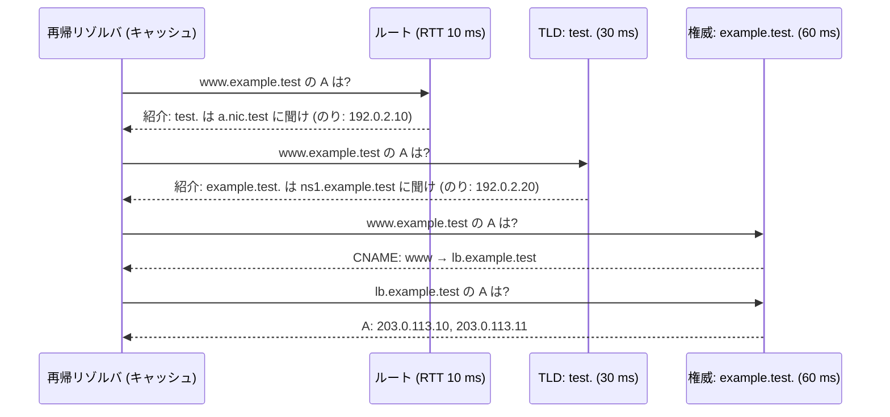
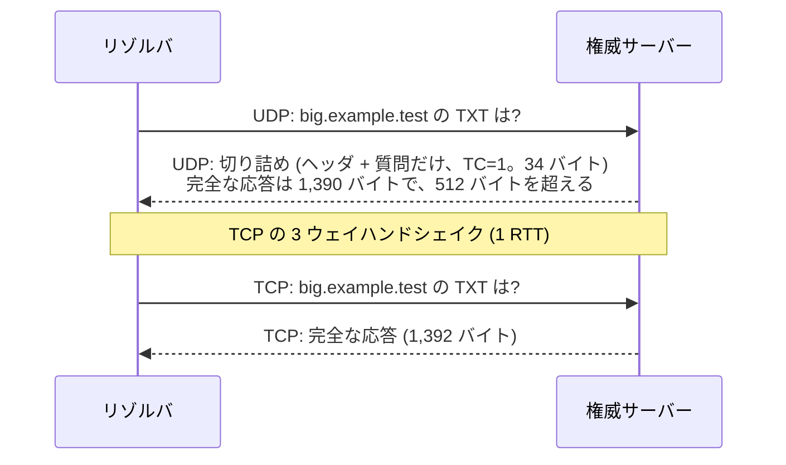
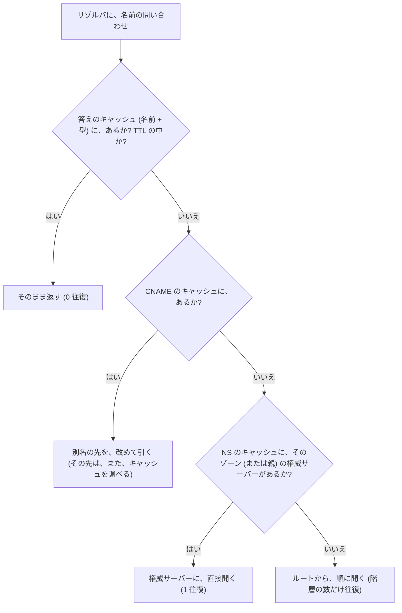
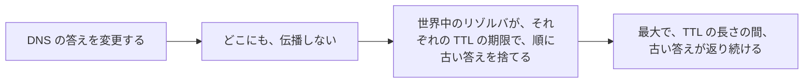

# 図1: DNS の階層と解決

## 1. 名前空間と、登場人物



| 役 | 内容 |
|---|---|
| スタブリゾルバ | OS の中の小さな部品。再帰リゾルバに頼むだけ |
| **再帰リゾルバ** | 利用者に代わって、ルートから順に聞き、**答えをキャッシュする** |
| 権威サーバー | ゾーンの正式な答えを持つ。再帰はしない |

## 2. 反復的な解決(演習1)



**のり(glue)**: 委任先の名前(`ns1.example.test`)が、そのゾーンの中にあるとき、名前から IP を調べようがない(循環する)。親が、IP も一緒に渡す。

## 3. メッセージの形式(演習1)

```
 質問 (34 バイト):
   12 34 | 01 00 | 00 01 | 00 00 | 00 00 | 00 00      ← ヘッダ 12 バイト
   ID      フラグ   質問数   回答数   権威数   追加数
   03 w w w 07 e x a m p l e 04 t e s t 00             ← 名前: ラベルの長さ + 文字列、最後に 0
   00 01 | 00 01                                       ← 型 A、クラス IN

 応答 (50 バイト): 回答の名前が  c0 0c
   c0 0c = 上位 2 ビット 11 → ポインタ → 「先頭から 12 バイト目の名前を、もう一度使う」 (名前の圧縮)
```

フラグ(16 ビット):

```
 15  14-11  10  9   8   7   6-4  3-0
 QR  Opcode AA  TC  RD  RA  Z    RCODE
 応答 種類  権威 切り詰め 再帰希望 再帰可 予約 結果 (0=OK, 3=NXDOMAIN)
```

質問のフラグ 0x0100 = RD だけ。権威サーバーの応答 0x8500 = QR + AA + RD。

## 4. 演習1の測定結果

| 状況 | 問い合わせ | 所要時間 |
|---|---|---|
| 1. 冷えた状態 (CNAME を含む) | **4 回** | **166.0 ms** (= 10 + 30 + 60 + 60) |
| 2. もう一度 (すべてキャッシュ) | **0 回** | 0.0 ms |
| 3. 同じゾーンの別の名前 (NS のキャッシュ) | 1 回 | 61.4 ms |
| 4. 存在しない名前 (NXDOMAIN) | 1 回 | 61.6 ms |
| 5. 存在しない名前をもう一度 (**否定キャッシュ**) | 0 回 | 0.0 ms |
| 6. TTL 2 秒の名前 | 1 回 | 61.5 ms |
| 7. もう一度 (TTL の中) | 0 回 | 0.0 ms |
| 8. 2.2 秒後 (**TTL の期限切れ**) | 1 回 | 61.7 ms |
| 9. 大きな応答 (TXT 12 件)。**UDP が切り詰められ、TCP でやり直し** | 2 回 | **183.4 ms** |

## 5. UDP の切り詰めと、TCP でのやり直し



| | 時間 (権威の RTT 60 ms) |
|---|---|
| 普通の応答 (UDP で収まる) | 約 61 ms |
| 大きな応答 (UDP + TCP) | 約 183 ms = 60 (UDP) + 60 (TCP の接続) + 60 (TCP の問い合わせ) |

## 6. キャッシュの種類



| キャッシュ | 保持の期間 | 効果 |
|---|---|---|
| 答え (A、AAAA など) | レコードの TTL | 同じ名前の再問い合わせが、0 往復 |
| **否定キャッシュ** | SOA の minimum | 存在しない名前の、再問い合わせが、0 往復 |
| **NS (委任)** | NS の TTL (長いことが多い) | 同じゾーンの別の名前で、**ルートと TLD を飛ばせる** |

## 7. TTL のトレードオフ

| TTL | 利点 | 欠点 |
|---|---|---|
| 短い (数十秒) | 変更が速く反映。障害時に、素早く切り替え | 権威サーバーへの負荷。解決の遅さ (61 ms) が、頻繁に見える |
| 長い (数時間) | 負荷が小さい。解決が速い | 変更が反映されるまで、長くかかる |



移行の前に、TTL を短くしておく。TTL を無視する、または、下限を設けるリゾルバやアプリがある(短い TTL に頼った切替は、完全には効かない)。
