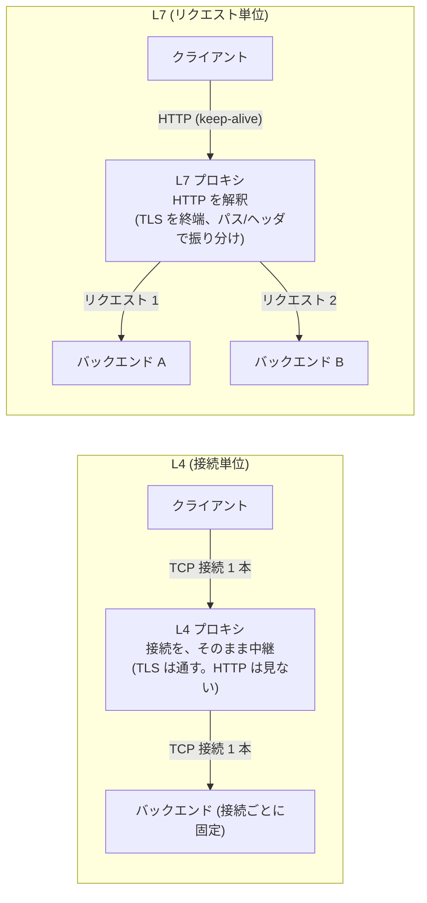
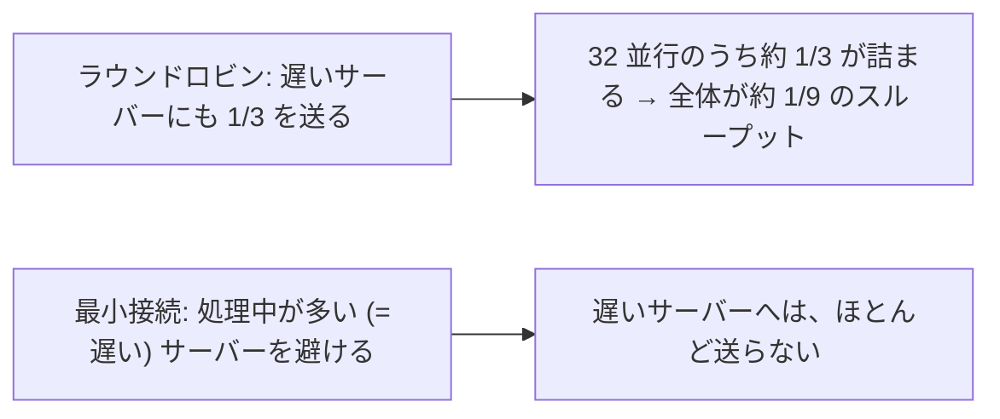
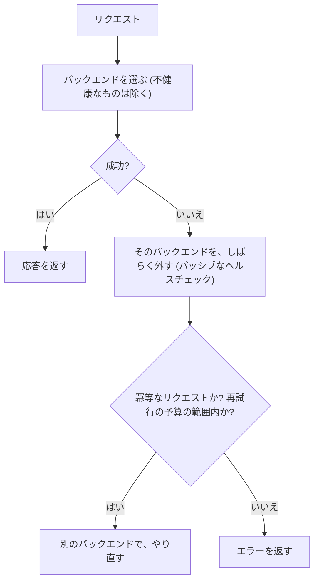
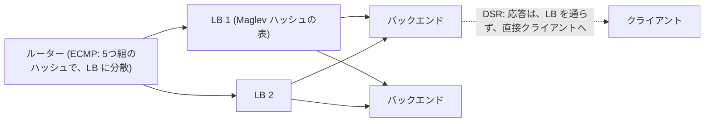

# 図2: ロードバランシング

## 1. 3 つの振り分けの層

| 段階 | 仕組み | 粒度 | 更新の速さ |
|---|---|---|---|
| ① 名前 → アドレス | DNS | 粗い(拠点) | 遅い (TTL) |
| ② アドレス → 場所 | BGP / エニーキャスト | 場所 | 数十秒〜数分 |
| ③ アドレス → 個々のサーバー | ロードバランサ | **リクエスト単位** | **即時** |

## 2. L4 と L7



| | L4 | L7 |
|---|---|---|
| 見るもの | IP、ポート | HTTP の中身 |
| TLS | パススルー | 終端 |
| 振り分けの単位 | 接続 | リクエスト |
| 機能 | 単純、高速 | ルーティング、再試行、圧縮、認証、メトリクス |
| コスト | 小 | 大 |

## 3. 実測(演習3、ループバック、32 並行、バックエンドの処理時間 0)

| 経路 | リクエスト/秒 | p50 | p99 |
|---|---|---|---|
| 直接 | 136,943 | 185 µs | 812 µs |
| L4 プロキシ | 77,792 | 381 µs | 987 µs |
| L7 (接続を使い回す) | 44,472 | 739 µs | 1,680 µs |
| L7 (毎回新しい接続) | **21,347** | 1,455 µs | 2,960 µs |

(同じマシンの CPU を共有しているので、絶対値は意味を持たない。比と傾向だけを使う。)

## 4. 振り分けのアルゴリズム


## 5. シミュレーションの結果(演習2、10 台、平均 / p99、サービス時間の平均 = 1)

**指数分布(ばらつき小)**

| 方式 | 稼働率 70% | 稼働率 90% |
|---|---|---|
| ラウンドロビン | 2.01 / 9.25 | 5.56 / 26.60 |
| ランダム | 3.36 / 15.43 | 10.04 / 45.75 |
| 最小接続 | 1.16 / 5.29 | 1.93 / 8.17 |
| P2C | 1.67 / 6.86 | 2.90 / 10.11 |

**裾の重い分布(対数正規 σ=1.5。ばらつき大)**

| 方式 | 稼働率 70% | 稼働率 90% |
|---|---|---|
| ラウンドロビン | 10.34 / 102.67 | **36.62 / 215.67** |
| ランダム | 10.57 / 91.80 | 36.80 / 212.11 |
| 最小接続 | 1.44 / 15.77 | **3.59 / 30.42** |
| P2C | 2.97 / 28.08 | 7.14 / 49.87 |

- ラウンドロビンは、リクエストの重さがばらつくと、崩れる(平均 36.6 対 最小接続 3.6)。
- 裾の重い分布では、ランダムとラウンドロビンは、ほぼ同じ。
- P2C は、2 台しか見ないのに、ランダムより、はるかに良い(36.80 → 7.14)。

## 6. 遅いサーバーが 1 台(演習3 B: 1 台 50 ms、他は 1 ms)

| 方式 | リクエスト/秒 | 平均 | 振り分け (速い、速い、遅い) |
|---|---|---|---|
| ラウンドロビン | 1,787 | 17.7 ms | 1,816 / 1,817 / 1,816 |
| 最小接続 | **15,789** | **2.0 ms** | 23,781 / 23,376 / **601** |



## 7. 一貫性ハッシュ(演習2 B)


```
        リング (ハッシュ値の円)
              S1 ●
         ・         ・
      S3 ●    key→    ● S2       キーは、時計回りに、最初に出会う ● が担当
         ・         ・           S2 を足すと、S1 と S3 の間の、一部のキーだけが S2 に移る
              S4 ●
```

| 方式 | 増やす (10→11) | 減らす (10→9) | 偏り (最大/平均) |
|---|---|---|---|
| 剰余 | 90.9% | 89.9% | 1.02 |
| 一貫性 (仮想ノード 1) | 9.6% | 11.3% | 1.59 |
| 一貫性 (仮想ノード 10) | 13.0% | 9.0% | 1.45 |
| 一貫性 (仮想ノード 100) | 9.4% | 10.0% | 1.20 |
| 一貫性 (仮想ノード 1000) | 9.0% | 10.2% | 1.06 |
| ランデブー | 9.1% | 9.9% | 1.01 |

仮想ノード: 1 台のサーバーを、リング上の多数の点に配置して、偏りを減らす。

## 8. ヘルスチェックと再試行(演習3 C: 1 台が 1 秒後に落ちる)

| 設定 | 成功 | 失敗 | 失敗の割合 |
|---|---|---|---|
| 再試行なし、ヘルスチェックなし | 67,701 | 22,148 | **24.65%** |
| 再試行あり、ヘルスチェックなし | 73,806 | 0 | 0% |
| 再試行あり、ヘルスチェックあり | 75,619 | 0 | 0% |



再試行の注意: **冪等でないリクエストは、二重に実行される**。**再試行の嵐**(遅くなったバックエンドに、再試行が、さらに負荷を足す)→ 予算、指数バックオフ + ジッタ。全部が不健康のときは、全部に送る(fail-open)。

## 9. 接続の管理

| 論点 | 内容 |
|---|---|
| アイドルタイムアウトの不一致 | LB が先に切った接続に、リクエストを送って 502。**上流(LB)を、下流より短く** |
| ドレイン | 止める前に、新しいリクエストを送らず、処理中の完了を待つ |
| 元のクライアントの IP | `X-Forwarded-For`、PROXY プロトコル |
| HTTP/2 と偏り | 長寿命の接続に、リクエストが多数載る → 接続単位の振り分けでは、偏る |

## 10. L4 ロードバランサの実現(Maglev など)



LB が増減しても、一貫性ハッシュの表で、同じ接続が、同じバックエンドに行く。
