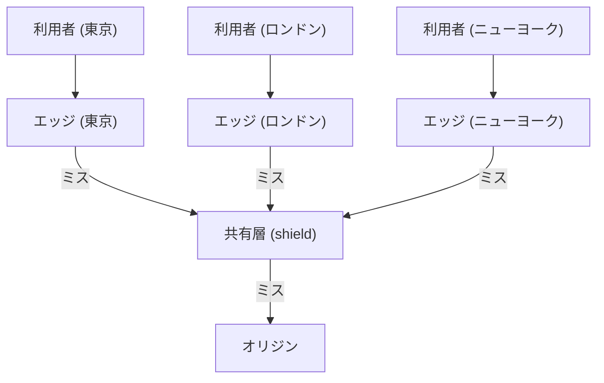
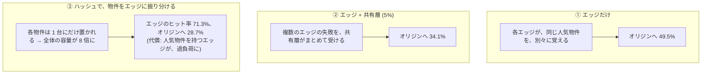
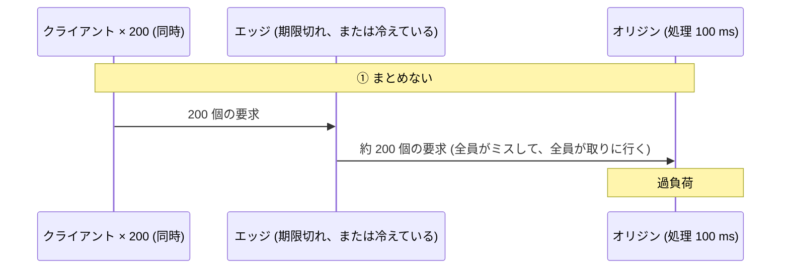
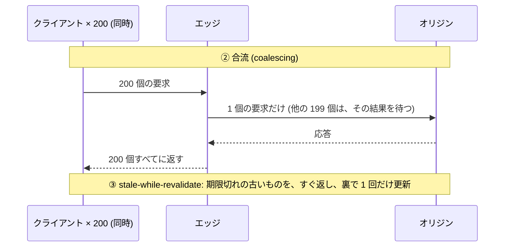
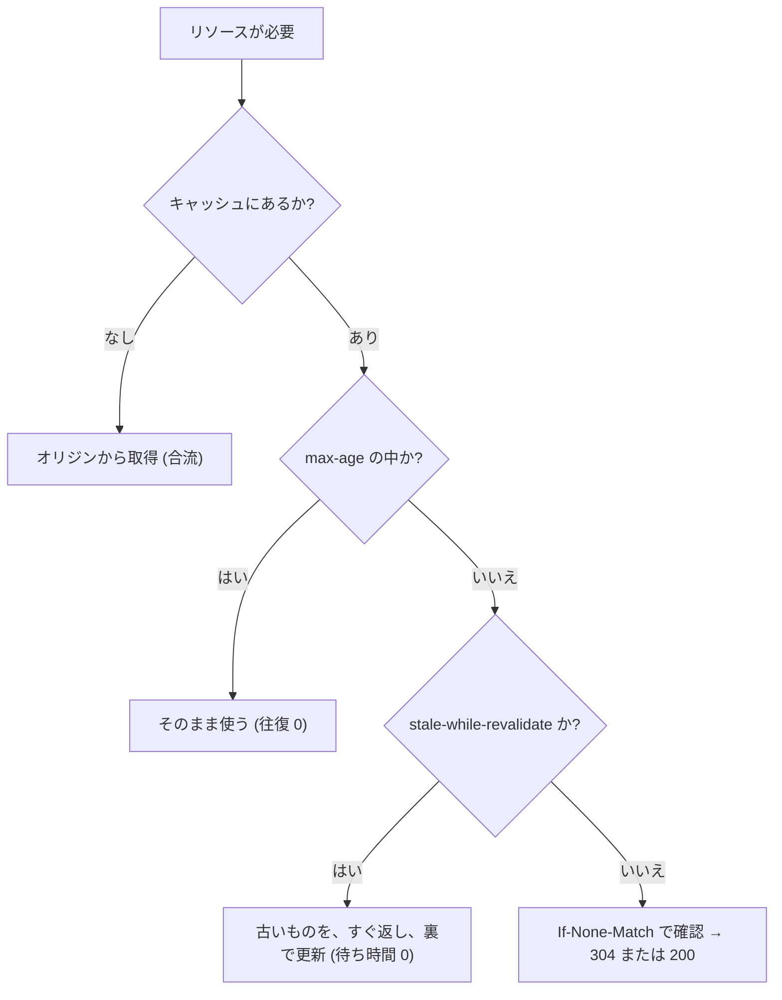

# 図3: CDN とキャッシュ

## 1. CDN の構成



利用者を、近いエッジに導く方法: DNS(ジオ DNS)、エニーキャスト(BGP)。

## 2. アクセスの偏り(Zipf 分布)

```
 人気順の順位 i の物件の、アクセスの割合 ∝ 1 / i^α

 アクセスの割合
  大 ┤█
     │█▌
     │█▌▌
     │██▌▌▌
  小 ┤████▌▌▌▌▌▌▌▌▌▌▌▌▌▌▌▌  ......  (ロングテール)
     └────────────────────────────→ 人気順
       少数の人気物件が、大半のリクエストを占める
```

## 3. ヒット率(演習5 A、10 万個の物件、150 万回の要求)

**α = 1.0**

| キャッシュ (カタログ比) | LRU | FIFO | LFU | 上限 |
|---|---|---|---|---|
| 0.1% | 29.0% | 25.0% | 40.1% | 42.9% |
| **1%** | **50.6%** | 46.5% | 59.3% | 61.9% |
| 5% | 66.5% | 62.6% | 72.7% | 75.2% |
| 10% | 73.7% | 70.1% | 78.4% | 81.0% |

**α の違い(キャッシュ 1%)**

| α | LRU | FIFO | LFU | 上限 |
|---|---|---|---|---|
| 0.8 | 20.4% | 17.9% | 30.2% | 34.0% |
| 1.0 | 50.6% | 46.5% | 59.3% | 61.9% |
| 1.2 | 79.5% | 76.2% | 84.0% | 85.2% |

- 1% を置くだけで、リクエストの約半分に答えられる(α = 1.0)。
- 収穫は逓減する(1% → 10% でも、50.6% → 73.7%)。
- LFU が最良だが、人気が時間で変わらない(独立参照モデル)という仮定による。実際は、LRU の変種や TinyLFU。

## 4. 物件の大きさが、ばらつくとき(α = 1.0、LRU、対数正規)

| キャッシュ | 物件のヒット率 | **バイトのヒット率** |
|---|---|---|
| 全体の 1% | 50.0% | 44.3% |
| 全体の 5% | 66.1% | 64.0% |
| 全体の 10% | 73.5% | 72.0% |

大きな物件は、多くの容量を食い、ヒットしにくい。オリジンの帯域を減らすなら、バイトのヒット率を見る。

## 5. 階層(演習5 B、エッジ 8 台、各 1%)



| 構成 | エッジのヒット率 | オリジンへの要求 |
|---|---|---|
| エッジだけ | 50.5% | 49.5% |
| エッジ + 共有層 | 50.5% | 34.1% |
| ハッシュ振り分け | 71.3% | 28.7% |

## 6. スタンピード(演習5 C)





| 方式 | オリジンへの要求 | クライアントの平均 | 最大 |
|---|---|---|---|
| 1. 冷えている。まとめない | **187** | 93.5 ms | 105.7 ms |
| 2. 冷えている。合流 | **1** | 101.9 ms | 102.0 ms |
| 3. 期限切れ。合流 | 1 | 101.6 ms | 101.7 ms |
| 4. 期限切れ。合流 + stale-while-revalidate | **1** | **0.0 ms** | 0.1 ms |

(1. が 200 でなく 187 なのは、一部の要求が、最初の応答が戻った後に始まったため。)

## 7. キャッシュ制御の判断



## 8. キャッシュの他の論点

| 論点 | 内容 |
|---|---|
| キャッシュキー | URL だけか、ヘッダ (`Accept-Encoding`、`Cookie`) も含めるか。含めすぎるとヒット率が落ち、含めないと誤った内容を返す (`Vary`) |
| 無効化 (purge) | 世界中のエッジから消す (数秒かかる)。**ファイル名にハッシュを含める**と、不要 |
| ロングテール | 一度しか要求されない物件が、キャッシュを汚す → 2 回目で初めて入れる (admission) |
| 動的コンテンツ | キャッシュできない。TLS 終端と、最適化された経路を提供 |
