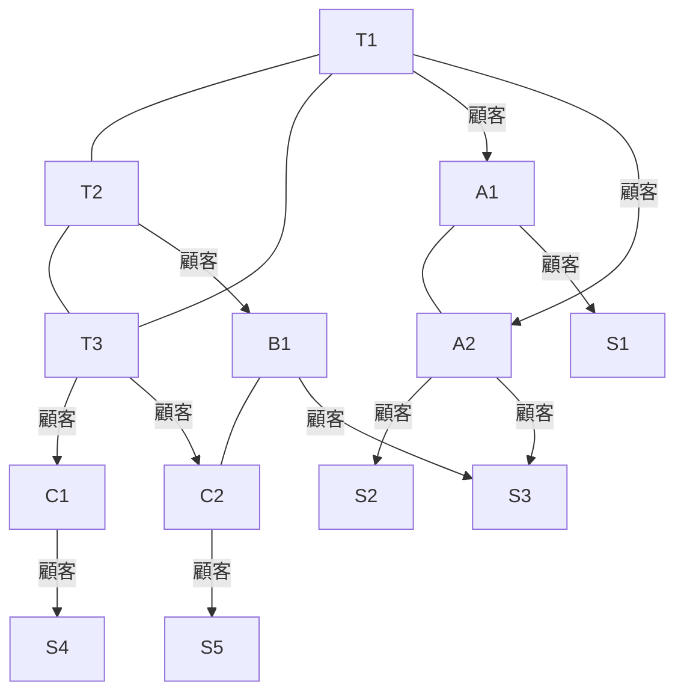
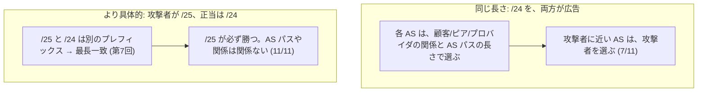
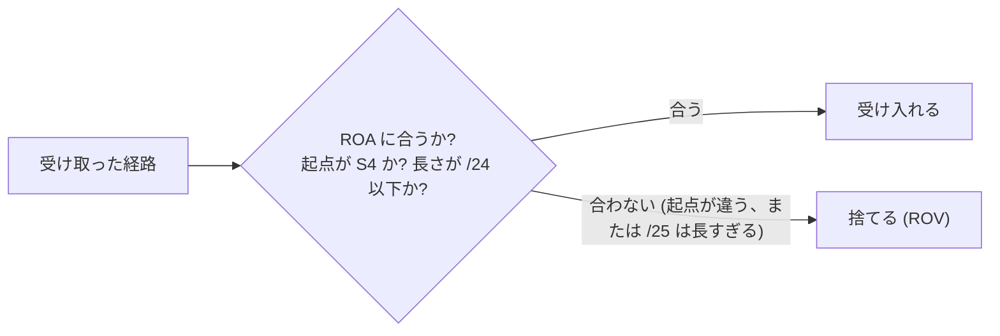
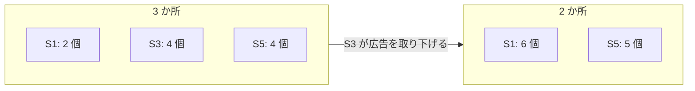
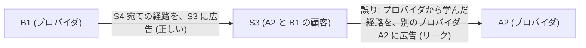

# 図4: BGP、乗っ取り、エニーキャスト

## 1. 演習4のトポロジー(13 個の AS)



実線の矢印 = プロバイダ → 顧客。線 = ピア(T1・T2・T3 は、互いにピア)。S3 は、A2 と B1 の両方に接続(マルチホーム)。

## 2. 経済的な関係と、規則(Gao–Rexford)

| 関係 | 内容 |
|---|---|
| 顧客 → プロバイダ | 顧客が、お金を払って、通信を運んでもらう |
| ピア | 対等な AS が、互いの顧客の通信を、無料で交換する |

| | 規則 |
|---|---|
| **選ぶ順序** | ① 顧客から学んだ > ② ピアから > ③ プロバイダから。② AS パスが短い。③ 隣の AS 番号が小さい |
| **広告** | 顧客から学んだ経路は、誰にでも広告。**ピアとプロバイダから学んだ経路は、顧客にだけ** (谷を作らない) |

```
 谷なし (valley-free) の経路の形:   上り (顧客→プロバイダ) …→ 高々 1 回のピア →… 下り (プロバイダ→顧客)

 例 (演習4):  S1 → A1 → T1 → T3 → C1 → S4
              └上り┘└─上り─┘└ピア┘└─下り─┘
```

## 3. 乗っ取り(S4 が正当、S1 が攻撃者。11 個の AS の行き先)

| 攻撃 | S1(攻撃者)へ | S4(正当)へ |
|---|---|---|
| なし | 0 | 11 |
| **同じ長さ (/24)** | **7** | 4 |
| **より具体的 (/25)** | **11** | 0 |



**現実の事例**: 2008 年、パキスタンの事業者が、YouTube のプレフィックスの、より具体的な `/24` を、内部で広告し、誤って外部に漏らした。YouTube への通信が、世界中で、パキスタンに吸い込まれ、約 2 時間、到達不能になった。

## 4. ROV(起点の検証)

ROA: 「203.0.113.0/24 の起点は S4、最大の長さは /24」

| 誰が ROV を行うか | /25 の乗っ取り | /24 の乗っ取り |
|---|---|---|
| なし | S1 へ **11** | S1 へ 7、S4 へ 4 |
| 最上位 (T1・T2・T3) だけ | S1 へ **4**、S4 へ 7 | S1 へ 4、S4 へ 7 |
| すべての事業者 (末端は行わない) | **S4 へ 11** | S4 へ 11 |



- 最上位だけが ROV を行うと、被害は 11 → 4 に減るが、攻撃者の近く(A1 とその顧客、ピア)は、まだ影響を受ける。
- ROV は、**普及するほど効く**。ただし、起点を検証するだけで、経路そのものは検証しない。

## 5. エニーキャスト(198.51.100.0/24 を、S1・S3・S5 の 3 か所から広告)

| AS | 流れる場所 | AS パス |
|---|---|---|
| T1 | S1 | T1 → A1 → S1 |
| T2 | S3 | T2 → B1 → S3 |
| T3 | S5 | T3 → C2 → S5 |
| A1 | S1 | A1 → S1 |
| A2 | S3 | A2 → S3 |
| B1 | S3 | B1 → S3 |
| C1 | S5 | C1 → T3 → C2 → S5 |
| C2 | S5 | C2 → S5 |
| S2 | S3 | S2 → A2 → S3 |
| S4 | S5 | S4 → C1 → T3 → C2 → S5 |

3 か所以外の 10 個の AS: **S1 へ 2、S3 へ 4、S5 へ 4**。

**S3 が落ちた(広告を取り下げた)あと**、11 個の AS(S3 を含む): **S1 へ 6、S5 へ 5**(自動的に、振り替わった)。



使われるところ: DNS のルートサーバー、公開リゾルバ、CDN。

| 利点 | 注意 |
|---|---|
| 自動的に、近い場所へ | 経路が変わると、TCP の接続が、途中で別の場所に切り替わり、切れる |
| 1 か所が落ちても、他に振り替わる | 短い通信 (DNS の UDP、短い HTTP) に向く |
| DDoS を、多数の場所に分散して受ける | 長い接続には、場所ごとの固有のアドレスも併用 |

## 6. 経路のリーク(S3 が、プロバイダから学んだ経路を、もう一方のプロバイダに広告)



| | S4 宛ての経路が、S3 を通る AS |
|---|---|
| リークなし | 0 個 |
| リークあり | **4 個** (B1・C2・S5・T2) |

末端の AS が、意図せず、他人の通信を運ぶ役(トランジット)を引き受ける。その回線は、通信量に耐えられず、輻輳する。

**現実の事例(2021 年、Facebook)**: Facebook の DNS サーバーは、データセンターへの接続が失われたと判断すると、自らの BGP の広告を取り下げる設計だった。そのため、DNS の権威サーバー自体に到達できなくなり、数時間、名前が解決できなくなった(DNS と BGP の依存)。
